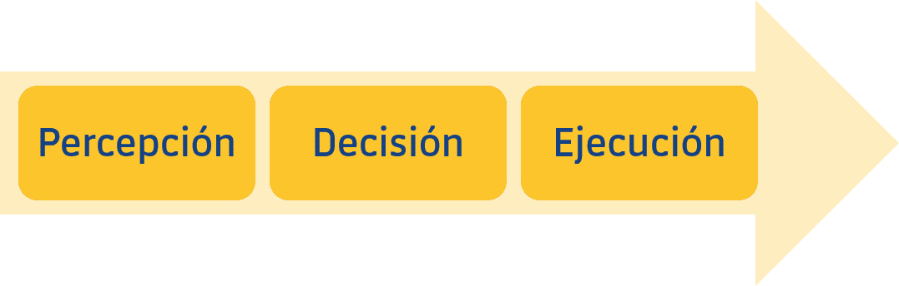
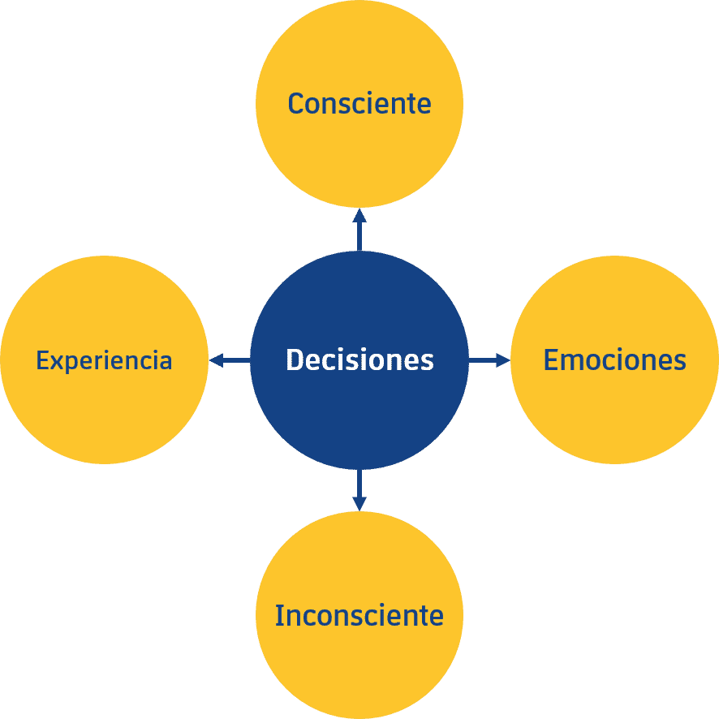
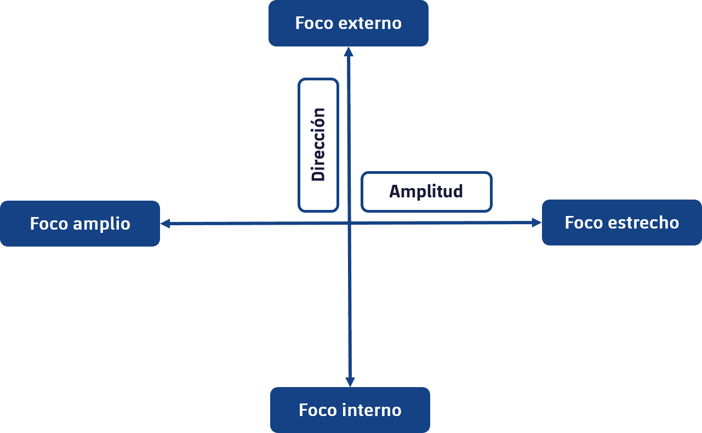

**2. Éléments cognitifs du joueur**

**2.1 Présentation**

Le module suivant analysera le développement et l’application de la prise de décision à partir de différents domaines de connaissance. L’intention est de matérialiser en faits concrets les expériences et le cadre théorique qui est développé dans la matière étudiée.

Les domaines professionnels dans lesquels la prise de décision est présente sont si vastes et diversifiés qu’ils invitent à les explorer, à découvrir comment la décision est abordée. De la psychologie, de la physiologie, de la neurologie, des entraîneurs de football professionnels et de base, ainsi que des athlètes de haut niveau, sont des agents de connaissances qui travaillent dans la prise de décision et peuvent nourrir de leurs expériences la proposition qui sera développée ci-dessous.

Les décisions sont inhérentes à l’acte de vivre. Nous décidons continuellement, qu’il s’agisse de décisions simples au fil des jours, ou de décisions complexes qui conduisent à un changement retentissant.

Ces décisions, étant très nombreuses, sont rarement amenées au niveau de la conscience, la plupart des décisions qui sont prises au quotidien sont inconscientes. Ce mécanisme de décision a une logique d’optimisation de l’énergie utilisée. Il n’est pas énergétiquement commode de penser consciemment à chacun des choix qui sont faits au quotidien, des vêtements à porter, du chemin à choisir pour se rendre au travail, de la façon de saluer chacune des personnes qu’ils rencontrent, de la façon de se brosser les dents tous les matins, etc. Il y a tellement de décisions qui sont prises quotidiennement que le système ne peut pas stocker cette information sur le plan de la conscience, en raison de la dépense énergétique qu’elle implique. La stratégie neuronale d’économie d’énergie est un produit des variables que l’on rencontre.

Un problème à souligner concerne le niveau émotionnel. Les émotions sont considérées comme la base de toutes les décisions que nous prenons. Chacun d’entre eux passe par le filtre émotionnel. Dans un sport avec la complexité du football et la charge émotionnelle qu’il implique, la compréhension de la dynamique émotionnelle sera de la plus haute importance, en raison de l’influence qu’elle exerce sur la prise de décision.

Dans le domaine du football, dans un match, le nombre de décisions prises est si nombreux qu’il n’est pas possible d’en garder une trace. C’est pour cette raison que seront promus des stratégies méthodologiques et des outils d’optimisation visant à améliorer le processus de prise de décision chez les joueurs, dans le but d’améliorer le nombre de bonnes réponses et la rapidité de leur choix. Selon Guindos (2015), « la conséquence méthodologique à utiliser nous oblige à éduquer et à entraîner l’inconscient de manière pragmatique et appliquée à notre sport » (p. 90). La construction d’éléments qui configurent les tâches permettra de générer des habitudes dans l’inconscient qui permettent des réponses agiles, une fois assimilées au cours des processus de formation.

**Graphique 1. Processus décisionnel traditionnel**

Source : Guindos, 2015, p. 89.

**Graphique 2. Processus décisionnel actuel**

Source : Guindos, 2015, p. 91.

Pour mieux comprendre le processus de prise de décision, il est important de commencer par étudier la **structure cognitive, la mémoire perceptuelle et l’attention-concentration.**

Le processus de prise de décision est très complexe en raison des éléments qui doivent être pris en compte lors de sa réalisation. Si vous regardez de près les actions d’un joueur, vous pouvez voir que sa performance est divisée en deux moments différents : le moment où il perçoit l’information et le moment où il exécute son plan d’action. C’est ce qu’on appelle le cycle perception-action.

Lorsque la reconnaissance de l’action à exécuter est rapide, on peut dire que le joueur utilise des automatismes tactiques perceptifs, sinon, s’il n’a pas de situations perçues dans sa mémoire, ce seront les capacités cognitives perceptuelles qui seront chargées de faire une proposition de filtrage pour que le mécanisme de prise de décision ne soit pas trop exigeant.

Au cours du processus de prise de décision, les informations sont comparées à celles de certains scénarios précédemment vécus et résolus. En cas de similitudes, les réponses précédemment réussies sont adoptées. Si les scénarios d’intervention sont nouveaux, la réponse est fournie au moyen d’informations obtenues à partir d’expériences de jeu similaires au contexte.

Les actions qui sont effectuées dans la résolution des situations ne sont pas effectuées de manière isolée, mais sont enchaînées les unes aux autres en peu de temps et même certaines actions sont effectuées simultanément. Les joueurs expérimentés, tout en effectuant certaines actions, pensent et analysent déjà l’environnement pour décider quelle sera la prochaine intervention. Parmi le grand nombre de stimuli auxquels un joueur doit faire attention, deux peuvent être différenciés comme les plus importants : les actions de ses coéquipiers et celles de ses adversaires. De là émerge l’idée de **tactique.**

On sait que les informations les plus importantes pour les athlètes sont obtenues par le sens de la vue. C’est-à-dire à travers le champ visuel central (zone visuelle stéréoscopique), qui permet un angle de vision réduit, reçoit en même temps peu d’informations, mais une haute qualité de ces informations, appréciant chaque détail de la situation ; et, d’autre part, le champ visuel périphérique ou zone visuelle monoscopique, qui contient un grand angle, beaucoup d’informations, mais peu de qualité, puisqu’il ne s’arrête pas aux détails (Espar, 2017).

**Tableau 1. Caractéristiques du champ visuel**

<table>
<colgroup>
<col style="width: 47%" />
<col style="width: 52%" />
</colgroup>
<thead>
<tr class="header">
<th><strong>Périphérique</strong></th>
<th><strong>Central</strong></th>
</tr>
</thead>
<tbody>
<tr class="odd">
<td><ul>
<li>
Grand angle de vision.
</li>
<li>
Beaucoup d’informations.
</li>
<li>
Mauvaise qualité de l’information.
</li>
<li>
Moins de détails sont visibles.
</li>
</ul></td>
<td><ul>
<li>
Angle de vision étroit.
</li>
<li>
Une petite quantité d’informations.
</li>
<li>
Beaucoup d’informations de qualité.
</li>
<li>
Chaque détail est apprécié.
</li>
</ul></td>
</tr>
</tbody>
</table>

**Cognitive Structure**

C’est une structure qui permet au sujet de mieux comprendre les caractéristiques de l’environnement qui l’entoure, de capter les stimuli et de les traiter, avec l’intention de définir le degré d’importance et de signification de ceux-ci dans chaque situation particulière, afin de prendre des décisions.

Les sports d’équipe sont caractérisés par la dynamique situationnelle et changeante de l’environnement, ce qui conduit l’athlète à la nécessité de s’adapter en permanence aux changements basés sur la prise de décision.

De manière générale, certaines caractéristiques du traitement de l’information seront abordées afin de comprendre comment l’apprentissage déclaratif est généré.

**Traitement de l’information**

Les systèmes de mémoire sont présentés pour l’apprentissage déclaratif, mais pas moteur, qui sera discuté plus tard. Le déclaratif est important pour comprendre le jeu, mais pas pour agir dessus, car lorsqu’un joueur participe à une action il n’a pas le temps de raisonner.

Nous mettrons en évidence 3, le stockage des informations sensorielles, la mémoire à court terme, la mémoire à long terme.

Stockage d’informations sensorielles : Ce système de stockage peut contenir de grandes quantités d’informations sensorielles pendant une courte période, avant qu’elles ne soient perdues. Les informations d’enregistrement sensoriel disparaissent rapidement et ne peuvent être enregistrées que pendant une demi-seconde.

Mémoire à court terme (MCP) : C’est le centre du traitement de l’information. Les informations enregistrées sous forme de mémoire à court terme, provenant du stockage sensoriel, sont généralement nouvelles. Si ces informations ne sont pas répétées et mémorisées instantanément, elles risquent fort d’être oubliées. Si une personne est capable de répéter une nouvelle information pendant 20 à 30 secondes sur le CCM, elle pourra l’apprendre et ainsi la transférer dans la mémoire à long terme (LTM). La CCM peut être appelée mémoire de travail, ce qui, sous sa nature dynamique, donne l’impression de stocker des informations qui ne peuvent être pertinentes que dans l’immédiat, comme un agenda du moment.

Mémoire à long terme : Les informations stockées dans cette mémoire sont généralement permanentes. Avec la PCM, les informations de mémoire à long terme peuvent être mises à jour, réorganisées et renforcées.

Il faut rappeler que l’apprentissage moteur n’utilise pas cette voie comme une priorité, mais plutôt qu’à partir du cycle perception-action, le sujet effectue les actions optimales en fonction du contexte qu’il vit, et en fonction de son expérience, il effectue des actions de plus en plus adaptées au contexte, et plus raffinées (optimisées).

**Attention sélective**

Il est crucial que les athlètes aient la capacité d’ignorer les informations sensorielles non pertinentes, afin qu’ils puissent utiliser une attention sélective pour les informations les plus importantes manifestées dans une situation donnée. La capacité de répondre sélectivement aux stimuli est basée sur la distribution correcte des substances neurochimiques dans le cerveau (Cox, 1987). La perturbation de la distribution équilibrée de la dopamine et de la noradrénaline est associée à l’incapacité de s’occuper sélectivement d’un stimulus (Cox, 1987). Cette capacité à faire la distinction entre les informations pertinentes et non pertinentes peut être entraînée et dépendra des expériences auxquelles l’athlète est soumis.

**Rétrécissement attentionnel**

La capacité d’un athlète à répondre à des stimuli appropriés pendant le match a été appelée concentration attentionnelle. La concentration attentionnelle comprend la capacité de l’athlète à augmenter ou à diminuer son attention lorsqu’il s’y met. Comme le dit Easterbrook (1959), l’environnement nous fournit les informations dont nous avons besoin pour atteindre des performances habiles. Dans certaines situations, le rétrécissement attentionnel élimine tous les stimuli non pertinents et permet la permanence dans les plus pertinents. Ces conditions, comme nous l’avons mentionné précédemment, sont entraînées.

Au sein de la structure cognitive, quatre domaines qui la composent seront étudiés.

- Mémoire perceptuelle.

- Attention/concentration.

- Capteurs.

- Stimuli.

**Stimuli**

Les stimuli perçus sont responsables du déclenchement d’une série d’événements, qui sont capturés et traités par différentes zones. Avec cela, discriminer les stimuli et y entraîner les athlètes est d’une grande importance.

Parler des stimuli de manière générale, c’est parler de tout ce qui se passe autour d’une personne. Tout ce qu’il ressent, interprète à travers les organes sensoriels, perçoit d’une certaine manière et agit en conséquence, à tort ou à raison, sur la base de l’expérience accumulée.

Selon le degré d’importance attribué aux stimuli, il est important de comprendre comment toutes les informations perçues sont traitées afin de pouvoir concevoir des tâches en fonction du type de stimuli, liés à des aspects d’une ou plusieurs structures du joueur, qui sont destinés à être entraînés.

Discrimination au stimulus selon Damunt et Guerrero (2013) :

Selon la saisonnalité :

- Durée : Déclencheurs/Focus.

- Vitesse.

- Différences de vitesse.

- Prédiction d’événements.

Selon l’emplacement :

- Distance.

- Trajectoire.

- Orientation.

- Organisationnel.

Selon sa nature :

- Signifiants : ils fournissent des informations pertinentes au destinataire, qui choisit l’option optimale pour son objectif. Ceux-ci, à leur tour, sont subdivisés en animé/inanimé, spécifique/non spécifique, proximal/distal, intéroceptif/extéroceptif.

- Insignifiant.

Les stimuli signifiants spécifiques sont ceux qui effectuent le meilleur transfert vers le jeu réel en raison des similitudes des tâches. Dans ce cas, la mémoire perceptuelle, un sujet à développer plus tard, est mise en action pendant la compétition si elle a été préalablement entraînée avec des stimuli de haute spécificité.

**Capteurs**

Ceux-ci sont divisés en quatre types :

- Visuel.

- Auditif.

- Kinesthésique/tactile.

- Vestibulo-maculaire.

Dans les tâches sur le terrain, les capteurs peuvent être discriminés en fonction de la vision holistique du joueur, bien qu’il ne soit pas approprié de le faire comme norme d’entraînement. Ils peuvent être entraînés en fonction des objectifs à atteindre avec les athlètes lors d’une séance donnée.

Les capteurs sont les organes par lesquels nous recevons les informations fournies par les stimuli perçus. Il est important de noter que l’objectif, dans ce cas, est de savoir saisir et comprendre. Des capteurs sont utilisés pour capter les stimuli et, grâce à la mémoire perceptuelle et à l’attention-concentration, il est possible de comprendre ce qui se passe pour une prise de décision optimale.

**Capteur visuel**

Ici, quatre niveaux sont discriminés, chacun limitant le suivant.

**Orientation du corps**

–

Il est important non seulement au niveau de la coordination mais aussi au niveau cognitif, de pouvoir interpréter le plus grand nombre de stimuli dans le champ visuel grâce à un placement correct du corps dans l’espace. L’orientation du corps est ce qui nous permet de lire les espaces.

**Orientation de la tête**

–

Les joueurs qui jouent à l’intérieur reçoivent beaucoup de stimuli. Il est essentiel d’orienter la tête vers l’endroit où les stimuli sont générés.

**Orientation des yeux**

–

Celle-ci est un peu plus limitée car la plupart du temps la mobilité des yeux s’accompagne du mouvement de la tête.

**Amplitude visuelle/vision périphérique**

–

Il consiste en la capacité d’identifier des objets autour du point de fixation. Déterminez la largeur du champ de vision.

**Capteur auditif**

Lorsqu’il s’agit de football, le capteur auditif passe au second plan. Selon Damunt et Guerrero (2013), cela est dû à deux raisons :

- La plupart des informations auditives qui parviennent à l’athlète ont déjà été reçues visuellement.

- Généralement, les informations provenant des capteurs auditifs ne permettent pas d’anticiper. Ce que le sujet fait, c’est réagir. Si l’objectif est d’optimiser le système de prise de décision, l’anticipation occupe une place centrale plus que la réaction.

**Capteurs kinesthésiques/tactiles**

- Contacts de référence : localisez l’adversaire.

- Soyez conscient des changements de posture et des mouvements que vous faites vous-même, ainsi que des informations concernant la fatigue, la douleur, etc.

**Capteurs de vestibule maculaire**

Ce sont des capteurs chargés de gérer l’équilibre corporel. Au football, de nombreuses situations génèrent des déséquilibres posturaux, il est donc recommandé de s’entraîner à ce type de capteurs ; Alors que cela se produit déjà dans les tâches globales.

Après avoir capturé les stimuli provenant de l’environnement grâce aux capteurs, l’étape suivante consiste à les comprendre. C’est là que la mémoire perceptuelle et l’attention-concentration entrent en jeu.

**Mémoire perceptuelle**

Cette mémoire fait référence à toutes les informations qui entourent un sujet sur les stimuli qu’il perçoit.

Dans la première réaction d’un enfant à un stimulus, il ne sait pas s’il est significatif ou non, ni sa signification. C’est le moment où il commence à former son expérience, tout en investiguant les stimuli qui lui fourniront des informations.

La mémoire perceptuelle est liée à la nécessité d’aider les joueurs, en particulier dans les étapes d’apprentissage, afin qu’ils sachent identifier les stimuli de l’environnement qui sont vraiment significatifs pour les stocker dans la mémoire et ensuite utiliser les réponses motrices appropriées.

**Développement de la mémoire perceptuelle**

On peut voir que lors d’un match de football, un joueur reçoit des centaines de stimuli tout le temps, tous sous forme de perceptions. L’intention avec le développement de la mémoire perceptuelle est de générer des connaissances avec lesquelles elle peut discerner et traiter toutes les informations qu’elle reçoit.

Dans la mesure où l’enfant-joueur maîtrise la logique interne du jeu, la culture tactique de l’équipe, le modèle de jeu et connaît également parfaitement ses ressources motrices, cela signifiera qu’à l’entraînement, il a optimisé ses capacités perceptivo-motrices, ce qui lui permettra de mieux performer sur le terrain.

La mémoire perceptuelle est influencée par deux variables. Marqueurs émotionnels et schémas mentaux. Comme mentionné plus haut, les émotions sont le filtre des décisions qui sont prises, chacune est traversée par une émotion. L’émergence d’une action motrice (décision) dans une situation donnée sera déterminée par les émotions. En ce qui concerne les schémas mentaux, ils aident le cerveau à résoudre et à gérer des problèmes complexes.

**Optimisation de la mémoire perceptuelle**

On peut parler d’une chaîne d’événements allant de la répétition de stimuli à l’utilisation de stimuli spécifiques, en passant par la consolidation dans la mémoire à court et à long terme.

Répétition des stimuli – spécificité des stimuli – stockage en mémoire.

L’intention est de créer des contextes où le sujet peut interpréter les similitudes des stimuli et les associer à ce qu’il a appris précédemment, sur la base de ses expériences. Cela génère une répétition du stimulus, qui à son tour a des niveaux élevés de spécificité avec le contexte du jeu. Le cerveau génère la synthèse des protéines dans la formation d’un souvenir, si un souvenir est stimulé de manière appropriée, il est stocké dans la mémoire à long terme.

Mémoire perceptuelle

*Cliquez pour retourner*

Attention/concentration.

*Cliquez pour retourner*

Attention

Contact avec les stimuli les plus pertinents.

Concentration

Maintien et concentration de l’attention sur la tâche spécifique.

Nideffer (1976) affirme que les processus attentionnels ont deux dimensions indépendantes. La première est appelée amplitude, et la seconde, la direction.

**Graphique 3. La focalisation attentionnelle varie en fonction de l’amplitude et de la direction**

Source : Création des auteurs.

La dimension de l’amplitude du centre attentionnel de l’athlète varie de étroite à large, tandis que la direction varie de l’interne à l’externe.

*  
Module 3 sur 6*

**2.2 Modèles attentionnels**

Ces dernières années, le monde du sport de haut niveau a pris de plus en plus conscience que l’attention et la concentration sont décisives pour le succès ou l’échec d’une équipe ou d’un athlète. Cela est de plus en plus étudié par les entraîneurs, les préparateurs physiques et les psychologues du sport. Les équipes sportives comprennent que les variables de distraction (perte d’attention) sont des situations qui apparaissent fréquemment lors de la pratique sportive et encore plus lors des matchs ou des compétitions. Les athlètes ressentent de nombreuses variables comme des agents distrayants, qui peuvent être externes ou internes, qui menacent la concentration attentionnelle.

Lorsqu’un athlète a de bonnes performances techniques, physiques et tactiques, il peut améliorer ses capacités en tant qu’athlète s’il parvient également à s’entraîner et à développer son attention et sa concentration, cela lui donnera une plus grande capacité à résoudre différentes tâches.

Lors d’un match de football, un joueur doit traiter un grand nombre de stimuli : ses coéquipiers, ses rivaux, le public, ses émotions internes, le rôle qu’il doit jouer à tout moment et en fonction de la situation du jeu, etc. Tout cela conduit les athlètes à développer la capacité de diriger leur attention à tout moment vers le jeu et non vers autre chose.

Selon Dosil (2004), « le contrôle de l’attention et de la concentration devrait être l’un des objectifs à prendre en compte dans tout programme d’entraînement sportif et une habileté qui doit être perfectionnée tant par les athlètes que par les entraîneurs » (p. 177).

Nideffer (1976) distingue deux dimensions de l’attention : l’amplitude, qui est large et petite, et la direction, qui est externe et interne.

Quant à l’amplitude, elle désigne tout ce que l’athlète peut traiter dans un champ d’information à un moment donné. Si l’athlète trouve beaucoup d’informations à traiter, nous sommes en présence d’un large champ. Inversement, s’il y a peu d’informations, le champ se rétrécit. Ces informations, pour les deux domaines, sont importantes. (Nideffer, 1976).

En termes de direction, il s’agit de l’endroit où l’attention est dirigée. Ici, nous pouvons trouver deux chemins, externe ou interne. Lorsque l’athlète commence à concentrer les informations de l’environnement, que ce soit le public, la météo, l’entraîneur, les adversaires, etc., il se concentre sur la direction externe. Lorsque vous commencez à concentrer vos émotions et vos pensées sur la fête, nous sommes dans une direction interne.

Les deux dimensions, amplitude et direction, peuvent être combinées pour créer quatre styles d’attention. Ce sont les façons dont les athlètes perçoivent les informations de leur environnement.

**Spacieux-extérieur**

–

Beaucoup d’informations sont traitées immédiatement. Il permet une évaluation rapide et concrète de l’environnement.

**Spacieux-intérieur**

–

L’analyse de la situation est perçue ainsi que la planification des schémas moteurs internes de l’athlète. Les informations passées et les interventions futures possibles sont examinées.

**Interne réduit**

–

Utilisez une répétition mentale avant l’exécution motrice. Il permet à l’athlète de revoir ses variables psychologiques.

**Réduit-externe**

–

Ici, l’attention est dirigée vers un but prédéterminé ou vers une certaine situation extérieure.

L’objectif de nos athlètes est de s’entraîner et de développer les quatre dimensions attentionnelles, en donnant la priorité à celles qui ont une focalisation attentionnelle externe, car le fait de s’occuper des focalisations internes pendant la compétition a généralement une composante interférente dans la performance de l’athlète. De cette façon, ils seront en mesure d’identifier les informations dans l’environnement en fonction de l’objectif le plus pertinent et de changer avec la capacité de s’adapter.

Cela peut être entraîné et réalisé avec succès dans la mesure où l’athlète connaît en détail les particularités de sa discipline sportive et découvre ses capacités d’attention.

**Mémoire motrice**

Les souvenirs moteurs des intentions tactiques, des schémas de jeu, etc., font partie d’un filtrage émotionnel précédent. Il faut rappeler que c’est à travers le cycle perception-action que, implicitement, le joueur utilise cette « mémoire motrice » (si on peut l’appeler ainsi) pour faire ressortir l’action motrice. En ce qui concerne la mémoire motrice, les variables suivantes peuvent être identifiées :

- Connaissance procédurale des compétences de coordination.

- Mouvements innés (génétique).

- Des mouvements appris par la pratique.

- Mouvements implicites/explicites.

Dans un match de football, la prise de décision sera utilisée de différentes manières. Cela dépendra de l’emplacement du joueur sur le terrain et de la situation, si elle est primordiale ou non.

Pour donner une définition de ce qui précède, nous pouvons prendre ce que Torrents, Pol, Seirul·lo et Balagué (2014) proposent lorsqu’ils affirment que :

Malgré le fait qu’elles intègrent des processus volitifs, les actions motrices des êtres vivants et, en particulier, les actions sportives sont régulées principalement dans les zones sous-corticales et ne nécessitent pas l’existence de programmes préalablement stockés dans le cerveau ou de décisions motrices consciemment élaborées. (p. 65).

D’autre part, Seirul·lo (1987) déclare :

La soi-disant prise de décision ne peut pas non plus être comprise uniquement comme un processus conscient, bien qu’à certaines occasions, elle puisse l’être (par exemple, lorsqu’un gardien de but décide intentionnellement de plonger dans une certaine direction pour dégager un penalty). Dans la plupart des cas, lors de l’interaction entre adversaires, il y a une cascade d’actions très efficaces (feintes, feintes, tentatives, changements de direction, etc.) qui ne nécessitent pas le couplage intention-action ou instruction-action. Pour cette raison, il semble souhaitable de réduire les consignes qui sont habituellement données en formation et de les remplacer par des contextes qui favorisent certaines pratiques et en évitent ou en limitent d’autres, comme c’est le cas avec les situations de simulation préférentielles. (p. 66).

En résumé, lors de la conception des tâches d’entraînement, il faut tenir compte d’un grand nombre d’éléments de configuration qui rapprochent les athlètes de leur réalité contextuelle, c’est-à-dire du jeu. De cette façon, créez des tâches dans lesquelles les joueurs doivent prêter attention pour une prise de décision optimale.

**Tableau 2. Configurer les éléments dans la prise de décision**

<table>
<colgroup>
<col style="width: 49%" />
<col style="width: 50%" />
</colgroup>
<thead>
<tr class="header">
<th><strong>Adversaires</strong></th>
<th><ul>
<li>
Direct.
</li>
<li>
Du partenaire.
</li>
<li>
Vos intentions.
</li>
</ul></th>
</tr>
</thead>
<tbody>
<tr class="odd">
<td><strong>Boursiers</strong></td>
<td><ul>
<li>
Situation.
</li>
<li>
Intentions.
</li>
</ul></td>
</tr>
<tr class="even">
<td><strong>Espace</strong></td>
<td><ul>
<li>
Champ (tout le champ).
</li>
<li>
Jouez et fermez l’espace (observez les coéquipiers et les adversaires).
</li>
</ul></td>
</tr>
<tr class="odd">
<td><strong>Heure</strong></td>
<td><ul>
<li>
Du match.
</li>
<li>
De l’action concrète (rythme, moment juste, etc.).
</li>
</ul></td>
</tr>
<tr class="even">
<td><strong>Réglementation</strong></td>
<td><ul>
<li>
Du jeu.
</li>
<li>
De la concurrence.
</li>
</ul></td>
</tr>
<tr class="odd">
<td><strong>Capacités propres</strong></td>
<td><ul>
<li>
Techniques.
</li>
<li>
Physique.
</li>
<li>
Stratégique.
</li>
</ul></td>
</tr>
<tr class="even">
<td><strong>Ballon</strong></td>
<td><ul>
<li>
Emplacement.
</li>
<li>
Dangerosité.
</li>
</ul></td>
</tr>
<tr class="odd">
<td><strong>Action arbitrale</strong></td>
<td><ul>
<li>
Connaître les caractéristiques des arbitrages.
</li>
</ul></td>
</tr>
</tbody>
</table>

Source : Espar en Seirul·lo, 2017, p. 256.
