**Module 2. L’analyse de l’APP défensive**

**  
Unité 2.1 Introduction à l’APP défensive**

*Bloc 1 de 5*

Il est clair que l’objectif du collectif ne sera pas le même dans la phase défensive de la PBL comme dans la phase offensive. De plus, comme nous le savons déjà, les différents PBL, défensifs ou offensifs, peuvent et ne partagent généralement pas un objectif ou un indicateur de performance.

Nous pourrions tous être d’accord si nous définissons comme objectif principal dans la PBL défensive de rendre impossible ou difficile pour l’adversaire de réussir dans une PBL donnée. Cela ouvre un large éventail d’objectifs à atteindre, allant de l’empêcher le but de l’adversaire dans un certain coup de pied arrêté, sans doute le plus pertinent, au vol du ballon sur une touche de l’adversaire, y compris, entre autres, empêcher l’adversaire d’obtenir un corner ou une touche au profit d’un coup franc à longue portée lancé directement dans la surface. Ce ne sont là que quelques exemples d’objectifs que nous pouvons nous proposer face à une PBL rivale ou, en d’autres termes, ce que nous voulons qu’il se passe lorsque l’adversaire l’exécute.

À tout cela, il faut ajouter la grande variété de redémarrages du jeu, et donc d’ABP, que l’on trouve dans ce sport. Chacun d’entre eux a une nature interne différente et avec des possibilités d’action totalement différentes pour les deux équipes. Nous pensons qu’il n’est pas nécessaire de revoir la conceptualisation de chaque action de coup de pied arrêté spécifique, car en plus d’être fastidieuse et insignifiante pour le cours, comme nous l’avons vu dans le premier module, tout le monde sait ce qu’est un coup de pied de coin ou un coup franc latéral. Par conséquent, une fois que l’analyste et le coach ont défini les critères pour limiter ces actions et considérer leurs chances de réalisation, il faut se concentrer sur l’analyse.

En raison de la variété des objectifs des différentes APP et de la nature diverse de chacun d’entre eux, nous pensons qu’il est d’une importance vitale d’aborder chaque action séparément afin d’approfondir en détail sa spécificité et ses aspects les plus pertinents. De cette façon, nous considérerons que chaque action de coup de pied arrêté doit avoir des variables d’analyse différentes, même s’il est vrai que des actions telles que les corners et les fautes indirectes, ou les pénalités et les fautes directes, en raison de certaines similitudes, peuvent partager bon nombre de ces variables.

Il convient de noter que nous nous concentrerons sur l’analyse défensive des corners et qu’une proposition de variables pour l’analyse des fautes « indirectes » sera également présentée, ne faisant pas référence aux fautes indirectes selon le règlement, mais à celles dans lesquelles le coup direct n’est pas recherché.

Des actions telles que les coups d’envoi, les touches, les coups francs directs ou les pénalités seront analysées à titre d’exemples dans le module suivant, en se concentrant sur la facette offensive de ces actions. D’autre part, les tirs au but, en raison de la densité d’analyse de cette action, seront abordés dans un autre cours spécifique de ce certificat.

Comme nous l’avons mentionné, dans ce module, nous nous concentrerons sur l’analyse des coups de pied arrêtés défensifs et, par conséquent, sur les variables à analyser, et les différentes possibilités d’action dont nous disposons seront axées sur l’évitement du succès de l’adversaire dans ladite action. Il est donc clair que la performance, et l’amélioration qui en découle, de l’équipe dans la PBL défensive seront inversement proportionnelles au succès ou à la performance de l’adversaire dans la PBL en question.

Il est temps de se rappeler que, compte tenu de la pertinence évidente de la PBL dans le football, il est tout aussi important de marquer un but PBL que d’empêcher l’adversaire de le réaliser.

**Unité 2.2 Le processus d’analyse de l’APP défensive à travers les corners**

*Bloc 2 de 5*

**Un corner est-il un demi-but ?**

Sans aucun doute, le corner ou le coup de pied de coin est l’action de coup de pied arrêté la plus étudiée et analysée, ce qui favorise le fait que nous disposons de beaucoup d’informations pertinentes sur son incidence et son efficacité dans le jeu.

Comme nous l’avons mentionné dans le module 1, il y a généralement une moyenne de 10 corners par match, il est donc courant d’avoir entre 4 et 6 corners dans chaque match. Selon les principales recherches, entre 22 % et 30 % des corners sont terminés (Borrás et Sainz de Baranda, 2005 ; Silva Puig, 2011 ; Sainz de Baranda et López-Riquelme, 2012 ; Maneiro, 2014). De même, et en évaluant la qualité de ces tirs, entre 8 % et 10 % des corners se terminent par un tir au but (Borrás et Sainz de Baranda, 2005 ; Silva Puig, 2011 ; Sainz de Baranda et López-Riquelme, 2012). Il existe également un grand consensus dans la littérature spécialisée concernant la fréquence des buts : les valeurs comprises entre 1,3 % et 2,6 % de l’atteinte des buts sont déterminées dans un coup de pied de coin (Perez et Vicente, 1996 ; Gréhaigne, 2001 ; Borrás et Sainz de Baranda, 2005 ; Taylor, James et Mellalieu, 2005 ; Silva Puig, 2011 ; Sainz de Baranda et López-Riquelme, 2012).

Une étude du département d’analyse du F. C. Barcelone, dans laquelle 378 corners faisant référence à 72 matchs de la Liga Santander 2018-2019 ont été analysés, a ratifié ces indices d’efficacité, et même dans certaines valeurs, les résultats ont été inférieurs aux attentes. Il a été précisé qu’il faut 4 corners pour tirer, 20 pour tirer au but et 75 pour marquer un but.

On peut constater que, contrairement à certains courants d’opinion, les virages sont des actions d’efficacité relativement faible. Malgré cela, Maneiro et al. (2017), dans une analyse descriptive et comparative des corners lors de l’UEFA Euro 2012, affirment que 76% des buts marqués dans ce type d’action se sont avérés transcendantaux dans le résultat final et ont permis à l’équipe qui a marqué des points.

Il est clair que l’objectif que l’équipe se fixera, ou du moins l’objectif le plus prioritaire, sera d’empêcher l’équipe adverse de tirer et, par conséquent, d’éviter la possibilité qu’elle marque un but.

**Possibilités d’organisation dans les coins défensifs**

Tout d’abord, pour aborder l’analyse des coins défensifs, nous devons nous concentrer sur la détermination du type de défense que l’équipe effectue. Par conséquent, l’équipe – et, en fin de compte, l’entraîneur – devra prendre une décision sur la façon dont elle pense qu’il est le plus efficace de défendre ces actions. Cela dépendra, entre autres, du point de vue du personnel d’entraîneurs, de la vision de l’analyste, des capacités et des caractéristiques des joueurs, du contexte de la ligue et du club, et du plan de match du week-end.

En tant qu’analystes, nous devons d’abord différencier 3 types de défenses en faisant référence au type de marquage qui se produit. Ainsi, nous distinguons la défense zonale, la défense combinée et la défense individuelle.

- balle

***Défense zonale :***

Il n’y a pas de marquage individuel et chaque joueur est responsable d’une certaine zone. C’est un type d’organisation qui privilégiera le contrôle des espaces, son principal avantage étant l’occupation de toutes les zones de la zone. D’autres points en faveur de cette défense seraient le fait de choisir quel joueur sera à chaque poste (en fonction de leurs caractéristiques) et la difficulté de l’adversaire à effectuer des mouvements de blocage contre les défenseurs.

D’autre part, il s’agit d’un type d’organisation défensive qui nécessite un haut niveau d’agressivité et de dynamisme avant le service, car de par sa nature même, nous avons affaire à un type de défense relativement statique, ce qui conduira à une situation de désavantage dans la course de l’adversaire. Pour réduire ce facteur, il est important qu’il y ait des joueurs ayant pour fonction de couper ou d’entraver les courses des finisseurs principaux.

Les possibilités offertes par ce type de défense sont nombreuses au niveau de l’organisation et du positionnement des joueurs. Parmi les structures les plus observées, on peut trouver les exemples suivants :

[**1–4–3–21-5-2-21-5-3-1**](https://static.capabilia.org/cursos/barcelona_analisisdelasaccionesabalonparadoes_dic20/L2/index.html)

**Graphique 1. Structure 1–4–3–2**

**Source : **Élaboration des auteurs basée sur \[Image sans titre sur la structure 1–4–3–2\], n.d., Département d’analyse de F. C. Barcelone (WYSCOUT)

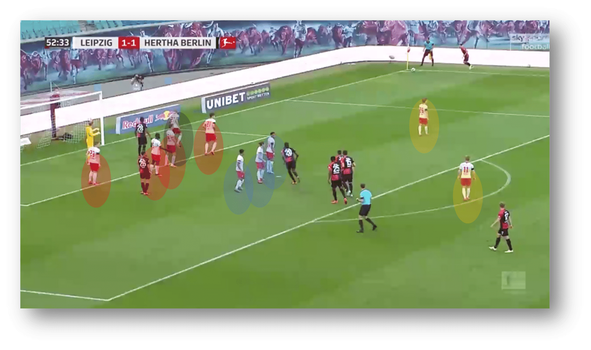

- balle

**Défense combinée :**

Cette organisation défensive, comme son nom l’indique, combine le marquage zonal et le marquage individuel. C’est-à-dire qu’il y aura des joueurs avec le rôle de marqueurs et d’autres chargés de défendre une certaine zone.

Avec la défense de zone, ce sont les deux organisations défensives les plus courantes aujourd’hui. De plus, dans des ligues comme celle espagnole, cette méthode prédomine clairement comme l’organisation la plus utilisée. Il nous propose de donner la priorité à une certaine zone avec des joueurs responsables de cet espace et, en même temps, de rendre difficile l’entrée et le tir des attaquants avec des marquages individuels.

Parmi ses points faibles, on peut souligner la vulnérabilité aux blocages ou aux mouvements de traînée et, selon la structure utilisée, l’existence de zones vides, qui peuvent être utilisées au contraire.

Certaines des structures les plus observées dans le football aujourd’hui peuvent être les suivantes :

***1.er poteau et petite surface à l’avant (2 dans la zone).***

**Graphique 4. 1.er bâton et petite surface à l’avant (zone de 2 po)**

**Source :** Élaboration des auteurs basée sur \[Image sans titre sur 1.er bâton et petite surface avant (2 dans la zone)\], s.d., F. C. Département d’analyse de Barcelone (WYSCOUT).

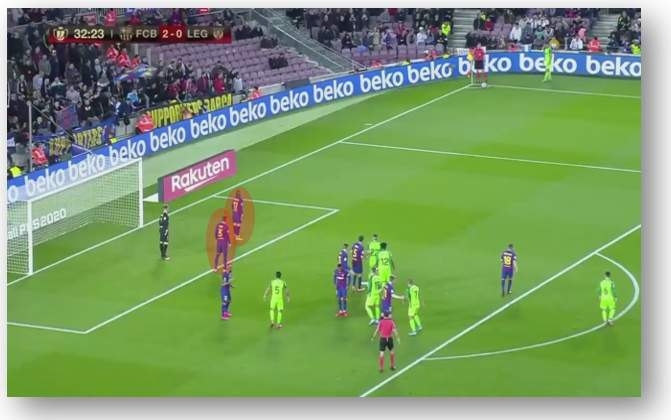

***1.er poste, petite zone à l’avant et 2ème poste (3 en zone).***

**Graphique 5. Poteau 1.er, petite surface à l’avant et poteau 2.do (zone 3 po)**

**Source :** Élaboration des auteurs basée sur \[Image sans titre sur 1.er poteau, petite surface avant et poteau 2.do (3 dans la zone)\], s.d., F. C. Département d’analyse de Barcelone (WYSCOUT).

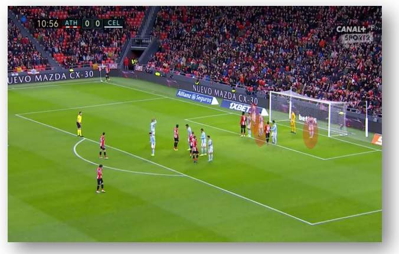

***1.er poteau, petite zone à l’avant et les deux poteaux (zone de 4 po).***

**Graphique 6. 1.er poteau, petite zone à l’avant et les deux poteaux (zone de 4 po)**

**Source :** Élaboration des auteurs basée sur \[Image sans titre sur 1.er poteau, petite surface avant et les deux poteaux (4 dans la zone)\], s.d., F. C. Département d’analyse de Barcelone (WYSCOUT).

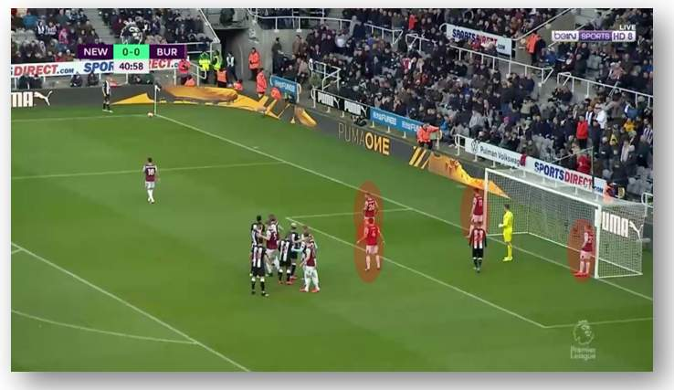

- balle

**Défense individuelle :**

Organisation basée exclusivement sur le marquage individuel, où les joueurs ne sont jamais responsables d’une certaine zone, mais seulement de leur paire. En raison de sa vulnérabilité aux mouvements de traînée ou aux blocs rivaux, et de l’exposition de zones clés, son utilisation est pratiquement inexistante aujourd’hui.

La structure choisie sera la clé de la performance de l’action elle-même. Considérer les équipes comme des systèmes complexes qui s’auto-organisent en permanence, l’inclusion ou non d’un joueur dans une certaine zone variera le comportement du collectif et peut avoir un grand impact sur la défense de cette action sur coup de pied arrêté. Nous considérons le processus de choix de la structure dans les coins et nous soulignons qu’il doit s’agir d’un processus de réflexion profonde dans lequel, sans aucun doute, une multitude de facteurs influenceront, du point de vue du personnel d’entraîneurs au contexte de la ligue et aux antécédents de l’équipe, tout se produisant, bien sûr, en raison des caractéristiques – dans ce cas, défensives – des joueurs.

**Tableau 1 : Comparaison entre la défense zonale et la défense combinée dans les corners**

<table>
<colgroup>
<col style="width: 50%" />
<col style="width: 49%" />
</colgroup>
<thead>
<tr class="header">
<th><strong>DÉFENSE ZONALE</strong></th>
<th><strong>DÉFENSE COMBINÉE</strong></th>
</tr>
</thead>
<tbody>
<tr class="odd">
<td><ul>
<li>
Toutes les zones étaient occupées rationnellement.
</li>
<li>
Possibilité de choisir quel joueur occupera chaque zone.
</li>
<li>
Nous évitons ou rendons très difficile le blocage d’un adversaire.
</li>
</ul></td>
<td><ul>
<li>
Tous les adversaires ont des marques individuelles et ne feront donc pas de courses propres.
</li>
<li>
Possibilité de prioriser les espaces clés en plaçant le(s) joueur(s) dans la zone.
</li>
<li>
Des responsabilités plus définies. Chacun est responsable de sa marque.
</li>
</ul></td>
</tr>
<tr class="even">
<td><ul>
<li>
Organisation statique avec un désavantage face à la race rivale.
</li>
<li>
A priori, il n’y a pas de contact constant avec l’adversaire et plusieurs fois, il sera capable de faire une course propre.
</li>
<li>
Il peut y avoir des espaces entre les zones où il n’est pas clair à qui incombe la responsabilité.
</li>
</ul></td>
<td><ul>
<li>
Vulnérabilité aux blocages et/ou aux mouvements de traînée.
</li>
<li>
Certaines zones importantes peuvent être exposées.
</li>
</ul></td>
</tr>
</tbody>
</table>

**Source : **Auteurs.

**Identification des rôles fonctionnels dans les coins défensifs**

Il sera clé et essentiel pour l’analyse détaillée d’une PBL défensive donnée de définir les rôles fonctionnels que les joueurs auront.

Nous entendons par rôle fonctionnel dans l’APP la conduite ou le comportement que l’entraîneur a défini et établi pour le joueur, qui, s’adaptant continuellement aux besoins et aux comportements émergeant dans le même jeu, doit le développer pour le bénéfice collectif.

Dans la PBL défensive spécifique du corner, du coup de pied ou du corner, nous pouvons distinguer les rôles fonctionnels suivants :

**Joueur en zone**

–

Leurs responsabilités varieront selon que l’équipe défend avec une défense zonale ou combinée. Dans le cas où c’est ce dernier, il incombe à lui et à l’autre joueur supposé de la zone d’attaquer le ballon pour essayer de le dégager.

 

Ces joueurs auraient comme caractéristiques clés – dans ce cas, des qualités – un grand jeu aérien (surtout si nous défendons combinés), le courage d’attaquer le ballon, la responsabilité de zone et la capacité de communication pour ordonner les coéquipiers avec le gardien de but.

**Portier**

–

Leur éventuelle implication doit être précisée, en collaboration avec l’entraîneur et l’entraîneur des gardiens de but. Un rôle pourrait être de s’occuper de la zone 2.do du poteau, en particulier dans les ballons fermés.

 

Il est essentiel que le gardien de but connaisse les rôles de chacun des joueurs et agisse en conséquence, en ordonnant et en ajustant les positions.

**Tableau d’affichage individuel**

–

Un joueur avec la responsabilité évidente d’empêcher le tir de son partenaire. Pour ce faire, ils doivent maintenir un profil corporel adéquat, en interposant toujours leur corps entre le but et l’adversaire. Il est essentiel que vous utilisiez le contact, autant que possible, pour empêcher l’attaquant de s’enfuir.

 

En fonction des caractéristiques du marqueur et de l’adversaire, le marqueur doit adapter la distance à l’adversaire, en essayant de trouver le bon équilibre pour une position qui rend impossible la course de l’adversaire.

 

Les marqueurs individuels doivent avoir une certaine intensité et une certaine discipline défensive, ne pas avoir peur du contact physique et, surtout, éviter les actions telles que les saisies, qui se termineront par une pénalité.

**Lecteur court**

–

Joueur chargé de défendre le service court de l’adversaire. L’entraîneur peut décider qu’il va jouer directement à la ligne courte (ligne 9.15 ou proche) ou qu’il commencera à jouer un autre rôle fonctionnel et, en raison de la performance de l’équipe adverse, finira par défendre la remise en jeu courte.

 

Généralement, ce rôle sera occupé par des joueurs offensifs, ce qui sera d’une importance vitale que, s’adaptant toujours à la situation et à l’objectif de l’équipe lorsque l’adversaire a pris court, ils évitent de faire des interventions soudaines et des fautes inutiles.

**Joueur sur rebond**

–

Un joueur qui adaptera sa position à l’espace dans la zone avant de la zone avec le principe clair de récupérer le rebond ou le dégagement et avec la possibilité, ou non, de commencer la contre-attaque.

 

L’idéal est que les joueurs qui jouent ce rôle aient un point de méfait pour prévoir où ce rebond pourrait se situer. À son tour, si l’équipe a l’intention de lancer la contre-attaque rapidement, elle doit faire une démonstration physique importante en s’offrant comme première ou deuxième option pour atteindre la moitié de terrain de l’adversaire.

 

Une autre de ses fonctions possibles peut être d’effectuer un marquage individuel, au cas où l’adversaire entrerait avec un autre finisseur ; Par conséquent, vous devrez être conscient de cette situation.

**Joueur en disposition offensive**

–

Un joueur qui est « lâché » et qui se trouve dans une zone proche du milieu de terrain, avec l’intention d’être une option pour l’action suivante (contre-attaque) ou, simplement, de placer les adversaires et de faire entrer l’équipe adverse avec moins de joueurs pour terminer.

 

Généralement, ce rôle sera rempli par les joueurs les plus rapides et les plus offensifs de l’équipe, et bien qu’il puisse sembler que leur seul rôle devrait être de se préparer à la contre-attaque, ils peuvent être très utiles à l’équipe en anticipant quand il y a un long dégagement. Si cela se produit, des qualités telles que le jeu consécutif peuvent devenir essentielles pour que l’équipe s’en sorte.

Bien que ce ne soit pas si courant, nous devons également connaître** d’autres rôles fonctionnels **tels que les suivants :

**Cutter de course**

–

Les joueurs les plus éloignés d’une défense de zone peuvent avoir pour rôle d’empêcher les finisseurs les plus dangereux de l’adversaire de courir seuls.

**Joueur en couleur 1.er ou 2.do couleur**

–

Bien qu’il soit de moins en moins utilisé, il y a actuellement des équipes qui reprochent à un ou deux joueurs d’être juste sous les poteaux, bloquant les éventuels tirs au but.

Bien que nous ayons revu et limité les fonctions que les joueurs peuvent avoir dans un coup de pied de coin, pour analyser les performances d’une équipe, nous devons être clairs que, dans la plupart des actions visualisées, il ne s’agira pas de comportements fermés. Tout comme la nature même des êtres vivants et du football, de petits changements dans un certain rôle peuvent complètement modifier les performances des joueurs et, par conséquent, le comportement général de l’équipe dans cette PBL.

Si nous analysons une équipe qui commence avec une défense combinée avec 2 joueurs dans la zone, 5 dans le marquage individuel, 1 au rebond et 2 défenseurs sur le court, nous ne pouvons pas nous en tenir à cette analyse des rôles, car elle est loin d’être une véritable analyse du comportement de l’équipe. Il faut aller plus loin et analyser la progression du jeu, essayer de comprendre si cette équipe a placé ces 2 joueurs en short parce qu’ils jouent contre un adversaire qui prend beaucoup en short et veut l’éviter, ou s’ils ont simplement laissé un seul joueur en rebond parce que l’adversaire laisse un joueur dans cette zone. Observer les joueurs qui sont petits peut être la clé. D’où viennent-ils ? Étaient-ils dans la zone, marquaient ou au rebond ? Quel a été le stimulus qui les a amenés à modifier leur rôle ? Les deux joueurs de la zone sont-ils les deux joueurs ayant la plus grande capacité aérienne ?

La question constante et la compréhension de la raison des rôles fonctionnels lorsque nous analysons une équipe seront essentielles pour soutenir une analyse significative, qui dissèque de la manière la plus réelle et la plus probable les actions possibles que l’équipe adverse peut effectuer dans cette PBL spécifique. Ce processus de déduction des rôles fonctionnels sera particulièrement important dans l’analyse de l’adversaire, car être capable de tirer des conclusions dans cet aspect nous donnera l’avantage de savoir comment ils seront organisés dans cette PBL particulière et nous serons en mesure d’agir en conséquence avec une certaine prévoyance.

Bien que cela dépende de la demande du personnel d’entraîneurs, nous considérons qu’il est essentiel de se pencher sur les joueurs qui remplissent chacun des rôles, car la détection de leurs principales caractéristiques lors du marquage ou de la défense d’une zone apportera un point de qualité à notre analyse et ce seront ces petits détails qui pourront finir par faire la différence. En revanche, avec l’analyse de sa propre équipe, cette facette du processus ne sera pas aussi pertinente, car, bien qu’il faille vérifier que chaque acteur occupe et développe son rôle fonctionnel, toute l’équipe doit être claire sur les rôles à remplir et les fonctions à remplir.

**Proposition de variables pour l’analyse des corners défensifs**

Une fois que les possibilités d’organisation défensive et de rôles fonctionnels ont été introduites – deux facteurs déterminants, avant tout, dans l’analyse de l’équipe adverse – il sera essentiel de définir les variables à analyser, dans ce cas, lors d’un corner contre l’adversaire. Ceux-ci seront compris comme les aspects clés ou les points les plus importants à observer dans la performance du coup de pied de coin, contre son camp ou chez l’adversaire.

Comme nous l’avons mentionné dans le module précédent, il est très important de définir les aspects ou les comportements que nous allons considérer, car, bien que le processus d’analyse PBL soit flexible et adaptable aux besoins du moment, il s’agit d’établir les paramètres que l’analyste et le coach jugent les plus pertinents pour définir la performance en PBL de l’équipe rivale et de sa propre équipe.

Certaines des variables sur lesquelles nous pouvons nous concentrer pour l’analyse des corners défensifs peuvent être les suivantes :

- - 
  - 

balle

**Organisation défensive : **Quel type de défense l’équipe utilise-t-elle ?

- Combiné

- Zonal

<!-- -->

- - 
  - 
  - 
  - 
  - 

balle

**Structure de l’organisation défensive statique : **Celui qui ne peut être détecté qu’avec une image avant le coup de pied de coin.

- Combien y en a-t-il et comment les joueurs se positionnent-ils dans la zone ?

- Combien de joueurs font du marquage individuel ?

- Quel est le nombre de joueurs sur le rebond ?

- Y a-t-il un joueur positionné pour défendre le service court ?

- Laisseront-ils un joueur dans une disposition offensive ?

<!-- -->

- - 
  - 

balle

**Structure de l’organisation défensive dynamique :** Il s’agit des comportements qui émergent en relation avec la structure de l’organisation défensive une fois que le ballon entre en jeu.

- Comment l’équipe se comporte-t-elle lorsqu’il y a une touche courte ? Qui est le premier joueur à défendre le service court ? Et le second ?

- Comment se comporte le joueur rebondissant si l’adversaire entre avec un autre finisher ?

Comme nous l’avons mentionné, il est essentiel de personnaliser et d’identifier les joueurs qui effectuent chaque comportement, afin d’obtenir une analyse détaillée de la performance de cette action.

Pour répondre à ces questions et tenter d’identifier une organisation spécifique, il est important de visualiser un grand nombre d’actions afin de trouver des régularités. De plus, nous devons être clairs sur le fait que l’ordinateur qui fait l’objet de notre analyse à ce moment-là n’exécutera pas cette défense PBL comme s’il s’agissait d’une machine programmée pour répéter automatiquement les mêmes comportements. Ils tenteront d’adapter leur organisation à la situation posée par l’équipe à laquelle ils font face. Bref, il faut observer la structure que cette équipe a dans différentes situations. Comment modifiez-vous votre structure lorsqu’un adversaire entre avec 6 finishers au lieu de 5 ? Quels changements faites-vous lorsque l’adversaire laisse 3 joueurs au rebond ? Lorsqu’ils gagnent, gardent-ils toujours un joueur dans une disposition offensive ?

Plus nous saurons de détails sur la manière dont l’équipe analysée adapte sa structure aux différentes situations posées par l’adversaire et au match lui-même (score adverse, infériorité numérique, etc.), plus nous nous rapprocherons de la détermination d’une régularité dans l’organisation de l’adversaire dans ladite PBL.

**Paramètres qualitatifs**

–

Attitudes ou tendances que nous considérons comme clés pour la performance de l’action analysée. Nous pouvons traiter d’aspects pertinents de nature individuelle ou collective. Cela dépendra de notre point de vue subjectif sur le comportement de l’équipe sur ce coup de pied arrêté. Quelques exemples :

 

- Évaluation de l’occupation des zones clés : Quels sont les domaines prioritaires pour défendre le corner ? Et, par conséquent, quel domaine peuvent-ils négliger le plus ?

- Évaluation globale du rendement : dans quels domaines ont-ils été les plus à risque ? Quel type d’expédition ont-ils été le plus vendus aux enchères ?

- Évaluation des mouvements de 2.as : 2.as donnent-ils une chance de bouger ?

- Évaluation des marquages individuels : sont-ils agressifs ? Les pertes de marquage se produisent-elles facilement ? Quels joueurs ont le plus de mal à marquer ?

- Évaluation de la participation du gardien de but : Sort-il bien au-dessus des ballons croisés au 2.do poteau ? Est-ce qu’il est à mi-chemin ?

- Évaluation du comportement des joueurs dans la zone : Le joueur a-t-il tendance à avancer (pas en avant au moment de la remise en jeu) ? A-t-il la même capacité à attaquer le ballon des deux côtés ? De quel côté a-t-il le plus de difficultés ?

- Approche de la performance individuelle : quel joueur est le plus décisif lorsqu’il s’agit de dégager des ballons aériens ? Le joueur court est-il agressif lorsqu’il défend le service court ?

**Paramètres quantitatifs**

–

Ces données significatives et pertinentes pour décrire les performances de l’équipement dans cette APP spécifique. Des plateformes telles que Mediacoach nous permettent d’accéder à des informations très détaillées sur les performances d’une certaine équipe dans une PBL, sur la base de la réalisation de la PBL. Nous pouvons souligner les points suivants :

 

- Combien de corners neutralisent-ils ? En d’autres termes, ils parviennent à empêcher l’adversaire de tirer.

- Combien de corners reçoivent-ils ? Pourcentage des enchères qu’ils ont reçues.

- Combien de buts ont-ils marqués sur corners ?

- Ont-ils commis des pénalités ?

Il est fortement recommandé de relier les données extraites avec les paramètres qualitatifs, c’est-à-dire que nous devons corroborer l’information avec notre perception réelle de la défense de ce coup de pied de coin. Par exemple, il se peut que, sur la base des paramètres quantitatifs de l’APP, nous déterminions qu’une équipe a très peu de tirs, mais en visualisant les actions, nous observons que ces tirs comportent un très grand danger, c’est-à-dire qu’il s’agissait de tirs très clairs. La relation entre le paramètre qualitatif et le paramètre quantitatif déterminera l’importance de cet aspect en question, en l’occurrence l’enchère.

À ce stade, nous aurons analysé toutes les variables et mis en évidence celles qui nous permettent de mieux disséquer les performances de l’équipe en question dans le coup de pied de coin contre. Ainsi, nous disposons d’informations précieuses qui, toujours selon les paramètres généraux de l’analyse PBL établis avec le personnel d’entraînement, peuvent nous aider à proposer une **option offensive** pour la compétition. Bien entendu, cela doit être en relation avec les informations présentées et toujours étayé par celles-ci.

Selon le rôle ou la fonction de l’analyste PBL au sein de l’équipe, cette option proposée sera plus ou moins étendue et détaillée. Même ainsi, il s’agira toujours d’une option spécifique pour ce match en fonction des faiblesses observées par l’équipe adverse, que nous pouvons exploiter grâce à nos forces sur un corner.

**Graphique 7. Variables d’analyse dans un coin défensif**

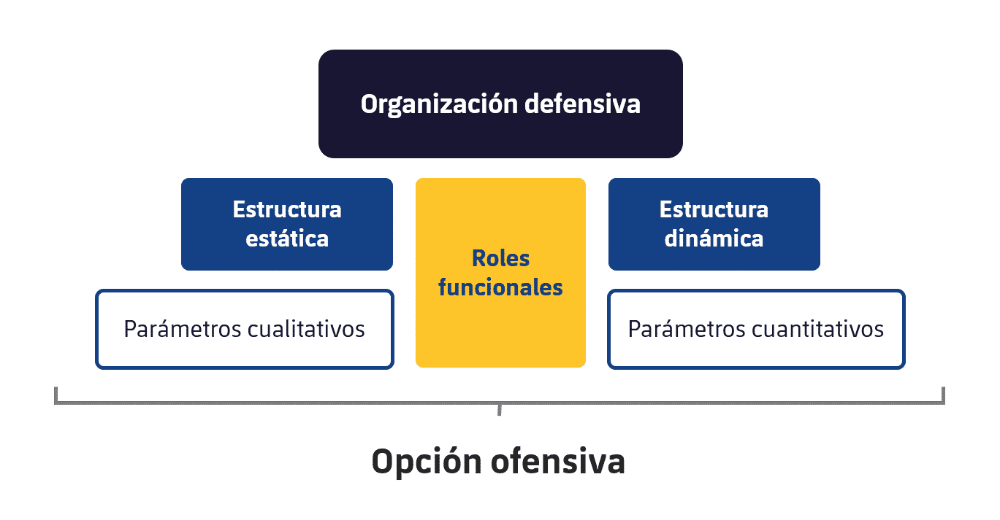

**Fontaine:** Élaboration personnelle.

Il convient de rappeler que, afin de définir des régularités dans la performance d’une équipe dans une PBL donnée, une large visualisation des actions sera d’une importance vitale, qui doit être variée et dans laquelle nous devons nous concentrer sur la façon dont l’équipe analysée est organisée dès le départ et comment elle se réorganise face à certains comportements spécifiques de l’adversaire ou, à leur tour, différents contextes de parti.

D’autre part, une autre grande caractéristique que l’analyse PBL doit contenir est, comme nous l’avons déjà mentionné, la personnification. En analysant en détail le comportement des joueurs, nous obtiendrons un point différentiel par rapport à l’adversaire. De plus, sûrement, connaissant les caractéristiques des adversaires en PBL défensif, nous comprendrons beaucoup mieux la raison des comportements collectifs dans le coup de pied de coin contre.

La proposition de variables présentée (Figure 8) nous permet de limiter notre processus d’analyse du coin défensif en partant de la structure défensive statique et, en détectant les rôles fonctionnels, d’aller vers sa structure dynamique ou, en d’autres termes, vers les modifications qu’ils apporteront dans certaines situations. À partir de là, nous avons une perspective qualitative et quantitative, afin de pouvoir effectuer une dissection et une évaluation efficaces de la performance de ladite équipe dans une PBL donnée, dans ce cas, dans le coin défensif. Tout cela nous donne la possibilité de proposer une option offensive qui sera basée sur l’exploitation des faiblesses, sur la base de l’analyse.

**Exemplification de l’analyse d’un corner défensif**

Ci-dessous, en essayant de mettre en pratique les contenus exposés, un exemple d’analyse de coin défensif pour chaque type de rapport est présenté. En rappelant les paramètres généraux présentés dans le module 1, ces rapports seront les suivants : rapports de l’équipe adverse – rapport d’avant-match PBL et rapport PBL (match) sur place – et rapports de l’équipe propre – rapport d’après-match et rapport cumulatif. Ci-dessous, en essayant de mettre en pratique les contenus exposés, un exemple d’analyse de coin défensif pour chaque type de rapport est présenté. En rappelant les paramètres généraux présentés dans le module 1, ces rapports seront les suivants : rapports de l’équipe adverse – **rapport d’avant-match PBL** et rapport PBL (match) ***sur place ***– et rapports de l’équipe propre – **rapport d’après-match** et **rapport cumulatif**.

**Rapport d’avant-match ABP (corner contre).**

–

Dans le rapport d’avant-match (Figure 9), nous essaierons de mettre en évidence les aspects pertinents de l’adversaire, dans ce cas défensif, sur la PBL en question. Nous nous en tiendrons aux variables mentionnées en commençant par l’organisation défensive de l’adversaire et la structure statique à la dynamique. Dans la section « à souligner », nous mettrons en évidence les paramètres qualitatifs et quantitatifs que nous considérons comme les plus pertinents pour définir la performance de l’équipe rivale dans ladite action.

 

Nous joignons notre proposition de rapports au programme IBooks Author, car il nous permet de saisir les informations de manière claire et de profiter des ressources de la vidéo et des images 2D (les deux peuvent être visionnées en plein écran).

 

- **Vidéo: **Un ensemble d’actions représentatives qui permettent une meilleure compréhension de l’information écrite (Figure 10). Il ne doit pas être très étendu et à partir de sa visualisation, nous devons être en mesure d’extraire les principales régularités, ainsi que, surtout, les situations qui génèrent un danger pour eux (rapport d’équipe rivale) ou qui le génèrent (rapport d’équipe propre). Les clips doivent maintenir un ordre logique, qui doit être convenu par l’analyste avec le personnel d’entraîneurs. Par exemple : ordre chronologique, ordre en fonction du danger de l’action, ordre en fonction du mode d’exécution...

Il est important de jeter les clips qui peuvent nous prêter à confusion, comme ceux dans lesquels une équipe qui est en infériorité numérique ou avec des résultats volumineux, dans laquelle l’équipe n’agit pas comme elle le ferait dans une situation habituelle.

 

Nous pouvons inclure des ressources audiovisuelles, même s’il est vrai que nous devons éviter de surcharger la vidéo et nous rappeler que le plus important est de mettre clairement en évidence les jeux qui, selon nous, définissent la tendance de cette équipe, dans ce cas, dans le coup de pied de coin contre.

 

- **Images 2D :** Il s’agit d’une ressource de plus qui peut nous aider à transmettre des connaissances sur l’organisation, dans ce cas défensive, de l’équipe en question. Réalisé à l’aide du programme Keynote, il cherche à exposer de manière simple et très visuelle la position habituelle de chaque joueur dans cette PBL, ainsi que des aspects pertinents tels que le nom, le numéro, la jambe dominante et la taille. Dans le cas spécifique du corner, il est important d’exposer deux images : l’une faisant référence à leur organisation en corners directs et l’autre faisant référence à la façon dont ils sont placés dans les corners courts (figures 11 et 12).

**Graphique 8. Rapport d’avant-match ABP (corner contre)**

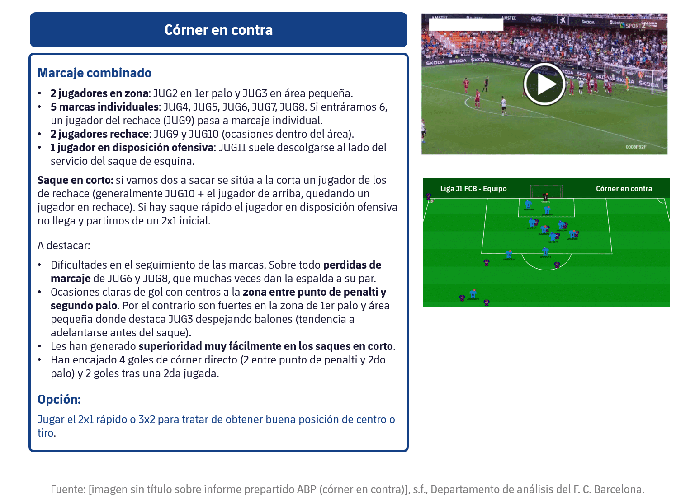

**Source :** \[Image sans titre sur le rapport d’avant-match ABP (corner contre)\], n.d., Département d’analyse du F. C. Barcelone.

**Vidéo 1. Mettre en surbrillance les clips d’angle contre**

**Graphique 9. Représentation 2D (avant-match) structure en coin contre**

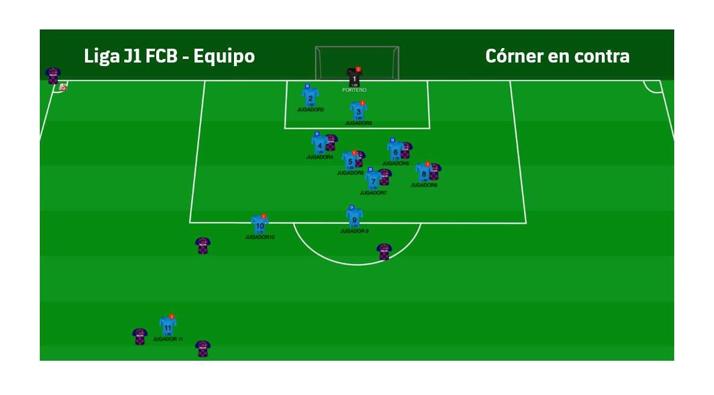

**Source : **\[Image sans titre sur la structure d’angle de représentation 2D (avant-match) contre\], n.d., Département d’analyse du F. C. Barcelone.

**Graphique 10. Structure de représentation 2D (avant-match) dans le coin court du contre**

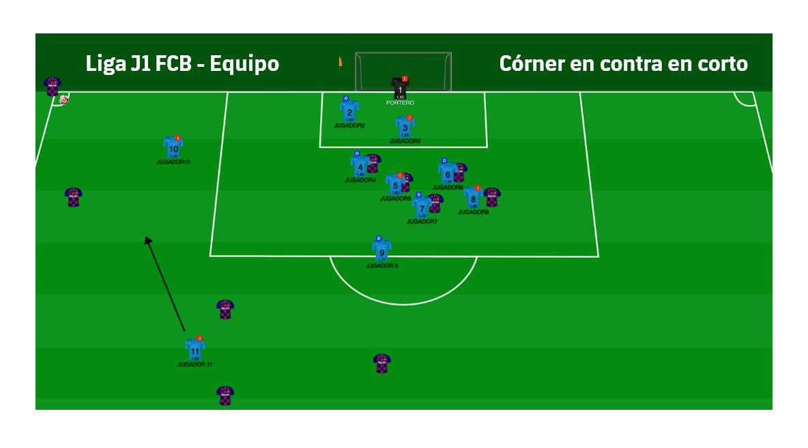

**Source :** \[Image sans titre sur une structure de représentation 2D (avant-match) dans un coin de contre court\], n.d., Département d’analyse du F. C. Barcelone.

**Rapport de match ABP in situ (corner contre).**

\+

**Graphique 11. Rapport de match ABP in situ (corner contre)**

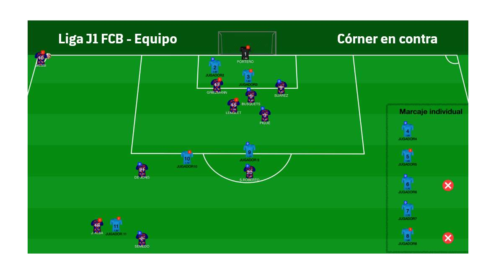

**Source :** \[Image sans titre sur le rapport de match sur site d’ABP (coin contre)\], s.d., Département d’analyse du F.C. Barcelone.

**Graphique 12. Rapport de match sur place de l’ABP (short contre)**

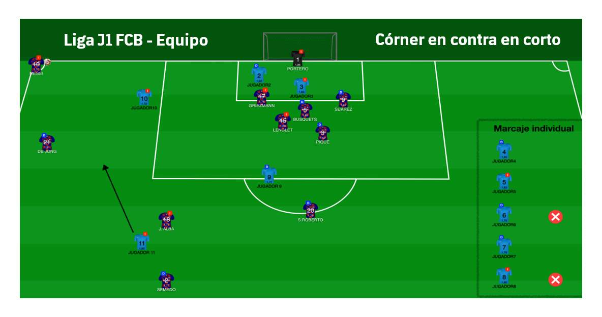

**Source :** \[Image sans titre sur le rapport de match sur site d’ABP (short contre)\], s.d., Département d’analyse du F. C. Barcelone.

**Rapport d’après-match ABP (corner contre)**

\+

**Graphique 13. Rapport d’après-match (corner contre)**

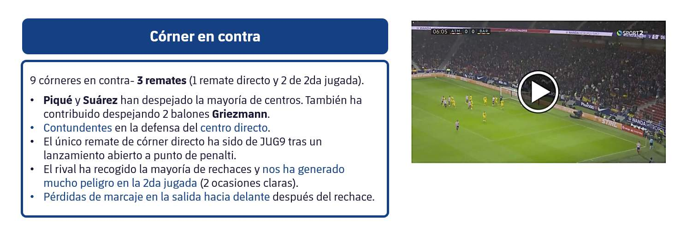

**Source : **\[Image sans titre sur le rapport d’après-match (corner contre)\], n.d., Département d’analyse du F. C. Barcelone.

**Rapport cumulatif ABP (coin contre)**

\+

**Graphique 14. Rapport cumulatif (coin contre)**

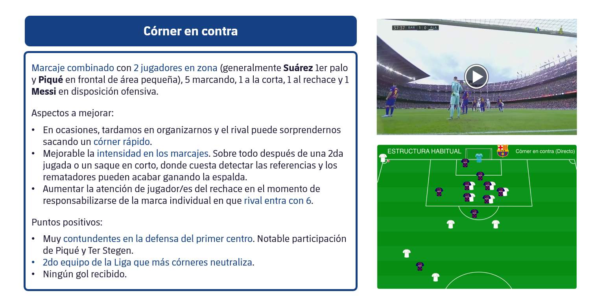

**Source : **\[Image sans titre sur le rapport cumulatif (coin contre)\], s.d., Département d’analyse de F. C. Barcelone.

**Unité 2.3 Proposition de variables et exemple d’analyse des fautes défensives indirectes**

***Bloc 3 de 5***

**Tout d’abord, il doit être clair que la proposition suivante (déjà discutée tout au long du module) ne sera pas basée sur les fautes indirectes par règlement, mais sur celles où le tireur n’a pas l’intention de frapper vers le but. C’est, sans aucun doute, l’un des critères discutés dans l’établissement des paramètres généraux de l’APP, qui doivent avoir été consolidés entre l’analyste et le personnel d’entraînement.**

**Contrairement aux corners, les coups francs indirects peuvent être tirés de n’importe quelle zone du terrain. C’est pourquoi, dans le cadre de ces actions, il est essentiel que l’analyste et le personnel d’entraîneurs structurent une classification des fautes indirectes en fonction de la zone dans laquelle elles se sont produites et déterminent l’importance de l’analyse que chacune d’entre elles aura.**

**Dans le cadre d’un processus flexible et adaptable, la nécessité d’une analyse PBL peut dépendre des exigences de la concurrence car, en parlant d’analyse de la rivalité, en fonction de l’intention de l’entraîneur, lorsque nous tirons un long coup franc, nous nous demandons s’il faut ou non analyser comment cette équipe défend les coups francs à longue distance. C’est pourquoi l’analyse de l’adversaire des fautes défensives indirectes dépendra de l’intentionnalité de sa propre équipe lors de l’exécution d’une telle action.**

**C’est-à-dire que si nous sommes une équipe qui sert toutes les fautes en bref jusqu’au dernier tiers du terrain et qui cherche à commencer le match rapidement, a priori, nous ne serons pas intéressés à analyser la structure défensive de l’équipe adverse sur les longs coups francs. D’un autre côté, si nous sommes une équipe plus directe en ce sens, déterminée à centrer les fautes du milieu de terrain à la recherche d’une extension à l’intérieur de la surface, nous devons savoir comment l’adversaire se comporte dans la défense de ces longs coups francs.**

**Compte tenu de ce qui a été dit, il est vrai que dans l’analyse des fautes indirectes, nous devons donner la priorité à celles qui impliquent une plus grande importance et, normalement, à celles qui ont le plus d’impact sur le jeu. Nous parlons de fautes latérales et de fautes latérales proches.**

**Proposition de variables pour l’analyse des fautes défensives indirectes (fautes latérales)**

**Certaines des variables sur lesquelles nous pouvons nous concentrer pour l’analyse des fautes latérales défensives peuvent être les suivantes :**

**Organisation défensive**

**+**

**Structure de l’organisation défensive statique**

**+**

**Structure organisationnelle défensive dynamique**

**+**

**Paramètres qualitatifs**

**+**

**Paramètres quantitatifs**

**+**

**\*Nous devons enregistrer le comportement de l’équipe analysée face aux fautes latérales à proximité. Modifie-t-il son organisation défensive lors des fautes latérales rapprochées ? À partir de quelle référence modifiez-vous sa structure ?**

**Exemplification de l’analyse d’une faute latérale défensive**

- **balle**

**Rapport d’avant-match ABP (faute latérale contre)**

**Graphique 15. Rapport d’avant-match ABP (faute latérale contre)**

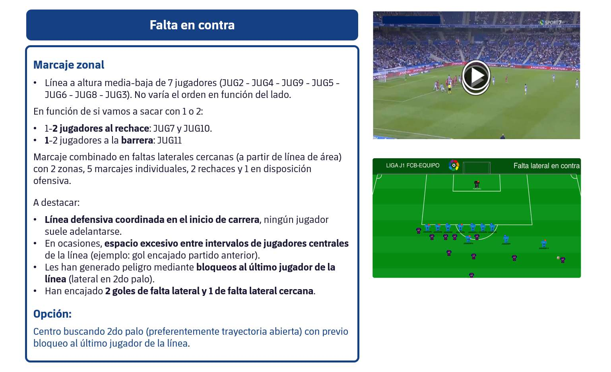

**Source : \[Image sans titre sur le rapport d’avant-match de l’ABP (faute latérale contre)\], s.d., Département d’analyse du F. C. Barcelone.**

**Vidéo 3. Clips de coup franc latéral en vedette contre**

**Lire la vidéo**

**Source : \[Archive vidéo\], n.d., Département d’analyse de F. C. Barcelone (Wyscout).**

**Graphique 16. Structure de représentation 2D (avant-match) en faute latérale contre**

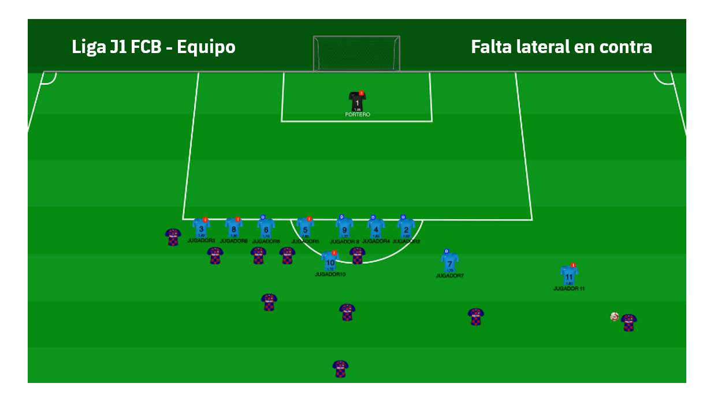

**Source : \[Image sans titre sur la structure de représentation 2D (avant-match) en faute latérale contre\], n.d., Département d’analyse du F. C. Barcelone.**

**Graphique 17. Structure de représentation 2D (avant-match) sur coup franc latéral rapproché contre**

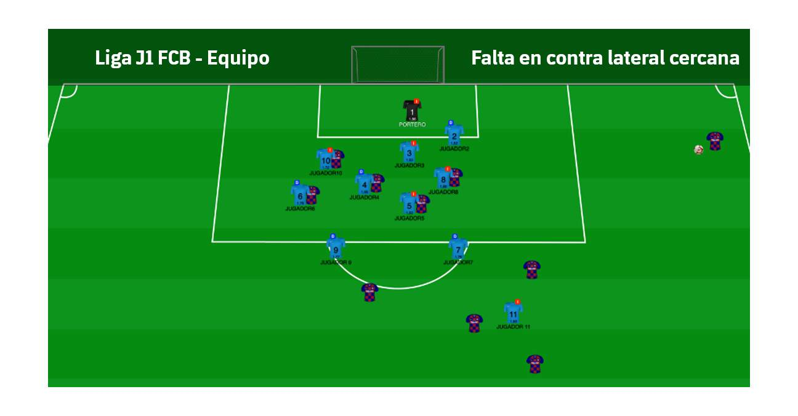

**Source : \[Image sans titre sur la structure de représentation 2D (avant-match) en coup franc latéral rapproché contre\], n.d., Département d’analyse du F. C. Barcelone.**

- **balle**

**Rapport de match sur site ABP (faute latérale contre)**

**Graphique 18. Rapport *de match sur site* ABP (faute latérale contre)**

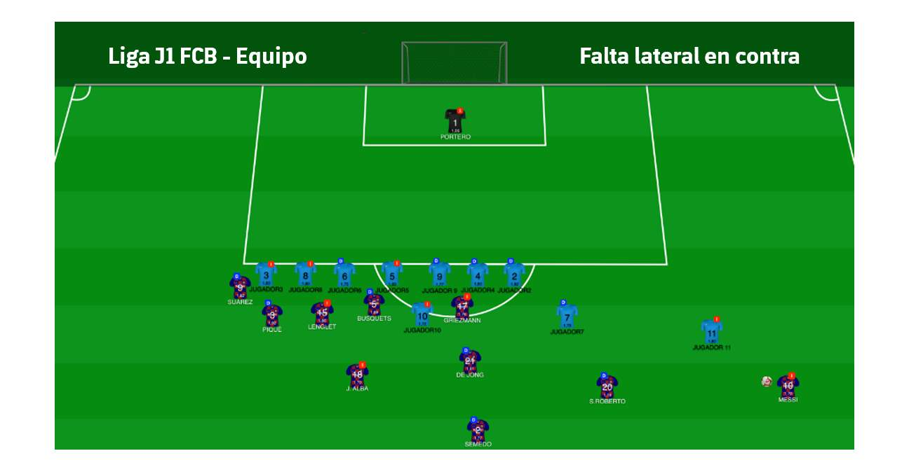

**Source : \[Image sans titre sur le rapport de match sur site ABP (faute latérale contre)\], n.d., Département d’analyse du F. C. Barcelone.**

- **balle**

**Rapport d’après-match ABP (faute latérale contre)**

**Graphique 19. Rapport d’après-match (faute latérale contre)**

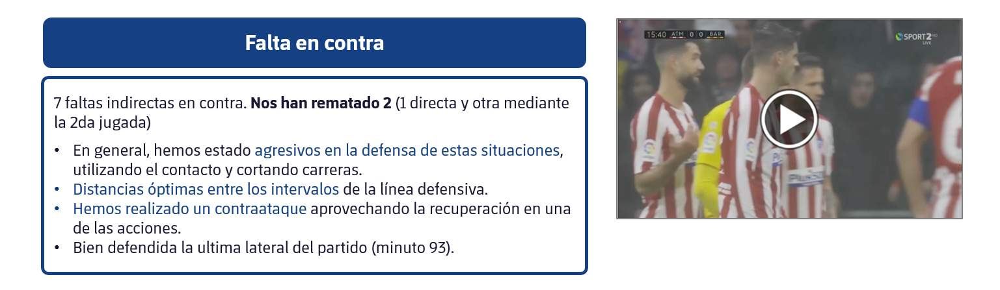

**Source : \[Image sans titre sur le rapport d’après-match (faute latérale contre)\], n.d., Département d’analyse du F. C. Barcelone.**

- **balle**

**Rapport cumulatif ABP (faute latérale contre)**

**Graphique 20. Rapport cumulatif (faute latérale contre)**

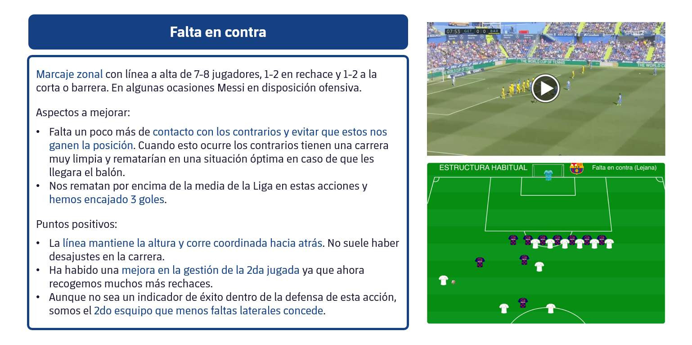

**Source : \[Image sans titre sur le rapport Accumulé (faute latérale contre)\], s.d., Département d’analyse du F. C. Barcelone.**

**Vidéo 4. Analyse des fautes cumulées contre**

**Lire la vidéo**

**Source : \[Archive vidéo\], n.d., Département d’analyse de F. C. Barcelone (Wyscout).**
