**Module 2. Etude des éléments structurels de la phase initiale  
Structure générale de l’équipe en arrangement**

*Bloc 1 de 3*

Afin de prendre un bon départ, quelle que soit la modalité d’action, il sera tout d’abord essentiel d’avoir une bonne **structure générale**, c’est-à-dire de réaliser une occupation correcte de l’espace afin de pouvoir obtenir tout type d’avantage plus tard. Cela dépend principalement de la conformation qu’une équipe aura en fonction de son style, de son système de jeu (1-4-4-2, 1-4-3-3, 1-5-3-2, etc.) et des modifications stratégiques qui sont assumées au cours d’un match par rapport à la structure de l’adversaire.

Comme nous l’avons déjà dit dans le premier module, dans la sortie du ballon, la structure générale dépendra également d’une phase précédente (**avant**) qui affectera, en fonction de la situation rencontrée, l’occupation du terrain par l’équipe.

Lors du coup de pied de but, une telle occupation sera initialement statique, car il s’agit en fait d’une reprise du jeu.

Nous pouvons utiliser ces conclusions comme paramètre pour comprendre, dans la première phase du jeu, s’il y a ou non des différences entre les deux situations et quels sont les principes généraux de l’équipe pour en ressortir de manière combinative ou plus directe.

Malgré la situation dans laquelle nous nous trouvons, nous devons toujours observer l’organisation de l’équipe en fonction des paramètres que nous avons déjà connus ci-dessus :

- balle

zonage et voies,

- balle

occupation en fonction de la taille,

- balle

l’occupation en fonction de la profondeur ;

- balle

dynamique en fonction de la position/situation du ballon.

Ces informations permettront à l’analyste de connaître la manière dont une équipe présente **son occupation rationnelle spécifique du terrain de jeu** dans la phase initiale, et, à partir de là, de comprendre les forces et les faiblesses de chacune des organisations possibles par rapport à la structure assumée par l’adversaire.

Si l’on prend comme référence la division en 4 zones, on peut différencier au sein de la structure générale **3 sous-structures (ou lignes),** chacune avec ses fonctions et son organisation liées les unes aux autres :

- 1

1

1. Une sous-structure : composée de joueurs situés de préférence dans la zone A (par exemple, gardien de but, défenseurs centraux, pivot ou arrières latéraux)

→ Ils sont le « cerveau » de l’équipe dans cette phase du jeu, car ils prennent les premières décisions tactiques et choisissent le type de départ. Bien que toute l’équipe soit constamment impliquée à tout moment, je pense que c’est à ce moment du match que ces joueurs ont les rôles les plus importants.

- 2

2

2. une sous-structure : composée de joueurs situés dans la zone B (par exemple, les arrières latéraux et les initiés)

→ Ils servent de support et de support aux deux autres sous-structures, car ils génèrent de la supériorité et finissent par compenser les espaces.

- 3

3

3\. sous-structure ra : joueurs plus éloignés dans ZC-ZD (par exemple les ailiers)

→ Ils remplissent des fonctions de coopération, car ils favorisent les fonctions de leurs coéquipiers par la fixation de la ligne défensive de l’adversaire, le démarquage et la mobilité.

Comme nous l’avons dit, ces sous-structures sont interdépendantes, c’est-à-dire qu’elles ont des emplacements et des rôles spécifiques qui sont liés, et chacune contribue à l’organisation globale de l’équipe.

**Graphique 1. Les 3 sous-structures en fonction des zones (équipements en disposition)**

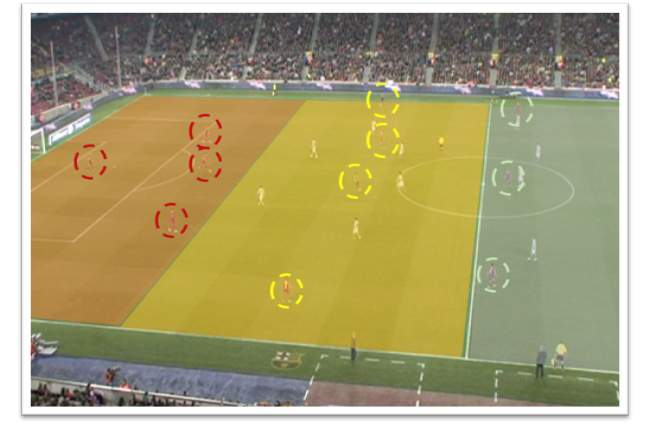

**Source** : Auteurs.

Si l’on prend comme référence la division en 4 voies, on peut différencier au sein de la structure générale **2 autres sous-structures (ou axes) :**

- balle

Joueurs dans les couloirs du milieu (par exemple, gardien de but, défenseur central, pivot, milieu de terrain, attaquants)

→ Sa fonction est de progresser et de guider la possession.

- balle

Joueurs dans les couloirs latéraux (par exemple, arrières latéraux, ailiers)

→ Ils ont pour tâche de donner de la largeur à l’équipe pour pouvoir générer plus d’espace à l’intérieur et équilibrer l’équipe au cas où il ne serait pas possible de progresser à l’intérieur.

**Graphique 2. Les 2 sous-structures en fonction des rails (équipement en agencement)**

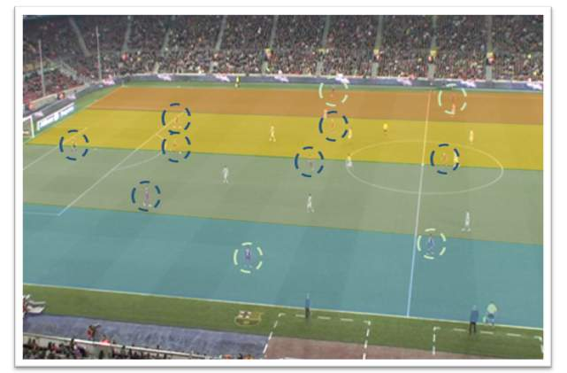

**Source** : Auteurs.

Il faut comprendre que chaque moyen d’analyse utilisé comme filtre d’évaluation nous aidera à obtenir certaines informations plutôt que d’autres, ce qui nous permettra d’en savoir plus sur l’organisation des équipes analysées.

Le positionnement statique (en particulier dans les tirs au but) sera un aspect très important, car il conditionnera fortement toutes les dynamiques successives en jeu et nous donnera des informations préalables sur les prochaines intentions de l’équipe en possession du ballon (comme nous le verrons plus tard, il en va de même pour l’équipe qui défend).

En ce qui concerne les paramètres spatiaux utilisés, dans la section suivante, nous étudierons plus en détail les différents emplacements spécifiques de chaque sous-structure (lignes ou axes), qui permettent à l’équipe en possession d’avoir une bonne organisation pour pouvoir réaliser une occupation correcte de l’espace, afin de réaliser une sortie de balle efficace.

**Sous-structures par rapport aux zones**

**Zone A-B (sortie de balle)**

Nous pouvons classer notre phase de départ en fonction du nombre et de la structure assumée par les joueurs dans la zone A et la zone B, en fonction de l’organisation elle-même et en fonction de la hauteur et de la conformation du bloc adverse.

En gardant ces facteurs à l’esprit, nous classons généralement les types de structures pendant la phase de démarrage en fonction du nombre de joueurs présents dans ces zones.

Ci-dessous, je vous présente les plus couramment utilisés :

- - 
  - 

balle

**Tee pour 4 joueurs**

- Pur : 2 centraux + 2 latéraux (à différentes hauteurs ou en ligne)

- Mixte : 3 défenseurs centraux + 1 pivot/intérieur

<!-- -->

- - 
  - 
  - 
  - 

balle

**Départ à 3 joueurs**

- Pure : 3 bloqueurs moyens

- Pure : 2 centrales + 1 latérale

- Mixte : 2 défenseurs centraux + 1 pivot

- Mixte : 2 centrales + 1 intérieure

<!-- -->

- balle

**Commençant avec 2 joueurs**

Par le terme « pur », j’entends une sortie composée de joueurs d’une **même ligne défensive**, tandis que par « mixte », j’entends une sortie lorsque des joueurs de la ligne médiane sont incorporés dans la ligne défensive.

Bien sûr, cette division se réfère principalement aux joueurs de champ ; Cependant, nous devons prendre en compte le rôle du **gardien de but**, car il sera toujours notre **homme libre**, capable de générer une supériorité qui nous permettra éventuellement de surmonter la pression de l’adversaire ou de sécuriser la possession en cas de pression.

- balle

**Tee pour 4 joueurs**

Le **démarrage pur à 4 joueurs** est l’un des plus couramment utilisés dans la plupart des systèmes de jeu.

Il se caractérise par la participation principale des deux défenseurs centraux et des arrières latéraux.

Généralement, il est utilisé contre les équipes qui pressent avec un seul attaquant.

La hauteur des arrières latéraux, qui peuvent être situés plus haut ou dans l’alignement des défenseurs centraux, dépendra à la fois du type de pression exercé par l’adversaire (dans un bloc haut ou dans un bloc bas) et du type de sortie que l’équipe veut réaliser, c’est-à-dire si elle veut générer des espaces à un endroit spécifique sur le terrain.

Par exemple, une ligne inférieure du 4 aura pour but d’attirer, par sa même disposition ou par une circulation préalable du ballon, les adversaires, pour ensuite générer de l’espace dans des zones plus avancées du terrain.

**Graphique 3. Des départs purs à 4 joueurs**

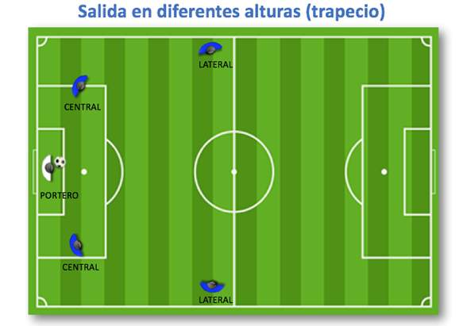

**Source** : Auteurs.

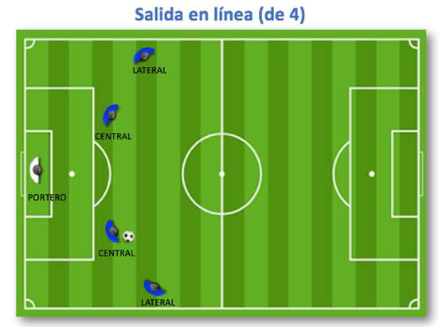

**Source** : Auteurs.

Le **début mixte avec 4 joueurs** est une variante, bien que moins utilisée, qui est utilisée en incorporant un pivot ou un intérieur dans la ligne des 3 défenseurs centraux afin de permettre au défenseur central proche d’être plus haut et de générer une supériorité numérique dans cette voie avec l’arrière latéral (nous pouvons le voir dans des équipes telles que l’Inter Milan de Conte).

Il s’agit d’une variante intéressante, sûrement utilisée pour adapter le départ aux caractéristiques des joueurs eux-mêmes (ou de l’adversaire), plutôt que pour une simple question numérique.

**Graphique 4. Départ mixte avec 4 joueurs**

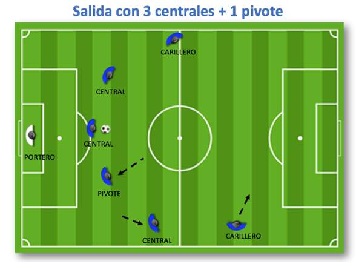

**Source** : Auteurs.

- balle

**Départ à 3 joueurs**

Le départ à trois de l’arrière est très bon car on modifie la pression de l’adversaire. Même s’ils vous pressent à deux (un attaquant et un milieu de terrain), quand vous sortez à trois, vous les obligez à se mettre en parallèle, en 4-4-2, puis vous les dépassez. (Guardiola cité dans Marsuian, 2017, https://bit.ly/3hLK4OF)

Le **début pur avec 3 joueurs** est typique des systèmes de jeu où il y a 3 défenseurs centraux (1-5-3-2, 1-5-4-1 ou 1-3-4-3), et, par conséquent, ils ont déjà dans ce domaine une supériorité numérique contre une équipe qui, par exemple, saute sur la pression avec deux attaquants.

Une variante est l’incorporation de l’un des arrières latéraux à la hauteur des défenseurs centraux (c’est pourquoi il est toujours pur), ce qui provoque une inclinaison de la ligne, car il permet à l’arrière latéral du côté opposé d’être plus haut.

**Graphique 5. Sorties à 3 joueurs**

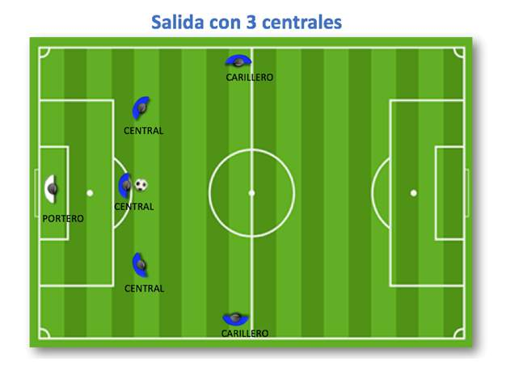

**Source** : Auteurs.

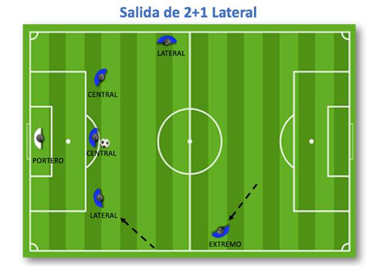

**Source** : Auteurs.

Le **départ mixte à 3 joueurs **permet d’incorporer un milieu de terrain à la ligne défensive et, ainsi, une supériorité est obtenue, notamment numériquement dans la sortie de balle.

La plus utilisée, également connue sous le nom de « sortie lavolpienne », car elle a été conçue par l’entraîneur argentin Ricardo La Volpe, prévoit que les défenseurs centraux s’ouvrent et que le milieu de terrain soit placé entre eux, tandis que les arrières latéraux avancent leur position en largeur et obligent les ailiers à agir davantage à l’intérieur (il est utilisé par des équipes comme le FC Barcelone ou le Bayern Munich de Guardiola).

Une variante permet la latéralisation de l’un des milieux de terrain vers la ligne défensive et oblige l’arrière latéral de la voie adjacente à se positionner plus en avant (une variante souvent utilisée dans le Borussia Dortmund de Tuchel ou le Séville de Lopetegui).

**Graphique 6. Sorties mixtes à 3 joueurs**

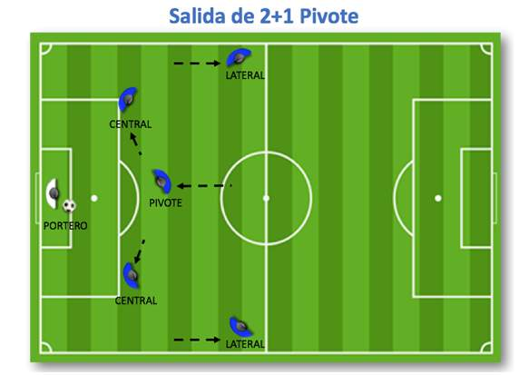

**Source** : Auteurs.

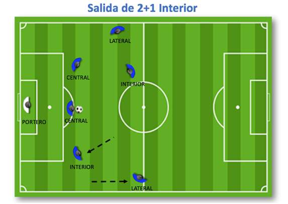

**Source** : Auteurs.

Toutes ces variantes sont appliquées par l’entraîneur en fonction des caractéristiques spécifiques de ses joueurs dans cette phase du jeu (elles peuvent dépendre, par exemple, de la capacité ou de l’incapacité des défenseurs centraux à filtrer les bonnes passes à l’intérieur) et en fonction de l’intention que l’entraîneur se fixe de sortir de l’arrière (par exemple sortir court ou sauter directement les lignes).

- balle

**Commençant avec 2 joueurs**

Il s’agit plutôt d’une situation spécifique, car cela présuppose soit que l’équipe adverse soit dans un bloc bas, soit qu’elle presse avec un seul attaquant et, par conséquent, n’oblige pas l’équipe en possession du ballon à utiliser d’autres joueurs pour donner la supériorité. Personnellement, je pense que cette sortie consiste plutôt en une variante du départ à 4, où les arrières latéraux auront des positions plus avancées, avec l’intention de progresser plutôt que de soutenir les défenseurs centraux au début, et où le pivot peut être positionné plus en avant que les défenseurs centraux pour soutenir la progression plutôt que de rejoindre la ligne.

- balle

**Zone A-B (coup de pied de but)**

Après le récent changement de règle, de nombreuses équipes ont profité des nouvelles règles pour avoir des avantages lorsqu’il s’agit de sortir le ballon de l’arrière.

Comme nous l’avons déjà mentionné, l’équipe qui a le ballon, parce qu’elle a la possibilité de placer ses joueurs à l’intérieur de la surface, a plus d’espaces à sa disposition. En effet, les adversaires ne pourront pas entrer dans la zone tant que le ballon n’aura pas clairement bougé.

Par conséquent, l’équipe qui défend le service aura plus d’espaces à défendre, ce qui est un avantage certain pour l’équipe en possession lorsqu’il s’agit de sortir de manière combinative.

En fonction de leurs schémas initiaux, l’équipe en possession du ballon pourra placer différents joueurs dans sa surface, dont l’objectif principal sera d’attirer les adversaires et peut-être de générer de l’espace entre les lignes ou sur les côtés, en fonction de la manière dont les adversaires sautent sous la pression.

La variante la plus couramment utilisée, en particulier par les équipes alignées avec une ligne défensive à 4, consiste à déposer les deux défenseurs centraux à côté du gardien de but juste à l’extérieur de la petite zone pour offrir au gardien de but une première solution plus confortable avec une ligne de passe courte.

Le soutien d’un ou plusieurs joueurs (généralement des pivots ou des initiés) peut être prévu, qui peuvent entrer pour générer de la supériorité et attirer encore plus d’adversaires, et générer des espaces dans des zones plus éloignées.

**Graphique 7. Tir au but avec 2 joueurs dans la surface et gardien de but (FC Barcelone)**

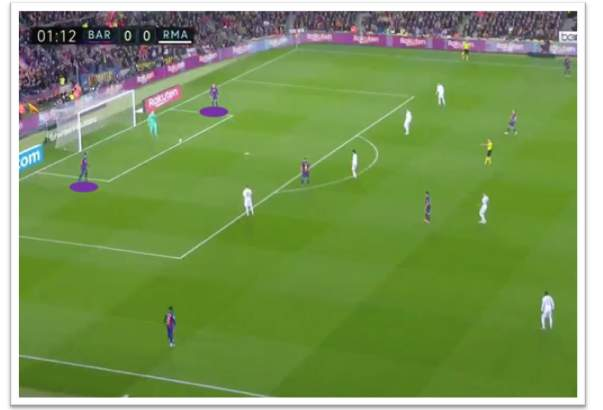

**Source** : Capture d’écran Wyscout avec sa propre adaptation.

Vous pouvez soit inclure encore plus de joueurs pour « remplir la sortie », soit les disposer à différentes hauteurs à l’intérieur de la zone pour ensuite provoquer des décalages dans la structure de l’adversaire, qui saute pour presser, et les forcer à défendre plus d’espace.

Il sera crucial d’identifier ce qu’ils accomplissent dans un certain endroit (où nous générons des espaces et avec qui nous en profitons).

Même pour les équipes qui sont dans une ligne de 3 défenseurs, une solution plus pratique peut être d’abaisser deux défenseurs centraux à côté du gardien de but pendant que le troisième est à l’extérieur de la surface ; De cette façon, nous faisons avancer les milieux de terrain centraux.

**Graphique 8. Sortie de but avec 4 joueurs dans la surface plus gardien de but (Inter Milan)**

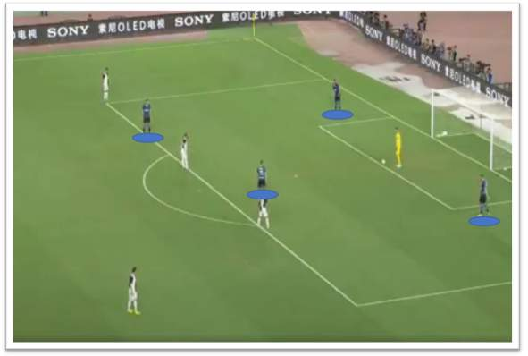

**Source** : Capture d’écran Wyscout avec sa propre adaptation.

- - 
  - 

balle

**Zone C-D**

Comme nous l’avons expliqué ci-dessus, les joueurs situés sur le terrain de l’adversaire pendant la phase initiale (principalement les attaquants, les milieux de terrain et les ailiers) ont généralement deux objectifs principaux :

- générer des espaces dans les zones proches du ballon (empêchant ainsi la participation des adversaires au jeu), en fixant et en attirant la ligne défensive de l’adversaire ; et

- Être les receveurs directs ou indirects du ballon (au cas où il est décidé de jouer long).

Il faut comprendre que ce sont ces joueurs qui permettent et facilitent une sortie correcte du ballon, quelles que soient leurs dynamiques successives.

En fonction du nombre (que ce soit avec 3 ou 2 attaquants), les joueurs pourront se positionner par rapport aux adversaires de la ligne défensive (plus ouvert ou fermé, en homme ou dans les intervalles) pour générer une sorte d’avantage qui permet à leurs coéquipiers et à eux-mêmes de générer des possibilités de progression vers le but.

L’identification de cet emplacement (en largeur et en profondeur) et ce qu’ils permettent d’obtenir avec cet arrangement sera essentielle pour comprendre le fonctionnement global de l’équipement et ses performances.

Il y aura toujours trois possibilités d’action : jouer directement long, jouer indirectement long ou jouer court. Dans le cadre de ces possibilités, comme nous le verrons dans le module suivant, il existe de nombreuses variantes et alternatives.

Cependant, la structure, en elle-même, surtout si l’on prend comme référence les joueurs les plus éloignés du ballon, peut nous donner beaucoup d’informations sur les intentions de l’équipe qui veut partir et les espaces qu’elle veut générer.

**Graphique 9. Positions des attaquants et des ailiers par rapport à la ligne défensive**

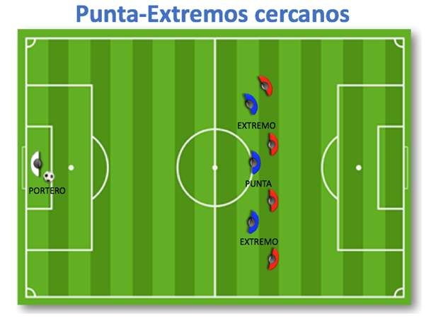

**Source** : Auteurs.

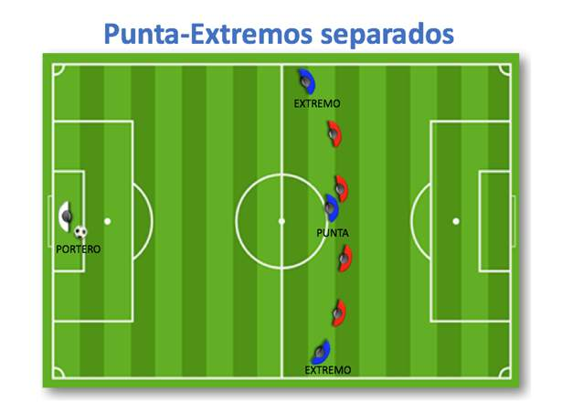

**Source** : Auteurs.

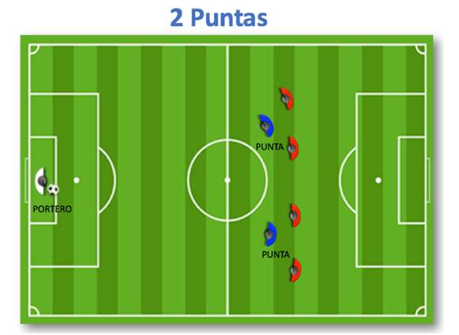

**Source** : Auteurs.

Il est possible de tenir compte du fait que, par rapport au plan de jeu, il peut également être nécessaire d’incorporer des joueurs d’autres lignes pour définir les adversaires et générer d’éventuels 2v1.

**Graphique 10. Différents mouvements en fonction de la position de départ de l’attaquant**

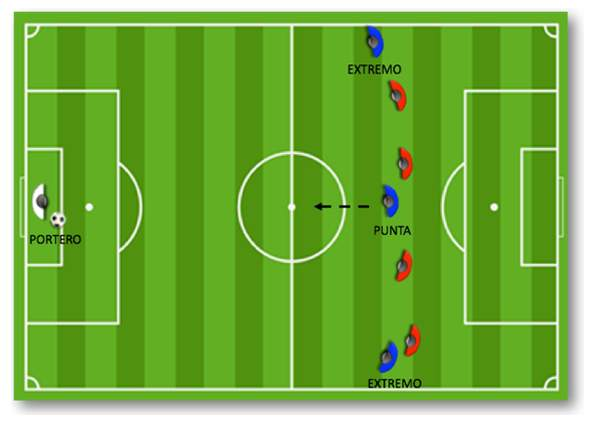

**Source** : Auteurs.

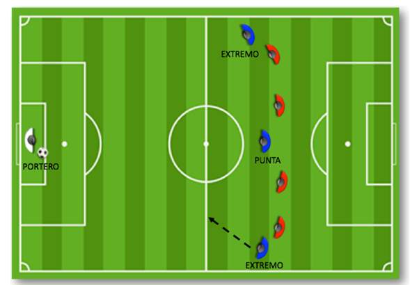

**Source** : Auteurs.

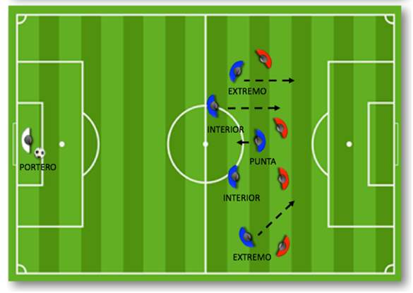

**Source** : Auteurs.

Bien sûr, de tels comportements seront toujours coordonnés avec les collègues les plus proches et les plus éloignés, dans le seul but de générer les espaces dont nous voulons profiter.

Dans la figure ci-dessous, nous pouvons voir deux des nombreuses options possibles pour générer des espaces entre les lignes, en raison de la relation entre les avants et les intérieurs.

Dans la première option, ce sont les milieux de terrain qui s’approchent du gardien de but pour attirer les adversaires qui les poursuivent, tandis que les attaquants vont profiter de l’espace généré pour recevoir directement le ballon (une option largement utilisée par le FC Barcelone de Valverde). Dans la deuxième option, en revanche, ce seront les attaquants qui vont « pousser » la ligne défensive de l’adversaire pour permettre aux intérieurs d’occuper l’espace créé et éventuellement de gagner des deuxièmes ballons.

Ce sont deux options que nous pouvons prendre en considération et qui dépendront de l’étude et de l’analyse des forces et des faiblesses de l’adversaire par rapport aux caractéristiques de nos joueurs.

**Graphique 11. Épingler pour créer des espaces**

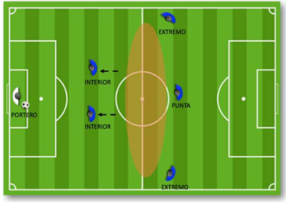

**Source** : Auteurs.

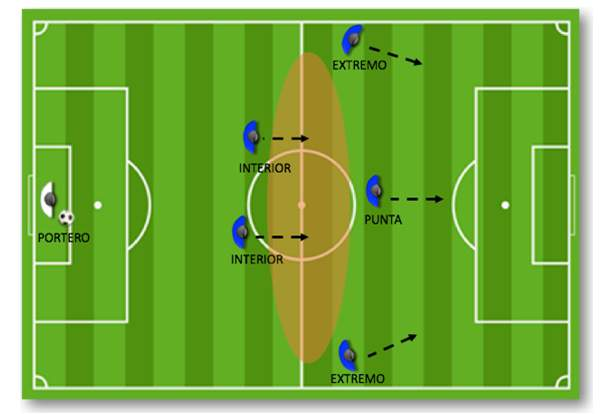

**Source** : Auteurs.

Par exemple, contre une défense à 3 joueurs, nous pouvons utiliser comme stratégie pour laisser tomber les joueurs dans les deux premières lignes beaucoup pour faire de la place au 3v3 à l’avant, et placer les attaquants en fonction des caractéristiques des défenseurs adverses, tout en cherchant à profiter de cette situation avec une passe directe (De la Fuente 2019, formation interne du club).

**Sous-structures par rapport aux rails**

- balle

**VOIES CENTRALES**

Le nombre et la position des joueurs situés dans les couloirs centraux dépendront de différents facteurs, tels que le système de jeu et les modifications qui seront apportées par rapport à la structure de l’adversaire. Cependant, il sera conseillé d’avoir au moins le même nombre de joueurs que les adversaires pour favoriser l’apparition de couloirs de passe ou une égalité numérique qui permet de récupérer le ballon en cas de perte.

L’obtention d’une quelconque supériorité (notamment numérique ou positionnelle) dépendra des mouvements ou des modifications structurelles spécifiques à chaque situation au cours d’un match.

**Graphique 12. Mouvement des intérieurs pour « vider » les couloirs centraux et générer de l’espace pour l’attaquant qui tombe pour recevoir**

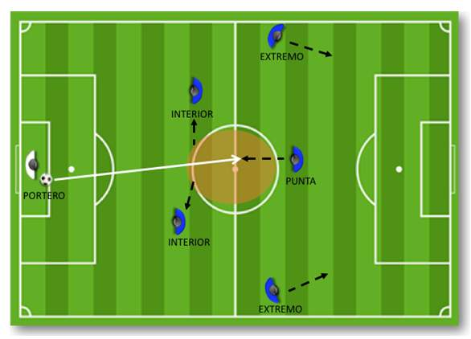

**Source** : Auteurs.

Se placer à différentes hauteurs nous donnera clairement des options pour progresser, car cela nous donnera différentes alternatives de passes qui obligeront l’équipe en défense à changer sa structure.

- - 
  - 
  - 
  - 
  - 
  - 
  - 

balle

**VOIES LATÉRALES**

Placer les joueurs en amplitude nous permet de faire ce qui suit :

- générer des espaces et des intervalles dans la structure de l’adversaire ;

- forcer les adversaires à couvrir plus d’espace pour défendre ;

- générer des intervalles (supériorités) à l’intérieur ; et

- d’avoir une option de continuité dans la possession.

Identifier comment et avec qui une équipe parvient à obtenir de la largeur sera important lors de l’obtention d’informations qualitatives, car cela nous permettra indirectement de connaître le nombre de joueurs situés à l’intérieur.

Comme on peut le voir sur les images suivantes, je propose un exemple des différentes façons dont on peut occuper les couloirs (référence 1-4-3-3 par rapport aux démarcations des latéraux-arrières-ailiers) :

- occuper les voies uniquement avec les côtés (les deux extrémités sont situées à l’intérieur) ;

- occuper une voie avec un joueur et l’autre avec deux ; et

- Occupez les deux voies avec deux joueurs.

**Graphique 13. Occupation des voies latérales par les côtés et les extrémités**

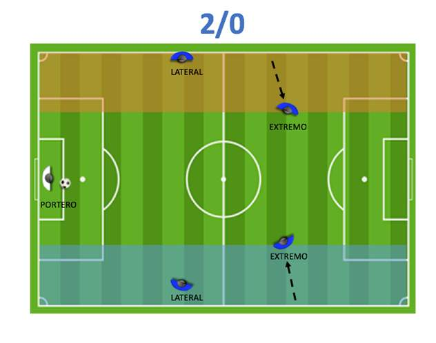

**Source** : Auteurs.

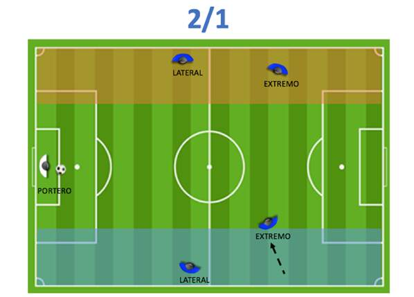

**Source** : Auteurs.

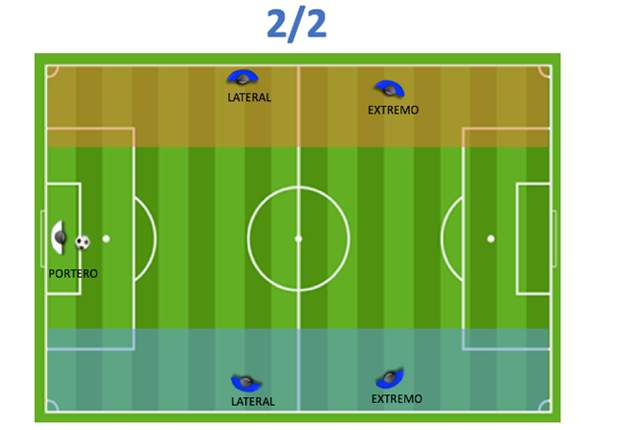

**Source** : Auteurs.

Nous pouvons utiliser ce filtre pour n’importe quel système de jeu, pas seulement pour ces deux démarcations (bien que ce soient celles qui occupent de préférence ces places sur le terrain). Il est également possible d’occuper les voies latérales avec d’autres joueurs en fonction de la situation dans laquelle nous nous trouvons et des objectifs que nous voulons atteindre.

**Structure générale de l’équipe de rétablissement**

Les mêmes paramètres qui nous permettent d’analyser les structures et la disposition de l’équipe en possession du ballon seront également importants pour identifier les structures de l’équipe qui défend la phase initiale de l’adversaire, car elle s’opposera à leur structure, qui, en soi, affectera celle de l’adversaire et sa dynamique ultérieure.

Il sera toujours important d’évaluer chaque situation en fonction du type de système défensif adopté et de la hauteur de la pression.

Généralement, le premier paramètre pris en compte est la hauteur du bloc, qui peut être l’une des options suivantes :

- balle

Dans un bloc haut : une équipe presse dans la zone A de l’adversaire, en plaçant la ligne défensive à la hauteur du milieu de terrain et tente de récupérer lors de la première circulation du ballon.

- balle

Dans le bloc central : l’équipe commence à presser dans la zone B de l’adversaire ou dans sa propre moitié de terrain, en privilégiant la défense des espaces derrière elle et en laissant la première passe au départ.

- balle

En bloc bas : l’équipe adverse préfère se positionner complètement (ou la plupart de ses joueurs) dans sa propre moitié de terrain et ferme au maximum ses espaces entre les lignes.

Au sein de chacun de ces scénarios, nous pouvons identifier directement combien de joueurs occupent des zones et des voies ainsi que la conformation qu’ils adopteront préférentiellement. En fonction de la hauteur du bloc, nous pourrons identifier les espaces dynamiques entre les différentes lignes de l’équipe en défense.

Par exemple, dans la figure suivante, nous pouvons voir comment l’équipe qui défend ne positionne aucun joueur dans la zone A de l’adversaire (sa zone D) et laisse la sortie courte aux défenseurs centraux pour donner la priorité à la défense des espaces entre les lignes. Il présente donc un bloc moyen en ligne et très compact, qui initiera sûrement la pression lorsque l’équipe adverse essaiera de jouer à l’intérieur ou à l’extérieur.

**Graphique 14. Sous-structures par zones (équipements en récupération)**

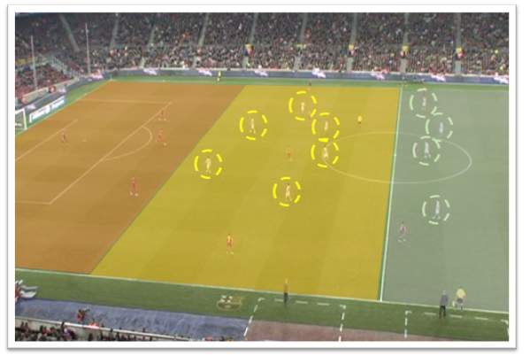

**Source** : Auteurs.

Le même filtre peut être utilisé pour identifier l’emplacement de l’équipement par rapport à l’amplitude et, par conséquent, aux rails. De plus, comme nous pouvons le voir, la même équipe a la plupart de ses joueurs situés dans les couloirs centraux et un seul, l’arrière droit, légèrement plus ouvert. Dans ce cas, nous pouvons conclure que l’intention de l’équipe sera de défendre les espaces centraux et de laisser la possibilité à l’adversaire de sortir, et à partir de là de commencer la pression éventuelle.

**Graphique 15. Sous-structures à base de rails (équipements en récupération)**

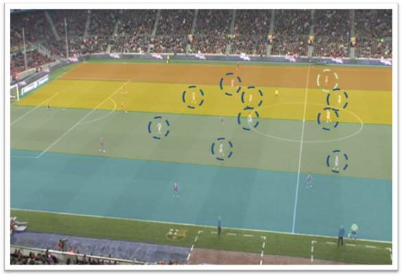

**Source** : Auteurs.

Ci-dessous, je présente des exemples de différentes méthodes utilisées pour faire face à une équipe pendant la phase initiale, divisée par **des lignes de pression**.

**Joueurs de 1. Ligne RA en bloc haut-moyen**

1.  **Appuyez avec 1 pointe**

> **→ Solution possible :** des défenseurs centraux ouverts qui peuvent progresser en conduite.

**Graphique 16. Pression à 1 pointe**

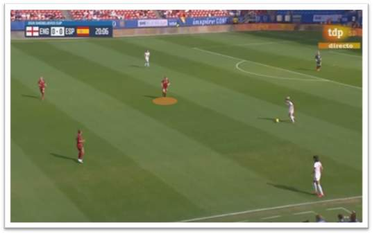

**Source** : Capture d’écran Wyscout avec sa propre adaptation.

2. **Appuyez avec 2 pointes (ou 1 pointe + 1 à l’intérieur)**

> **→ Solution possible :** ligne de 3 avec pivot situé entre les défenseurs centraux ou derrière les sauteurs, latéralisé intérieur, latéral inférieur dans l’alignement des défenseurs centraux.

**Graphique 17. Pression en 2 points**

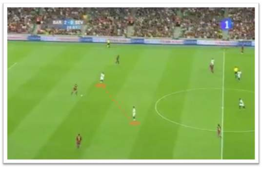

**Source** : Capture d’écran Wyscout avec sa propre adaptation.

3. **Appuyez avec 3 pointes (ou 2 pointes + 1 demi-pointe)**

> **→ Solution possible :** option de jeu direct vers 2 joueurs. A-3. Ligne.

**Graphique 18. Pression en 3 points**

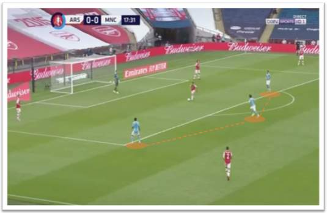

**Source** : Capture d’écran Wyscout avec sa propre adaptation.

**Graphique 19. Pression avec 2 attaquants + 1 milieu de terrain**

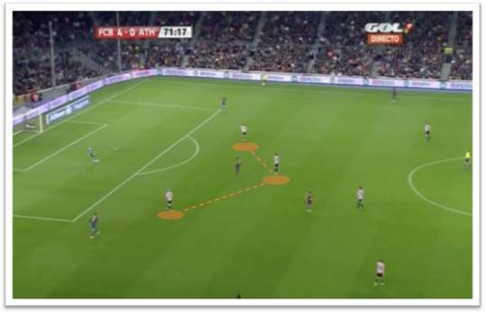

**Source** : Capture d’écran Wyscout avec sa propre adaptation.

**Joueurs de 1. Bloc bas de la ligne RA**

1. **Appuyez avec 1 pointe**

**→ Solution possible : **conduire rapidement avec les deux défenseurs centraux.

2. **Appuyez avec 2 pointes**

> **→ Solution possible : **ligne de 3 avec pivot situé entre les défenseurs centraux ou derrière les sauteurs, intérieur latéralisé.

De nombreuses équipes appliqueront différentes variantes au démarrage de la presse. Cela signifie que, malgré leur structure initiale, une fois que la balle se déplace, ils peuvent (ou non) modifier cette structure. Un exemple clair est une équipe qui presse en 1-4-3-3, où l’attaquant saute sur un défenseur central, tandis que lorsqu’il saute sur l’autre, il sera à l’intérieur (les ailiers attendant de sauter sur les arrières latéraux), ce qui, en fait, modifiera leur structure en 1-4-4-2.

Nous pouvons également attirer <u>l’attention sur les joueurs de 2. Pour aligner</u> et identifier les éléments suivants :

- balle

le nombre (2, 3 ou 4),

- balle

leurs structures (en ligne ou en losange),

- balle

leurs appariements (to zone, to man),

- balle

s’ils ont divisé le bloc ou non, et

- balle

d’éventuelles asymétries vers une voie.

Par exemple, dans la figure 20, nous pouvons voir comment la disposition en losange au milieu de l’équipe défendant le service rend pratiquement impossible pour l’adversaire de trouver directement ses joueurs intérieurs. Pour cette raison, il sera important pour l’équipe en possession du ballon de générer de la supériorité dans les couloirs latéraux.

**Graphique 20. Disposition en losange (4 joueurs sur les voies du milieu)**

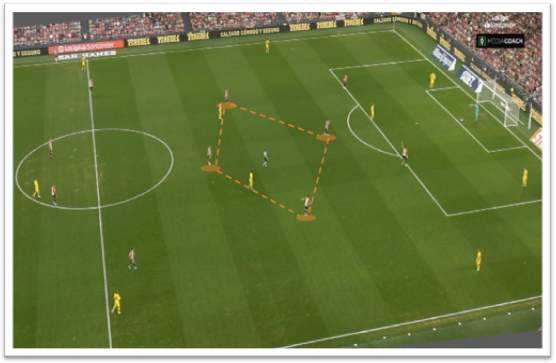

**Source** : Capture d’écran Mediacoach avec sa propre adaptation.

**Graphique 21. Disposition en ligne (3+1 joueurs) + bloc partagé**

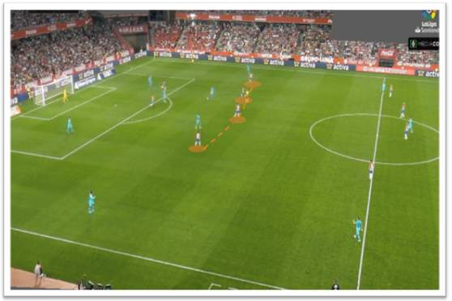

**Source** : Capture d’écran Mediacoach avec sa propre adaptation.

**Graphique 22. Disposition en défense, coup de pied de but (identifier les distances et les paires)**

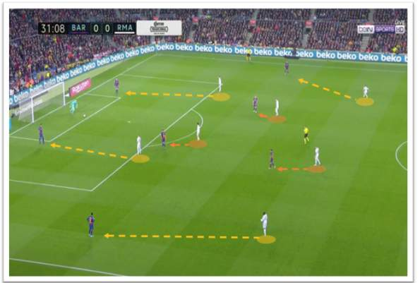

**Source** : Capture d’écran Wyscout avec sa propre adaptation.

Pour <u>3 joueurs. Dans la ligne défensive</u>, il sera important d’identifier des facteurs tels que les suivants :

- balle

le numéro,

- balle

hauteur (et distance par rapport aux autres lignes),

- balle

la distance entre les joueurs sur la même ligne, et

- balle

Jumelages.

L’absence de hors-jeu dans le coup de pied de but sera un autre facteur que nous devrons prendre en considération pour comprendre le comportement de ceux qui sont à l’extérieur.

**Graphique 23. Mise en page en ligne avec 4 joueurs**

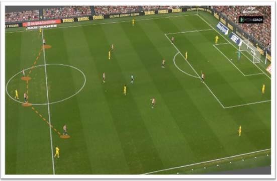

**Source** : Capture d’écran Mediacoach avec sa propre adaptation.

**Graphique 24. Mise en page en ligne avec 3 joueurs ouverts**

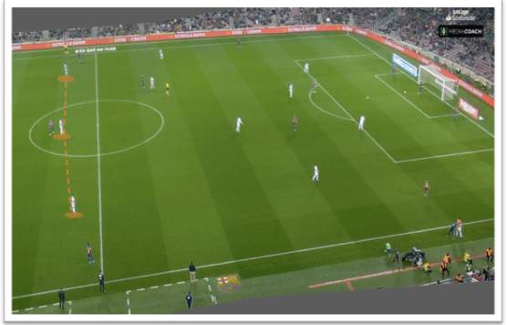

**Source** : Capture d’écran Mediacoach avec sa propre adaptation.

**Graphique 25. Mise en page en ligne avec 3 joueurs fermés**

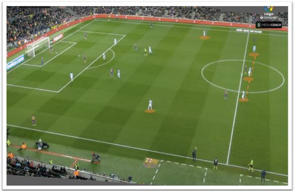

**Source** : Capture d’écran Mediacoach avec sa propre adaptation.

De même, il faudra observer la position éventuelle des joueurs sous surveillance en cas de coups de pied arrêtés tels que des corners ou des fautes, et identifier les éléments suivants

- balle

combien de joueurs laissent encore plus de traces,

- balle

l’endroit où ils se trouvent ;

- balle

Qui êtes vous.

De cette façon, nous pouvons identifier les avantages possibles lors du redémarrage du jeu et décider si nous allons jouer directement long.

De toutes les informations présentées, nous pouvons conclure que les équipes adoptent différents types de pression contre le départ de l’adversaire, et vice versa. De cette façon, ils occupent le terrain de jeu de différentes manières et obligent donc les adversaires à choisir des comportements différents ou à adopter certaines structures au lieu d’autres.

**Comparaison des deux structures générales**

Une fois que nous aurons acquis les connaissances nécessaires sur les structures des deux équipes, nous serons en mesure de superposer les deux et à partir de là d’obtenir d’autres informations qui nous aideront à identifier des zones, des espaces et des avantages possibles.

En particulier, nous nous concentrerons sur les informations suivantes :

- balle

le nombre de joueurs des deux équipes dans la zone A et la zone B (milieu de terrain) ;

- balle

le nombre de joueurs des deux équipes ci-dessus ;

- balle

distances des joueurs en intermédiaire (supériorités numériques et positionnelles) ; et

- balle

appariements (supériorité qualitative).

**Graphique 26. Chevauchement des structures des deux équipes dans les tirs au but**

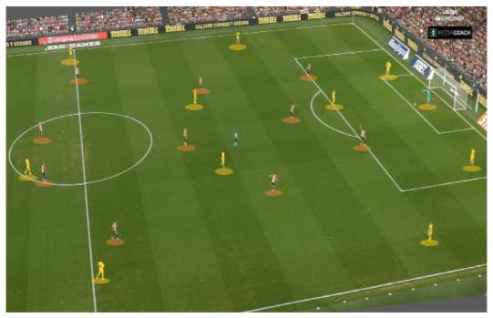

**Source :** Capture d’écran Mediacoach avec sa propre adaptation.

Compter combien de joueurs des deux équipes se trouvent dans les deux moitiés du terrain nous permet de connaître la possibilité, ou l’absence de possibilité, de jouer dans sa propre moitié de terrain ou directement dans la moitié de terrain de l’adversaire.

Une indication donnée au gardien de but lorsqu’il sort le ballon de sa surface est de faire particulièrement attention aux **joueurs éloignés** (il doit regarder de loin) :

**Si vous constatez une situation d’infériorité numérique**

\+

**Graphique 27. Situation à 8 contre 6 dans leur propre moitié de terrain (infériorité à l’avant)**

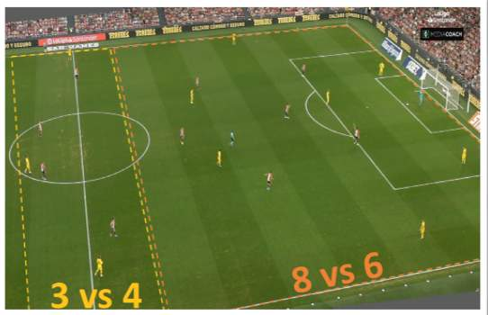

**Source : **Capture d’écran Mediacoach avec sa propre adaptation.

En fonction de la conformation des deux structures, vous pouvez trouver une supériorité numérique à différents endroits, ce qui vous indiquera où jouer directement :

- balle

**Jouer dans la zone A** (1ère ligne) si nous avons la supériorité avec le début de 2 ou 3

→ Avec défenseurs centraux

> → Avec des joueurs qui rejoignent la ligne des défenseurs centraux (pivot, intérieur, arrières latéraux)

**Graphique 28. Quelques possibilités de jeu avec 1. Ligne RA**

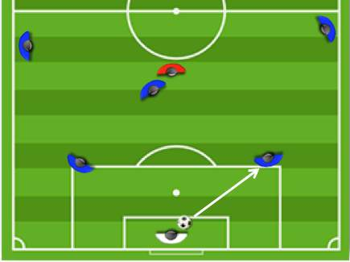

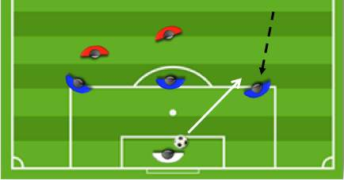

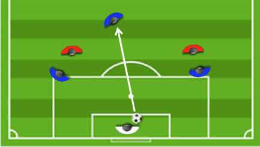

**Source : **Auteurs.

- balle

**Jouer dans la zone B** (2ème sur la ligne) si nous sommes alignés par le début de 3 dans la zone A

→ Intérieurs entre les lignes

> → Côtés larges

**Graphique 29. Quelques possibilités de jeu à 2. à la ligne**

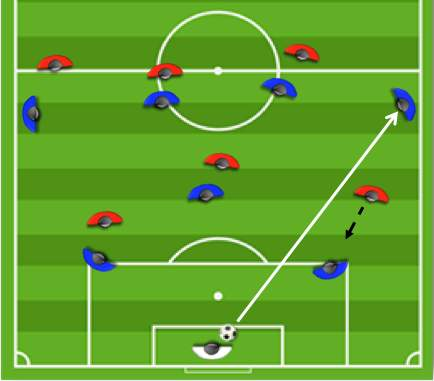

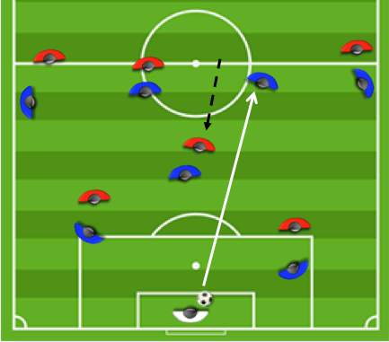

**Source** : Auteurs.

**En situation de parité numérique**

\+

**Graphique 30. Situation 8 contre 7 dans leur propre moitié de terrain (égalité en hausse)**

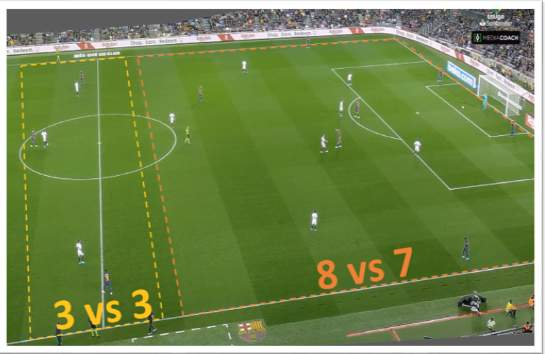

**Source : **Capture d’écran Mediacoach avec sa propre adaptation.

Des questions telles que les capacités physiques, les mouvements précédents et la prochaine intention de jouer seront l’un des principaux facteurs qui influenceront la décision que le gardien de but prendra de jouer directement avec les attaquants et à distance.

**Graphique 31. Quelques possibilités de jouer avec 3. Ligne RA**

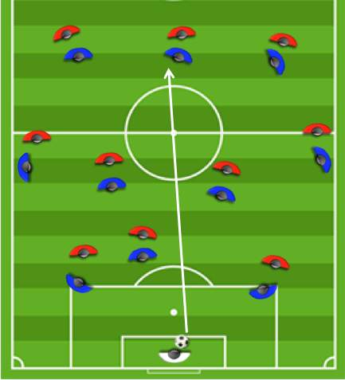

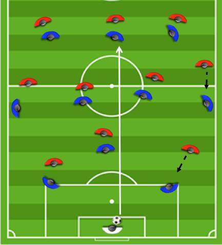

**Source : **Auteurs.

La position et la distance que les joueurs auront de 2. La ligne la plus éloignée sera essentielle lorsqu’il s’agira de comprendre les possibilités de profiter de l’avantage numérique et de ne pas perdre la possession, car ils doivent être prêts à pouvoir récupérer d’éventuels deuxièmes ballons.

Un autre facteur qui doit être pris en considération est la **distance de la relation** et, par conséquent, l’apparition des **joueurs dans les intermédiaires**.

En termes structurels (sans tenir compte des mouvements pour le moment), la coïncidence des deux structures nous donnera certaines distances entre les marques, ce qui générera des endroits où la supériorité (densité) ou l’infériorité apparaissent.

Identifier les zones où il y a moins d’adversaires en infériorité (intermédiaire) nous permettra de trouver plus facilement des solutions pour progresser et obligera les rivaux à changer de structure.

**Graphique 32. Identification des joueurs rivaux en intermédiaire (infériorité)**

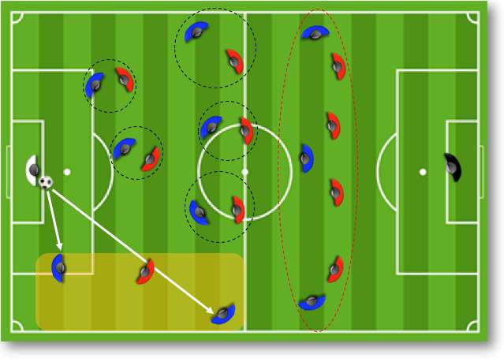
