# Module 3. Etude des éléments dynamiques dans la phase initiale

**  
Unité 3.1**

*Bloc 1 de 3*

Dans le module précédent, nous avons analysé comment, à travers les structures, les intentions, les possibilités et les avantages peuvent être identifiés dans la phase initiale, avant que la balle ne roule. Une fois la balle déplacée, ces structures vont modifier leurs formes et leurs organisations pour s’adapter à la nouvelle situation dans laquelle se trouve la balle (notre première référence).

Le football est une succession constante de situations complexes et dynamiques, car ces mouvements provoqueront sûrement des espaces momentanés (ils apparaissent et disparaissent continuellement) dont nous devons profiter pour pouvoir en ressortir efficacement.

Face à des problèmes vastes et complexes, ce seront souvent des solutions simples qui nous offriront une clé pour comprendre les comportements des équipes. Parfois, c’est une question de mètres ou d’une passe trop lente ou trop rapide qui provoquera un changement soudain de toute l’organisation d’une équipe, et cela s’applique également pendant la phase initiale, le moment du jeu où les possibilités de progression vers la moitié de terrain de l’adversaire sont préparées et générées.

**Comment pouvons-nous nous rapporter les uns aux autres dans un environnement aussi complexe et changeant ?**

Dans tout système complexe, il y a toujours un équilibre entre le chaos et l’ordre, l’aléatoire et la structure. Identifier les facteurs du jeu qui nous donnent de l’ordre et qui nous permettent de nous rapporter à l’environnement, de nous adapter constamment, sera un aspect fondamental lors de l’analyse de notre équipement, car ce seront les informations qui seront vraiment importantes.

Cela dit, nous allons essayer de vous enseigner certains des outils généraux que les joueurs peuvent utiliser pour établir des relations les uns avec les autres, ce qui affecte la dynamique du jeu. Par conséquent, nous analyserons leur impact sur les changements structurels des deux équipes, en identifiant comment elles créent les avantages qui leur permettent de progresser vers le terrain de l’adversaire dans les meilleures conditions. On peut les voir comme des moyens qui permettent à la circulation de ne pas être une simple succession de passes, mais qu’il y a un but précis d’organiser l’équipe en possession et de désorganiser l’équipe rivale pour progresser.

***« Un tout produit des qualités qui n’existent pas dans les parties séparées.***

***Le tout n’est jamais seulement l’addition des parties. C’est autre chose » (Morin, 1998)***

**Éléments dynamiques**

***« La capacité d’une équipe à s’auto-organiser détermine sa possibilité d’être ou de ne pas dominer le jeu » (F. Seirul-lo Vargas, 2017, communication personnelle).***

*Par éléments dynamiques*, nous nous référons à tous ces modèles d’interrelations entre deux ou plusieurs joueurs (également appelés *critères de façonnage*) qui influencent continuellement la dynamique du jeu et contribuent à l’apparition d’avantages ou de supérioribilités, qui seront les situations qui permettront de progresser sur le terrain de l’adversaire pour créer des occasions de but dans les meilleures conditions spatio-temporelles possibles.

Ils peuvent être utilisés comme éléments d’observation du jeu qui vous permettent d’évaluer comment une équipe atteint un certain objectif de jeu.

Lorsque les équipes sont en possession du ballon, des mouvements et des actions collectifs et individuels seront provoqués qui génèrent de la largeur et de la profondeur, ce qui aura pour objectif clair l’utilisation et la création d’espaces qui seront attaqués et exploités pour vaincre l’adversaire et atteindre l’objectif d’atteindre le but de l’adversaire et de marquer. (Sánchez, 2015, p. 94).

L’interrelation de tous ces « outils » formera l’ADN de notre modèle de jeu, le langage proxémique ou non verbal, qui permettra aux joueurs d’une même équipe de communiquer entre eux et de tromper, par la même occasion, les adversaires. Ils remplissent le « sac à dos » avec les expériences et les capacités du joueur qu’il utilisera pour se rapporter à l’environnement dans lequel il joue.

L’ensemble des éléments qui favorisent ces interactions peut être défini comme faisant partie d’une *technique footballistique spécifique. *Francisco Seirul-lo Vargas les entend comme

La maîtrise des actions motrices qui nous aident à créer, exécuter et contrôler les mouvements et qui nous permettent d’être continuellement en relation avec l’environnement, à travers des réponses correctes et efficaces au fil du temps pour les différents besoins qui s’y présentent. (2017)

Ces éléments participent au développement de la capacité du joueur à interpréter personnellement chaque situation de jeu, mais aussi à la capacité des joueurs à communiquer entre eux de manière efficace et efficiente, par le biais d’interactions connues et prévisibles (intracommunication), et à se rapporter aux comportements opposés des adversaires, grâce aux mêmes interactions qui seront inattendues et inconnues des adversaires (intercommunication). De tels éléments, comme on l’a dit, sont toujours liés aux paramètres généraux de l’espace-temps et sont :

- balle

L’emplacement.

- balle

Les supports.

- balle

Les distances.

- balle

Les trajectoires (avec et sans le ballon).

- balle

L’instant (individuel et collectif, avec et sans ballon).

Par conséquent, leur identification sera importante pour extraire des informations sur les performances individuelles et collectives lors de la phase de démarrage d’une équipe. Nous approfondirons ensuite la façon d’utiliser ces ressources une par une, notamment lors de la phase d’initiation.

**L’emplacement**

***« Un joueur peut être bien positionné, mais mal placé » (J. Lillo, communication personnelle, 2016).***

La localisation s’entend de l’union de deux facteurs individuels :

- - 
  - 
  - 

balle

La *position*, entendue comme l’occupation d’une certaine place sur le terrain de jeu. *Où *se trouve un joueur :

- Dans la moitié de terrain de l’adversaire ou dans sa propre moitié.

- Dans la zone A-B-C-D.

- Dans les voies latérales ou centrales.

<!-- -->

- balle

Le *profil*, c’est-à-dire l’orientation du corps donnée à la position par rapport à l’espace, au ballon et aux autres joueurs (*comment *un joueur se sent). Il permet de voir et de percevoir plus ou moins d’espaces, ce qui influence directement la prise de décision du joueur et sa performance dans le contexte.

**Graphique 1. Influence de l’emplacement sur la dynamique de jeu suivante**

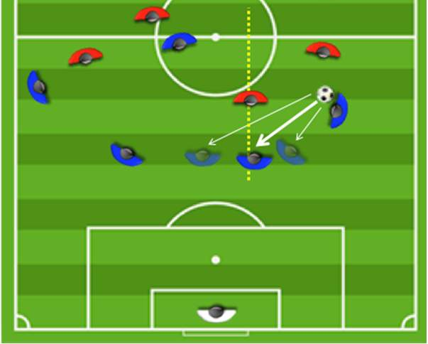

**Source** : Auteurs.

L’union de ces deux facteurs peut informer sur les intentions de chaque joueur d’influencer le jeu et sur ses chances de les atteindre, car cela est lié à la possibilité visuelle de pouvoir extraire des informations.

Par exemple, comme on peut le voir sur l’image ci-dessus, la position du défenseur central ou son profil corporel influenceront non seulement ses prochaines performances, mais aussi les performances successives de ses coéquipiers et rivaux. Il y a de fortes chances que, en fonction de leur emplacement précédent, ils puissent apparaître ou disparaître irrémédiablement, dès lors que la dynamique continue du jeu est toujours modifiée et que le scénario des possibilités d’action change.

Chaque joueur aura toujours différentes possibilités de connexion avec ses coéquipiers qui seront liées à leur emplacement sur le terrain. Par exemple, comme on peut le voir sur l’image suivante, l’emplacement d’un joueur dans les couloirs centraux (comme un défenseur central qui reçoit le ballon du gardien de but) favorisera les chances de se rapporter à ses coéquipiers dans les 4 directions spatiales du terrain, tandis qu’un joueur proche de la ligne de touche (un arrière latéral qui reçoit le ballon dans la largeur maximale) aura au moins une direction de coupe puis 3 occasions sur 4 pour établir des relations avec leurs pairs.

**Graphique 2. Directions possibles de la relation en fonction de la position**

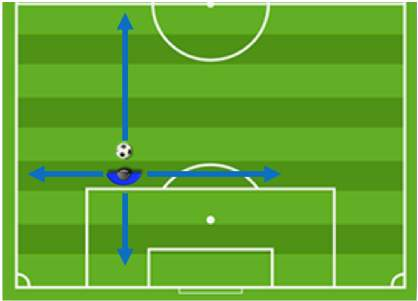

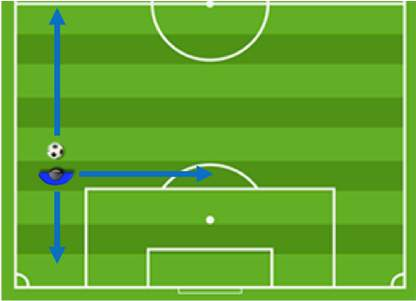

**Source** : Auteurs.

Pour cette raison, de nombreuses équipes qui défendent le ballon commencent à presser lorsqu’il atteint l’un des joueurs latéraux de l’équipe en possession, car elles veulent profiter des moins d’options relationnelles que le nouveau détenteur aura, en utilisant la ligne de touche comme un autre récupérateur.

De plus, identifier les trajectoires que les adversaires utilisent pour couper ces voies de connexion sera un autre aspect fondamental lorsqu’il s’agira de trouver des solutions alternatives pour pouvoir progresser ou continuer à conserver la possession pendant la phase initiale. Le profil lui-même sera un facteur très important lorsqu’il s’agira de pouvoir obtenir directement des informations et, par conséquent, d’agir d’une certaine manière.

Un emplacement correct (en fonction des objectifs) vous permettra d’obtenir beaucoup d’informations et d’exécuter l’action suivante au moment exact et de la meilleure façon, toujours en fonction des intentions précédentes. Il s’agit d’une* vision de jeu *appliquée dans les 3 moments de temps, c’est-à-dire : voir ce qui s’est passé avant de recevoir le ballon pour se préparer (avant), agir de la manière la plus correcte par rapport aux informations qui ont été obtenues de l’environnement (pendant) et ensuite continuer à chercher pour comprendre comment participer au jeu suivant (après).

Comme le montre l’image suivante, recevoir un ballon par derrière ne permettra guère à un joueur de poursuivre l’action de jeu suivante plus rapidement que s’il le reçoit face à la moitié de terrain de l’adversaire : les informations changent, le temps nécessaire pour tourner ou les comportements que l’on peut supposer, mais aussi la manière dont les adversaires peuvent agir, ce qui affectera les performances du joueur.

Voir l’ensemble du terrain ou la majeure partie de celui-ci est un avantage fondamental, car cela permettra au joueur de choisir facilement la meilleure option parmi les nombreuses qu’il voit.

De nombreuses équipes identifient généralement le début de leur pression lorsqu’un adversaire reçoit par derrière (concept de balle couverte), car la situation dans laquelle se trouve le possesseur ne lui permettra pas de jouer vers l’avant, du moins rapidement.

**Graphique 3. Le même profil affecte le visuel d’un joueur**

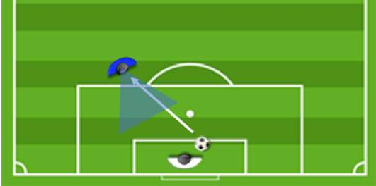

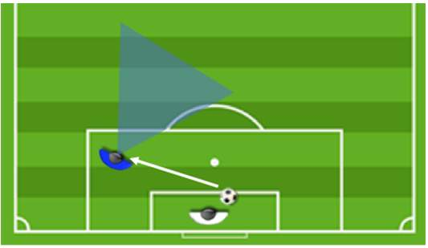

**Source** : Auteurs.

De toute évidence, il sera toujours plus facile pour le possesseur de jouer vers l’endroit où il est profilé et peut regarder, puisqu’il reçoit des informations sur son environnement. Dans le cas où il reçoit dos à lui, il serait plus sûr d’interagir avec un coéquipier qui est en meilleure condition que lui pour voir ce qui se passe dans la moitié de terrain de l’adversaire (concept de jouer face à face), il sera donc probablement en mesure de prendre de meilleures décisions.

Tenter une passe en profondeur ou en parallèle en tournant augmentera, en fonction de la situation dans laquelle se trouve le joueur, les chances de perdre la balle, ce qui favorisera la récupération de l’adversaire.

**Graphique 4. Choisissez les options de jeu les plus sûres en fonction de l’emplacement**

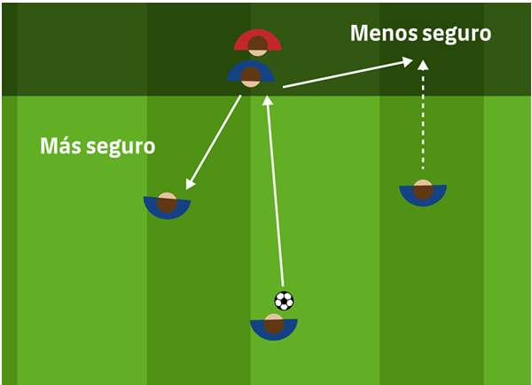

**Source** : Auteurs.

Par conséquent, il sera important de comprendre comment, grâce à sa localisation, un joueur peut influencer le jeu lorsqu’il s’agira d’obtenir des informations pertinentes lors de l’analyse de la phase initiale.

Nous n’oublions pas que nous pouvons appliquer le même principe pendant la phase de récupération : se positionner par rapport au possesseur rival et à ses possibilités de relation proche ou lointaine sera très important lorsqu’il s’agira de pouvoir réaliser la guérison.

**L’accompagnement**

**« Les supports permettent au coéquipier qui a le ballon d’aider » (J. Vilá, communication personnelle, 2017).**

Se déplacer et se positionner par rapport au ballon, aux coéquipiers et aux adversaires nous permet de générer des *itinéraires relationnels *que nous pouvons utiliser (ou non) en fonction de l’objectif spécifique que nous avons.

***« Le soutien crée quelque chose qui n’existe pas » (Seirul-lo Vargas, communication personnelle, 2017).***

La mobilité des joueurs permet de générer des alternatives de jeu qui n’existaient pas une demi-seconde auparavant, qui forment des espaces de relations (*espaces de phase*) qui fournissent au détenteur différentes solutions, parmi lesquelles il choisira celle qui sera la plus correcte pour lui à ce moment-là. Plus le détenteur aura d’options relationnelles et plus il sera facile de choisir la meilleure option pour progresser. Ils permettent au détenteur de se connecter directement avec le joueur qui offre le soutien ou de profiter de l’espace que le partenaire crée avec sa performance.

En général, les supports ont les fonctions suivantes :

- 1

1

Favoriser la réception éventuelle du ballon dans les meilleures conditions possibles.

- 2

2

Faciliter la prise de décision du titulaire.

- 3

3

Faciliter l’atteinte des objectifs de l’équipe en privilégiant les actions conjointes (dans les deux phases du jeu).

- 4

4

Entraver le comportement individuel et collectif de l’adversaire.

Différents types de supports apparaîtront alors, chacun d’entre eux ayant des effets différents sur la dynamique du jeu. Nous analyserons ceux qui apparaissent le plus par rapport à la phase initiale du jeu :

**Soutien à la progression**

–

Il permet à un ou plusieurs adversaires ou lignes de pression d’être directement surmontés par une passe (par exemple, le pivot reçoit derrière la ligne des deux attaquants rivaux).

**Graphique 5. Prise en charge de la progression du pivot**

**Source** : Auteurs.

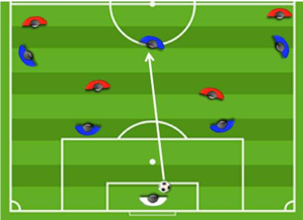

**Soutien à la continuité**

–

Il vous permet de maintenir la disposition du ballon et de déplacer la structure de l’adversaire, en générant des décalages pour pouvoir ensuite progresser (par exemple, passer d’un défenseur central à un autre défenseur central pour vaincre l’attaquant rival).

**Graphique 6. Soutien à la continuité de l’installation**

**Source** : Auteurs.

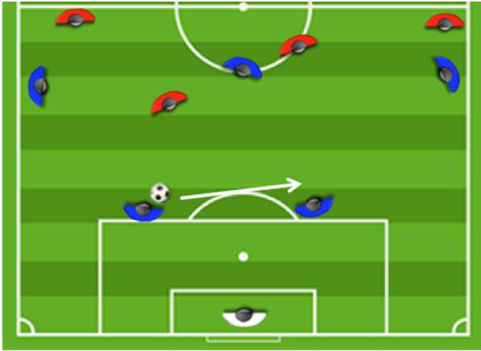

**Soutien d’urgence**

–

Une sortie facile est proposée au coéquipier sous pression ou avec difficulté, pour pouvoir maintenir la disponibilité du ballon (par exemple, le défenseur central propose une ligne de passe s’approchant du latéral latéral pressé par un ailier adverse).

**Graphique 7. Soutien d’urgence du défenseur central au défenseur latéral**

**Source** : Auteurs.

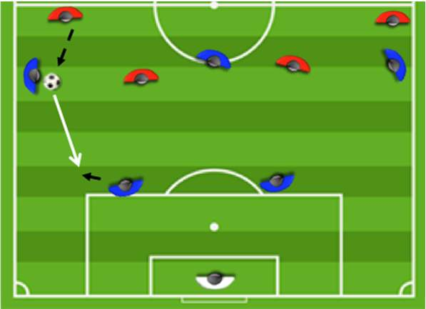

**Soutien à l’attraction**

–

Cela se produit lorsqu’un coéquipier se déplace pour attirer la marque d’un adversaire sur le ballon et générer d’autres lignes de passe pour le possesseur (par exemple, les intérieurs s’approchent du gardien de but pour générer des espaces de réception au milieu de terrain).

**Graphique 8. Soutien à l’attraction intérieure pour favoriser un accueil à la fine pointe de la technologie**

**Source** : Auteurs.

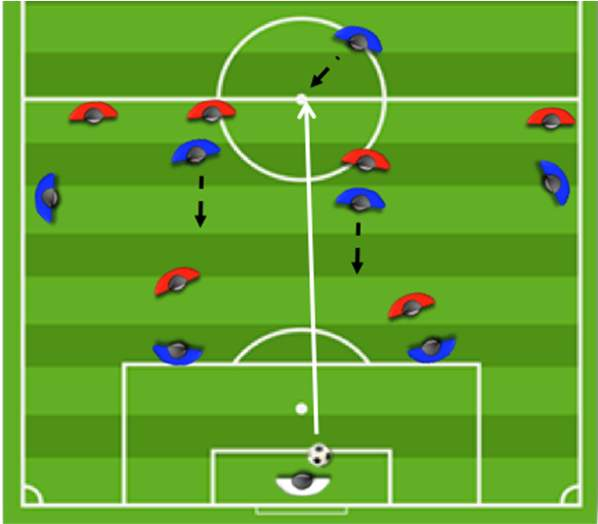

**Support d’attache**

–

Cela se produit lorsqu’un joueur, avec sa position ou son mouvement, éloigne les adversaires du ballon pour générer des espaces et favoriser l’action suivante du coéquipier qui reçoit (par exemple, un attaquant qui fixe les deux défenseurs centraux pour que l’intérieur reçoive entre les lignes).

**Graphique 9. Support de fixation de pointe pour favoriser une réception intérieure ou demi-point**

**Source** : Auteurs.

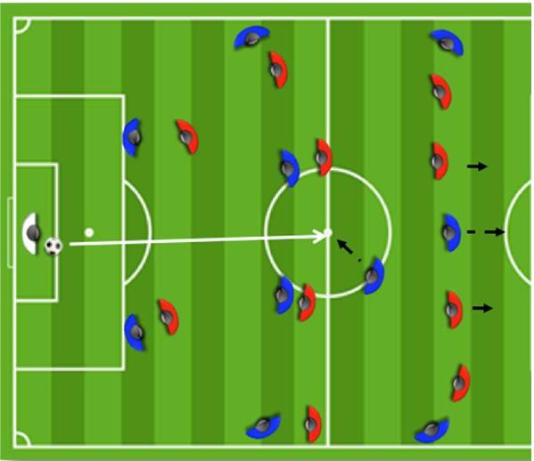

**Prise en charge de la serrure**

–

Lorsqu’un joueur, en raison de sa position ou parce qu’il accomplit une trajectoire précédente, gêne ou empêche l’adversaire d’intervenir sur le possesseur ou le receveur (par exemple, pivot qui coupe la trajectoire de l’attaquant qui saute au centre).

**Graphique 10. Support de blocage de pivot sur la pointe de l’adversaire**

**Source** : Auteurs.

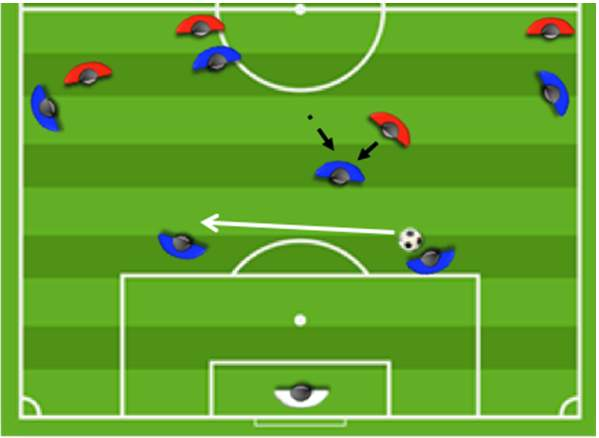

**Soutien du troisième homme**

–

Cela se produit lorsque le possesseur (premier homme) est en relation indirecte avec un coéquipier (troisième homme) qui a la ligne de passe bloquée par un adversaire, passant le ballon auparavant à un autre joueur (deuxième homme).

Peut-être:

- Direct (1er-2e-3e) : par exemple, le gardien de but passe le ballon au pivot, qui le décharge sur un défenseur central.

- Indirecte (1er-2e-1er-3e) : par exemple, le gardien répète la passe avec le défenseur central pour laisser le temps au pivot de se positionner derrière les deux attaquants.

**Graphique 11. Soutien du troisième homme (direct et indirect)**

**Source** : Auteurs.

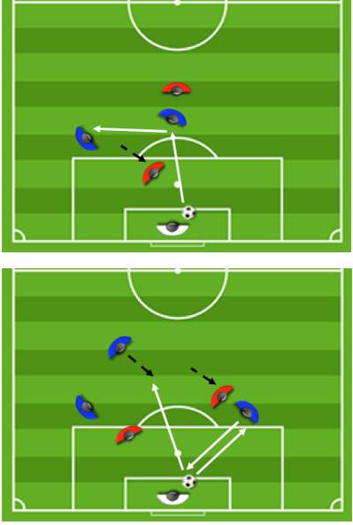

**Les distances**

Tous les paramètres spatiaux enseignés dans les modules précédents nous permettent d’identifier à quelle distance se trouvent les joueurs d’une même équipe et de l’équipe adverse les uns des autres (paires-intermédiaires) et par rapport au ballon à un moment donné.

Le mouvement ou la simple position changera constamment les événements de chaque situation et, par conséquent, ces *distances relationnelles *formeront de nouveaux espaces qui modifieront la situation de chaque joueur sur le terrain et lui offriront des rôles et des responsabilités différents en fonction de chaque moment.

Les distances nous permettent d’identifier :

- balle

si une équipe maintient habituellement sa structure ou non ;

- balle

les possibilités de connexion entre les joueurs d’une même équipe ;

- balle

les possibilités d’intervention que chaque joueur a sur un certain joueur rival ;

- balle

la capacité de chaque joueur à agir dans des conditions de proximité avec un adversaire.

Dans le module précédent, chaque pièce d’équipement était divisée en fonction des sous-structures qui ont été créées en fonction de zones (lignes) et de voies (axes). Désormais, l’organisation des équipes sera différenciée sur la base des distances dynamiques par rapport au ballon.  
Nous pouvons différencier les joueurs en deux groupes généraux :

- 1

1

Joueurs proches du ballon.

- 2

2

Des joueurs loin du ballon.

**Graphique 12. Possibilités de connexion du gardien de but à un certain moment du jeu en fonction des distances**

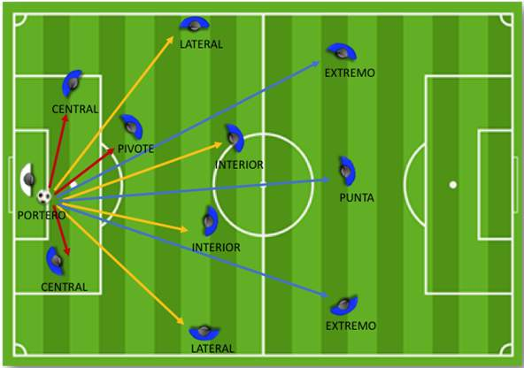

**Source** : Auteurs.

Ces distances affecteront directement les modes de connexion entre le possesseur et un receveur potentiel car elles modifieront des facteurs tels que la longueur de la passe, sa trajectoire, le temps nécessaire à la connexion et, par conséquent, affecteront également les chances de l’adversaire d’intervenir pour récupérer le ballon.

La prise en compte des aspects négatifs et positifs de chaque situation (jouer court ou long, par exemple) sera un argument qui sera traité dans le dernier module.

Francisco Seirul-lo Vargas (2017, communication personnelle) propose le concept d’espace de phase, qui changera de nom en fonction des principales fonctions qu’il assume dans les deux phases du jeu :

- 1

  - 

1

**Espace d’intervention** : Espace où se trouvent le *ballon*, le* possesseur *et le *rival direct*.

- **Intervention directe sur le téléphone portable :** Il influence et affecte directement l’organisation des autres espaces (le ballon étant la référence la plus importante).

<!-- -->

- 2

  - 
  - 

2

**Espace d’entraide : **Espaces proches du ballon. Il s’agira des joueurs qui sont les plus proches du ballon dans chaque direction, qui sont liés au possesseur ou au premier récupérateur. 

- **Dans la disposition des balles :** Ils offrent au porteur des options de dépassement grâce aux appuis et aux mouvements et peuvent également générer des espaces pour la progression de ce dernier.

- **En non-disposition du ballon** : Ils provoquent de la densité autour du ballon en couvrant et en bloquant ces possibilités de connexion entre le possesseur et le receveur de l’adversaire, avec pour objectif principal de pouvoir récupérer le ballon sans qu’il ne quitte cet espace.

<!-- -->

- 3

  - 
  - 

3

**Espace de coopération :** Les joueurs distants sont positionnés de telle sorte que lorsqu’ils entrent en jeu, ils le font de manière efficace et productive. Les participations directes dans le jeu ne dépendront que des besoins réels de l’équipe et garantiront qu’il y a 11 joueurs proactifs dans le jeu à tout moment. 

- **Dans la disposition des balles :** Ils coopèrent pour permettre au possesseur et aux coéquipiers proches d’agir plus facilement, en générant des espaces dans la zone proche du ballon grâce à leurs propres emplacements. Ils peuvent être des références pour des connexions plus longues qui vous permettront de tirer parti des incohérences dans la structure rivale.

- **En cas de non-élimination du ballon : **Ils surveillent les supports les plus éloignés, compensant les espaces générés par leurs coéquipiers qui sautent sous la pression et sont les derniers éventuels récupérateurs du ballon.

**Graphique 13. Espace de phase entre la bille et le pivot lors de la sortie de la balle**

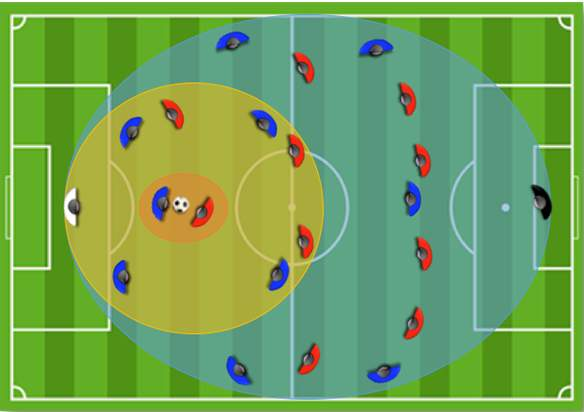

**Source** : Auteurs.

Chacun de ces espaces relationnels a ces différentes fonctions qui doivent toujours être reconnues par chacun des acteurs dans les deux phases du jeu pour que l’équipe puisse réaliser une organisation efficace.

En tant que critère d’organisation général, chaque coéquipier devra interagir avec le coéquipier le plus proche de la zone de balle.

*Se tenir à différentes hauteurs pour offrir des lignes de dépassement, se séparer commodément *pour séparer les adversaires ou se rapprocher pour les attirer et les soutenir sont des paramètres que nous devrons prendre en compte lors de l’évaluation de la façon dont les joueurs se rapportent à l’intérieur de ces distances relationnelles. Ils seront un filtre important qui nous permettra de comprendre la carte de la structure des deux équipes à tout moment et de connaître leurs possibilités d’action pour favoriser et améliorer les conditions temporelles et spatiales des personnes impliquées. De plus, cette organisation sera responsable de l’efficacité et de l’efficience que l’équipe assumera pendant les deux phases du jeu, c’est-à-dire que les chances de récupération dépendront directement de l’ordre obtenu grâce à la circulation du ballon, avant la perte, et vice versa.

**Les trajectoires**

Chaque joueur doit exécuter son action motrice dans une certaine direction et avec certaines trajectoires qui indiqueront ses intentions de jouer. On peut diviser les trajectoires en deux grandes catégories :

- 1

1

**Trajectoires avec le ballon**

- - 
  - 
  - 

balle

Passes : Grâce aux **passes**, les joueurs s’associent entre eux et communiquent donc. Chaque passe est une intention, une opportunité et un message qu’un joueur offre à son coéquipier afin d’atteindre collectivement un objectif. « La trajectoire de la passe sera alors conditionnée par les possibilités techniques des joueurs et par l’opportunité tactique correcte » (Casáis Martínez et Lago Peñas, 2006, p. 123). On peut distinguer différents types de passes qui impliquent un changement dans la structure de l’adversaire :

- Les passes qui traversent les lignes : Elles nous permettent de progresser en profitant d’un éventuel avantage positionnel.

- Passes qui ne franchissent pas les lignes : Elles permettent à l’adversaire de se déplacer pour générer des décalages dans sa structure et générer des avantages d’une sorte ou d’une autre.

Dans cette dynamique, nous pouvons :

- Jouez avec le partenaire à proximité : Pour attirer les rivaux ou les déplacer.

**Graphique 14. Jouez avec des coéquipiers proches**

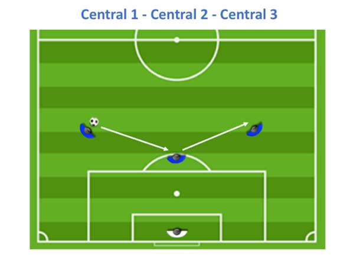

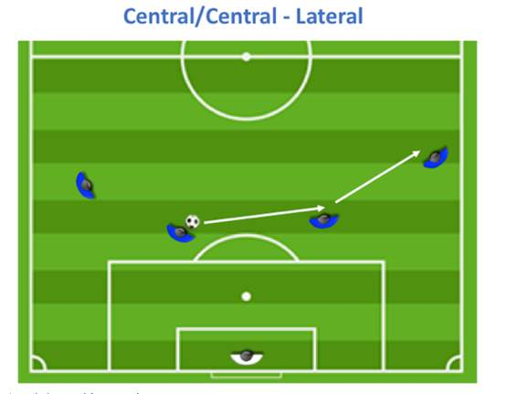

**Source** : Auteurs.

- **Sautez sur le coéquipier le plus proche et jouez avec un plus éloigné** : pour forcer l’adversaire à beaucoup frapper ou profiter des espaces libres qu’il génère.

**Graphique 15. Jouer avec des coéquipiers éloignés**

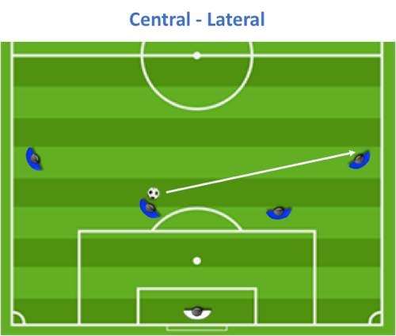

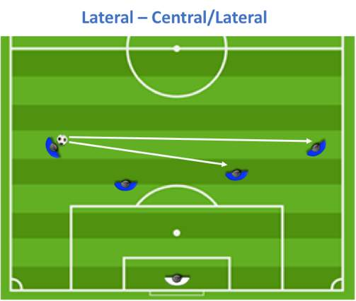

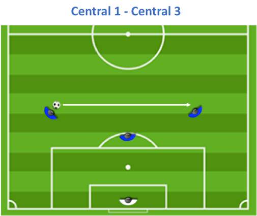

**Source :** Auteurs.

- **Passe répétée :** Cela nous permet d’attirer les adversaires, de générer des espaces, de donner aux coéquipiers le temps de mieux se positionner.

Cependant, si l’on simplifie, il y aura toujours trois possibilités lorsque l’on joue avec un ballon, chacune avec ses effets spécifiques sur le jeu :

- **Diagonal:** Il permet de s’affranchir des lignes et de faciliter le jeu suivant, dès lors que le receveur sera positionné face au jeu.

- **Vertical: **Il vous permet de surmonter les lignes ou de les déplacer.

- **Horizontal:** Il vous permet de déplacer des lignes pour attirer les adversaires et générer de l’espace.

Évidemment, des facteurs plus spécifiques, tels que la force imprimée sur le ballon, la hauteur de la passe, sa distance ou sa direction, affecteront directement l’efficacité de la passe et donc chaque joueur devra gérer chaque caractéristique de la meilleure façon possible. Ce n’est pas la même chose de passer dans l’espace qu’au pied ou à une jambe plutôt qu’à l’autre, et il faut comprendre comment, par des passes, une équipe parvient à déstructurer les adversaires.

Un exemple très évident de la façon dont ces aspects spécifiques d’un seul élément du jeu, comme la passe, peuvent affecter le jeu à des échelles beaucoup plus grandes (ou macro) est montré par le football féminin, en ce sens que, pour des raisons physiques et anthropométriques, la force imprimée sur le ballon par un joueur sera différente et réduite par rapport à celle d’un joueur. Et puis il est difficile de trouver des joueurs qui peuvent déplacer le ballon sur 40 ou 50 m avec la même force qu’un joueur. C’est pourquoi les équipes féminines ont tendance à se balancer beaucoup plus sur le côté du ballon que les équipes masculines, car le timing et la dynamique des longues passes sont différents.

Un autre exemple est celui des coups de pied de but ou des sorties de ballon, où il sera courant de trouver des gardiens de but incapables de tirer loin et d’atteindre des zones de 3/4 de la moitié de terrain adverse. Par conséquent, dans ces situations, les équipes féminines peuvent se retrouver dans des blocs plus élevés dans la phase de récupération que ceux des hommes, ce qui affectera le comportement – parmi de nombreux autres aspects – de la ligne défensive.

Voici des exemples de la façon dont des éléments appelés micro peuvent avoir des répercussions macro sur le jeu. En tant qu’analystes, la connaissance du détail sera un outil de plus qu’il faudra utiliser pour privilégier l’information qualitative dans les rapports.

- - 
  - 
  - 

balle

**Tuyaux: **Ce sont des outils très importants qui vous permettent d’attirer les adversaires, de les fixer et de les faire glisser ou de profiter des espaces libres pour générer de la supériorité et, en plus, chronométrer l’action pour permettre aux coéquipiers de se positionner et de générer des conditions favorables pour que l’action se poursuive.

Vous pouvez forcer une modification de la structure de l’adversaire en conduisant :

- vers des intervalles spécifiques (entre deux joueurs ou des lignes rivales) ;

- vers des joueurs spécifiques, pour les attirer et éventuellement libérer des coéquipiers ;

- vers certaines zones du terrain pour attirer les adversaires.

**Graphique 16. Élément central des drives/intervalles de l’adversaire**

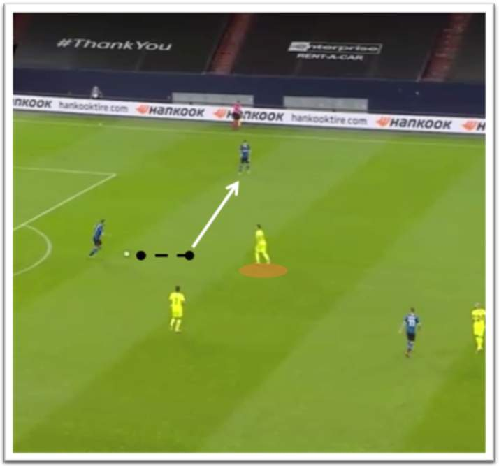

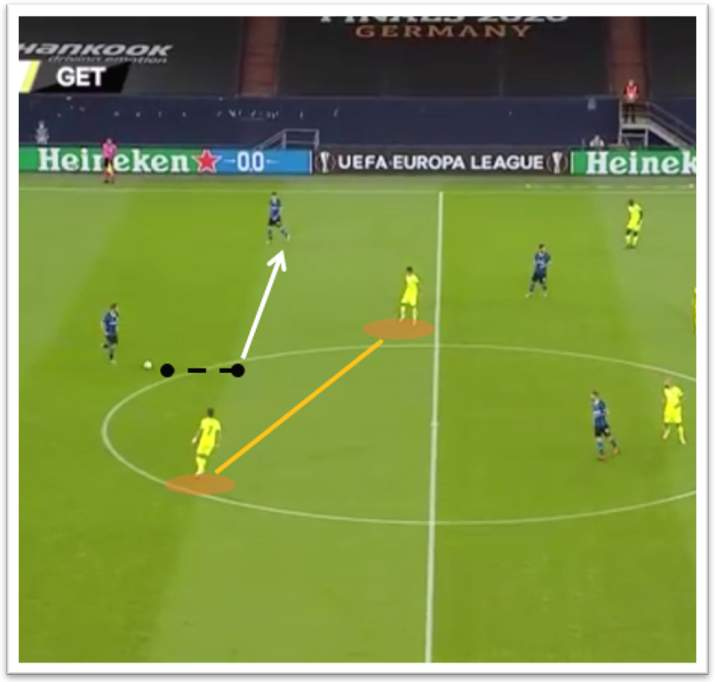

**Source : **Auteurs.

C’est dans la perception de la situation et dans la capacité du joueur à comprendre les risques qu’il peut prendre en conduisant dans les zones initiales. S’il est le dernier joueur, il doit minimiser autant que possible les pertes de balle possibles qui pourraient compromettre le résultat, en détectant la distance minimale à laquelle attirer l’adversaire direct qui saute à la pression (distance de sécurité de 3-4 m).

- 2

2

Trajectoires sans ballon

- - 
  - 
  - 
  - 
  - 
  - 
  - 
  - 

balle

**Joueurs de l’équipe en possession du ballon : **Identifier les mouvements qui permettent l’apparition de lignes de dépassement ou de supports.

- Avant, côté, diagonales, courbes (non marquées).

- Vers le ballon, en s’éloignant du ballon.

- Devant le rival, derrière le rival.

- Vers l’intérieur, vers l’extérieur.

- Avec une feinte préalable.

- N’occupez pas simultanément le même espace que le partenaire.

- Adaptez le rythme et la vitesse.

- Bouger pour toujours s’orienter vers le jeu.

<!-- -->

- - 
  - 
  - 
  - 
  - 
  - 
  - 
  - 
  - 
  - 
  - 
  - 

balle

**Récupération des joueurs de l’équipe : **Ils ont pour objectif de couper les lignes de passe ou d’empêcher la circulation propre de l’adversaire en possession, en l’obligeant à se rendre aux endroits du terrain qui lui permettront de récupérer le ballon. Différents facteurs sont à prendre en compte en fonction de l’espace relationnel dans lequel se trouve un joueur :

- N’entrez pas brusquement.

- Évaluez la distance lorsque vous intimidez.

- Identifier la bonne jambe du joueur en possession du ballon et la couvrir avec sa propre trajectoire (identifier sa latéralité).

- Utilisez des feintes défensives.

- Orientez le possesseur pour jouer vers l’intérieur ou vers l’extérieur.

- Passez à pair ou impair.

- Faites pression sur le possesseur rival qui ne le voit pas.

- Évitez les relations profondes.

- Identifier les supports à proximité et se positionner pour couvrir les lignes de dépassement ou marquer l’homme.

- Trajectoires pour compenser les coéquipiers qui sautent sous la pression.

- Positionnez-vous entre le ballon et votre propre but ou vers l’espace où vous souhaitez récupérer.

- Évitez les changements d’orientation dans la circulation de l’adversaire.

**Graphique 17. Parcours incurvé de la pointe au gardien de but pour couper les lignes de passe avec le centre (notion de pressing impair lorsque le porteur n’a aucune chance de jouer avec notre paire)**

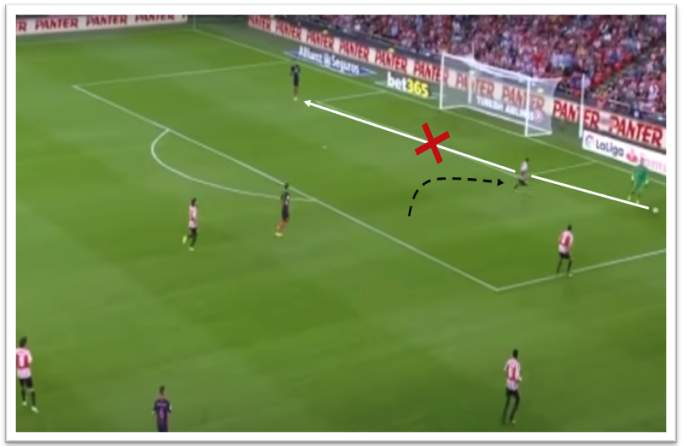

**Source : **Auteurs.

Le concept *d’épinglage* sera approfondi, car il s’agit d’un élément très important du jeu, surtout pendant la phase initiale, et peut-être sous-estimé. Dans l’étude des éléments dynamiques qui a été réalisée, le concept de *fixation* apparaît comme une conséquence de l’utilisation de certains de ces éléments, mais il convient d’approfondir ce sujet.

*Le fixing* permet de déterminer le comportement de l’adversaire avec la conduite, en annulant ou en retardant son intervention, ce qui permet de provoquer des déséquilibres importants dans la structure de l’adversaire ; Par conséquent, il génère l’apparition de contextes favorables pour pouvoir atteindre les objectifs du jeu.

Fixer ou attirer au centre oblige l’adversaire à se rapprocher des couloirs centraux et génère de l’espace à l’extérieur pour pouvoir se connecter avec les arrières latéraux ou les ailiers. Jouer à l’extérieur en attirant les adversaires par tilting génère des décalages pour rejouer à l’intérieur.

Les joueurs qui fixent les plus éloignés avec leur position permettent l’apparition d’espaces proches de la balle, car ils divisent le bloc de l’adversaire en deux, et vice versa : les joueurs qui attirent les adversaires vers la balle permettent l’apparition d’espaces dans des zones éloignées.

On peut considérer qu’il existe différentes façons de placer un ou plusieurs adversaires, en fonction de la situation dans laquelle vous vous trouvez, et tous ont la même intention de générer ces espaces dont un joueur ou ses coéquipiers peuvent profiter pour pouvoir partir plus facilement :

- - 
  - 
  - 

balle

**Titulaire:**

- **Arrêter:** Pour inviter les adversaires à sauter et à générer de l’espace, en fixant l’adversaire qui arrive.

- **Conduire: **Vers des joueurs (pairs ou impairs) ou des intervalles, éventuellement non alignés, pour déplacer encore plus les adversaires et générer plus d’espace.

- **Passer: **En répétant une passe, un ou plusieurs adversaires peuvent être attirés, ou passer à un certain endroit avant d’aller à un autre (troisième homme) permettra aux adversaires d’être attirés vers un endroit différent sur le terrain de celui où ils veulent réellement aller, ce qui transformera la structure et désorganisera l’équipe rivale.

<!-- -->

- - 
  - 
  - 
  - 
  - 

balle

**Non-possesseur :**

- Se placer entre deux rivaux.

- Se déplacer pour s’éloigner des marques de zone du ballon.

- Déplacez-vous pour attirer vos adversaires et créer de l’espace pour eux-mêmes ou vos coéquipiers.

- Se déplacer pour retarder l’intervention d’un adversaire dans la zone du ballon.

- Apparaître dans le champ de vision de l’adversaire pour être individualisé et fixé.

**Le moment**

**« Le temps gère tout » (Seirul-lo Vargas, communication personnelle, 2017).**

La quantité et la vitesse des actions de chaque joueur et la circulation du ballon donneront à l’équipe un certain* rythme de jeu* à un moment précis du jeu. Il est lié à l’espace et au temps.

Savoir gérer les bons moments *(timing)* pour exécuter une certaine action (individuelle ou collective) sera essentiel pour qu’elle soit efficace dans le jeu, c’est-à-dire pour pouvoir se conformer aux intentions avant son exécution.

Les mouvements du ballon sont ce qui produit la vitesse dans le jeu. Il faut être conscient que « ralentir le jeu » à certains endroits du terrain, donner une pause au rythme (par exemple, le centre et l’arrière latéral qui répètent les passes entre eux), lui permettra d'"accélérer » dans d’autres (par exemple, en répétant la passe, l’ailier et l’attaquant rivaux ont été attirés afin que l’intérieur puisse recevoir entre les lignes et nous placer plus rapidement dans la moitié de terrain adverse).

**Graphique 18. Le gardien de but marche sur le ballon pour attirer les adversaires et générer de l’espace**

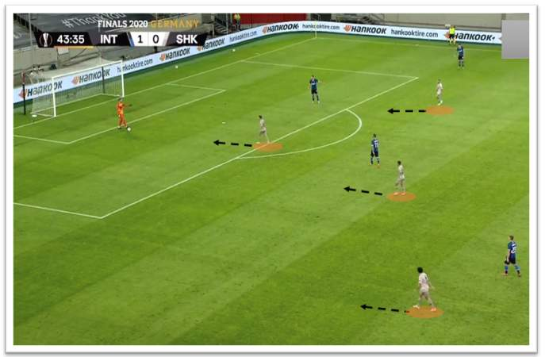

**Source :** Auteurs.

- balle

**Taux de trafic :** Capacité individuelle et collective à gérer le temps et la possession pour influencer l’organisation rivale. Comme ce rythme peut varier – c’est-à-dire que les moments de circulation peuvent être plus lents ou plus rapides – il faut toujours tenir compte de la façon dont chacune de ces deux variables affectera l’organisation de l’équipe qui défend.

- balle

**Taux de pression : **Somme des vitesses de mouvement individuelles pour rendre difficile la possession du ballon par l’adversaire. Théoriquement, la pression peut également modifier ces deux moments, puisque vous pouvez choisir d’accélérer la pression si l’adversaire est en difficulté ou avec un ballon très proche du but, ou de le ralentir, s’il n’y a pas d’options pour récupérer le ballon rapidement. Le choix des temps de pressage dépendra des caractéristiques des adversaires, des exigences physiques et des moments du match.

L’alternance entre des moments de rythme bas et des moments de rythme plus élevé sera un facteur qui devra être pris en compte dans l’analyse, dans les deux phases du jeu, car il nous permettra de comprendre quand et comment une équipe alterne ces situations au cours d’un match et comment une équipe réagit en fonction de cela. Par exemple, il y a beaucoup d’équipes qui commencent le match en essayant de sortir de l’arrière de manière plus combinée, mais cette dynamique peut changer au cours du match, modifiant le style de départ ou son rythme. Par conséquent, il faut comprendre s’il s’agit de quelque chose qui dépend d’une stratégie spécifique ou s’il s’agit d’une réaction à des changements de comportement chez l’adversaire.

Un autre exemple dans l’autre phase du jeu est d’observer combien d’équipes modifient le type de pression dans le ballon de l’adversaire et le rythme de celle-ci pendant le match (en fonction de facteurs tels que la condition physique, le résultat, etc.).

**Avantages (supériorités) dans le jeu**

**Graphique 19. Éléments (critères) et avantages (supériorités)**

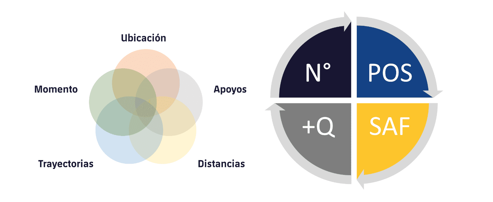

**Source :** Auteurs.

**Pourquoi nous organisons-nous ? Quels sont les objectifs d’une telle organisation ?**

La connexion de tous les éléments enseignés ci-dessus permet un dynamisme dans le jeu qui provoque l’émergence et la création de certains **avantages spatio-temporels** sur le terrain, en raison de l’interaction constante de tous les joueurs. Les trouver vous permettra d’obtenir des situations favorables en fonction des objectifs ou d’en générer d’autres, augmentant ainsi les chances de succès dans chaque situation de jeu. Ces avantages ne sont pas stables, mais doivent être exploités au moment où ils apparaissent, car, en raison du dynamisme même du jeu, une seconde plus tard, ils peuvent disparaître.

Savoir quels avantages peuvent être générés aidera à analyser comment une équipe dans la phase initiale modifie son comportement pour conditionner celui de l’adversaire et permettre l’apparition de certains de ces avantages afin d’atteindre le terrain de l’adversaire dans les meilleures conditions possibles.

Nous pouvons classer 4 types d’avantages :

- balle

**Numérique: **Présence d’un plus grand nombre de joueurs d’une équipe que d’une autre, à un endroit précis du terrain (par exemple, pivot qui se glisse entre les défenseurs centraux pour créer un 3 contre 2 dans la zone A, contre les deux attaquants rivaux qui sautent sous la pression du ballon).

**Graphique 20. Avantage numérique (3v2)**

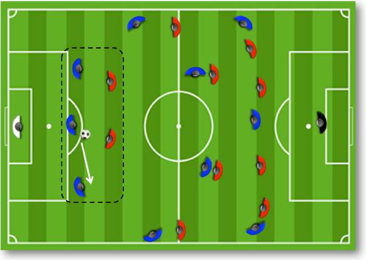

**Source :** Auteurs.

- - 
  - 
  - 

balle

**Positionnel:** Lorsque le joueur se situe dans des espaces précis (entre les lignes ou entre adversaires) pour forcer les adversaires à fermer des espaces et à déstructurer (par exemple, un pivot qui se situe derrière les deux attaquants rivaux qui sautent). Il existe 3 typologies :

- Entre les lignes.

- Inter lignes.

- Hors-ligne.

**Graphique 21. Différents types d’avantages positionnels**

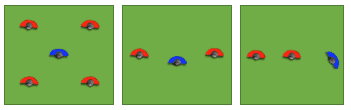

**Source :** Auteurs.

Chaque équipe placera les joueurs différemment (en fonction de leurs stratégies et des qualités des joueurs) derrière les différentes lignes de pression ou sur les côtés du bloc adverse pour profiter des opportunités que la circulation précédente lors du début a générées. L’objectif de celle-ci sera de progresser vers le terrain de l’adversaire et de créer des contextes favorables pour les joueurs les plus déséquilibrés.

**Graphique 22. Avantage de position (pivot entre les lignes)**

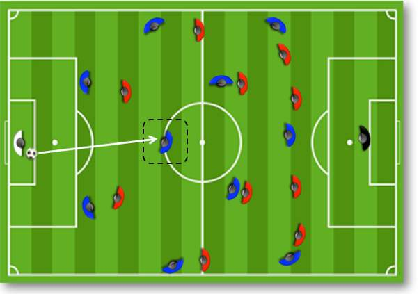

**Source : **Auteurs.

- balle

Dynamique (ou socio-affectif) : Lorsque la relation entre certains joueurs est meilleure que celle de leurs rivaux (par exemple, la capacité de s’en sortir court, bien que sous une forte pression de l’adversaire, dans un petit espace).

**Graphique 23. Avantage dynamique (rapport effectif entre le défenseur central, le pivot et l’arrière latéral)**

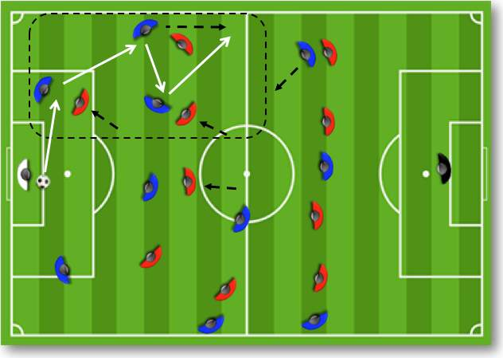

**Source :** Auteurs.

- balle

**Qualitatif:** Lorsqu’un joueur a des capacités techniques, physiques et décisionnelles qui lui permettent de résoudre efficacement une certaine situation dans les deux phases du jeu (par exemple, la capacité du pivot à ne pas perdre le ballon sous la pression).

**Graphique 24. Avantage qualitatif (pivot qui parvient à performer sous pression)**

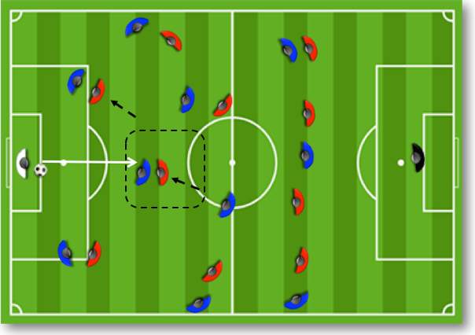

**Source : **Auteurs.

Chaque avantage est momentané et temporaire, c’est-à-dire qu’il apparaît et disparaît continuellement en fonction des nombreuses interactions qui se produisent entre les deux équipes.

Il faut comprendre que tout le monde participe constamment au jeu et que l’équipe se développe en tant qu’unité fonctionnelle pour, par son auto-organisation, générer et apporter des supériorités ou des avantages à chaque instant du jeu.

L’équipe en possession du ballon aura deux façons de générer ces avantages et de les exploiter :

- 1

1

Profitez directement de la pression de l’adversaire.

- 2

2

Créez-les en faisant circuler le ballon, auquel cas il faudra attirer/occuper les adversaires puis trouver un homme libre de sa propre équipe.

En général, si l’adversaire ne bouge pas, il faut le faire bouger en faisant circuler le ballon. Par conséquent, surtout pendant la phase initiale, il faudra être patient, c’est-à-dire être conscient qu’il sera difficile de sortir à la première circulation, et qu’il faudra ne pas prendre de risques pour forcer le jeu.

Une fois l’avantage trouvé, quel qu’il soit, son utilisation dépendra inévitablement de très petits détails qui engloberont tous les éléments que nous avons étudiés ci-dessus.

Par exemple, si l’intention de l’équipe en possession du ballon est de progresser sur l’aile avec le latéral qui est dans l’axe de sa paire directe, la progression possible dépendra de son orientation et de la passe que le coéquipier lui fera :

- 1

1

Si la passe se fait à sa jambe éloignée, c’est-à-dire avec un avantage pour qu’avec un contrôle, il puisse échapper à la pression de l’adversaire en le battant directement, il pourra progresser dans le jeu et profiter de l’avantage qu’il avait.

- 2

2

En revanche, si dans la même situation de jeu il est nécessaire que l’orientation du corps ne soit pas correcte ou que la même passe soit, au lieu de vers la jambe éloignée, vers la jambe proche de l’arrière latéral, l’action suivante sera différente car plus de touches seront nécessaires et, par conséquent, plus de temps. Cela changera radicalement le contexte spatio-temporel et obligera peut-être le joueur à revenir jouer avec le défenseur central et, ainsi, à éviter la pression de l’adversaire (il ne profitera donc pas de l’avantage qui était généré).

**Graphique 25. Passe au pied éloigné ou au pied proche (central avec arrière latéral)**

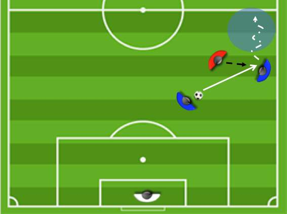

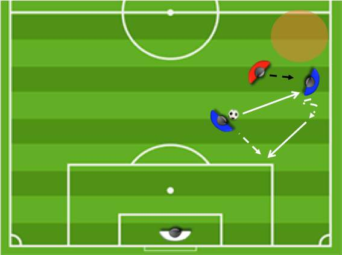

**Source :** Auteurs.

Ce qui précède est un exemple de la façon dont de petits micro-détails peuvent inévitablement influencer toute la dynamique du jeu (positivement ou négativement). Par conséquent, lorsqu’il s’agira de comprendre le fonctionnement des deux équipes au cours de la phase initiale, il sera important de détecter comment ces avantages sont exploités ou comment ils sont réadaptés, au cas où ils ne seraient pas utilisés, et d’en identifier les causes.
