**Module 4. Tendances méthodologiques de la formation PBL**

**Unité 4.1. Introduction à la formation PBL**

*Bloc 1 de 5*

**4.1. Introduction à la formation PBL**

Comme tout aspect pertinent du jeu, l’APP nécessite un processus d’entraînement en fonction de son importance, en tenant compte de ses caractéristiques et en l’adaptant à tout moment à la réalité des joueurs et de l’équipe.

Il est évident que l’un des facteurs les plus déterminants de la performance dans le football, et encore plus dans la PBL, sont les conditions des joueurs. Pour cette raison, nous pouvons trouver des entraîneurs qui jugent approprié de tenir leurs joueurs responsables, presque exclusivement, de la PBL, en fonction entièrement de leur inspiration et de leurs performances individuelles le jour de la compétition. De cette façon, ils choisissent de donner un rôle presque inexistant aux éléments de décor dans leur planification sportive.

Rien ne pourrait être plus éloigné de la vérité, nous considérons que le processus d’entraînement PBL doit respecter et s’adapter aux caractéristiques individuelles de nos joueurs, non pas pour des raisons de commodité, mais parce que générer des situations de simulation qui favorisent l’apparition de certains comportements (forces), augmentera les chances de succès dans l’action en question. De plus, nous devons être très conscients que les caractéristiques de nos joueurs vont guider, et parfois définir, notre intervention dans le processus. Par conséquent, en tenant compte de ces caractéristiques et en s’entraînant en conséquence, même en sachant que la performance finale de l’action sera totalement multifactorielle, nous serons plus proches de la réalisation de l’objectif souhaité dans un PBL donné.

Dans le même ordre d’idées, Antic, R. (2017. p. 276) cité dans Silva Puig, D. (2011) commente ce qui suit : 

*  
*On avait un joueur comme Kiko qui était un point de référence pour les jeux de distribution au niveau offensif et qui se faisait commettre des fautes par les adversaires, on savait à l’avance que toutes les 45 minutes on allait avoir entre 7 et 10 coups francs près de la surface adverse ; Sachant cela, nous devons chercher au sein de l’effectif des moyens de tirer le meilleur parti de ce type de jeu. Pour cela, nous avons eu Pantic qui était un spécialiste extraordinaire des décors.

**Combien de temps consacre-t-on à la formation PBL ?**

Il n’y a certainement pas beaucoup de preuves scientifiques qui déterminent le temps qu’une équipe passe à s’entraîner sur les coups de pied arrêtés tout au long de la saison. Et certainement, encore moins qu’il rattache ce temps d’entraînement à la performance de l’équipe en compétition en matière de PBL.

Malgré cela, tout le monde sait aujourd’hui que l’entraînement de ces actions peut occuper un coin, généralement, pas plus de 20 minutes à la fin du microcycle hebdomadaire, dans de nombreux cas, en étant optimiste. Cela nous amène, à tout le moins, à nous demander si le faible volume de formation qui est normalement attribué à ces actions par rapport à leur pertinence dans le jeu est cohérent.

Dans cette optique, il nous semble opportun de se plonger dans l’étude réalisée par Silva Puig (2011) où l’un de ses objectifs était de déterminer le temps d’entraînement qu’une équipe professionnelle de la première division espagnole consacrait aux coups de pied arrêtés d’entraînement.

L’une des principales conclusions tirées est que cette équipe professionnelle a consacré 5,5 % du temps total d’entraînement tout au long de la saison (y compris la pré-saison) à l’optimisation des coups de pied arrêtés. Ces données sont encore plus significatives si on les compare à la relation considérable plus que démontrée entre l’efficacité et l’objectif de l’APP. Dans le cas de l’étude, Silva Puig a comparé que 5,5 % du temps passé à l’entraînement PBL avec le pourcentage de buts marqués par l’équipe a été analysé cette saison-là (32,1 %), notant une grande différence entre les deux valeurs.

**Graphique 1. *Comparaison entre les buts marqués par l’APP et le temps total de votre entraînement***

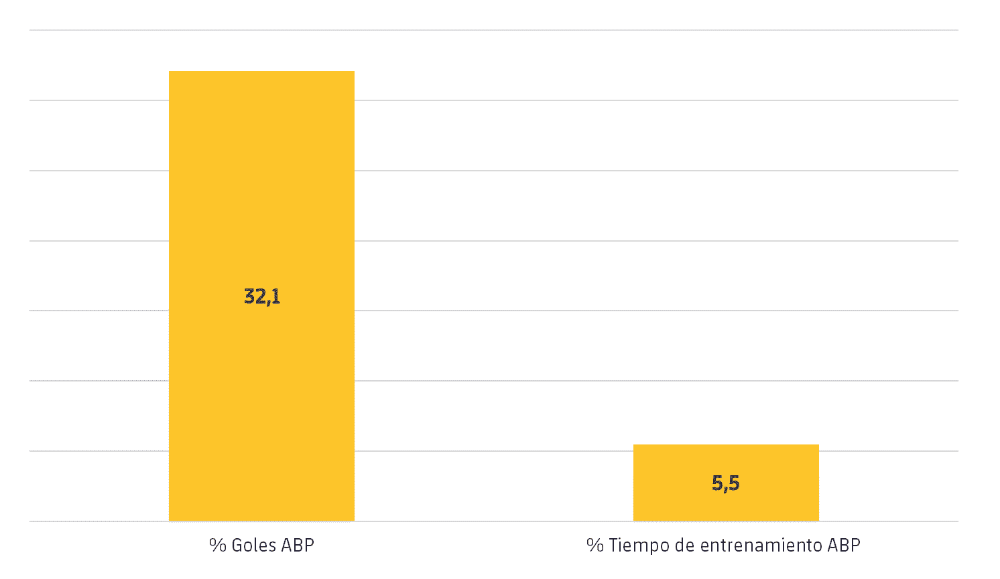

**Source : **Élaboration des auteurs à partir *de la pratique des coups de pied arrêtés dans le football. Revue conceptuelle sous les théories de la praxiologie motrice,* par Silva Puig, D., 2011.

En raison de la complexité du football lui-même et du chemin même vers le succès totalement multifactoriel de ce sport, nous ne pouvons pas dire que, si une équipe consacre plus de temps d’entraînement à l’APP, ses performances en compétition seront meilleures ; Mais il est vrai que des études comme celle mentionnée ci-dessus nous amènent au moins à nous interroger sur le poids que ces actions, souvent négligées, devraient avoir dans le processus de formation.

**Comment les APP ont-ils été formés ?**

Dans la plupart des contextes, le processus de formation à l’APP a toujours été ciblé, et l’est en fait, par le biais d’une méthodologie que nous pourrions qualifier d’analytique. Ainsi, pendant de nombreuses années, ces actions ont été pratiquées à travers des situations totalement fermées dans lesquelles l’entraîneur expliquait le jeu à faire et les joueurs se limitaient essentiellement à reproduire ce schéma, encore et encore, en recherchant l’intériorisation de ladite action et, par conséquent, l’optimisation de celle-ci.

Normalement, ce processus s’est déroulé sans opposition ou avec une opposition passive. De plus, il convient de noter que, la plupart du temps cette méthode est utilisée, l’objectif est basé uniquement et exclusivement sur l’amélioration de l’action pour le match du week-end, parfois, en ignorant totalement l’amélioration du joueur.

Au fil des ans, le processus de formation PBL a évolué et des propositions ont émergé qui, même si elles étaient réalisées dans des environnements plus fermés que le contexte du jeu lui-même, donnaient déjà une petite place à l’autonomie du joueur. De cette façon, des facteurs clés tels que la prise de décision, la communication (collaboration) et la contre-communication (opposition) commençaient déjà à être pris en compte et à se voir accorder une certaine importance. Des aspects qui, bien qu’ils puissent nous sembler évidents aujourd’hui et que nous comprenons implicites dans toutes les actions du *continuum* du jeu, ont été largement oubliés par la méthodologie analytique.

Ayant son origine dans l’évolution des théories de l’entraînement des sports d’équipe ces dernières années et partant du paradigme de la complexité, une nouvelle approche de l’entraînement PBL émerge. Cette méthodologie dite intégrée doit être implicite dans la méthodologie d’entraînement au football elle-même car, même dans le cas de situations de nature unique et probablement avec moins d’incertitude que les situations dynamiques, les coups de pied arrêtés font toujours partie du sport lui-même et, par conséquent, nous comprenons que nous ne pouvons pas isoler ses conditions de pratique de la réalité du jeu et des besoins du joueur.

Ensuite, nous nous concentrerons sur les tendances méthodologiques les plus couramment utilisées pour l’entraînement des décors. Ainsi, nous essaierons de fournir à la fois une conceptualisation théorique et quelques directives d’application comme exemple de ce processus de formation. Nous commencerons cet examen d’un point de vue traditionnel, basé sur la méthodologie analytique, et nous nous dirigerons vers une perspective systémique, en nous rapprochant ainsi de la réalité du football lui-même, avec la méthodologie intégrée.

**Graphique 2. *Grandes tendances méthodologiques en matière de formation à l’APP***

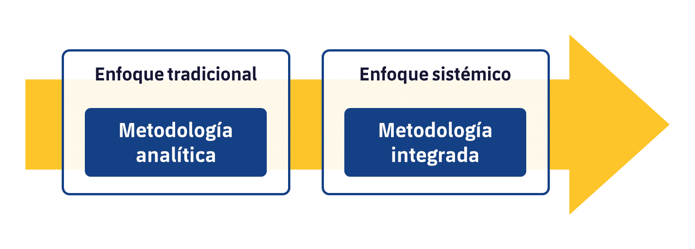

**Source : **Auteurs. Département d’analyse du FC Barcelone.

**Unité 4.2 Formation à l’APP par méthodologie analytique**

*Bloc 2 de 5*

**4.2. Formation à l’APP par méthodologie analytique**

Si nous réfléchissons et essayons de regarder en arrière au début de notre carrière sportive, que ce soit en tant que joueur, entraîneur ou analyste, et essayons de visualiser à quoi ressemblait l’entraînement PBL, nous aurons sûrement du mal à nous souvenir d’une situation dans laquelle nous nous sommes concentrés sur l’entraînement PBL.

En d’autres termes, à de nombreuses occasions (et même dans la plupart des cas aujourd’hui), la méthode d’entraînement d’une certaine action sur les coups de pied arrêtés consistait à isoler cette action du jeu lui-même et à la répéter en introduisant certaines modifications. Par conséquent, on pourrait dire que la formation PBL est basée depuis de nombreuses années sur la reproduction de modèles ; c’est-à-dire dans la répétition de ces actions elles-mêmes, dirigées à tout moment par l’entraîneur pour une mise en scène correcte en compétition.

Ainsi, de l’approche classique, cette méthodologie analytique a été choisie, qui aurait pour base principale l’attribution des rôles par le coach et la reproduction des comportements souhaités par les joueurs. Par conséquent, ce type d’entraînement aura pour but clair d’automatiser certains comportements souhaités par l’entraîneur au profit de la performance en compétition.

Bonfanti et Pereni (2002), Prieto (2008), Fraile et Agudo (2010) cités dans Fernández Hermógenes, Camerino et García de Alcaraz (2017) affirment que la formation PBL doit être effectuée :

- balle

Les derniers jours du microcycle, généralement un jour ou deux avant la compétition.

- balle

Progressivement.

- balle

Sans opposition ou avec opposition passive.

Tout cela dans le but de fournir au joueur un contexte qui assure l’optimisation de sa capacité d’attention et de concentration, ce qui sera très demandé par la pratique de l’action de coup de pied arrêté en question.

En ce qui concerne la planification que l’entraînement PBL peut prendre au cours d’une saison, Silva Puig (2011) a confirmé dans sa thèse que dans l’équipe professionnelle analysée, il y avait une progression presque linéaire en termes d’augmentation de l’entraînement PBL, celle-ci prenant plus d’importance lors de la 2e manche du championnat (Figure 3). En outre, il a précisé que dans la période de pré-saison, il y a une tendance à entraîner les PBL défensifs dans une plus grande mesure, tandis qu’au fur et à mesure que la ligue progresse, l’entraînement des PBL offensifs dépasse celui des PBL défensifs, cette différence devenant très visible au 2e tour de la compétition.

**Graphique 3. *Pourcentage de formation PBL selon les phases de la saison en comparant ABP DEF et ABP OF***

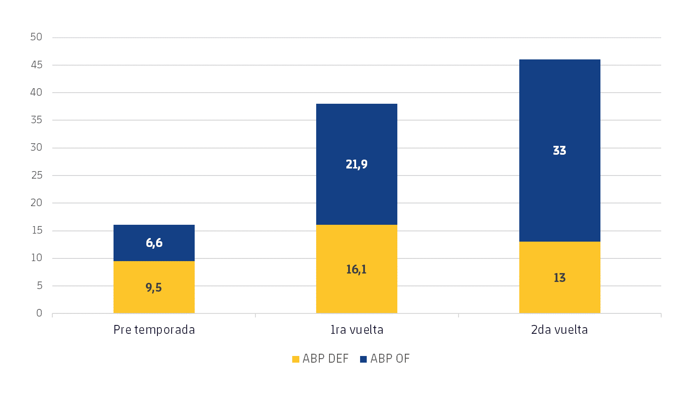

**Source : **Élaboration des auteurs à partir *de la pratique des coups de pied arrêtés dans le football. Revue conceptuelle sous les théories de la praxiologie motrice*, par Silva Puig, D., 2011.

Il est évident que tous les APP ne sont pas formés de la même manière. La vérité est qu’il y a une grande tendance à prioriser la formation de certains APP au détriment des autres. Les PBL dans lesquels le processus d’entraînement est généralement approfondi sont les coups de pied de coin et les coups francs indirects, ou ce que tout au long de la saison nous avons appelé des fautes indirectes, comprenant ceux qui ne cherchent pas à frapper directement au but. Silva Puig, D. (2011) a ratifié cet argument dans son étude où il a déterminé que, tant dans les facettes offensives que défensives, les PBL les plus entraînées par l’équipe analysée étaient, de loin, les deux actions discutées suivies de la facette offensive des pénalités et des fautes directes (Figure 4).

**Graphique 4. *Nombre de fois que chaque APP est formé***

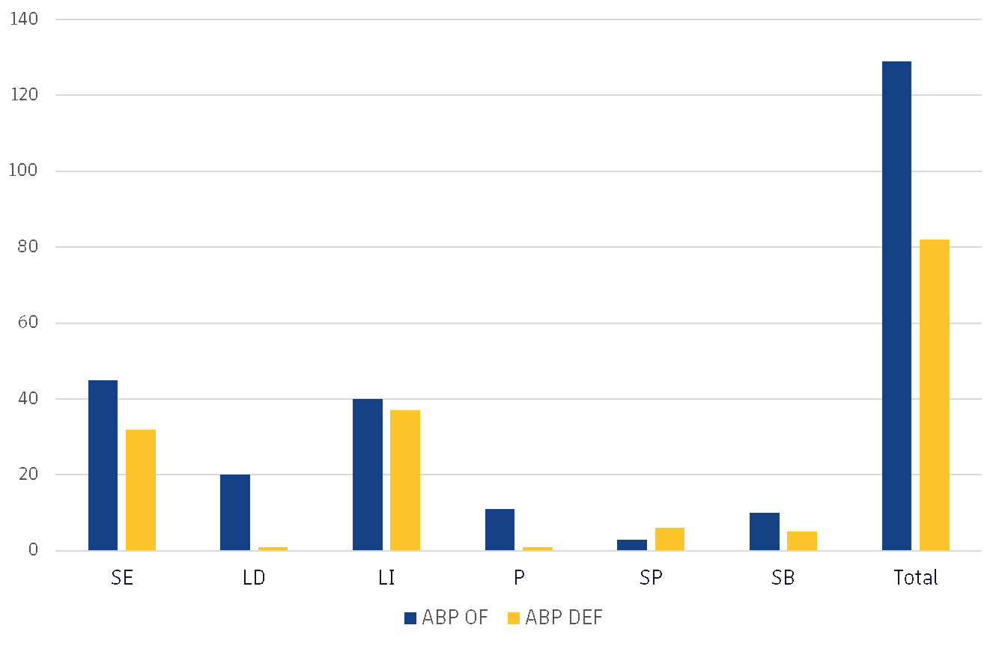

**Source : **Adapté de *Praxisdes coups de pied arrêtés dans le football. Revue conceptuelle sous les théories de la praxiologie motrice,* par Silva Puig, D., 2011.

Comme nous l’avons mentionné, grâce à cette méthode, la PBL est généralement entraînée dans les derniers jours du microcycle, cherchant à offrir au joueur un contexte qui, en plus de favoriser sa capacité de concentration en raison de la fatigue théorique plus faible de la séance, lui permet également de se souvenir plus facilement du jeu ou de l’organisation proposée pour le match.

L’une des raisons pour lesquelles cette méthodologie analytique a été si largement utilisée au fil des ans est la simplicité de son application, et parce que, sans aucun doute, elle permet à l’entraîneur de diriger les comportements qu’il veut suivre dans le jeu dans cette même PBL ; Bref, ça nous permet de répéter.

**Proposition pratique de formation à l’APP à l’aide d’une méthodologie analytique**

Ci-dessous, nous proposons quelques exemples de situations de formation PBL utilisant la méthodologie susmentionnée. Tout d’abord, l’accent serait mis sur l’insufflation de l’organisation défensive que l’entraîneur juge la plus appropriée, puis sur la proposition de jeux offensifs, préalablement conçus, afin de les automatiser. De cette façon, vous passerez du général au particulier, de la défensive à l’offensive, en partant du principe de progression comme l’une des bases de ce processus d’entraînement.

Nous concentrerons cette proposition pratique sur l’entraînement des coups de pied de coin.

Ainsi, les situations décrites conservent les clés de cette méthodologie : Situer la séance d’entraînement dans les derniers jours du microcycle, baser l’introduction du contenu sur le principe de la progression et de la non-introduction de l’opposition, ou en tout cas, l’introduction de l’opposition passive (sauf pour le coin défensif). Tout au long des situations d’entraînement proposées, l’entraîneur fera de petites explications pour soit introduire une variation dans la situation elle-même (en proposant des solutions possibles), soit communiquer des aspects intéressants de différents comportements dans les coins pratiqués.

- balle

L’organisation défensive des corners grâce à une méthodologie analytique.

L’entraîneur explique l’organisation défensive à développer lors de l’entraînement aux 11 joueurs tandis que l’entraîneur adjoint garde le reste de l’équipe, qui agira comme l’équipe rivale (rôle offensif). Cette organisation sera composée d’une **défense combinée avec 2 joueurs en zone 1.Er poteau et centre avant petite zone, 5 marqueurs individuels, 1 joueur sur le court, 1 joueur sur le rebond et 1 joueur sur la disposition offensive.**

De cette façon, l’équipe qui répète cette action sera disposée de la manière indiquée et l’équipe offensive essaiera d’alterner différentes zones de lancer. Dans la première phase de l’exercice, aucun joueur n’entrera pour tirer, mais simplement le lanceur exécutera là où l’entraîneur l’indique. Dans ce cas, l’entraîneur spécifie que le lanceur doit alterner les lancers à 1. Le but a été marqué au poteau et au point de penalty, testant ainsi la répartition de l’espace par les joueurs dans la surface (Figure 5).

**Graphique 5. *Tirs sans tacle des finisseurs dans des zones de 1. Er poteau et point de penalty***

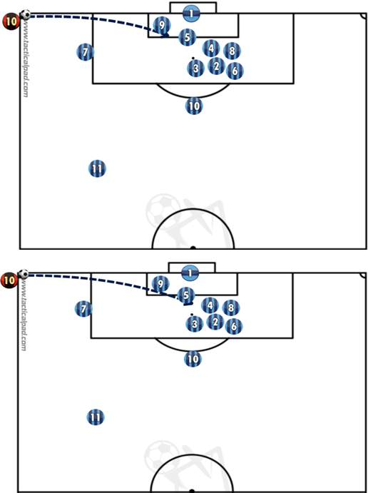

**Source : **Auteurs.

Les joueurs 9 et 5 sont chargés de faire une défense de zone. Les 5 autres qui se trouvent à l’intérieur de la zone ont le rôle de marqueurs.

La progression dans l’exercice consisterait à inclure les finishers. Ils entreront librement sans aucune indication préalable. À ce stade, le coach, à travers une brève explication, clarifie comment le comportement collectif doit être dans les situations suivantes :

- **Si un joueur adverse s’approche du service et est menacé d’un service court, **le joueur en position offensive (toujours situé au milieu du terrain où se produit le corner) doit être attentif pour venir en aide au joueur situé dans le court. L’intention sera de convertir rapidement l’infériorité (2x1) en égalité (2x2).

- **Si l’équipe adverse entre avec 6 finishers, **le joueur avec le rebond sera chargé de marquer ce sixième finisher tandis que le joueur en disposition offensive doit baisser sa position et occuper la zone du rebond.

De cette façon, le coach propose 3 scénarios possibles (la norme plus ces deux variantes) dans lesquels il spécifie comment devraient être les comportements des joueurs impliqués dans ces actions.

Comme nous l’avons dit, dans cette variable, les spikers décideront comment ils vont entrer pour spiker et alterneront également les entrées de 6 spikers et les lancers courts.

**Graphique 6. *Prises avec entrée libre des finishers***

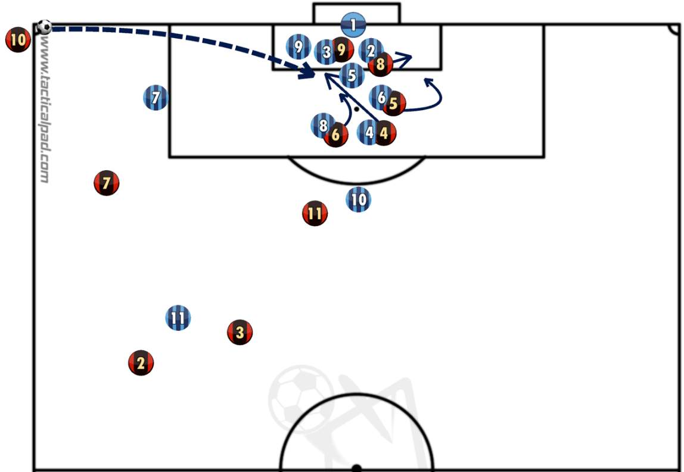

**Source : **Auteurs.

Dans la prochaine modification, le 2ème entraîneur aura spécifié à l’équipe offensive deux mouvements standards à effectuer, comme 1 joueur essayant d’anticiper le joueur du court, un autre s’éloignant vers le 2ème poteau et 3 joueurs entrant en décalage dans une course vers la surface de réparation, le tout en partant d’une disposition 2-3.

En cas de connaissance d’une régularité de l’adversaire, le 2ème entraîneur essaiera de simuler ce comportement. Exemple : référence au point de penalty d’un tacle du joueur, après un blocage.

L’objectif de l’équipe défensive sera le même que lors de toute situation proposée, éviter le tir de l’adversaire, cette fois face à certains mouvements délibérés de l’adversaire. De plus, l’entraîneur peut profiter de ce moment pour attribuer un marquage individuel, généralement axé sur le ou les joueurs de référence de l’adversaire suivant.

**Graphique 7. *Tirs avec tacle des finisseurs avec des mouvements prédéfinis***

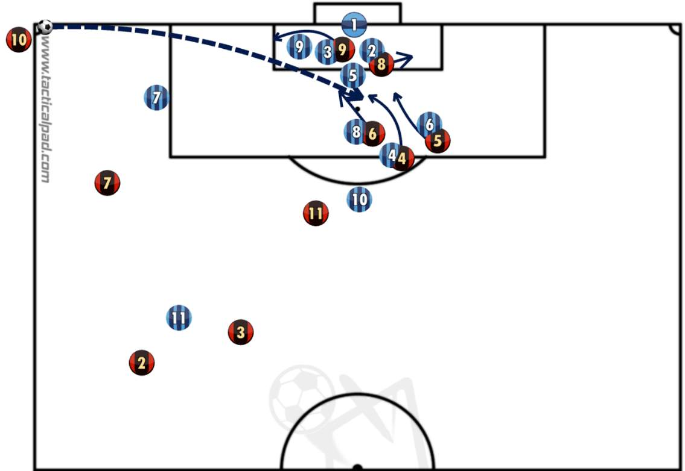

**Source : **Auteurs.

- balle

L’organisation offensive des coups de pied de coin grâce à une méthodologie analytique.

Suivant la même ligne que dans la situation précédente, l’entraîneur explique l’organisation offensive à développer par les 11 joueurs, à la fois statique, comprenant leur disposition initiale, et dynamique, considérant ainsi les mouvements qui vont se succéder pour tenter de terminer l’action. Pendant ce temps, les joueurs qui ne participent pas restent également attentifs aux explications. Les rôles fonctionnels seront les suivants : **1 tireur, 5 attaquants, 2 joueurs au rebond (on peut s’approcher pour jouer court) et 2 joueurs en défense.**

La situation sera basée sur la pratique de deux jeux possibles, sans opposition, que le lanceur marquera lorsqu’il s’approchera du fanion.

[**Déplacer AMouvement B**](https://static.capabilia.org/cursos/barcelona_analisisdelasaccionesabalonparadoes_dic20/L4/index.html)

3 spikers partent ensemble du centre de la zone et courent vers le 1er poteau lorsque le tireur baisse le bras (signal de départ), l’un d’eux (celui qui a le moins de capacité aérienne) change de trajectoire, se « désengage » et se dirige vers la zone de rebond pour bloquer ou centrer devant le joueur défensif du rebond. Pendant ce temps, un joueur avec un long rebond (finisher) court jusqu’au point de penalty où il termine un tir avec une trajectoire ouverte. Les deux finisseurs restants seront placés l’un près du joueur de zone théorique de l’adversaire, ce qui rend difficile pour lui d’attaquer le ballon et l’autre dans la zone du 2e poteau, en attendant un éventuel 2e jeu (Figure 8).

**Graphique 8. *Déplacer A***

**Fontaine: **Élaboration personnelle.

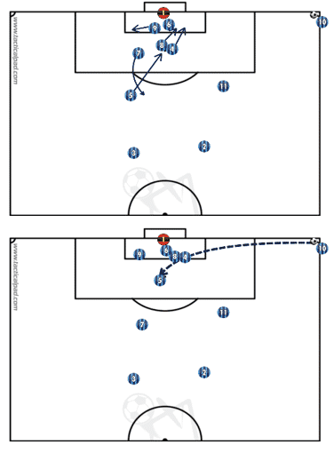

**Unité 4.3. Une nouvelle approche de la formation PBL. Vers une méthodologie intégrée**

*Bloc 3 de 5*

**4.3. Une nouvelle approche de la formation PBL. Vers une méthodologie intégrée**

**La nécessité de changer**

Il est certain que la compréhension au fil des années de l’APP, sous ce paradigme traditionnel basé sur une approche totalement analytique, a contribué à la popularisation de ces actions en tant que situations mécanisées qui limitent les performances du footballeur.

Tout cela a contribué à la généralisation d’un certain manque de motivation d’une grande partie des joueurs lors de l’entraînement de ce type de situation, ainsi qu’au fait que de nombreux entraîneurs en viennent à considérer l’entraînement de l’APP comme un aspect totalement tabou pour le football des jeunes.

Dans le même ordre d’idées, Herráez (2003) dans son article sur les aspects théoriques et pratiques des coups de pied arrêtés d’entraînement dans le football, déclare que :

Nous devons bannir l’image fausse que l’APP a des actions mécanisées, qui restreignent la créativité du joueur, en particulier celle des plus petits, alors que ce qui est voulu est précisément le contraire, augmenter le nombre de possibilités de jeu, augmenter la capacité discriminative du sujet, ainsi qu’améliorer son attention et sa concentration.

L’entraînement des coups de pied arrêtés ne doit en aucun cas être exclu de la pratique de l’entraînement, car nous éviterions un ensemble de situations totalement pertinentes pour le jeu, tant en termes de fréquence dans le jeu qu’en termes d’influence sur le résultat. Et, par conséquent, nous éviterions un aspect du jeu dans lequel, bien sûr, le joueur devra se développer tout au long de sa carrière sportive.

Nous comprenons qu’une réflexion profonde est nécessaire sur la manière dont nous pouvons inclure la formation des contenus de base de l’APP dans les étapes de formation, tout en garantissant le haut niveau d’engagement moteur requis pour que le joueur se développe dans une pratique massive et continue.

Nous considérons donc que, tant au niveau pédagogique que dans le football professionnel, une nouvelle approche de l’entraînement de ce type d’action peut être optimale à travers laquelle nous pouvons présenter au joueur des contextes d’interaction similaires à ceux qu’il trouvera en compétition sans isoler l’APP ni restreindre sa créativité dans ceux-ci.

**D’une méthodologie analytique à une méthode intégrée**

Nous sommes tous conscients de la profonde évolution que le processus d’entraînement dans les sports d’équipe a connue ces dernières années, où le professeur Seirul·lo, entre autres, a laissé derrière lui le paradigme classique (des théories comportementalistes et mécanistes) et s’est concentré sur le processus d’entraînement de ces sports. du point de vue de la complexité, en se concentrant sur l’athlète humain.

S’appuyant sur la conception du joueur comme une structure hyper-complexe et dissipative, (Seirul·lo, 2017. p. 28) souligne que :

Nous devons réaliser un entraînement dans lequel le joueur est immergé dans des événements situationnels compatibles avec lui, où l’auto-modélisation individuelle devra nécessairement apparaître qui optimisera sa fonctionnalité, lui permettant de résoudre les événements qui composent le sport auquel il participe. (p. 28)

S’il est vrai que les Set Pieces portent par leur nature même des caractéristiques distinctives qui nous permettent de les considérer comme des contextes de moins d’incertitude qu’une situation dynamique, nous ne pouvons pas toujours les entraîner comme s’ils étaient une partie totalement isolée du jeu.

Dans le même ordre d’idées, López et Fernández (2013) soulignent qu’il est important de fournir une composante perceptivo-décisionnelle à la formation PBL, favorisant ainsi des situations dans lesquelles le joueur s’adapte à un environnement qu’il doit contrôler.

C’est à ce moment-là que nous devons réfléchir à des questions telles que les suivantes :

**Est-ce que cela a du sens d’essayer d’entraîner l’APP sans opposition afin de reproduire plus efficacement le modèle proposé par l’entraîneur, alors qu’en compétition il y aura toujours une telle composante ?**

**Faut-il toujours s’entraîner à l’APP à des moments de très faible fatigue afin d’optimiser la capacité de concentration et d’attention, alors que la sensation de fatigue du match ne correspondra sûrement pas à celle de l’entraînement au moment de la réalisation d’un certain APP ?**

De plus, López et Fernández (2013) soulignent l’importance de relier une certaine PBL à sa continuité dans le jeu, une situation à laquelle il est également important pour le joueur et l’équipe de s’adapter. Sur la base de ces idées, ils ont fait une compilation des moyens de formation à l’APP dans laquelle ils ont précisé, selon leur point de vue, les avantages et les inconvénients de chacun (Figure 10).

**Graphique 10. *La formation PBL signifie. Avantages et inconvénients.***

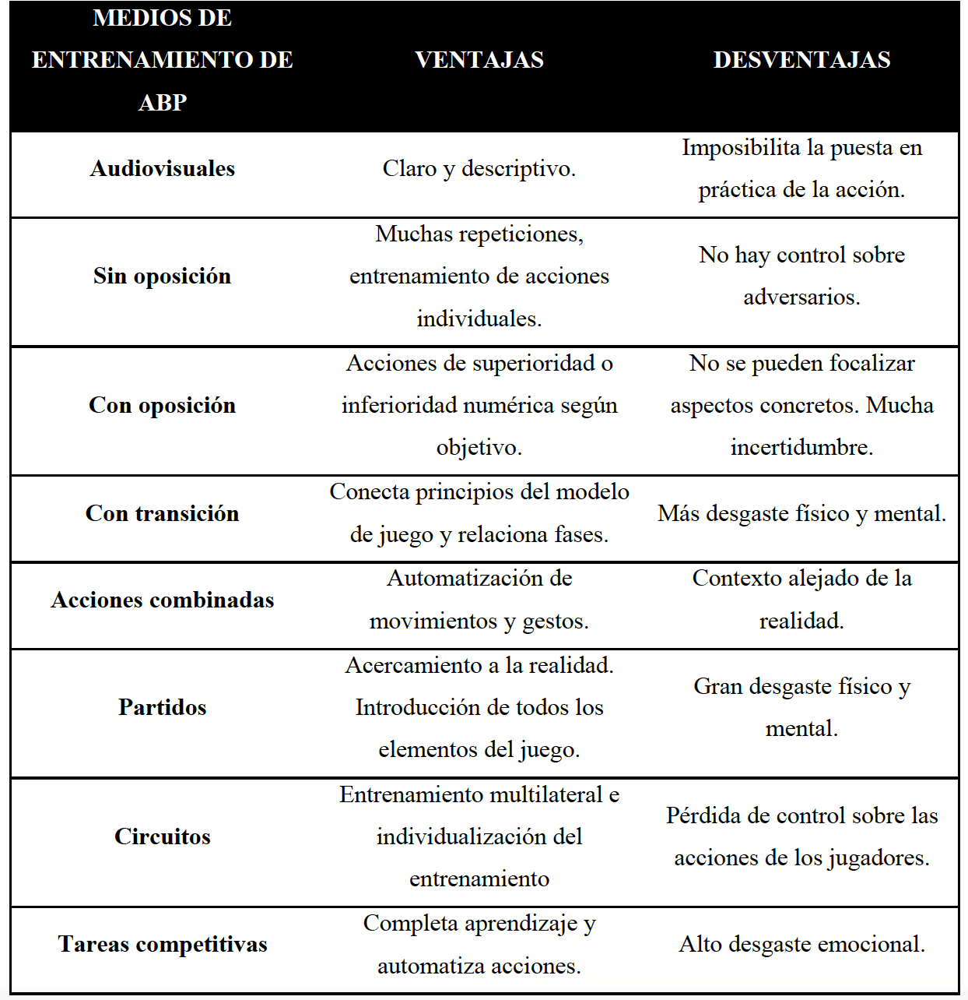

**Source : **Adapté de « Orientations méthodologiques pour l’entraînement des coups de pied arrêtés » (p.7), par López, A. et Fernández, D., 2013, *Futbolpf : Journal of Physical Preparation in Football, (9).*

Suivant cette tendance méthodologique, Fernández Hermógenes et al. (2017) proposent de rapprocher l’entraînement des coups de pied arrêtés de la réalité d’un match de football avec les exigences physiques et psychologiques que cela implique.

Dans le même ordre d’idées et du point de vue des joueurs, Sergi Gómez (communication interne du département d’analyse du FC Barcelone, non publié), défenseur central du FC Séville, a souligné que : *« Lorsque l’ABP est entraîné à la fin de la séance et isolé, le joueur a tendance à se déconnecter ». *De plus, il a terminé en précisant : *« De mon point de vue, la formation PBL doit être incluse autant que possible dans les situations de la séance ».*

Pour aller plus loin, Fernández Hermógenes, (2019) du département d’analyse du FC Barcelone, ne se concentre pas seulement sur l’entraînement de ces actions lors de séances exigeantes du microcycle hebdomadaire, mais propose également d’inclure une formation PBL lors de certaines situations (ou tâches) fatigantes du simulateur.

Nous comprenons que ce n’est pas la même chose de tirer un corner pour gagner à la 20e minute dans un match que nous jouons à domicile lors de la 2e journée de championnat, que de le faire dans les arrêts de jeu d’un match nul à l’extérieur. En ce sens, il est essentiel de proposer des situations d’APP dans différents scénarios avec différents niveaux d’exigence physique et mentale et d’engager le joueur, compris comme une structure hyper-complexe, à interagir et à s’adapter à des environnements changeants.

Cette proposition propose non seulement de travailler sur l’APP en tant que telle, mais se concentre également sur l’entraînement de contenus technico-tactiques qui seront totalement transcendantaux pour l’optimisation de la performance d’un joueur dans une APP donnée. Celles-ci peuvent être incluses dans une variété de tâches, et certaines des plus importantes pourraient être les suivantes (Figure 11).

**Graphique 11. *Contenus technico-tactiques individuels de PBL. Concentré sur les corners et les fautes indirectes***

<table>
<colgroup>
<col style="width: 49%" />
<col style="width: 50%" />
</colgroup>
<thead>
<tr class="header">
<th><strong>Contenu individuel au niveau défensif</strong></th>
<th>Contenu <strong>offensant individuel</strong></th>
</tr>
</thead>
<tbody>
<tr class="odd">
<td><ul>
<li>
Marquage individuel à partir d’un coin direct.
</li>
<li>
Marquage individuel dans le coin indirect (sortir et garder le corps profilé)
</li>
<li>
Marquage individuel en cas de fautes (facteur de conditionnement du hors-jeu)
</li>
<li>
Contrôle d’un certain espace assigné.
</li>
<li>
Approche du dégagement (course défensive).
</li>
<li>
Exécution de l’autorisation.
</li>
</ul></td>
<td><ul>
<li>
Tir à l’arrêt (corner direct). Chemin ouvert et fermé
</li>
<li>
Tir en mouvement (corner court) Trajectoire ouverte et fermée.
</li>
<li>
J’ai frappé avec d’autres trajectoires (plat et plat).
</li>
<li>
Surmonter un marquage individuel (Se débarrasser de la marque)
</li>
<li>
Approche du tir (course finale).
</li>
<li>
Déroulement de l’enchère
</li>
</ul></td>
</tr>
</tbody>
</table>

**Fontaine: **Propre élaboration basée sur* la Proposition pour l’intégration des corners dans le microcycle structuré du FCB*, par Fernández Hermógenes, D., 2019, Département d’analyse du FC Barcelone. Non publié.

Fernández Hermógenes (2019) souligne qu’en introduisant ces contenus, ou d’autres spécifiés par l’entraîneur, dans des situations ou des tâches d’entraînement, nous impliquons le joueur dans des contextes dans lesquels il sera très fréquemment en compétition tout au long de sa carrière sportive. En outre, il précise que le fait que le joueur interagisse dans de tels contextes améliore l’apprentissage de la résolution de problèmes, stimulant la créativité du joueur pour résoudre une certaine situation.

Par exemple, il est certain qu’un joueur qui s’est entraîné tout au long de sa formation et de sa phase professionnelle, comme se débarrasser d’un marquage dans une certaine tâche, aura beaucoup plus de facilité à s’adapter à une situation similaire lors d’un coup de pied de coin en faveur de la compétition. De cette façon, la performance du joueur ne sera pas dirigée dans ces tâches, mais ce sera le joueur lui-même qui, en expérimentant ses possibilités d’action, comprendra que la meilleure façon de résoudre cette situation particulière peut être de feinter d’un côté pour sortir de l’autre côté.

Nous considérons donc que, grâce à la méthodologie intégrée, en plus de partir d’une conception du joueur totalement différente de celle de la méthodologie analytique, nous pouvons optimiser les performances en PBL des joueurs, et in fine, de l’équipe, en laissant place à la créativité propre du joueur qui interagira à tout moment avec l’environnement dans lequel il se trouve.

À tout ce qui précède, il faut ajouter deux éléments qui peuvent être essentiels à l’application de la méthodologie intégrée : la compétition active et les systèmes de notation.

Tout d’abord, nous croyons que tout ce qui implique de pratiquer ou d’entraîner l’APP dans des contextes sans opposition ne correspond pas aux réalités de la compétition et, en plus, ne perturbe ni ne génère de problème pour le joueur qui effectue cette APP. À un moment donné, nous pouvons être intéressés à souligner un aspect d’un jeu répété et à l’entraîner sans opposition, mais nous pensons qu’il doit s’agir de situations très exceptionnelles et loin d’être une constante dans le processus d’entraînement et d’optimisation de l’APP de la carrière sportive du joueur.

D’autre part, en ce qui concerne l’inclusion de systèmes de notation, Herráez (2003) a déjà présenté une proposition dans laquelle il entendait inclure l’entraînement des PBL dans des matchs réduits ou dans d’autres situations moins spécifiques telles que les circuits ou les arrivées, et introduire la concurrence comme un élément clé de ce processus.

Le fait d’introduire de la concurrence dans la situation présentée stimule la motivation des joueurs et génère leur adhésion à l’entraînement de ces actions. De plus, à travers la « concurrence » générée, nous essayons de garder reflétée la pertinence de l’APP dans le résultat.

À ce stade, il nous semble intéressant de nuancer les aspects clés des deux tendances méthodologiques discutées (figure 12). Il est donc clair qu’il y a eu une évolution en termes d’utilisation d’une méthodologie analytique pour la formation de l’APP, mais nous pensons que cela doit encore augmenter et nous devons continuer à travailler et à réfléchir pour essayer d’inclure la formation de ces actions dans des contextes réels et qui engagent vraiment le joueur. qui, en fonction de leurs interactions avec tous les éléments présents dans ces situations, vont s’auto-modéliser et tisser leur chemin vers l’optimisation de la performance dans ces actions.

Même ainsi, nous ne pouvons pas commettre l’erreur de considérer la méthodologie analytique comme une erreur, car elle peut vraiment être très utile dans des situations spécifiques pour effectuer un certain comportement pour la compétition du week-end ou pour établir des bases organisationnelles dans un certain PBL.

Bien sûr, dans le cadre de cette combinaison des deux tendances méthodologiques, nous considérons que la méthodologie analytique ne peut en aucun cas être la base de l’entraînement de l’APP tout au long d’une saison ou encore moins, tout au long de la carrière sportive d’un joueur.

**Graphique 12. *Comparaison des aspects clés de la méthodologie analytique et de la méthodologie intégrée dans la formation PBL***

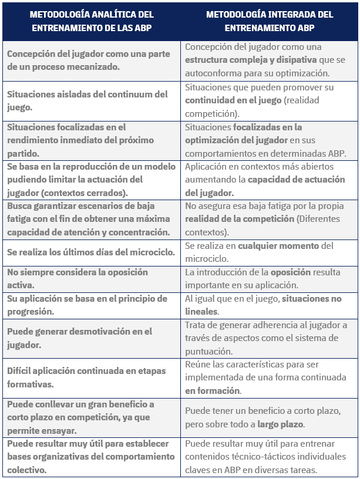

**Source : **Auteurs.

**Proposition pratique pour la formation à l’APP à l’aide de la méthodologie intégrée**

Ci-dessous, nous allons essayer d’illustrer certaines situations de formation PBL à travers la méthodologie intégrée. À cette fin, nous considérons qu’il est très important que ces tâches maintiennent les principaux aspects discutés jusqu’à présent. Par conséquent, dans les situations où nous entraînons l’APP de manière intégrée, nous devons être en mesure de présenter une variété de scénarios dans lesquels ces APP se produisent (au niveau de la fatigue), ainsi que de nous concentrer sur certains contenus individuels spécifiques à optimiser, tout en essayant de ne pas isoler la situation du jeu lui-même et en laissant de la place aux possibilités d’intervention du joueur.

- balle

Situation A. **Rondo 5x2 + corner** (Figure 13)

Deux rondos 5x2 sont fabriqués, organisant les joueurs de manière à ce que ceux qui nous intéressent pour avoir une charge plus élevée (par exemple, parce qu’ils ont joué moins de minutes le jour du match) soient situés dans le rondo loin du but. Chaque fois que le préparateur physique le signale, les joueurs vont aller à un rythme élevé dans la zone où deux corners seront pris à la suite. Il est à noter qu’après chaque corner, l’équipe défensive a la possibilité d’obtenir un point si elle parvient à amener le ballon à la hauteur du 2ème rondo. Pour ce faire, ils disposent de 10 secondes après le premier dégagement, sinon la séquence sera terminée et le prochain corner sera tiré ou les joueurs reviendront à des situations de rondo. Une équipe sera organisée offensivement et l’autre défensivement, de sorte qu’elles alterneront les rôles à chaque panneau. La seule indication donnée par l’entraîneur est que l’équipe dans un rôle défensif doit être organisée en marquage combiné.

Le système de notation suivant est établi : Enchère = 1 point. But = 3 points. Amener le ballon au 2ème rondo = 1 point pour l’équipe défensive.

Variante possible : Utilisation du même exercice en effectuant des coups francs latéraux.

- balle

Situation B.** Allumette réduite + faute latérale **(Figure 14)

Une situation de match réduit 5v5 + 2 jokers extérieurs est jouée par chaque équipe. Au signal du préparateur physique, l’un des jokers (précédemment indiqué) sera prêt à tirer un coup franc latéral. Comme dans la tâche précédente, chaque signal de l’entraîneur physique est un changement de rôle, par conséquent, les deux équipes alterneront l’attaque d’un coup franc latéral avec la défense. Dans ce cas, l’entraîneur indique que l’équipe défensive doit être organisée dans une zone tandis que l’équipe offensive doit exécuter à travers une trajectoire ouverte.

Le même système de pointage est établi que dans l’exercice précédent, mais dans ce cas, le point (tir) ou les 3 points (but) seront ajoutés au résultat du match.

Variante possible : Limitez le nombre de défenseurs qui participent à la PBL.

Dans les deux situations proposées, le contenu individuel de base pour l’APP sera entraîné et optimisé, comme l’élimination du marquage individuel, à la fois sur coup franc latéral et sur corner, ou au niveau défensif, la vitesse dans l’organisation collective (attention), le marquage ou le positionnement individuel et la gestion de l’espace en défense de zone.

**Graphique 13. *Situation A. Rondo 5x2 + corner***

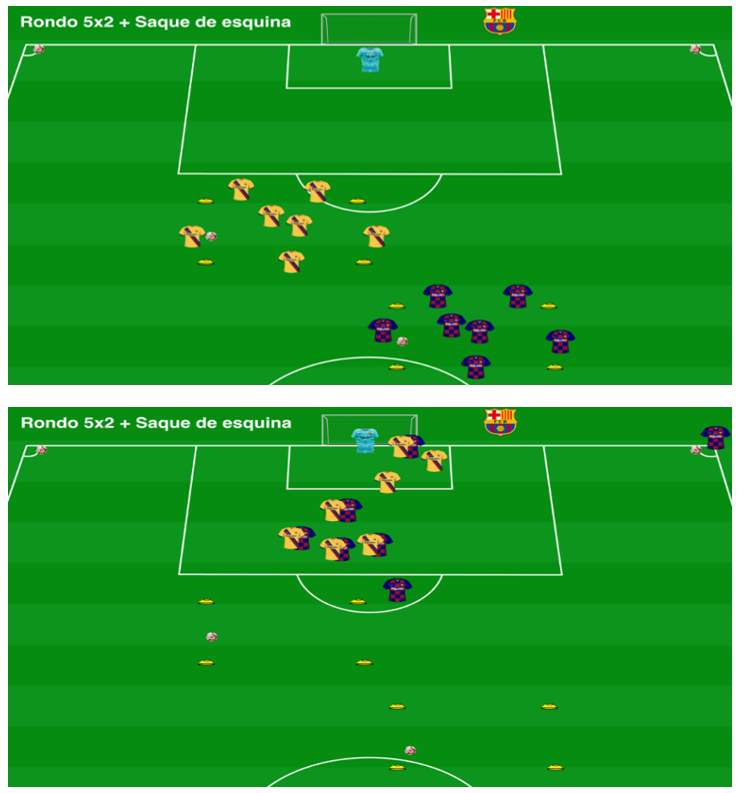

**Source : **Élaboration propre basée sur *la Proposition pour l’intégration des corners dans le microcycle structuré du FCB*, par Fernández Hermógenes, D., 2019, Département d’analyse du FC Barcelone. Non publié.

**Graphique 14. *Situation B. Match réduit + faute latérale***

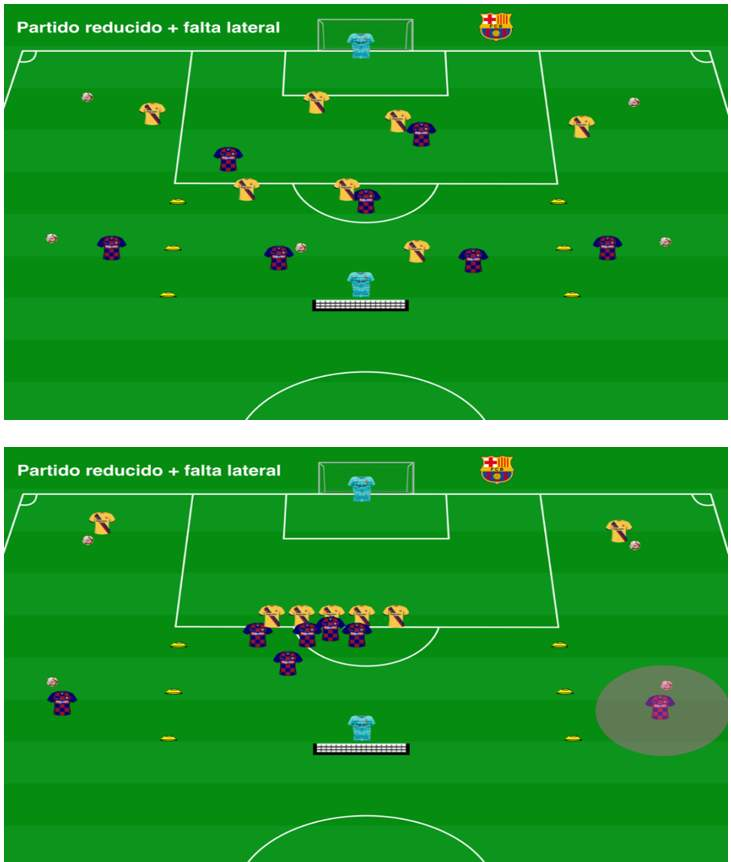

**Source : **Élaboration propre basée sur *la Proposition pour l’intégration des corners dans le microcycle structuré du FCB*, par Fernández Hermógenes, D., 2019, Département d’analyse du FC Barcelone. Non publié.

Enfin, l’inclusion de l’entraînement au coup de pied de coin dans un microcycle hebdomadaire est présentée à titre d’exemple (Figure 15). Celle-ci, adaptée de Fernández Hermógenes (2019), a un critère qui divise l’application de cette méthodologie de formation PBL en deux aspects : un ludique et un compétitif.

Dans le premier, à travers des situations de faible exigence physique et mentale, l’objectif est d’inclure des aspects clés des coups de pied de coin à travers d’autres exercices (par exemple : finition, passes de roues, jeux de situation, etc.). D’autre part, dans la concurrence concurrentielle, la situation principale sera l’APP elle-même ; Cependant, il peut être inclus dans certains exercices ou travaillé séparément, avec des systèmes d’opposition et de notation.

**Graphique 15. *Exemple d’inclusion de l’entraînement au coup de pied de coin dans un microcycle hebdomadaire***

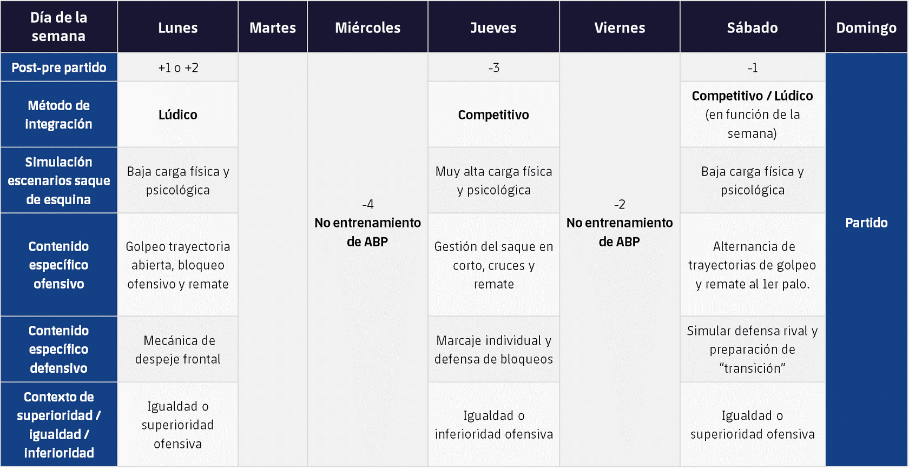

**Source : **Élaboration propre basée sur *la Proposition pour l’intégration des corners dans le microcycle structuré du FCB*
