[**  
Module 3. Situations de simulation préférentielles de préférence contextuelle du jeu**](https://static.capabilia.org/cursos/barcelona_coachesacademyii_intercambiopedagogicoconeljugador_eldisenodelasspenrelacionalapreferenciadecontenidosdidacticoses_may21/L3/index.html#/)

**  
Unité 3.1 Situations de simulation préférentielles de préférence contextuelle du jeu**

*Sujet 1 de 3*

**Introduction**

Les procédures observées jusqu’à présent, représentées par différents SSP, ont pour nature d’établir un contexte qui permet d’optimiser et de se concentrer sur les aspects coordinateurs et cognitifs, à travers les différents concepts qui composent l’intention collective et, par conséquent, l’idée de jeu. Par conséquent, ces jeux communicatifs ne nécessitent pas la définition spécifique d’une situation de jeu particulière, ni de références ou de formalismes qui découlent du jeu. Au contraire, tout jeu de football qui parvient, à travers les contraintes qui façonnent la conception du SSP, à établir une cohérence par rapport à la dynamique du jeu – c’est-à-dire qu’il est de coopération-opposition, qu’il est d’espace partagé, qu’il a le ballon comme élément dynamique de référence pour les deux équipes, et que l’exécution des actions de jeu se fait principalement avec les membres inférieurs – et qu’il met le centre d’attention dans les aspects liés à l’individu-joueur et à sa relation avec le jeu, il sera considéré comme un environnement propice à faciliter son auto-formation (Seirul·lo, 2020). En bref, nous pourrions dire que n’importe laquelle des situations de simulation préférentielles précédemment montrées représenterait des contextes dans lesquels les éléments intrinsèques du jeu sont continuellement présents et où le jeu du football présente de plus grands degrés de liberté, soit en raison de la modification des règlements, des concepts auxquels on veut avoir un impact, soit de l’interprétation que l’on fait de sa propre idée du jeu que l’on veut prendre dehors.

D’autre part, les SSP de préférence contextuelle du jeu se référeront à ces procédures qui visent à représenter un contexte particulier du jeu, et qui permettent ainsi d’établir un point de départ défini, à travers lequel l’optimisation de chacun des joueurs – dans leur relation avec l’environnement de jeu – se fait référence à un contexte défini et que nous considérons comme plus proche de ce que nous trouvons dans situation de match. Dans la plupart des cas, l’intention préalable à son application dans la pratique de l’entraînement est donnée par la construction d’un modèle de jeu qui *parvient à *séquencer certaines *parties *du jeu, et que celles-ci constituent une référence commune pour toute l’équipe ; C’est-à-dire que les contextes de jeu qui sont définis sont généralement caractérisés par le consensus de tous les membres pour comprendre que chacun d’entre eux fait référence à un moment particulier du jeu et qu’il est connu et identifiable de tous. Rien ne pourrait être plus éloigné de la vérité, nous allons essayer d’expliquer quelle erreur de perception peut provoquer la spécification des contextes de jeu et, d’autre part, d’impliquer son utilité lors de la conception de SSP de ces caractéristiques.

En premier lieu, puisque ce jeu est considéré comme un tout indivisible, le fragmenter et le séquencer pour en représenter certaines parties n’a aucun sens si nous voulons que la somme de tous nous donne la totalité du jeu. Il a déjà été fait référence, dans le cours 1, à la possibilité de s’interroger sur ce qui est actuellement considéré comme la *réalité *du jeu et sur la manière dont cette conception a modifié la manière dont nous observons les événements d’un match.

À de nombreuses reprises, nous représentons des situations de jeu particulières qui ont une très grande valeur conceptuelle (explicite), mais qui ne tiennent pas pleinement compte de la signification qu’elles ont pour le joueur. Prenons, par exemple, un contexte dans lequel nous voulons pratiquer une sortie de ballon, représentée dans notre zone de départ par un but, et la structure *partielle *qui coexiste généralement dans ces espaces, prenons par exemple le gardien de but, les défenseurs centraux, les arrières latéraux et les milieux de terrain, ainsi que l’approche théorique de l’adversaire que nous considérons comme un défi à contrer (Figure 1).

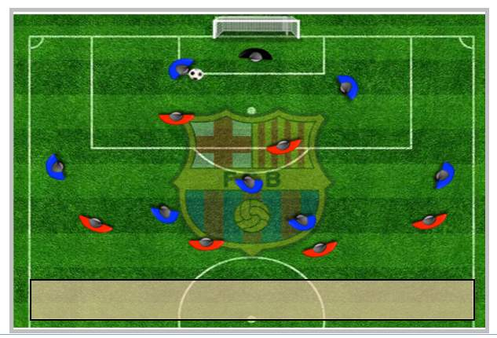

**Fontaine: **Élaboration personnelle.

**Figure 1 : Représentation d’une situation de jeu**

Représentation d’une situation de jeu particulière, à partir d’une relance du but, dans laquelle une structure 1-4-3 dans la disposition du ballon et une structure 4-2 dans la récupération se font face.

Dans cet exemple, une situation de jeu claire peut être observée dans un premier temps, où le ballon se trouve dans la zone la plus proche de son propre but, et où les joueurs qui sont généralement à l’arrière et à l’intérieur des zones jouent contre les joueurs les plus avancés de l’équipe adverse. La zone de score indique également la directionnalité qui est recherchée dans ce jeu, et pourrait représenter l’arrivée d’une deuxième phase du moment de disposition (si vous voulez l’appeler ainsi), c’est-à-dire avoir surmonté cette situation partielle de 8x6.

La mise en œuvre de ce type de SSP signifie que tous les participants (ou non, si vous souhaitez inviter les joueurs à vivre le contexte sans savoir au préalable de quelle situation de jeu spécifique il s’agit, même si ce n’est pas fréquent) sont conscients du type de contexte de jeu dont ils font partie avec l’intention de transférer ces connaissances ou cette expérience à une situation de match plus spécifique. Disons que, dans la procédure précédente, les joueurs s’identifient avec des démarcations ou des fonctions spécifiques, qu’ils comprennent qu’ils se trouvent dans une zone spécifique du terrain et qu’ils connaissent leur objectif (atteindre une certaine zone) ainsi que celui de l’adversaire (marquer un but sur but). Toute cette mise en scène veut représenter une *partie *du jeu que l’on pourrait définir comme *sortie* de balle, comme on pourrait généralement l’appeler (on ose dire, traditionnellement) en se référant au début de partie, une séquence précédant une progression dans le jeu, pour finalement conclure, et valant la redondance, dans une finition dans le but de l’adversaire.

Comme nous l’avons observé, la conformation de ces contextes d’apprentissage provient normalement d’un point de vue linéaire et rigide basé sur un modèle mental. Nous ferons de même et nous nous baserons sur une structure de jeu qui modélise les différents moments ou, plutôt, les contextes qui, selon nous, peuvent apparaître dans le match. Cela servira de point de départ pour proposer différents exemples facilement reconnaissables par tous, étant donné qu’il s’agit de la manière dont le jeu a été organisé ces derniers temps, sans laisser de côté l’intention de le présenter pour ce qu’il est vraiment : un contexte d’apprentissage de plus dans lequel la possibilité (ou du moins devrait) de l’émergence de nouvelles interactions entre les joueurs qui commencent, Ici, oui, de références construites (et non dynamiques). Par conséquent, les mêmes aspects de coordination et cognitifs mentionnés dans les modules précédents ne devraient pas être affectés en termes de développement (faire quelque chose de contextualisé ne devrait pas changer notre mission d’auto-façonner le joueur et de promouvoir des interactions efficaces-efficientes entre eux par rapport à l’environnement), mais simplement plus d’informations sont fournies pendant le SSP et cela change les conditions initiales du jeu pour la valeur qui lui est donnée socioculturellement à ces références précédentes.

Dans le cas de contextes de jeu, nous nous référerons à la signification que le joueur (et l’ensemble des joueurs) donne à ces références avant le début du jeu et à ce que cela implique dans leur interaction ultérieure avec celle-ci, en comprenant que, comme mentionné précédemment, ces références découlent d’un modèle mental (construction) normalement conçu par l’entraîneur et que, Par conséquent, ce n’est pas nécessairement un aspect qui est directement perçu à partir des événements du jeu.

**Le joueur aurait-il l’impression d’être *sur une balle si *ce concept n’a pas été présenté auparavant comme l’une des *parties* du jeu ? Ou ce que le joueur perçoit, s’il n’avait aucune de ces références précédentes, ce sont simplement ces références dynamiques qui naissent du mobile (ballon) et des lieux, des distances et des trajectoires de ses coéquipiers et de ses adversaires ?**

C’est simplement l’une des nombreuses réflexions que l’on peut faire sur la valeur ajoutée offerte par ces contextes définis et qui découlent souvent plus du besoin de l’entraîneur, d’énumérer, de contrôler et d’expliquer les différentes circonstances du jeu, que de la fluidité du joueur dans un contexte donné et qui a des caractéristiques particulières dont il peut se nourrir.

**Les caractéristiques des contextes de jeu**

Nous essaierons de nuancer l’explication précédente à travers cette section, dans laquelle nous avons l’intention d’approfondir les différentes caractéristiques que présentent généralement les pratiques basées sur des contextes de jeu spécifiques. Si nous regardons à nouveau la figure 1 et imaginons que nous commençons le jeu avec les conditions expliquées (une équipe doit avoir le ballon jusqu’à ce qu’elle puisse atteindre la zone de score, et l’autre doit récupérer le ballon et marquer un but), nous pouvons nous faire une idée de la façon dont les différents événements du jeu se dérouleraient, Surtout si à la fin de chaque *replay*, il a été relancé depuis le but. Par conséquent, nous pouvons imaginer que les informations que nous pouvons fournir en tant qu’entraîneurs sont liées à la largeur entre les défenseurs centraux, à la ligne de passe du gardien de but, à la hauteur des arrières latéraux, aux trajectoires du milieu de terrain, à la synchronisation entre les milieux de terrain, et à tout aspect connexe qui facilite la coordination entre ce groupe de joueurs afin d’atteindre cette zone qui représente le dépassement de cette situation. Bien sûr, dans un premier temps et vu de l’extérieur, la situation en question présente de nombreux aspects similaires à ce que l’on peut comprendre comme *une sortie *de balle et que les entraîneurs et les joueurs pourraient facilement sentir qu’ils vivent dans un contexte identique à celui du match. Cependant, si l’on prend le *match *comme point de référence, il est conseillé de réfléchir aux caractéristiques que ce type de pratique apporte avec lui, afin d’en tenir compte dans le processus d’apprentissage des joueurs et les éventuels transferts qui peuvent survenir par rapport au contexte compétitif.

- 1

1

<u>Nous nous appuyons sur des éléments rigides et non dynamiques</u>

C’est le premier point sur lequel nous devons être clairs et, bien qu’il ait déjà été mentionné au cours du texte, il est essentiel de comprendre que les éléments qui composent un contexte particulier (zone du terrain, structure, démarcations, etc.) n’ont pas de valeur en eux-mêmes, mais que c’est nous qui attribuons certaines interprétations ou d’autres en fonction des informations que nous associons à chacune des références. Par exemple, diviser le champ en zones (A, B, C et D) n’a pas de valeur informative objective, mais sa signification sera le produit, en premier lieu, de la définition que nous donnons à chacune de ces zones (au lieu de quatre, il pourrait s’agir de deux, trois, cinq ou sept, selon l’utilisation que nous donnons à ces zones). et deuxièmement, de l’éducation attentionnelle que nous mettons en avant chaque fois que nous nous référons à l’un de ces domaines (par exemple, dans la zone A, nous voulons attirer autant de joueurs que possible et nous sentir à l’aise malgré le fait de jouer près de notre objectif). Par conséquent, il est important de comprendre que les possibilités d’action que l’équipe perçoit dans chacun de ces contextes seront soumises à la valeur ou à la signification que nous associons à chacun d’eux, et que ce qui aura vraiment une valeur ajoutée, ce seront ces références dynamiques qui se produiront au cours du jeu, qui seront traitées dans le troisième point. En bref, nous devons comprendre les limites de l’utilisation de ces éléments statiques du jeu comme référence et ne pas tomber dans l’erreur de leur donner une importance transcendantale pour comprendre le jeu, puisque ce qui est pertinent se trouve dans les aspects qui le dynamisent.

- 2

2

<u>On oublie que le tout est toujours présent</u>

À ce stade, nous voulons introduire la compréhension du jeu dans son ensemble, un *continuum *d’événements stochastiques (les conditions précédentes sont les suivantes et donc ce n’est pas un processus déterministe, mais ce n’est pas non plus aléatoire), dans lequel ces contextes ne représentent qu’une fraction, un instant du jeu qui est difficile à répéter et qui, Par conséquent, il peut être représenté dans son intégralité.

**Figure 2 : Représentation de la situation de jeu précédemment présentée.**

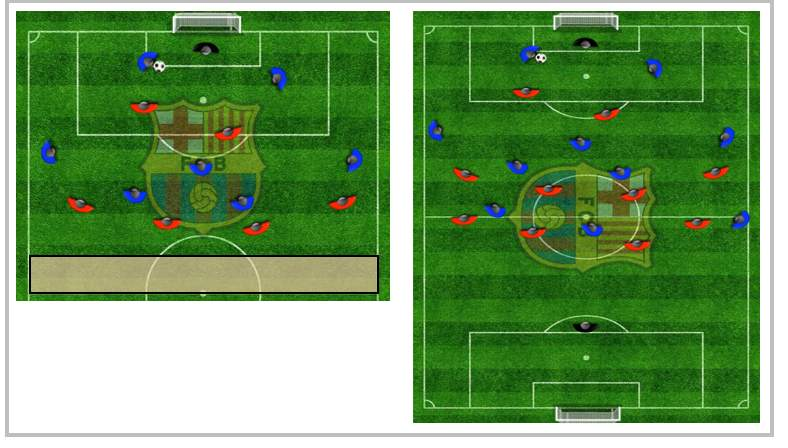

**Fontaine: **Élaboration personnelle.

**Graphique 2**. Représentation de la situation de jeu précédemment présentée (à gauche), avec la reprise du but et avec une structure spécifique de l’équipe en disposition et de l’équipe en récupération, par rapport à la situation de jeu complète (à droite).

Si l’on revient à l’exemple précédent, maintenant représenté dans la figure 2, où 8 joueurs d’une équipe et 6 d’une autre sont utilisés pour représenter un redémarrage du jeu avec une certaine structure initiale (à gauche), on peut dire que, superficiellement, il représente fidèlement une partie du contexte global du jeu (à droite). Au moment où le ballon entre en jeu, les deux situations – même si l’une est pratiquement la même que l’autre – et toute la dynamique sont conditionnées par tous les éléments qui composent chacune d’elles. Par exemple, le fait de ne pas avoir les joueurs les plus avancés est déjà un facteur conditionnant dans le comportement des joueurs présents, en termes de distances, de profils et de possibilités d’action qu’ils perçoivent. Pour dire l’une des multiples options, dans la figure de gauche, l’intérieur sera plus en phase avec la possibilité de recevoir dans la zone de but marquée pour atteindre la cible, alors que peut-être, dans la figure de droite, ils ont l’air plus positionnels, essayant de recevoir devant leurs milieux de terrain, Sachant qu’il y a des joueurs avec qui continuer à communiquer sur les ailes et dans les zones les plus avancées.

Ici, nous ne faisons pas référence à ce qui serait la meilleure option pour être efficace dans le jeu (en plus du fait que cela dépendra également de l’idée et des intentions du jeu que l’équipe a), mais nous voulons refléter cela lorsque nous jouons un jeu partiel (à gauche) de ce que nous comprenons comme le jeu total (à droite), Le premier acquiert une caractéristique fractale et devient donc un jeu en soi et non la représentation fidèle d’une partie du jeu qui peut ensuite être attachée aux parties restantes pour former le tout. Les fractales sont présentes dans la nature et font référence à des structures apparemment irrégulières qui se répètent à différentes échelles, acquérant ainsi des formes, des caractéristiques et des comportements équivalents dans toutes les dimensions à partir desquelles le phénomène peut être observé (Balagué & Torrents, 2011).

**Graphique 3. Exemple d’une fractale dans la nature, où le tout est représenté dans chacune des dimensions sous-jacentes**

**Source : **\[Image sans titre sur les fractales\], s.d., [<u>https://bit.ly/32q637P</u>](https://bit.ly/32q637P) 

Il s’agit de soutenir que la représentation partielle d’une situation de jeu est possible, mais seulement à travers les propensions (certaines interactions) qui y sont recherchées, et non du point de vue formel et structurel (contrecarrer une certaine structure de l’équipe adverse). Cela devient plus évident si nous prenons l’exemple des situations qui représentent les *zones de progression*, où nous supposons que l’équipe a déjà réussi à vaincre une série de joueurs de l’équipe adverse et que nous entrons dans cette zone de création mal nommée.

**Sur quels éléments structurels nous appuyons-nous pour dessiner les contextes à ce stade du jeu ? La variabilité avec laquelle il est généralement atteint, le désordre que présentent généralement les formations d’équipe, la multitude d’interrelations possibles qui se produisent en raison de la nature stochastique du jeu, comment peuvent-elles être représentées à partir d’une instance statique du match alors que le ballon a déjà dynamisé (et conditionné) les événements précédents ?**

De même que dans la figure 2, il était assez facile d’identifier tous les éléments contextuels (du point de vue de l’entraîneur), dans cette figure 4, nous aurions besoin de plus d’informations verbales ou, plutôt, nous aurions besoin d’avoir vu le cours, la tendance et le dynamisme du jeu (les moments précédents) pour comprendre à quelle situation de jeu spécifique il se réfère. car par l’image statique un nombre infini de choses peut être présupposé, même si elles sont représentées d’une manière presque rigide.

**Graphique 4. Représentation graphique d’un SSP qui veut représenter un certain contexte du jeu qui ne part pas de décors**

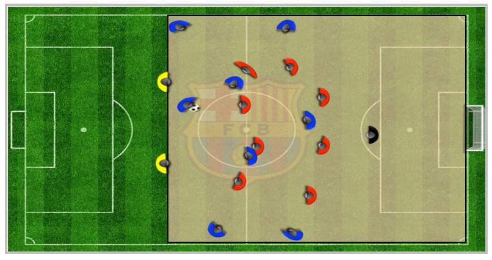

**Fontaine: **Élaboration personnelle.

Dans ce SSP, la même équipe qui a commencé dans la situation précédente a maintenant le ballon sous contrôle dans la zone du milieu de terrain et devant la structure de l’adversaire avec un 1-4-4. Vu sous cet angle, il semble logique de penser que la structure de l’équipe en arrangement est complétée par deux jokers qui pourraient représenter les défenseurs centraux pour établir un 4-3-3. Dans ce cas, cependant, le milieu de terrain a le ballon devant les deux lignes de 4 proposées par l’adversaire, une situation qui ne se produit que si les attaquants de l’autre équipe ne sont pas directement impliqués à ce moment-là, et si l’équipe est stable.

Il ne peut s’agir d’une continuation de la situation de la figure 2, car il est rare que le jeu concatène deux périodes de jeu stable au cours desquelles les lignes sont franchies, une par une, pour avancer vers le but de l’adversaire. Comme nous l’avons insisté, ce contexte de jeu pourrait représenter un 8x6, dans un grand espace, avec un but assez éloigné et avec la présence de deux jokers qui représentent à leur tour un soutien pour l’équipe en disposition et une menace dans le cas où l’équipe rouge récupère le ballon. Cela n’équivaut pas à se préparer à savoir jouer avec une structure 1-4-3-3 contre une structure 1-4-4-2, dans la zone de création, car ces arguments ne sont que des caractéristiques rigides qui ne sont pas fidèles au dynamisme du jeu.

En fait, si nous devions continuer la situation de la figure 2, nous trouverions quelque chose de similaire à ce qui est observé dans la figure 5 (ou à n’importe quelle image aléatoire que nous extrayons d’un match dans lequel le jeu vient de commencer à partir du but) car une fois que le ballon entre en jeu, toutes ces références statiques initiales sont floues et il est impossible de prévoir les nouveaux événements du jeu. Ángel Ric (2018) explique que « cette diversité de comportements se traduit par une dynamique métastable » ([<u>https://bit.ly/3n2rm8S</u>](https://bit.ly/3n2rm8S)), c’est-à-dire que nous devons supposer que cette coexistence de la stabilité et de l’instabilité dans le jeu signifie que nous devons considérer la pratique de l’entraînement d’une certaine manière chez les joueurs, car « certains contextes de jeu peuvent modifier la quantité de comportements stables et instables de l’ensemble des actions que les joueurs réalisée dans des domaines spécifiques du terrain » (Ric, 2018, [<u>https://bit.ly/3n2rm8S</u>](https://bit.ly/3n2rm8S)).

**Graphique 5 : Cas d’un match dans lequel le ballon se trouve au milieu de terrain**

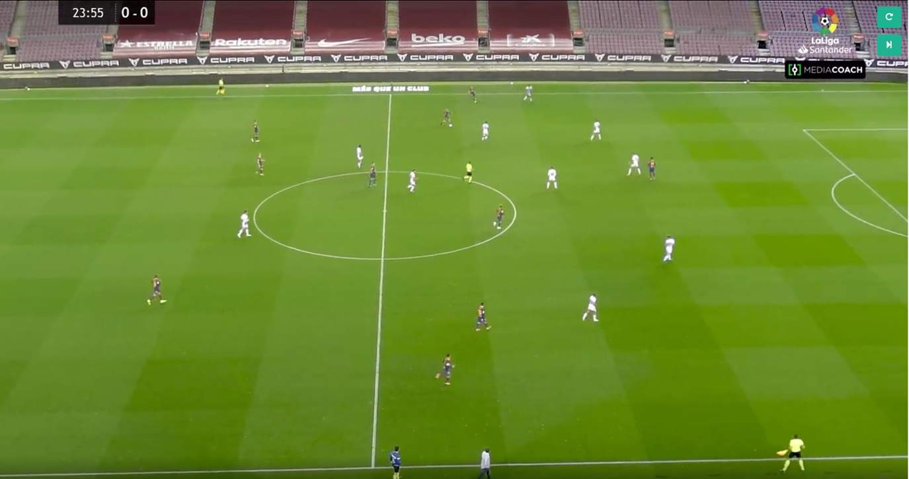

**Fontaine: **Département de science des données du FC Barcelone.

**Graphique 5 : **Instance d’un match dans lequel le ballon se trouve au milieu de terrain. Comment savoir qui est le joueur (démarcation) qui a le ballon ? Avec quelle structure chaque équipe joue-t-elle ? D’où vient la balle ? Qui prend l’initiative en ce moment même ?

Par conséquent, le contexte de jeu semble jouer un rôle crucial lors de la conception de nos séances d’entraînement (que nous développerons plus tard), mais nous insistons à nouveau sur le fait que nous ne pouvons pas trop insister sur la conformation de ce contexte à travers les éléments structurels et formels du jeu, mais que tout cela devient le point de départ pour identifier une situation et ensuite donner lieu à la multitude d’interactions qui permettent aux joueurs de fonctionner dans cet environnement.

- 3

3

<u>Nous croyons que nous représentons la </u>*réalité *<u>du jeu</u>

Cet excès d’importance que l’on accorde au contexte du jeu nous amène généralement à différencier les SSP plus génériques ou décontextualisés, de ceux qui prennent en compte le contexte du match pour les appeler spécifiques ou contextualisés. De notre point de vue, ces catégories peuvent être valables pour se référer précisément au fait d’ajouter des références contextuelles à un PSS ou non, mais jamais pour déterminer que l’un est plus réel que l’autre.

Nous avons confondu ce qu’est la réalité du jeu au point de considérer que l’attribution de démarcations et la mise en place d’objectifs ont beaucoup plus de réalisme que n’importe quel jeu qui nous permet de manifester en permanence les interactions que nous considérons comme typiques de notre idée du jeu. Comme l’explique Andreu Enrich (2021), « la réalité du jeu n’est pas les formalismes du jeu... Ce n’est pas l’apparence des règles du jeu ; mais plutôt les propensions de ce que nous voulons promouvoir » ([<u>https://apple.co/3gntVRz</u>](https://apple.co/3gntVRz)) et, par conséquent, tout PSS qui garantit l’émergence de nos intentions sera le critère élémentaire pour considérer la validité (ou la *réalité*, si vous voulez) de la pratique que nous avons conçue.

Laissant de côté la différence qui existe dans l’impact émotionnel de jouer un match avec celui de faire une tâche d’entraînement (on ne peut jamais représenter avec une fidélité totale les situations de jeu qui se produisent dans un match lors d’une séance d’entraînement), il convient de se demander quels aspects le joueur soustrait des contextes d’entraînement qu’il se propose ensuite d’effectuer dans le match. Revenant sur la dichotomie de savoir si le point de départ est le jeu ou le joueur, Sampaio (2019) nous a invités à cesser de parler de ce qui est plus spécifique ou de ce qui est plus réel, pour laisser place au concept de transfert. Quels aspects du jeu se transmettent d’un contexte à l’autre ?

Comme mentionné précédemment dans le cours, les humains apprennent à apprendre, ce à quoi Keith Davids (2020) ajoute que

Il est important de comprendre que les affordances (possibilités d’interaction) qui sont perçues dans un contexte ne sont pas directement transférées à un autre. Les gens apprennent à utiliser de nouvelles affordances dans différents contextes. En bref, les gens n’apprennent pas à se déplacer dans l’environnement, mais nous apprenons à apprendre à bouger, car nous nous adaptons constamment. ([<u>https://www.youtube.com/watch?v=sOQ9_KX2wn8</u>](https://www.youtube.com/watch?v=sOQ9_KX2wn8)).

Cette déclaration peut nous aider à comprendre les processus internes du SSP lorsque nous le contextualisons et, à notre tour, à comprendre ce que cela peut impliquer dans la situation du parti.

La figure 6 montre deux espaces de dimensions égales, de même densité et avec le même objectif pour l’équipe en disposition, qui est de garder le ballon le plus longtemps possible, ainsi que pour les mêmes joueurs de participer aux deux SSP.

Dans l’exemple de gauche, la seule indication donnée est d’avoir le ballon, tandis que dans l’exemple de droite, le contexte de jeu est référencé à travers l’aire de jeu qu’il représente (zone A) et offre également la possibilité aux récupérateurs de changer de rôle s’ils parviennent à marquer un but dans le cas de la récupération du ballon (dans le premier exemple, Un changement de rôle instantané est effectué, dès qu’ils récupèrent le ballon). Indépendamment de l’effet d’avoir l’objectif, à la fois en tant que joueur en préparation et en tant que joueur en récupération, il est logique de penser que les joueurs, affectés à des postes spécifiques et sachant que la zone A du terrain est représentée, acquièrent d’autres comportements en fonction de la signification que ce contexte a pour eux.

Cela ne signifie pas que dans le premier cas, une *balle n’est *pas fabriquée et dans le second, c’est le cas, mais que les références précédentes configurent la manière dont les possibilités d’action dans l’environnement sont visualisées. Probablement, bon nombre des interactions émergentes sont les mêmes et identiques par rapport au jeu contextualisé plus tard, mais la valeur socioculturelle que la deuxième situation a dans l’équipe change complètement les *affordances perçues*.

Cela signifie que, si nous comprenons chaque entraînement ou chaque match comme un nouveau contexte d’apprentissage, les références précédentes existantes (par exemple, dans un match qui se termine avec une certaine structure, avec certains joueurs occupant des positions spécifiques et donnant certaines instructions sur l’intention recherchée) auront un effet sur la façon dont nous percevons les opportunités qui se présentent dans le contexte du jeu.

**Figure 6 : Représentation de deux SSP**

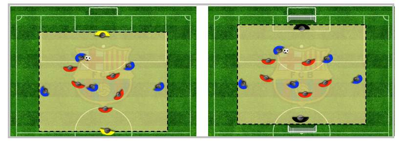

**Fontaine: **Élaboration personnelle.

**Graphique 6.** La représentation de deux SSP qui, étant de densité égale de joueurs, maintenant la supériorité numérique et les dimensions de l’espace, peut conduire à des interprétations différentes par les joueurs si des références (et des signifiants) préalables sont donnés qui les contextualisent dans une situation de jeu et dans un rôle donné.

Il convient de noter, en le rapportant à nouveau au concept de *réalité du jeu*, que le deuxième SSP, celui qui représente le but, les défenseurs centraux, les arrières latéraux, le gardien de but et une certaine pression de l’équipe adverse, ne représentera pas une sortie de *balle *(comme déjà expliqué dans la section précédente), mais favorisera la répétition systématique des interactions entre une série de joueurs qui jouent habituellement dans des démarcations en « X » (représentées par le aire de jeu destinée à être représentée), dans une densité « Y » et à des distances « Z » du ou des buts. Et que, grâce à l’expérience de ces densités, distances, espaces, supériorités, etc., de nouvelles *affordances *seront découvertes qui faciliteront la découverte de nouvelles *affordances *si un contexte similaire est identifié dans une rencontre.

En bref, et pour résumer ces trois sections, il sera important de considérer les contextes de jeu comme un espace où le joueur et l’équipe ont des références plus ou moins communes, à partir desquelles ils peuvent continuer à explorer et à exploiter les possibilités d’interaction les plus efficaces pour être efficaces dans le jeu. Par conséquent, « un joueur ou une équipe, comme tout système non linéaire, a la capacité de répondre par un éventail large, mais fini, de comportements plutôt que de trouver une seule solution pour atteindre le même objectif » (Ric, 2018, [<u>https://bit.ly/3n2rm8S</u>](https://bit.ly/3n2rm8S)). Cela dit, il faut tenir compte du fait que, en continuant avec l’exemple de la figure 6, le fait que le jeu dans la zone de départ est représenté de manière répétitive dans les deux sens (en raison du fait d’avoir deux buts et deux gardiens de but) et que le comportement le plus courant est de donner de la continuité quel que soit l’endroit où se trouve le ballon, Cela ne veut pas dire que les joueurs ne sont pas incapables d’identifier les espaces à l’arrière ou les opportunités de jouer longtemps au moment où elles se présentent. Nous insistons sur l’importance de comprendre que *les affordances *sont toujours présentes et que ce que nous recherchons avec nos tâches de formation est de promouvoir les propensions qui s’identifient à celles auxquelles nous voulons accorder plus d’attention. De la même manière, bien que le ballon passe d’un gardien de but à un autre et change la direction du jeu (parce que l’arrière droit est maintenant un arrière gauche, et vice versa), nous comprenons que cela a un impact beaucoup plus faible sur le joueur par rapport à la pertinence d’avoir la présence de joueurs spécifiques proches ou éloignés. la densité provoquée par le comportement de l’adversaire dans l’espace de jeu, l’identification des trajectoires, c’est-à-dire tous ces éléments dynamiques du jeu et laisse place aux comportements individuels et collectifs.

**Objectif de « préférer » contextuellement le jeu**

Il convient de comprendre que ces jeux contextuels (faisant référence au fait qu’un contexte spécifique a été défini) acquièrent beaucoup d’importance dans le processus de création de synergies et d’accélération du processus d’apprentissage au sein de l’équipe (l’apprentissage étant entendu comme la capacité de continuer à apprendre à partir du contexte dans lequel ils interagissent).

Bien que nous ayons mentionné de nombreuses caractéristiques impliquées dans la « préférence » des contextes de jeu dans les SSP à partir d’un point de départ erroné (du jeu et non du joueur), nous voulons ici souligner la valeur ajoutée de proposer ce type de pratique et nous approfondirons les éléments que nous utiliserons pour décrire chacune d’entre elles.

Il est essentiel de proposer des contextes de jeu qui permettent d’établir un langage commun. Si l’on considère l’entraîneur comme un élément fondamental du système d’apprentissage, comme expliqué dans le cours 1, il est évident que son idée du jeu, l’interprétation qu’il en fait et son modèle mental de la façon dont le jeu est façonné (par exemple, un modèle de jeu), auront également un impact important sur l’équipe (en comprenant cela comme l’ensemble des personnes qui la forment, et pas seulement les joueurs). Par conséquent, il faut comprendre que la perception et la compréhension du jeu par l’entraîneur seront également un facteur clé dans le développement de l’équipe.

C’est pourquoi, si l’entraîneur est capable d’identifier et de différencier les différents contextes de jeu qui se produisent et de donner de la cohérence à l’interrelation qui existe en eux, il n’est pas superflu d’utiliser ce langage (aligné à son tour sur le langage du club) pour faire explicitement référence à certaines situations et échanger des informations verbales à ce sujet. Comprenant que la valeur de cette connaissance déclarative est résiduelle dans la pratique du jeu, nous envisageons la possibilité de nous référer à ces situations pour introduire une certaine SSP, pour expliquer un incident de match ou pour donner des informations contingentes qui sont déjà contextualisées sous ce langage commun.

Cependant, nous sommes d’accord avec Carlos Lago (2021) lorsqu’il affirme que

Jouer et partager une interprétation du jeu avec ses coéquipiers dans l’espace le plus proche (espace d’aide) et dans l’espace le plus éloigné (espace de coopération) ne consiste pas à maîtriser des réponses prédéterminées. Il ne s’agit pas d’avoir des comportements automatisés qui se déclenchent lorsque l’environnement de jeu présente des caractéristiques spécifiques. Il s’agit plutôt d’avoir des structures comportementales qui permettent aux joueurs de s’adapter/proposer des réponses spécifiques à la situation et d’entrer en relation avec leurs coéquipiers de manière appropriée pour atteindre l’objectif commun poursuivi. Cette interprétation du jeu doit être découverte par le joueur et montrée par l’entraîneur lors de la séance. ([<u>https://bit.ly/32rrPIj</u>](https://bit.ly/32rrPIj)).

Par conséquent, il sera essentiel que, quel que soit le nombre ou le type de situations de jeu proposées, nous les comprenions toutes comme des points de départ à partir desquels de nouveaux comportements émergeront, et non comme des situations définies avec une interaction préétablie considérée comme idéale pour pouvoir la résoudre. Les situations de jeu ne sont pas résolues, mais jouées.

Nous sommes maintenant sur le point d’évoquer certains des éléments que nous considérons comme essentiels pour définir les contextes de jeu et comment, à partir de ces éléments plutôt rigides et statiques, nous essayons également de donner naissance aux aspects dynamiques qui en découlent. La compréhension de ces concepts nous aidera par la suite à comprendre la classification des contextes de jeu qui sera faite, ainsi que les exemples SSP que nous proposerons à la fin du module.

- 1

1

<u>Les moments du match</u>

Sans vouloir entrer dans trop de détails sur les réflexions qui pourraient être faites concernant les différents moments qui existent dans le jeu, nous nous référerons ici aux phases que nous considérons comme pouvant coexister au cours du jeu et qui se différencient en présentant des caractéristiques suffisamment uniques pour les séparer. Dans ce cas, la littérature souligne généralement la présence de quatre moments basés sur la possession du ballon ou non, ainsi que les moments de transition qui existent entre ces deux phases. Nous ne nous référerons qu’à deux moments de jeu : le moment de la disposition et le moment de la récupération. Nous contemplons que la dynamique du jeu ne différencie pas ces deux moments de manière séquentielle, c’est-à-dire qu’il ne s’agit pas d’un échange de coups dans lequel une équipe a d’abord le ballon et essaie de marquer, puis l’autre équipe fait de même, mais que le jeu lui-même est un *continuum *où ce qui prédomine est l’intention de l’équipe et qui prend l’initiative à ce moment du jeu. Enrich (2021) explique que

Avoir le ballon ou ne pas avoir le ballon ne doit pas expliquer les phases du jeu, mais c’est l’intention qui a le plus de pertinence dans la dynamique du jeu. Je peux avoir le ballon et défendre et je ne peux pas l’avoir et attaquer. ([<u>https://apple.co/3gntVRz</u>](https://apple.co/3gntVRz)).

Cela nous semble être un exemple très réussi pour comprendre ce que l’on appelle les phases du jeu et qui nous permet d’unifier tous les moments en un seul, celui de l’intention collective.

**Que voulons-nous accomplir à ce moment-ci ? Dans quelle mesure sommes-nous en mesure d’y parvenir par rapport à ce que l’adversaire propose ?**

**Figure 7 : Représentation des moments du jeu dans le cadre normatif (règles du jeu)**

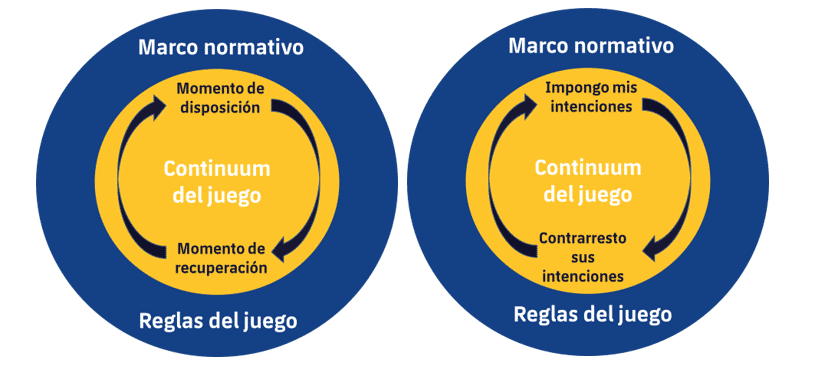

**Fontaine: **Élaboration personnelle.

**Graphique 7. **Représentation des moments du jeu dans le cadre normatif (règles du jeu). Il faut simplement souligner que le règlement ne spécifie pas qu’il y a des phases ou des moments spécifiques du jeu, mais qu’il s’agit d’interprétations qui proviennent de la dynamique du jeu, et c’est pourquoi la figure de la droite est proposée comme une alternative, où le jeu est un tout où l’intention d’une équipe et d’une autre s’affrontent. La figure de gauche sera référencée dans le texte.

Dans tous les cas, comprenant qu’une structure plus rigide nous permettra de comprendre les contextes de jeu que nous donnerons à titre d’exemple, ce module fera également référence aux moments de disposition (DM) et aux moments de récupération (MR), pour faire référence au moment où l’équipe a le ballon et au moment où l’équipe ne l’a pas et a l’intention de le récupérer.

- 2

2

<u>Les zones de la campagne</u>

Il s’agit de références spatiales communes à toute l’équipe afin de pouvoir localiser les différents événements et éléments du jeu dans une zone spécifique du terrain. Comme mentionné ci-dessus, ces domaines du domaine ne sont pas non plus une condition de la réglementation, mais sont des références construites afin d’établir un langage commun. Par conséquent, dans notre cas, nous nous référerons à la division du terrain en quatre zones (A, B, C et D) et quatre voies (LD, CD, CI et LI), donnant lieu à 16 secteurs.

**Figure 8 : Représentation des aires du champ auquel nous allons faire référence, et des 16 secteurs qui sont formés par la combinaison de zones et de voies**

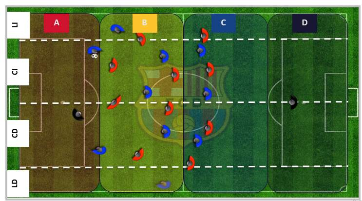

**Fontaine: **Élaboration personnelle.

On insiste sur le fait que ces zones n’ont pas de valeur en elles-mêmes, mais qu’on ne leur donnera un sens que lorsque des comportements, des conditions ou des intentions seront associés à chacune d’elles. Enfin, il convient de noter que les espaces auxquels nous donnerons vraiment de la pertinence au cours de tout jeu contextuel sont ceux qui sont dynamiques, qui seront régis par les distances des joueurs par rapport au ballon (intervention, entraide et coopération), ainsi que les espaces qui sont activés et désactivés par l’orientation du joueur (zone active et zone passive). entre autres.

- 3

3

<u>La structure de l’équipe</u>

Aussi connue sous le nom de système de jeu, la structure représentera l’emplacement initial des joueurs, représenté par des démarcations, et donnera naissance aux différentes *lignes *qui composeront le bloc de l’équipe. Dans une proposition comme celle que nous présentons, qui prône des dynamiques circulaires à toutes les échelles du jeu, ce type de définition ne convient pas tout à fait et, comme mentionné ci-dessus, ce seront les distances par rapport au ballon qui détermineront le rôle de chaque joueur (Figure 9). Il est crucial de comprendre que ce type d’organisation a été érigé parce que

La plupart des équipes de football sont organisées en fonction de l’emplacement des buts, en raison de deux objectifs principaux : marquer un but et protéger son propre but. Cependant, l’emplacement du ballon est essentiel pour définir le contexte du jeu. (Ric, Robertson et Sumpter, 2021, p. 15).

**Figure 9 : Représentation des espaces d’intervention, d’entraide et de coopération**

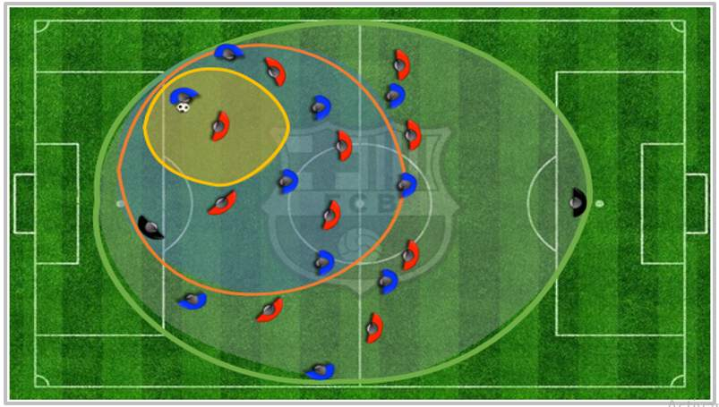

**Fontaine: **Élaboration personnelle.

**Graphique 9.** Représentation des espaces d’intervention, d’entraide et de coopération. Distance entre les joueurs et le ballon, quelle que soit la position d’origine qu’ils occupent. Suite à la confrontation des systèmes, on pourrait dire que dans ce cas, nous sommes partis d’un 1-4-4-3, en disposition, et d’un 1-4-4-2, en reprise. Même ainsi, en continuant avec les réflexions de la section précédente, si le jeu n’est pas en mouvement, nous avons besoin de plus d’informations pour comprendre comment ce cadre du jeu a été atteint.

Néanmoins, comme il s’agit généralement de partir d’une formation particulière (1-4-4-2, 1-4-4-3, 1-3-5-2, 1-3-4-3, 1-4-2-3-1, etc.), cet aspect sera évoqué pour contextualiser la situation de jeu et que ces rôles soient identifiés lors de la remise des références précédentes dans le SSP. Ainsi, nous comprenons que ces démarcations et ces rôles ne sont que des points de départ et qu’au moment où la balle entre en jeu, la dynamique elle-même conduira à ce que chacune d’entre elles se manifeste d’une manière différente, sans pouvoir prédéfinir les aspects que chacune des démarcations doit couvrir. Cela sera expliqué dans la section suivante, à travers les zones d’occupation préférentielle (ZOP) et les zones d’action préférentielle (ZAP) du joueur.

- 4

4

<u>Les démarcations du joueur</u>

Dans cette organisation linéaire par structures, ce que l’on appelle des démarcations ont émergé pour désigner chacun des acteurs qui composent cette structure, afin de définir le rôle que chacun d’entre eux occupe. Sans entrer dans la façon dont il faut appeler chacune de ces démarcations, puisqu’il s’agit d’un langage qui change en fonction du contexte socioculturel, il faut tenir compte du fait que ces références ont une signification pour le joueur, puisqu’il s’agit d’un aspect avec lequel il se développe et qui acquiert une valeur plus grande au fur et à mesure que son expérience augmente. Par conséquent, si nous voulons qu’ils se débarrassent des clichés possibles liés à chacune de ces démarcations et qu’ils naturalisent chacune d’entre elles comme de simples points de départ à partir desquels ils peuvent se développer en tant que joueurs, nous devons donner un message qui transmet du dynamisme lorsqu’on se réfère à ces occupations sur le terrain.

Comme nous l’avons dit, ces démarcations sont généralement liées aux lignes qui vont du plus proche du but de l’adversaire (défenseurs) au plus proche du but de l’adversaire (attaquants). Nous proposons des POPS qui représentent ces mêmes démarcations, mais qui prennent comme référence l’occupation, non pas du terrain de jeu, mais par rapport à la structure elle-même (Figure 10).

**Graphique 10. Représentation des zones d’occupation préférentielles en fonction de la structure et de la direction du jeu, avant la prise en compte du ZAP de chaque joueur**

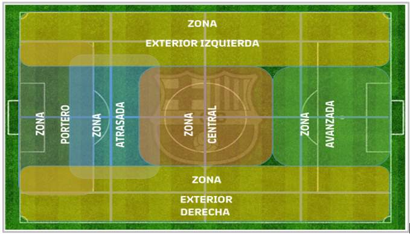

**Fontaine: **Élaboration personnelle.

En ce sens, peu importe que vous soyez un arrière latéral ou un ailier ouvert, peu importe que vous soyez un intérieur ou un milieu de terrain, mais ce qui est vraiment important, c’est la façon dont vous vivez le jeu par rapport à la structure (espace intérieur, espace arrière, espace avancé), car cela conduira à une série de perceptions basées sur de nouvelles possibilités d’action. C’est à partir de ce ZOP initial que se développe le ZOP de chaque joueur, comprenant cela comme sa propre tendance à occuper l’espace tout en agissant, avec ou sans le ballon, en sortant de son point de départ, afin d’être efficace dans le jeu (Figure 11). Cet élément est un aspect à prendre en compte lorsque l’on envisage la SSP, car connaître les tendances affichées par certains joueurs, en fonction du ZOP qu’ils occupent, nous permet de concevoir des environnements encore plus riches en tenant compte des caractéristiques propres au joueur.

**Figure 11 : Représentation de la zone de performance préférentielle d’un joueur qui aurait pu débuter dans la voie de gauche. En rouge, l’espace qu’il a occupé le plus souvent**

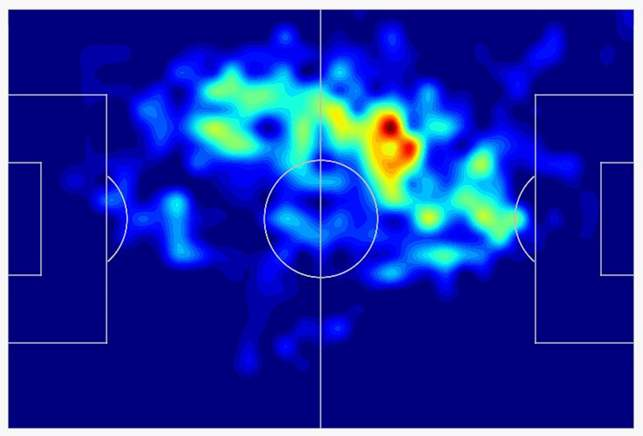

**Fontaine: **Département de science des données du FC Barcelone.

En général, et en bref, dans cette section, nous avons voulu faire référence aux éléments qui peuvent nous aider lors de la définition d’un contexte de jeu et qui, au fur et à mesure qu’ils sont présentés et pratiqués, deviendront une contrainte de plus grande signification pour les joueurs lorsqu’il s’agira de les vivre à l’entraînement. Nous voulons souligner à nouveau l’importance non seulement de ces constructions tactiques (moments, zones, structure et démarcation) qui acquièrent une certaine valeur pour l’équipe, mais aussi de ces éléments dynamiques qui nous permettront de représenter les contextes de jeu du match à travers les densités, les distances, la relation numérique des équipes, la présence ou non de buts, et ainsi de suite. Ces références spatio-temporelles du jeu peuvent être extraites de l’environnement compétitif pour concevoir des tâches d’entraînement représentatives (Gonçalves et al., 2019), et c’est précisément là que réside l’importance réelle de proposer des contextes de jeu définis qui nous aident à optimiser les interactions et les interrelations des membres de l’équipe.

**Les contextes de jeu**

Avec tout ce qui précède, nous pensons que l’intention devrait être d’évoluer vers l’identification de ces paramètres circulaires qui nous permettent de comprendre les différents contextes de jeu, non pas comme une séquence linéaire d’événements ou comme des situations isolées du jeu qui doivent être résolues, mais comme des références dynamiques auxquelles les joueurs peuvent prêter attention lorsqu’ils jouent. Tant que nous serons clairs sur ce concept, il nous sera plus facile d’énumérer et d’énumérer toute proposition de contextes de jeu car notre regard ne sera pas excessivement attaché aux contextes énumérés en eux-mêmes, mais nous accorderons plus d’attention aux conditions initiales que chacun de ces contextes provoque afin de les traiter comme un défi à relever collectivement à travers des interactions appropriées.

Ci-dessous, nous présentons une proposition de différentes circonstances de jeu qui peuvent être proposées à l’entraînement dans le but de faire l’expérience de conditions de jeu spécifiques.

**Figure 12 : Exemples de contextes de jeu**

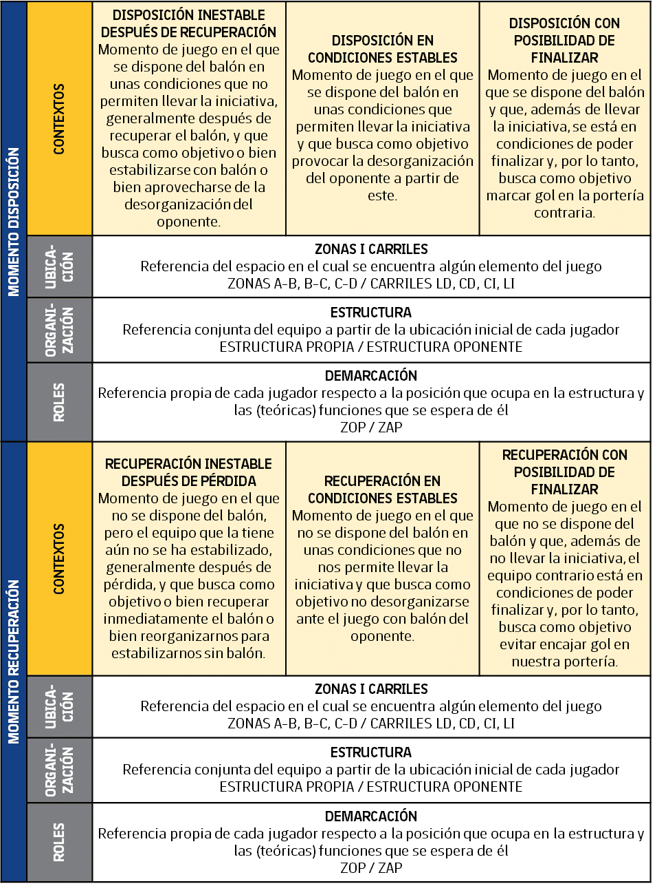

**Fontaine: **Élaboration personnelle.

**Graphique 12. **Exemples de contextes de jeu, en fonction du moment de préparation ou de récupération, et qui peuvent être décrits à travers la localisation de la situation, l’organisation des équipes et les rôles fonctionnels attribués à chaque joueur.

Dans chacun des contextes décrits, on peut supposer de nombreuses situations de jeu qui s’enrichissent d’informations complémentaires (zones et voies auxquelles il est fait référence, structure de l’équipe, ZOP et ZAP des joueurs), mais qui englobent également des possibilités infinies d’action avec les modifications spatio-temporelles intrinsèques que chacun de ces contextes implique. N’oubliez pas que le plus important sera d’établir un point de départ, en étant suffisamment flexible pour comprendre qu’il n’y aura pas d’interactions prédéterminées ou de solutions idéales à chacun de ces scénarios.

Nous invitons le lecteur à se demander si ces contextes sont représentatifs du jeu, si la propension avec laquelle nous pratiquons chacun d’entre eux est équivalente à ce que les joueurs vivent dans les matchs et s’il est plus judicieux, d’une part, de pousser l’entraînement au maximum de variabilité en exposant l’équipe à tous les contextes infinis qui peuvent se produire ou si, Il vaut plutôt la peine de préparer l’équipe aux situations que nous voulons dominer et imposer au jeu. C’est-à-dire, partir de la carte des contextes à partir des intentions que nous avons et non de toutes les alternatives possibles que le jeu nous présente.

**Exemples de SSP avec préférence contextuelle dans le jeu**

Bien que nous ayons déjà exposé quelques exemples de SSP au cours de la lecture, nous essaierons de préciser dans cette section certaines procédures sous la nomenclature utilisée dans la section précédente afin de montrer comment nous pouvons capturer ces contextes de jeu dans la pratique.

Il est à noter que l’un des aspects qui différenciera ces pratiques des SSP qui ont été introduits dans les modules précédents sera les dimensions de l’espace utilisé et le nombre d’acteurs participant à chacun d’entre eux, permettant ainsi de se concentrer davantage sur l’interprétation et la gestion de la dynamique spatio-temporelle. Comme mentionné dans le module précédent, les jeux dans de petits espaces nous permettent d’optimiser de nombreuses interactions que nous considérons comme préférentielles à plusieurs reprises (répéter sans répéter), ce qui fait que du point de vue du joueur, il doit s’adapter à l’espace-temps à travers son geste et son profil.

Par conséquent, ce que les SSP suivants promeuvent dans une plus grande mesure, c’est qu’ensemble, du point de vue de l’équipe, les joueurs peuvent interpréter les distances, les densités, les trajectoires, entre autres éléments qui composent le jeu, sans perdre l’intention principale qu’ils ont en tant que collectif. Cela ne signifiera pas que le jeu se perdra dans de petits espaces (ou du moins c’est ce que nous croyons de notre idée de jeu), mais que le jeu réduit sera généré dans différentes zones de l’espace délimité, à travers l’interprétation des densités qui s’effectue, toujours avec la possibilité de revenir du petit espace au grand espace, et ainsi de suite. En d’autres termes, le contexte prévu n’est pas joué, mais le contexte du jeu nous permettra d’expérimenter et de réinterpréter continuellement certaines conditions spatio-temporelles.

**Aménagement stable**

–

Dans un espace d’environ 2x2 unités de terrain (zones B et C, voies CD et CI), deux équipes de 6 jouent à l’aide de deux jokers, l’un à l’intérieur et l’autre sur l’un des côtés du rectangle. L’objectif sera d’avoir le ballon le plus longtemps possible, en tenant compte du fait que des joueurs spécifiques partiront de la démarcation des défenseurs centraux, des arrières latéraux et des milieux de terrain, en devant se positionner dans les espaces (approximativement) vus sur le graphique. Nous pensons que la structure des deux équipes et la position des jokers nous permettront d’inviter les joueurs à interpréter quand il est plus pratique de jouer à l’intérieur ou à l’extérieur, même en privilégiant les interactions intérieures car elles ont généré cette supériorité numérique. De plus, les récupérateurs devront récupérer pour avoir le ballon, mais en même temps, ils devront tenir compte du fait qu’il y a un joueur derrière eux, ce qui génère également un certain doute lorsqu’il s’agit de libérer ou non les joueurs intérieurs. Dans le changement de rôle, l’équipe rouge fait de même de l’autre côté du terrain, et les jokers sont positionnés à l’inverse (le deep inside, et le deep inside).

**  
**

**Figure 13 : Préférence contextuelle SSP avec un arrangement stable**

**Fontaine: **Élaboration personnelle.

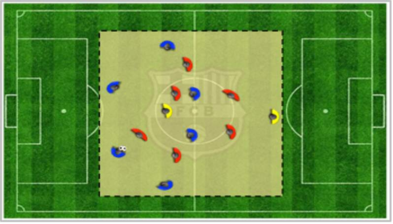

**Aménagement avec possibilité de fin**

–

Dans un espace d’environ 2x4 unités de terrain (zones C et D, couloirs LD, CD, CI et LI), une équipe joue avec 8 joueurs avec l’intention de marquer un but, tandis que l’autre équipe a 9 joueurs (y compris le gardien de but), et doit récupérer le ballon et le faire atteindre la wild card. La règle du hors-jeu est ajoutée et les voies latérales sont réduites de sorte que, d’une part, une plus grande densité est représentée sans pouvoir utiliser toute la largeur et la profondeur de l’espace délimité et, d’autre part, d’inviter les joueurs extérieurs et avancés à interpréter le moment de l’arrivée et à ne pas avoir autant de temps et d’espace pour atteindre la ligne de fond avec le ballon à leur pied (par exemple, réception dans l’intervalle entre le central et le latéral). D’autre part, le fait que le joker soit dans cette position offre la possibilité à l’équipe de départ en position de redémarrer et de donner une passe de sécurité si elle se sent sous pression, mais en même temps, cela l’oblige à ajuster les distances relationnelles pour ne pas le laisser si loin qu’il est impossible de lui intercepter une passe en cas de perte. Il est important de comprendre que dans ce contexte, il n’y a peut-être pas autant d’interactions qui représentent l’achèvement lui-même, mais ce qui est prévu, c’est de générer un certain contexte qui favorise une réinterprétation constante du « quand » est le moment opportun pour générer la dernière passe, et comment donner une continuité à la disposition dans le cas où ce n’est pas possible. en tenant compte de la résistance offerte par l’équipe en rétablissement.

**  
**

**Figure 14 : Préférence contextuelle SSP avec une disposition avec possibilité de se terminer**

**Fontaine:** Élaboration personnelle.

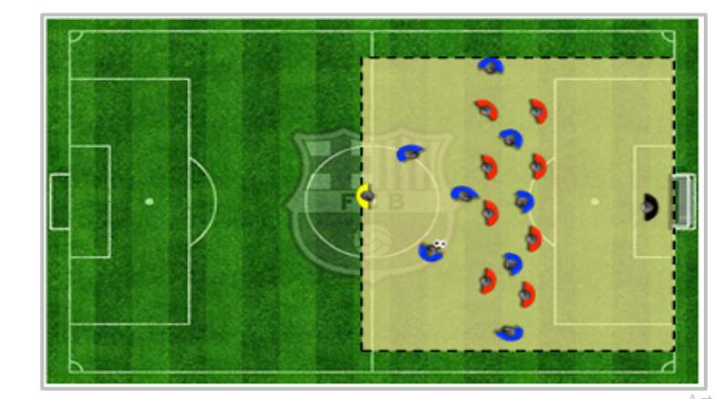

**Disposition instable après la récupération**

–

Dans un espace d’environ 2x2 unités de terrain (zones A et B, couloirs CD et CI), deux équipes disputent un match avec une structure initiale de 1-2-1-2, représentant, d’une part, les joueurs qui jouent habituellement dans le couloir central (équipe bleue), et d’autre part, les joueurs qui occupent les joueurs extérieurs et un intérieur (équipe rouge formée par les arrières latéraux et les ailiers, et un milieu de terrain). L’objectif est de marquer un but, pour les deux équipes, en tenant compte du fait que le fait de raccourcir la zone B et d’avoir une structure miroir (sauf pour le gardien de but), augmentera la densité et réduira les distances entre les joueurs des équipes opposées. L’objectif est de générer des situations d’inconfort et d’instabilité, afin de donner aux joueurs la possibilité d’interpréter quand ils peuvent profiter de cette instabilité ou quand ils doivent chercher des moments de stabilité à travers, par exemple, le gardien de but. D’autre part, cette densité et la promotion de cette instabilité peuvent être augmentées grâce à des variantes avec des règles telles que 1) le gardien de but ne peut que commencer le jeu, puis il ne peut plus intervenir au moment de la disposition ; ou 2) il y a hors-jeu de la part de l’avant-dernier joueur de l’équipe qui récupère.

**  
**

**Figure 15 : SSP de préférence contextuelle avec une disposition instable après la récupération**

**Fontaine: **Élaboration personnelle.

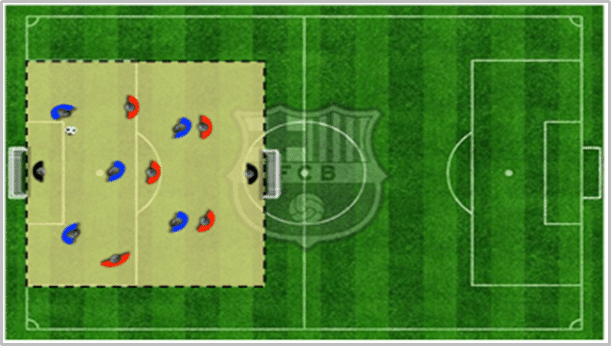

Ce ne sont là que quelques-unes des pratiques qui peuvent illustrer la contextualisation d’un SSP par rapport à, pardonnez la redondance, un contexte de jeu donné. Comme toute catégorisation de contenu, d’aspects et de fonctionnalités, les contextes de jeu que nous pouvons déterminer apparaîtront également interdépendants et simultanés, ce qui rend difficile la tâche d’être complètement fidèle aux environnements compétitifs.

**Parce qu’au moment où le ballon entre en jeu, quand un certain contexte de jeu commence-t-il et se termine-t-il ?**
