**Module 2. Situations de simulation de préférence cognitive préférentielle**

*Sujet 1 de 3*

**Unité 2.1 Préférence cognitive préférentielle : simulation de situations**

**Introduction**

Le football est un jeu dans lequel l’espace-temps (E-T) disponible pour effectuer des actions motrices lors du passage sur le terrain - entre coéquipiers et adversaires - varie constamment. En d’autres termes, cette succession stochastique non déterministe de moments met en évidence la nécessité de relier des séquences d’interaction, de collaboration et d’opposition différentes les unes des autres, qui se produisent sporadiquement, mais constamment, et dans lesquelles les protagonistes du jeu, les joueurs, doivent être en mesure de donner une réponse fonctionnelle.

Seirul·lo (1981) spécifie la relation entre l’espace et le temps, en basant sa conception sur l’éducation physique de base. Cependant, ses réflexions illustrent parfaitement, à notre avis, l’expérience qui s’est manifestée en faveur de l’autonomie recherchée dans des circonstances aussi changeantes.

 

Lorsque le temps fait son apparition dans ces relations, une autre nouvelle source d’enrichissement naît, provoquant des situations plus ou moins éducatives. Ainsi, lorsque des situations sont plus ou moins prévisibles, la capacité éducative des tâches à accomplir dans ces circonstances peut être plus ou moins grande. Le sujet programme des tâches pour une situation spatiale qu’il a perçue, mais au moment de leur application, cette situation peut avoir changé et elles peuvent ne pas être applicables. Parfois, nos capacités dépassent la difficulté, et parfois non, dans les deux cas, notre autonomie augmentera. Lorsque l’espace est occupé par d’autres corps, ils peuvent également augmenter la difficulté dans l’exécution de certaines des tâches que nous nous sommes fixées, par conséquent, dans l’espace, nous opposons les capacités possibles à accomplir, avec celles qui peuvent être effectuées, c’est notre « terrain d’essai », source de notre propre connaissance. (Seirul·lo, 1981, p. 87)

 

Le grand défi auquel est confronté le joueur/l’équipe est donc de pouvoir se frayer un chemin autonome dans cette mer de probabilités en « choisissant » rapidement l’option idéale pour continuer avec le ballon, soit en conservant son tempérament, soit en le passant à un autre coéquipier. En même temps, nous nous rapprochons de l’objectif de l’adversaire en équipe, formant à partir de rien, et instantanément, une trajectoire d’approche non linéaire de multiples trajectoires qui s’ouvrent et se ferment soudainement, en conséquence de cette variabilité E-T. L’objectif est d’avoir enfin suffisamment de fractions de temps, ainsi qu’un emplacement approprié, pour pouvoir envoyer le ballon loin du gardien de but et marquer.

Étant si difficile, *a priori,* le contexte décrit, comment les joueurs prennent-ils des décisions et les exécutent-ils de manière motrice parmi tant de stimuli existants sans savoir avec certitude lequel leur donnera une nouvelle possibilité de continuer à jouer le ballon ? Andrés Iniesta (TVE, 2016), dans un entretien avec le présentateur et réalisateur de l’émission *El cazador de cerebros* Pere Estupinyà, offre certains indices. Lorsqu’on lui demande comment il fait tout ce qu’il fait pendant le jeu, Iniesta explique que ce n’est pas quelque chose de raisonné, mais que cela lui vient automatiquement ou instinctivement. Il dit lui-même qu’il n’y a pas assez de temps pour raisonner en jouant au football. En d’autres termes, Iniesta introduit sans le savoir le cycle perception-action, et aussi comment leurs sensations influencent le moment de l’action.

En paraphrasant Warren (2006), nous dirions que la perception est la manière dont une personne prend conscience de son environnement. Cet auteur affirme que les étapes intermédiaires entre *l’entrée *et la sortie ne sont pas prises en compte*,* c’est pourquoi il la définit comme la perception directe. L’action motrice émerge de manière auto-organisée avec des caractéristiques uniques, spécifiques et non reproductibles, résultat de l’interaction de différentes contraintes du système (Figure 1). Le résultat comportemental conséquent de la perception directe permet de faire spontanément des solutions efficaces et efficientes, qui apparaissent comme des opportunités d’action pour chaque sujet dans l’E-T qui est en vie, sans nécessiter de programmes ou d’ordres externes ou internes. Cet E-T se caractérise par des altérations soudaines et inconstantes, comme celles du football. De plus, comme l’indiquent Oullier et Kelso (2009), les êtres humains ont des coordinations ou synergies préférentielles, qui sont données par des caractéristiques individuelles et l’expérience antérieure, les attracteurs naturels (intrinsèques) qui conditionnent nos capacités motrices.

Dans la vidéo, Iniesta (TVE, 2016) admet que, bien qu’il ait évolué tout au long de sa carrière de footballeur grâce à la pratique et aux entraîneurs qu’il a eus, il effectue également les mêmes actions que lorsqu’il était petit. Ceci, qui peut sembler contradictoire, est une référence implicite aux comportements et aux actions qui sont naturels en lui, qui ont évidemment été optimisés grâce à cette pratique. Cependant, ils savent les reconnaître comme les leurs parce qu’ils ont été capables de percevoir les sources d’information pertinentes dans le jeu et d’extraire l’information - et également d’effectuer l’action motrice en question - dès leur plus jeune âge, créant ainsi un profil ou une idiosyncrasie reconnaissable.

**Figure 1 : Théorie de l’auto-organisation**

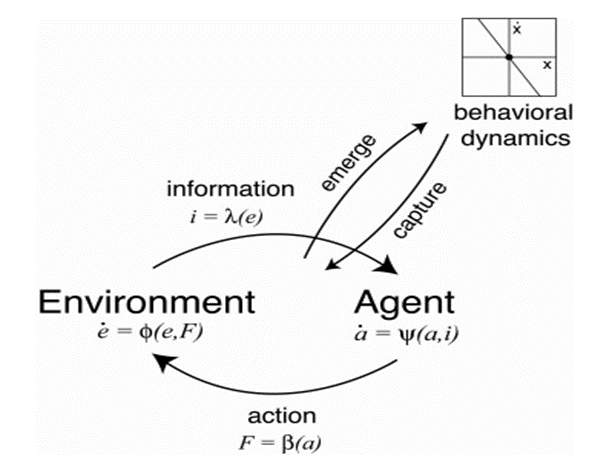

**Fontaine:** Warren, 2006, p. 367.

| LANGUE SOURCE             | CIBLE                     |
|---------------------------|---------------------------|
| Dynamique comportementale | Dynamique comportementale |
| Information               | Information               |
| Émerge                    | Urgence                   |
| Capturer                  | Capturer                  |
| Environnement             | Environnement             |
| Agent                     | Agent                     |
| Action                    | Action                    |

Maintenant, quel rôle les sensations jouent-elles dans tout ce processus ? Selon Feldman (2018), le monde que nous vivons est construit par le cerveau à travers des milliers de prédictions instantanées basées sur des fragments du passé (expériences vécues) et leur probabilité d’être utiles dans la situation actuelle. Cela se fait face à tout stimulus que nous recevons de l’extérieur, en étant capable de le prioriser ou de l’ignorer. Ces prévisions visent à anticiper les besoins énergétiques vitaux. Ce processus de changement est régulé par des sensations intéroceptives (représentations sensorielles résultant du mouvement interne de notre corps) que nous remarquons continuellement, plus ou moins intensément. Ce sentiment général est défini comme **un affect** et fait partie de la combinaison de **la valence** (sensation agréable ou désagréable) et de l’excitation (sensation du niveau d’altération ou d’activation). La combinaison de ces sensations affectives montre l’état budgétaire du corps. Le cerveau utilise la **niche affective** – composée d’objets et d’événements qui ont un rapport avec notre budget corporel dans le moment présent – pour équilibrer notre affect. Le reste des éléments sont des bruits sur lesquels le cerveau ne fait pas de prédictions. Leur succès et leur erreur dans cette tâche sont la base sur laquelle les émotions sont construites. En d’autres termes, l’intéroception du moment a plus d’impact sur la perception des choses et la façon dont nous agissons face à elles que ce qui se passe dans l’environnement qui nous entoure. Nous sommes prêts à nous occuper de notre budget corporel par l’affect, qui dirige notre décision et notre action par des prédictions, laissant la rationalité comme simple invitée.

Le cerveau utilise des prédictions pour initier des mouvements corporels ; Cependant, cela ne signifie pas qu’il y a toujours un mouvement physique réel. Ceux-ci se produisent avant que nous ne soyons conscients de l’intention d’agir et de bouger, ce qui est connu sous le nom **d’illusion du libre arbitre**. Cela signifie que, lorsque nous nous rendons compte que nous sommes en mouvement, nous avons peut-être déjà initié l’action. En d’autres termes, le cerveau fonctionne de manière proactive. Si ce n’était pas le cas, il nous serait difficile de nous déplacer dans le monde, car nous serions en retard pour toutes les choses qui se passent autour de nous - certaines positives pour nous et d’autres moins - et pourraient avoir des conséquences fatales. Cela ne signifie pas, selon Feldman (2018), que le cerveau ne fait pas d’erreurs ; En effet, cela arrive, mais il calcule rapidement les erreurs de prédiction en faisant une comparaison avec* l’entrée *sensorielle réelle et minimise cette circonstance. Cela permet d’apprendre. Selon l’auteur, ces boucles de prédiction intrinsèques (prédire-simuler-comparer-résoudre des erreurs) sont constantes et parallèles entre les multiples groupes de neurones qui créent des images, des sons, des odeurs, des goûts et des sensations tactiles. Ces groupes s’influencent et se limitent mutuellement pour former nos expériences qui, en fin de compte, dictent nos actions.

Pour Damunt et Guerrero (2021), le système d’urgence émotionnelle et les processus de réadaptation et de marquage somatique sont essentiels dans l’avenir du joueur dans le jeu. En effet, ils indiquent que lorsque le temps fait son apparition dans ces relations, une autre nouvelle source d’enrichissement naît, provoquant des situations plus ou moins éducatives. Lorsqu’on s’occupe du fonctionnement du système décisionnel de nos joueurs, un point de départ serait de comprendre que, plutôt que des élections (anciennement PAD+E), nous devrions généralement parler d’urgences, de décisions qui émergent de manière « instinctive » ou émotionnellement préférée.

Par conséquent, et compte tenu de ce qui précède, on peut conclure que les joueurs, lorsqu’ils jouent, effectuent les interactions qu’ils ressentent, sans avoir le temps d’y penser, bien au contraire. De plus, l’intuition conduit à des actions motrices spécifiques typiques du présent, en particulier dans les séquences de jeu où l’E-T est négligeable, toutes liées aux comportements naturels qui sont constitués comme des attrôleurs. Cela augmente le rôle des sensations et des émotions dans la pratique à des niveaux - jusqu’ici inconnus - . Cet aspect implique la nécessité de s’interroger sur la manière dont ils se construisent et se pratiquent, car ils sont l’étincelle qui nous anime, comme l’a pressenti Andrés Iniesta.

**Figure 2 : Iniesta Atom à nouveau**

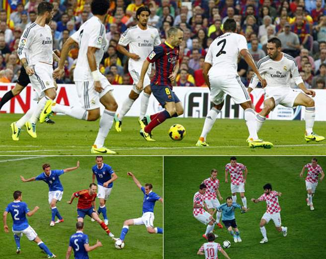

**Fontaine: **Marca, 2013, https://bit.ly/3dpc2jw

**Objectif de « préférer » cognitivement**

En 2018, lors de la finale de la Conférence Est de la NBA entre les Cavaliers de Cleveland et les Celtics de Boston, Sally Jenkins s’est interrogée dans un article du *Washington Post *: « Comment LeBron James a-t-il toujours une longueur d’avance ? Demandons aux scientifiques", c’est-à-dire pourquoi il semble toujours avoir une longueur d’avance sur ses adversaires. À travers les réflexions de plusieurs neuroscientifiques, il est extrait du contenu, entre autres, que les grands joueurs ont une mémoire supérieure pour obtenir des informations à partir du contexte qu’ils maîtrisent, et que, en même temps, ils ont la capacité de se souvenir avec une observation de beaucoup d’informations sur l’environnement. De plus, ils indiquent également qu’en se souvenant de tant d’informations, ils sont mieux à même de faire une prédiction de ce qui se passera ensuite.

Cette tâche, celle d’être capable de faire des prédictions fructueuses dans le contexte dans lequel nous vivons grâce à la capacité de mémoriser l’association à travers ce qui a été observé, comme nous l’avons vu dans la section précédente, est l’objectif poursuivi par les tâches d’entraînement cognitivement « préférentielles ». Cette émergence comportementale est significative surtout dans les séquences de jeu dans lesquelles le stress spatio-temporel est élevé. Il s’agit ici des interactions qui ont lieu à proximité du ballon et qui concernent principalement les joueurs qui sont en intervention (IN) - donc en contact avec le ballon - et en entraide (AM) - à des endroits proches de ce coéquipier ou adversaire. Seirul·lo (1981) l’exprime comme suit :

 

La connaissance de notre propre espace, celui qu’occupe notre corps, nous sert de référence pour structurer tout l’espace qui nous entoure, l’espace qui est le « pas moi ». L’utilisation de cet espace, en effectuant toutes sortes de tâches, nous permet de prendre conscience de ce qui nous entoure et, au moment de son occupation, nous vivons cet espace comme notre propre expérience. De cette façon, l’espace vécu est perçu à travers ma sensibilité extérieure, au sens le plus large considéré. Les sensations extéroceptives sont associées à des sensations intéroceptives pour connaître l’environnement, ses répercussions sur ma tâche et ma situation dans celle-ci à tout moment. Mais le temps que nous consommons dans cette exécution doit être l’objet d’une sensibilité interne, car ce n’est qu’au niveau du concept que nous pouvons avoir une véritable conscience du présent, de l’avant et de l’avenir. Par conséquent, lorsque nous développons des tâches au fil du temps, nous pouvons en prendre conscience en tant qu’espace vécu avec des caractéristiques particulières, induites par les caractéristiques de la tâche effectuée. Grâce à la possibilité de modifier les tâches elles-mêmes, et en relation avec le temps, nous pouvons utiliser l’espace et le temps comme moyen de développer certaines capacités de la personne et ainsi compléter d’autres aspects de l’éducation physique. (Seirul·lo, 1981, p. 85)

 

Feldman (2018) indique que tout ce que nous percevons autour de nous est représenté par des concepts dans le cerveau que nous avons acquis par l’expérience, qui sont réaffirmés ou non dans des régularités connues à chaque tour de tête et mouvement des yeux à travers des *entrées visuelles* changeantes. Ces régularités que nous percevons peuvent être de bas niveau (telles que des lignes, des contours, des rayures et des taches) ou de haut niveau (telles que des objets et des scènes complexes). Ce lien conceptuel est ce qui permet l’apprentissage, puisque le cerveau utilise des concepts pour donner un sens aux signaux qu’il perçoit. Cette stratégie fournit une explication cohérente à la personne, construit son monde extérieur de l’intérieur, tout en lui permettant de savoir ce qu’elle représente et comment agir face à de tels stimuli.

Compte tenu du comment, et en se référant aux concepts de base estimables dans le jeu du football, ce type de pratique vise à fournir au joueur de multiples expériences spécifiques, qui n’ont pas besoin d’être basées sur le jeu, qui sont le résultat de l’interaction des coéquipiers et des adversaires dans des densités variables et des limitations contextuelles et/ou réglementaires qui contraignent l’E-T, et qu’ils donnent des expériences significatives sur les questions suivantes.

- balle

Comment créer des lignes de dépassement ?

- balle

Comment créer et atteindre des espaces libres ?

- balle

Comment profiter des espaces créés ?

- balle

Comment gérer les espaces de complétion ?

Le principe de représentativité, en vigueur dans des contextes spécifiques - qui fait référence à la question de savoir si les sources d’information d’une pratique donnée sont comparables à celles du jeu - sera en faveur d’une amélioration à long terme de la capacité neuronale expliquée, ce qui favorisera la mémoire spatiale ou le GPS interne, ce qui, à son tour, conduira à une amélioration à long terme de la capacité neuronale expliquée, ce qui, à son tour, conduira au développement de la capacité neuronale expliquée. Il le fera avec la capacité de prédire ce qui va se passer, c’est-à-dire avec anticipation. Il est à noter qu’en aucun cas, ce qui est présenté dans ce document n’est encadré dans un modèle de jeu spécifique, bien au contraire. Ce qui est recherché, c’est la promulgation de l’anticipation dans des contextes ouverts. Dans des environnements fermés, où les actions sont facilement (ou totalement) prévisibles, il ne peut y avoir une forte optimisation de cette capacité, surtout si nous n’augmentons pas le défi pour nos joueurs en les faisant participer dans des contextes plus ouverts ou exploratoires, comme cela se produit pendant le jeu. Cette pratique favorisera l’éducation de l’intention, l’un des processus d’apprentissage que l’on peut comprendre comme étant lié à l’optimisation du GPS interne, ainsi qu’à celui du réglage perceptuel ; Les deux s’inscrivent dans la compréhension des besoins d’apprentissage des acteurs en termes de perception de l’environnement, dans le cadre du cycle perception-action.

Pour y parvenir, il est proposé de lier les concepts tactiques aux objectifs (Figure 2). Cela les rendra très flexibles et adaptables à la situation, puisque celle-ci peut changer en fonction de nos intérêts (Feldman, 2018).

**Figure 3 : Concepts et objectifs**

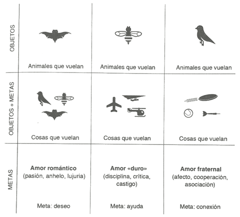

**Fontaine: **Feldman, 2018, p. 125.

Il convient d’ajouter, à titre de remarque, qu’il est recommandé de mettre en œuvre tout cela par le biais d’un échange avec le joueur qui valorise l’apprentissage implicite, une invitation qui optimisera le « flux », une performance supérieure associée au travail fonctionnel (Damunt & Guerrero, 2021).

Chacun des concepts proposés est traité à partir du moment avec la balle (MD) et du moment sans la balle (MR), en reliant les intérêts entre eux. Cela permettra au joueur de les deviner plus facilement, puisque la relation qui s’établit - en n’étant pas discordant l’un avec l’autre - récompense le comportement moteur émergent. À l’exception des finitions (qui n’ont lieu que lorsque la probabilité de marquer un but se produit), les trois contenus restants (création et occupation des espaces, circulation du ballon et gestion des avantages et des inconvénients) se produisent en même temps et toujours. À cela, il faut ajouter les concepts considérés comme transversaux : en MD, jouer ensemble, et en MR, récupérer sur le ballon. Celles-ci doivent apparaître de manière continue et ne peuvent être dissociées de toute pratique qui est proposée. De plus, chaque concept est également lié à une ou plusieurs chaîne(s) de coordination spécifique(s), en concentrant l’attention sur l’action de coordination différentielle (voir module 1), ayant également des concepts considérés comme transversaux pour ceux-ci. Enfin, sa mise en œuvre dans les contextes de jeu (voir module 3) est envisagée, ce qui permettra d’évaluer le niveau d’expertise des joueurs et, ainsi, de remodeler le plan d’amélioration. Il est à noter qu’en ce sens, elle est conçue comme sans fin et toujours en construction (Figure 4).

**Figure 4 : Concepts de jeu (CSA)**

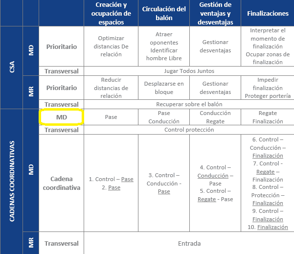

**Fontaine: **Adapté du domaine méthodologique FCB (s.d.), non publié.

Pour conclure cette section, nous voudrions souligner que l’ensemble de cette proposition doit être couvert dans sa mise en œuvre sous l’égide des relations interpersonnelles. L’empathie et l’affectivité doivent être les émotions qui imprègnent les interactions entre les joueurs. C’est la meilleure façon de s’assurer que l’information fluctue de sorte que toutes les personnes impliquées ressentent une sensation similaire, et, par conséquent, agissent de manière synchronisée, sans avoir besoin de s’occuper de quoi que ce soit d’autre, car cela leur permettra d’anticiper les interactions motrices du partenaire et de pouvoir l’aider (Seirul·lo, 2017).

**Conception de SSP avec préférence cognitive**

À ce stade, nous allons développer progressivement chacun des concepts soulevés jusqu’à présent. Avant de commencer à les expliquer, il convient de noter que toutes les idées associées à chacune d’entre elles sont exprimées par une approche externe. Cette façon de les citer offre un large éventail d’actions pour les réaliser. En fait, il fuit le modélisme. Il montre la fin qui est poursuivie, laissant le mode au joueur.

À cet égard, nous tenons à vous rappeler que tout ce qui sera mentionné ci-dessous est présenté dans une perspective qui prône de placer le joueur au centre du processus d’enseignement-apprentissage. Il est le principal protagoniste de sa formation. Par conséquent, il est proposé de partir de leurs compétences (entendues comme des actions d’urgence préférentielles, c’est-à-dire des comportements naturels récurrents) pour ériger la pratique du reste des concepts.

Après ces petites précisions, il ne nous reste plus qu’à commencer par tout cela. Commençons !

**Contenus transversaux**

**Progression en tant que bloc dans MD**

–

Toute l’équipe doit se déplacer ensemble sur le terrain en occupant rationnellement l’espace disponible, sans que cela nécessite une largeur et une profondeur maximales restrictives, liées à un système tactique spécifique. Il est prédit qu’il est entièrement dynamique, où la distance optimale est unique pour chaque joueur dans chaque séquence de jeu et typique du swing qui le caractérise.

- <u>Chaînes de coordination en DM.</u> Le contrôle et la protection facilitent la prochaine interaction avec le ballon. Celles-ci lient l’intention antérieure à sa réception à l’exécution de celle-ci pour atteindre l’objectif poursuivi. Pour cette raison, ils sont de nature multiforme.

**Appuyez sur le ballon en MR**

–

Ces mêmes emplacements doivent permettre de récupérer le ballon de manière proactive.

- <u>Chaînes de coordination dans les TMS.</u> Le tacle est conçu comme l’interaction sur le ballon qui nous permet de distinguer les conditions optimales pour le récupérer sans avoir besoin de le faire.

**Figure 5 : Coupe transversale**

<table style="width:100%;">
<colgroup>
<col style="width: 15%" />
<col style="width: 0%" />
<col style="width: 34%" />
<col style="width: 15%" />
<col style="width: 0%" />
<col style="width: 33%" />
</colgroup>
<thead>
<tr class="header">
<th colspan="3"><strong>Moment de la disposition</strong></th>
<th colspan="3"><strong>Temps de récupération</strong></th>
</tr>
</thead>
<tbody>
<tr class="odd">
<td><strong>Transversal</strong></td>
<td colspan="2"><strong>Formation des espaces de phase dans un bloc</strong></td>
<td><strong>Transversal</strong></td>
<td colspan="2"><strong>Récupérer sur le possesseur</strong></td>
</tr>
<tr class="even">
<td colspan="3"><ul>
<li>
Garantir les distances optimales entre les joueurs en fonction de la situation du ballon (pouvoir intervenir directement ou indirectement sur le ballon).
</li>
<li>
Réajuster constamment l’occupation rationnelle des espaces.
</li>
<li>
Ajustez les emplacements en prévision d’une éventuelle perte de balle.
</li>
</ul></td>
<td colspan="3"><ul>
<li>
Le joueur dans l’espace d’intervention réduit les chances d’interaction du joueur avec le ballon.
</li>
<li>
Les joueurs en entraide réajustent leur placement, évitant les options de passe avec des receveurs potentiels.
</li>
<li>
Les joueurs en coopération réajustent leur position en densifiant les zones proches du ballon.
</li>
</ul></td>
</tr>
<tr class="odd">
<td colspan="2"><strong>Transversal</strong></td>
<td><strong>Contrôle / Protection</strong></td>
<td colspan="2"><strong>Transversal</strong></td>
<td><strong>Entrée</strong></td>
</tr>
<tr class="even">
<td colspan="3"><ul>
<li>
Orientez le corps pour percevoir le maximum d’espace possible en fonction de l’origine et de la destination de la balle.
</li>
<li>
Orientez le ballon pour faciliter l’interaction suivante.
</li>
<li>
Réduisez, maintenez ou allongez la trajectoire de la balle pour ajuster le moment d’interaction.
</li>
<li>
Interposez le corps entre le ballon et le joueur de l’autre équipe pour éviter la perte et chronométrer la prochaine interaction.
</li>
</ul></td>
<td colspan="3"><ul>
<li>
Options de passage d’interruption.
</li>
<li>
Timing dans des situations désavantageuses, faisant l’entrée en avantage.
</li>
</ul></td>
</tr>
</tbody>
</table>

**Source : **Adapté du domaine méthodologique FCB (s.d.), non publié.

**Contenus spécifiques**

**Création et occupation d’espaces**

–

Ce concept vise à aider le joueur à adapter ses distances relationnelles à la fois dans DM et MR. Il manie « la ligne de passe » comme un élément clé. Sur la base de cette référence dynamique - au fur et à mesure que les canaux de communication apparaissent et disparaissent en raison du mouvement continu des coéquipiers, des adversaires et du ballon - les joueurs en AM et COO feront différentes trajectoires en s’approchant, en restant ou en s’éloignant du joueur en IN afin de continuer à avoir la possession du ballon ou de le récupérer.

 

- <u>Optimiser les distances de rapport en MD.</u> Les possibilités d’action du joueur avec le ballon déterminent la zone active et passive. Selon cela, la gestion personnelle du lieu occupé, par rapport à l’ampleur et à la profondeur, en tenant compte des espaces proches susceptibles d’être des emplacements favorables à recevoir un laissez-passer, favorise le mouvement appui/rupture. Tout cela en tenant compte des coéquipiers autour de moi et de ce que je provoque chez l’adversaire.

  - <u>Chaînes de coordination en DM.</u> **Le contrôle-passe** et la **passe** sont utilisés comme la coordination significative avec le ballon pour ce contenu. Une passe qui reconnaît les connotations du joueur qui doit la recevoir en fonction du contexte du jeu en cours de développement est encouragée.

- <u>Réduire les distances de rapport en MR.</u> Se rapprocher du ballon, en réduisant les distances de relation entre les joueurs en largeur et en profondeur, en veillant à la dissuasion des lignes de passe existantes entre le joueur avec le ballon et les adversaires à proximité de l’emplacement occupé.

**Figure 6 : Création et occupation des espaces**

<table>
<colgroup>
<col style="width: 15%" />
<col style="width: 34%" />
<col style="width: 49%" />
</colgroup>
<thead>
<tr class="header">
<th colspan="2"><strong>Moment de la disposition</strong></th>
<th><strong>Temps de récupération</strong></th>
</tr>
</thead>
<tbody>
<tr class="odd">
<td colspan="2"><strong>Optimiser les distances relationnelles</strong></td>
<td><strong>Réduire les distances relationnelles</strong></td>
</tr>
<tr class="even">
<td colspan="2"><ul>
<li>
Ajuster les distances de relation entre les joueurs à l’aide de la largeur et de la profondeur, en tenant compte des possibilités d’intervention sur le ballon (réception).
</li>
<li>
Identifiez et utilisez les espaces libres, en privilégiant ceux qui sont éloignés, en ne proposant pas la même ligne de dépassement.
</li>
<li>
Réajustez les distances de relation par rapport aux possibilités d’interaction du propriétaire, en tendant à changer la zone.
</li>
</ul></td>
<td><ul>
<li>
Réduire les distances de relation entre les joueurs, en réduisant la largeur et la profondeur du jeu de l’adversaire.
</li>
<li>
Quitter des zones éloignées, densifier la zone de la balle.
</li>
<li>
Gérer la distance d’intervention sur l’adversaire direct en fonction de mes possibilités et de leurs possibilités d’interaction.
</li>
</ul></td>
</tr>
<tr class="odd">
<td><strong>Spécifique</strong></td>
<td colspan="2"><strong>Passer</strong></td>
</tr>
<tr class="even">
<td colspan="3"><ul>
<li>
Utilisez la surface de contact appropriée.
</li>
<li>
Utilisez l’intensité idéale pour que le ballon atteigne le coéquipier.
</li>
<li>
Faire des passes favorisant la réception du coéquipier.
</li>
</ul></td>
</tr>
</tbody>
</table>

**Source : **Adapté du domaine méthodologique FCB (s.d.), non publié.

**Circulation du ballon**

–

Le ballon est le principal attracteur pour faire entrer E-T dans le jeu. Sa distribution implique de le gérer à l’intérieur comme à l’extérieur. Arriver, tenir et être capable de sortir de ces zones avec le ballon en possession, en utilisant habilement la densité « positive » émergente - que ce soit en MD ou en MR - prouve que l’équipe a l’initiative du jeu.

- <u>Attirer les adversaires dans MD/Identifier l’homme libre dans MR.</u> Ce concept découle de la nécessité d’avoir le ballon dans les meilleures conditions possibles. Pour ce faire, les circonstances spécifiques et les variables qui émergent au cours du jeu doivent être interprétées pour donner le ballon au joueur qui garantit la continuité. Ce dernier coïncidera parfois avec le joueur gratuit. Une telle relation peut se faire directement ou indirectement. La densification résultant des interactions d’attraction, en utilisant le ballon comme leurre dans différentes zones du terrain de jeu en répétant des passes ou des drives, implique la réalisation - après interprétation des trajectoires de saut de l’adversaire et des espaces qu’elle protège - de zones consécutives - qui n’ont pas besoin d’être en progression - qui répondent aux relations entre bénéficiaire et bienfaiteur appréciées entre coéquipiers.

  - <u>Chaînes de coordination en DM.</u> En plus des coordinations ci-dessus, le contrôle-conduite-dépassement est ajouté. Cela ajoute la possibilité de se déplacer avec le ballon sur le terrain de jeu, soit pour attirer les adversaires et/ou les vaincre. Sa particularité réside dans la pertinence du dépassement arrière associé à la conduite, qui sert de tromperie pour contacter le coéquipier situé dans la trajectoire opposée. Cacher cette intention finit par être le moyen saillant substantiel.

- <u>défilement dans le bloc dans MR.</u> L’équipe, lorsqu’elle n’a pas la possession, doit se déplacer avec le ballon, en se synchronisant pour préserver les distances relationnelles, tout en rendant impossible pour l’adversaire de jouer proprement à travers les espaces intérieurs de l’organisation caméléon résultant de la succession constante de l’aide des espaces AM et/ou COO en fonction de chaque démarcation. Tout cela alors que l’ambition est d’arriver avec des options pour prendre le ballon au joueur dans IN.

**Figure 7 : Circulation de la balle**

<table>
<colgroup>
<col style="width: 15%" />
<col style="width: 34%" />
<col style="width: 49%" />
</colgroup>
<thead>
<tr class="header">
<th colspan="2"><strong>Moment de la disposition</strong></th>
<th><strong>Temps de récupération</strong></th>
</tr>
</thead>
<tbody>
<tr class="odd">
<td colspan="2"><strong>Attirer les adversaires / Identifier les coéquipiers libres</strong></td>
<td><strong>Défilement en masse</strong></td>
</tr>
<tr class="even">
<td colspan="2"><ul>
<li>
Attirer les adversaires à l’intérieur/à l’extérieur pour sortir/porter le ballon (quand conduire/quand passer).
</li>
<li>
Identifiez les conditions optimales pour faire la passe afin que le receveur puisse garder le ballon.
</li>
<li>
Identifiez l’espace et/ou les joueurs en progression lorsqu’une zone est densifiée par la conduite.
</li>
</ul></td>
<td><ul>
<li>
Accompagner le mouvement du ballon tout en maintenant les distances relationnelles.
</li>
<li>
Privilégiez la protection des espaces intérieurs.
</li>
<li>
Gérer en permanence les aides pour éviter d’être dépassé.
</li>
</ul></td>
</tr>
<tr class="odd">
<td><strong>Spécifique</strong></td>
<td colspan="2"><strong>Réussite/Conduite</strong></td>
</tr>
<tr class="even">
<td colspan="3"><ul>
<li>
Répétez les passes dans la même zone pour attirer les adversaires.
</li>
<li>
Effectuer des passes au pied ou à l’espace en fonction de la proximité de l’adversaire.
</li>
<li>
Faites des passes verticales pour accélérer le rythme et des passes horizontales pour le ralentir.
</li>
<li>
Conduire dans la direction opposée à celle où la supériorité doit être générée (densification).
</li>
</ul></td>
</tr>
</tbody>
</table>

**Source :** Adapté du domaine méthodologique FCB (s.d.), non publié.

**Gérer les avantages et les inconvénients**

–

Dans l’évolution du jeu, différentes supériorités émergent continuellement, fugaces dans le temps, à la suite de l’échange simultané du travail de chacune des équipes. Parfois, ceux-ci sont exploités et offrent un certain avantage momentané et d’autres fois - soit parce qu’ils ne sont pas assez clairs et mettent en danger la possession du ballon, soit simplement parce qu’ils ne sont pas perçus - ils disparaissent et doivent être recréés. Normalement, lorsqu’ils profitent de l’un d’entre eux, ils sont davantage enchaînés, car l’équipe qui les subit doit se recomposer et rééquilibrer l’équilibre. Le jeu oscille entre cette symétrie délicate et variable et cette asymétrie dans laquelle chacune des équipes tente d’imposer son potentiel.

- <u>Gérer les avantages dans MD.</u> Recevoir le ballon implique le fait d’être mieux positionné que l’adversaire par rapport aux possibilités d’action du coéquipier qui effectue la passe. Une telle casuistique est considérée comme l’expression minimale de toute autre supériorité. Cette supériorité positionnelle antérieure permet de devenir plus que l’adversaire près du ballon, manifestant une supériorité numérique momentanée, ou d’exprimer la tentative de la surmonter par un dribble, par la consommation d’une supériorité qualitative ponctuelle. En liant le *timing* individuel au collectif, en variant les deux rythmes de jeu par un dynamisme localisé fluide et une circulation courte, les communes dans une expression du jeu qui est à l’origine de suffisamment E-T pour avoir le ballon avec de plus en plus d’options pour compléter avec succès l’interaction dans des espaces densifiés (densité positive).

  - <u>Chaînes de coordination en DM.</u> **Le contrôle-conduite-passe** et **le contrôle-dribble-passe** sont utilisés comme des ressources fonctionnelles subordonnées à la passe suivante. Leur apparence circonstancielle doit être comprise comme un moyen de continuer à favoriser la relation entre coéquipiers. Abuser de ces chaînes de coordination conduit à recréer un jeu dirigé et intermittent (avec des revirements élevés). Cependant, l’interprétation des séquences de jeu idéales pour les réaliser augmente l’E-T pour les coéquipiers.

- <u>Gérer les inconvénients dans MR.</u> L’équipe de MR devrait essayer de transformer les inconvénients en avantages. Les performances de chacun des joueurs varient en fonction de leur proximité dans la zone d’influence. L’utilisation de trajectoires dissuasives et le placement dans des intermédiaires, ainsi qu’une surveillance persistante, sont considérés comme cruciaux pour y parvenir. Le tout avec une intention proactive de récupérer le ballon qui prévaut l’anticipation sans sous-estimer les compétitions des adversaires.

**Figure 8 : Gestion des avantages et des inconvénients**

<table>
<colgroup>
<col style="width: 15%" />
<col style="width: 34%" />
<col style="width: 49%" />
</colgroup>
<thead>
<tr class="header">
<th colspan="2"><strong>Moment de la disposition</strong></th>
<th><strong>Temps de récupération</strong></th>
</tr>
</thead>
<tbody>
<tr class="odd">
<td colspan="2"><strong>Gérer les inconvénients</strong></td>
<td><strong>Gérer les inconvénients</strong></td>
</tr>
<tr class="even">
<td colspan="2"><ul>
<li>
Identifiez le type de supériorité (numérique, positionnelle et/ou qualitative) qui a été générée lors de la réception du ballon.
</li>
<li>
Profitez de l’avantage généré (numérique, positionnel et/ou qualitatif) pour vous déplacer dans l’espace tout en conservant la disposition du ballon.
</li>
<li>
Gérez le temps (accélérer ou ralentir) pour générer des avantages.
</li>
</ul></td>
<td><ul>
<li>
Identifiez le type d’infériorité (numérique, positionnelle et/ou qualitative) que l’adversaire a générée.
</li>
<li>
Orientez le joueur de l’autre équipe vers les espaces défavorisés.
</li>
<li>
Interprétez quand chronométrer (créer du temps) ou appuyer (réduire le temps) pour inverser l’inconvénient.
</li>
</ul></td>
</tr>
<tr class="odd">
<td><strong>Spécifique</strong></td>
<td colspan="2"><strong>Conduire/Dribbler</strong></td>
</tr>
<tr class="even">
<td colspan="3"><ul>
<li>
Concentrez votre attention sur le ballon et/ou l’environnement en fonction de la proximité de l’adversaire.
</li>
<li>
Adaptez la surface de contact et la puissance du toucher (distance pied/ballon) en fonction de la proximité des adversaires.
</li>
<li>
Différencier les phases pour venir à bout de l’adversaire : Accélérer avant - Tromper pendant - Laisser derrière soi plus tard (réagir et/ou traverser).
</li>
</ul></td>
</tr>
</tbody>
</table>

**Source : **Adapté du domaine méthodologique FCB (s.d.), non publié.

**Achèvements**

–

Ce concept a traditionnellement été séparé du reste du jeu. Ses caractéristiques spécifiques - principalement axées sur la présence d’objectifs - ont conduit à une différenciation dans les interactions qui peuvent être fonctionnelles pour marquer un but qui, par conséquent, a brouillé le reste des concepts présentés jusqu’à présent. Bien que cela puisse être partiellement vrai, il convient de se poser la question suivante : dans des contextes susceptibles d’augmenter la finition, les joueurs continuent-ils à créer et à occuper des espaces, à faire circuler le ballon et/ou, en bref, à gérer les avantages et les inconvénients ? Face à un tel dilemme, il est invité à continuer à dynamiser les idées exprimées ci-dessus, en ajoutant, comme il est logique, les objectifs, mais sans y prêter trop d’attention, puisque, selon le critère exposé, l’objectif doit être conçu comme une conséquence du jeu collectif exprimé de la même manière que dans d’autres domaines du domaine, mais avec la possibilité de se connecter avec eux. car ils sont le « joueur » le mieux placé pour mettre fin à l’interaction.

- <u>Décidez de l’heure de fin dans MD / Occupez les zones de fin dans MD.</u> L’objectif peut se produire de plusieurs façons. C’est pourquoi cela se produit généralement à quelques reprises au cours d’un match. Cette circonstance signifie que sa matérialisation doit être vécue dans des contextes ouverts, variables et variés, dans lesquels les acteurs interprètent les probabilités de succès en fonction de la densité existante. Cette limitation manifeste de l’E-T révèle que les interactions doivent se faire à un rythme élevé, mais surtout de manière précise. Synchroniser le* timing* entre le passage et le démarrage, sans oublier le reste des éléments, semble essentiel pour avoir suffisamment d’avantage pour finir sans précipitation, même si celui-ci, à de nombreuses reprises, doit se faire au premier contact. Être attentif aux secondes actions, être conscient de ce que sont les possibilités d’action du joueur qui fait le tir, essayer d’obtenir une position avantageuse par rapport aux adversaires proches en anticipant la trajectoire possible de la balle, augmente les chances d’atteindre l’objectif souhaité, s’il n’est pas atteint au premier essai.

  - <u>Chaînes de coordination en DM.</u> L’action finale s’affiche sous la forme d’une passe au filet. Cela peut se faire de n’importe où, en mettant en évidence comme contingent - en raison des particularités qui peuvent être mises en œuvre lors de la finition - le profil du joueur qui l’effectue. Cependant, l’objectif reste le même, envoyer le ballon loin du gardien de but. Par conséquent, les chaînes de coordination que l’on peut pratiquer (contrôle-conduite-finition, contrôle-dribble-finition, contrôle-protection-finition, **contrôle-finition** et** finition**), doivent aboutir à une exécution raffinée, qui ne veut pas dire esthétique, en faveur de l’E-T disponible - obtenu par le joueur ou donné par le jeu - qui équilibre précision et puissance.

- <u>Empêcher l’achèvement en MR / Protéger l’objectif en MR.</u> Dans les séquences de jeu dans lesquelles l’équipe adverse a la possibilité de terminer, en plus de surveiller les trajectoires effectuées par les joueurs de l’autre équipe et le ballon pour atteindre des zones avantageuses pour eux, en MR, il est également important de pouvoir interpréter la capacité de l’adversaire à cacher l’intention de tirer, ainsi que sa rapidité d’exécution. Cela implique l’obligation implicite pour le retriever d’ajuster la distance afin d’empêcher - et sinon d’entraver - l’achèvement. Tout en étant toujours conscient de la zone du terrain dans laquelle l’interaction a lieu, car, selon le joueur adverse, il peut être plus ou moins similaire d’essayer de réussir le tir.

**Figure 9 : Achèvements**

<table>
<colgroup>
<col style="width: 15%" />
<col style="width: 34%" />
<col style="width: 49%" />
</colgroup>
<thead>
<tr class="header">
<th colspan="2"><strong>Moment de la disposition</strong></th>
<th><strong>Temps de récupération</strong></th>
</tr>
</thead>
<tbody>
<tr class="odd">
<td colspan="2"><strong>Décider des heures de fin / Occuper les zones d’extrémité</strong></td>
<td><strong>Empêcher l’achèvement / Protéger l’objectif</strong></td>
</tr>
<tr class="even">
<td colspan="2"><ul>
<li>
Évaluez les chances de succès de l’achèvement en fonction de la supériorité manifestée.
</li>
<li>
Apparaître, en privilégiant l’espace libre, avec un avantage pour finir.
</li>
<li>
Anticipez le rejet éventuel après l’achèvement.
</li>
</ul></td>
<td><ul>
<li>
Évaluez les chances de l’adversaire de réussir.
</li>
<li>
Réduisez la distance avec l’adversaire car celui-ci augmente ses chances de réussir.
</li>
<li>
Interférer avec la trajectoire du ballon-but.
</li>
</ul></td>
</tr>
<tr class="odd">
<td><strong>Spécifique</strong></td>
<td colspan="2"><strong>Dribble / Finition</strong></td>
</tr>
<tr class="even">
<td colspan="3"><ul>
<li>
Effectuez l’action de coordination en fonction de l’espace disponible derrière l’adversaire (avec/sans itinéraire ultérieur).
</li>
<li>
Adapter, si nécessaire, le dernier contact de la chaîne de coordination pour faciliter la frappe.
</li>
<li>
Observez la position du gardien de but pour frapper, en privilégiant la précision à la puissance.
</li>
<li>
Adaptez la surface de contact en fonction de la distance jusqu’au but.
</li>
</ul></td>
</tr>
</tbody>
</table>

**Source : **Adapté du domaine méthodologique FCB (s.d.), non publié.

**Exemples de SSP de préférence cognitive**

L’optimisation des joueurs se fait naturellement par la pratique. Celle-ci doit donc être massive, spécifique, continue et variable. C’est-à-dire qu’il doit encourager le joueur à répéter sans répéter un concept dans le jeu. Petit à petit, comme l’indiquent Damunt et Guerrero (2021), au fur et à mesure que les expériences s’accumulent, le joueur est en mesure d’extraire des informations plus fiables du contexte, un aspect qui a un impact sur ses possibilités d’action, en les augmentant en quantité et en qualité dans la même séquence de jeu.

Les pratiques proposées ci-dessous visent à respecter ce qui précède. Ce sont des contextes de formation qui donnent lieu à l’émergence du concept voulu. Plus précisément, ils permettent au joueur d’explorer ses limites. Cette connaissance de soi est configurée parce que le joueur peut s’exprimer de manière motrice de manière libre, grâce, surtout, au fait que la conception et l’échange par le coach sont de nature plus exploratoire. Cette possibilité d’explorer le contexte et de se soi-même en parallèle soutient la créativité du joueur, c’est-à-dire qu’il peut pratiquer diverses actions - certaines inhabituelles - dans certains contextes similaires. Pour cette raison, les contraintes explicites proposées sont simples, afin de laisser suffisamment de marge pour pouvoir répondre, si elle est ainsi évaluée, aux contraintes implicites liées au profil du joueur.

Il existe des milliers de contextes de pratique valides ; Voici, à titre d’exemple, un petit échantillon qui n’a en aucun cas vocation à être contraignant. Au contraire, le lecteur est encouragé à les repenser et à en créer de nouvelles adaptées à leur réalité. Ce sont ces derniers qui comprendront vraiment toute la complexité présente dans l’équipe.

**Exemples pratiques**

Les tâches axées sur la **création et l’occupation des espaces **favorisent un fort dynamisme des acteurs. L’utilisation de l’E-T vise à générer différentes options de passe au joueur possesseur, en essayant de rendre difficile la récupération de l’adversaire et en offrant des solutions de continuité à la disposition. Par conséquent, l’adéquation de la densité semble être un point important. La pression E-T ressentie par le joueur doit favoriser le besoin de bouger afin de continuer à remplir l’objectif poursuivi. L’utilisation de jokers intérieurs et/ou extérieurs ne devrait pas avoir d’impact sur cette urgence. SSP1 montre une dynamique dans laquelle les deux équipes n’ont qu’à garder le ballon. Dans cette tâche, les joueurs peuvent se déplacer sur l’ensemble du terrain. D’autre part, dans SSP2, l’espace est divisé en quatre zones. La dynamique de jeu est similaire, mais, contrairement au précédent SSP, les deux équipes ont un objectif secondaire. Les références statiques aident le joueur à l’identifier. Cependant, la recherche d’un canal de communication dans le t-1 reste le stimulus décisif.

- ***Exemple SSP1 : (3x3) + 3C***

  - Description : L’espace est divisé en 2 zones. L’équipe en possession du ballon doit essayer de le garder.

  - Contraintes : 1) liberté de mouvement.

**Figure 10 : Exemple SSP1**

**Source : **Auteurs.

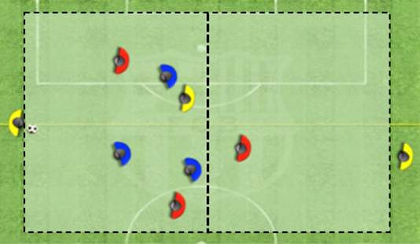

- ***Exemple SSP2 : (4x4) + 4C***

  - Description : L’espace est divisé en 4 zones intérieures et 2 zones de score, donnant ainsi une directionnalité au jeu. L’équipe en disposition est située avec 4 joueurs à l’intérieur avec l’aide de 4 jokers à l’extérieur. L’équipe en convalescence compte 4 joueurs sur le terrain. L’objectif de tout le monde est de recevoir le ballon dans les zones d’en-but.

  - Contraintes : 1) Liberté de mouvement. 2) Vous pouvez contacter le joker qui se trouve dans la zone d’en-but et obtenir 1 point lorsque vous recevez le ballon dans un espace libre de joueurs adverses.

**Figure 11 : Exemple SSP2**

**Source :** Auteurs.

Les SSP qui encouragent la pratique de la circulation du ballon favorisent des séquences de jeu où les joueurs créent E-T par l’arrangement du ballon. Ils visent à maintenir la disposition du ballon tout en déplaçant l’adversaire. La progression est une conséquence de l’interaction de ces deux intentions. Les actions de conduite et de dépassement permettent non seulement de progresser lorsqu’il y a de l’espace, mais aussi d’attirer les adversaires, un aspect qui favorisera l’apparition de joueurs libres. La gestion efficace du rythme de jeu, l’accélérer ou le ralentir, en alternant le type de passe, a un impact direct sur les probabilités sous-jacentes d’obtenir le ballon dans les meilleures conditions E-T. SSP3 fait preuve d’une dynamique dans laquelle ce qui précède est clairement visible. Il reprend les idées intrinsèques de SSP1 et SSP2, donnant aux joueurs une position spécifique. Ce fait limite leurs possibilités de mouvement et met l’accent sur celles du ballon. Dans SSP3, la continuité dans le jeu converge vers une réalisation progressive et déformée de l’E-T, où la balle est gérée en remarquant les probabilités sous-jacentes des éléments qui composent l’environnement. MD et MR ont des objectifs différents et, pour la première fois, des buts apparaissent. Ceux-ci ont un rôle secondaire. Il faut souligner la nécessité d’adapter le nombre de joueurs, ainsi que la supériorité apportée par les jokers, afin que la circulation soit fluide, sans être excessivement facile à réaliser.

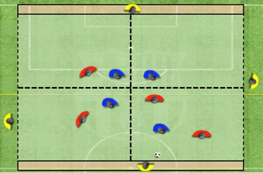

- ***Exemple SSP3 : ((3+3) + 1C) x 3***

  - Description : L’espace est divisé en 4 zones. Il y a 3 équipes, dont 2 sont disponibles et une autre en convalescence. Il y a un joker qui joue librement à l’intérieur de l’espace. L’objectif est d’amener le ballon dans l’espace libre des récupérateurs.

  - Contraintes : 1) L’équipe en MR doit intercepter et jouer le ballon avec l’autre équipe qui est en position de changer de rôle. 2) Chaque fois qu’il est reçu dans une zone sans récupérateurs, 1 point est ajouté pour les deux équipes en disposition. Si le joker le reçoit, 2 points sont ajoutés.

**Figure 12 : Exemple SSP3**

**Source : **Auteurs.

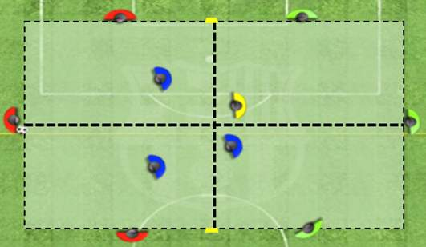

- ***Exemple SSP4 : ((P+3+3) + 1C) x 3***

  - Description : Espace divisé en 2 zones. 2 des 3 équipes plus la wild card sont dans le rôle de disposition, tandis que la troisième est dans le rôle de récupération. L’objectif du premier est de prendre le ballon d’une zone à l’autre, en le gardant. Les joueurs en MR doivent essayer de marquer.

  - Contraintes : 1) Les joueurs extérieurs éloignés (dans le graphique, à ce moment-là, ceux de l’équipe verte), ont le rôle de récupérateurs lorsque l’équipe en disposition se déplace d’une zone à l’autre.

**Figure 13 : Exemple SSP4**

**Source : **Auteurs.

La gestion des avantages et des inconvénients est étroitement liée à la circulation du ballon, mais se concentre sur les séquences de jeu où les joueurs se trouvent avec des possibilités de profiter de l’E-T disponible. Cela amènera à prendre en compte les idées du concept précédent dans de nombreuses situations. Les pratiques d’un tel concept devraient promouvoir des contextes dans lesquels la densité des joueurs compromet le rôle du joueur. L’enfant doit être capable de l’interpréter dans la continuité et d’agir en conséquence, en gardant à l’esprit l’endroit où se construisent les circonstances qui favorisent une densité positive. Il convient de se rappeler que, lorsque l’on parle des avantages et des supériorités qui accompagnent cette densité positive, non seulement la densité numérique sera prise en compte, mais la position et la qualité seront également très importantes, comme expliqué dans la section précédente. SSP5 se concentre sur cette interprétation dynamique de la densité, encourageant les joueurs à capturer des informations constantes de l’environnement. Regarder autour de soi pour connaître l’emplacement et la trajectoire des coéquipiers et des adversaires, tout en étant capable de cacher l’intention, vous permettra d’atteindre l’objectif de la tâche. Dans SSP6, les supériorités numériques initiales sont données, à la suite de la confrontation des structures en MD et MR (P-3-2 x P-2-2). Ce fait a un impact direct sur les séquences de jeu qui émergent au cours de la dynamique du jeu. Cependant, du point de vue du joueur, il doit continuer à être régi par ce qui est discuté dans SSP5. Pour cette raison, il est recommandé d’alterner différentes structures, ainsi que de faire partir les joueurs de différentes positions.

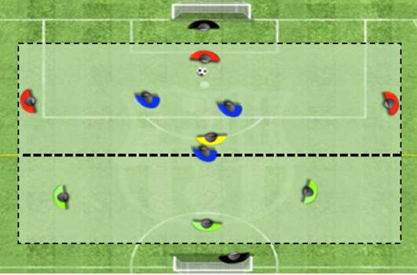

- ***Exemple SSP5 : P-5 x P-5***

  - Description : L’espace est divisé en 3 zones, avec un but de chaque côté. 2 équipes de 5 joueurs ont pour objectif de marquer un but.

  - Contraintes : 1) Un but peut être marqué dans l’un ou l’autre des deux buts. 2) Pour marquer, la supériorité numérique doit être atteinte dans la zone d’arrivée.

**Figure 14 : Exemple SSP5**

**Source : **Auteurs.

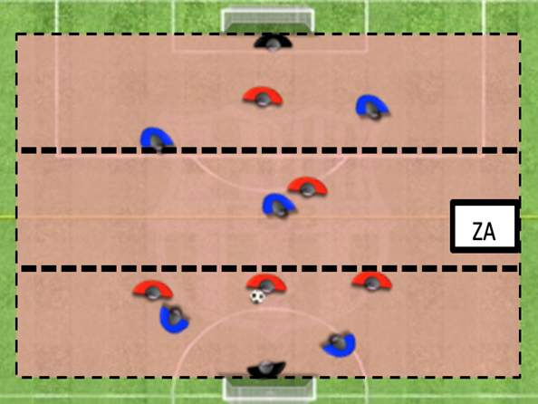

- ***Exemple SSP6 : P-4 x P-4***

  - Description : L’espace est divisé en 2 zones égales, dans la première il y a un 3x2 et dans la seconde il y a un 1x2. L’objectif des 2 équipes est de marquer un but sur but.

  - Contraintes : 1) Il doit y avoir un minimum d’un joueur en MR dans chaque zone.

**Figure 15 : Exemple SSP6**

**Source : **Auteurs.

Les dernières tâches qui sont présentées sont des SSP où il est prioritaire que les joueurs trouvent la possibilité de terminer. Par conséquent, il sera nécessaire de générer des situations d’avantage E-T. Les aspects traités dans les concepts précédents apparaîtront également spontanément, mais dans des situations d’achèvement, conditionnant ce fait aux actions des joueurs. Comme on peut le voir dans SSP7, une dynamique est reproduite dans laquelle, en plus de la possibilité de marquer des buts par des interactions entre les joueurs intérieurs, l’action de centre et de finition (action présente dans la zone D) est ajoutée, grâce à l’incorporation des joueurs supplémentaires des deux équipes. SSP8, en revanche, les interactions se déroulent à travers l’espace central, courtes et avec 1-2 touches, dans lequel l’adéquation du *timing* entre les joueurs est décisive pour obtenir des emplacements d’arrivée favorables.

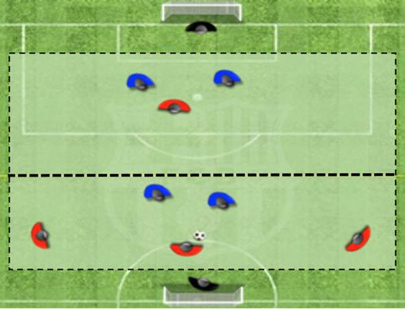

- ***Exemple SSP7 : P-5 x P-5***

  - Description : L’espace de jeu est divisé en 3 zones. Dans la troisième zone de chaque équipe, 2 joueurs sont à l’extérieur. Les équipes qui jouent dans l’espace intérieur ont pour objectif de marquer dans le but de l’adversaire.

  - Contraintes : 1) Il y a hors-jeu pour les joueurs intérieurs et extérieurs. 2) Le joueur extérieur en MR peut récupérer le joueur extérieur de l’autre équipe.

**Figure 16 : Exemple SSP7**

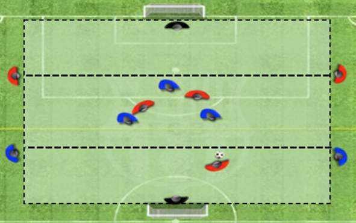

- ***Exemple SSP8 : ((3x3) + P) + 3C***

  - Description : l’espace est divisé comme indiqué dans le graphique. 2 équipes de 3 joueurs doivent tenter de marquer dans le même but à l’aide de 3 jokers extérieurs, en respectant la ligne de hors-jeu.

  - Contraintes : 1) Pour marquer un but, vous devez avoir joué avec le wild card de départ. 2) Il y a un hors-jeu pour les joueurs et les jokers.

**Figure 17 : Exemple SSP8**

**Source : **Auteurs.

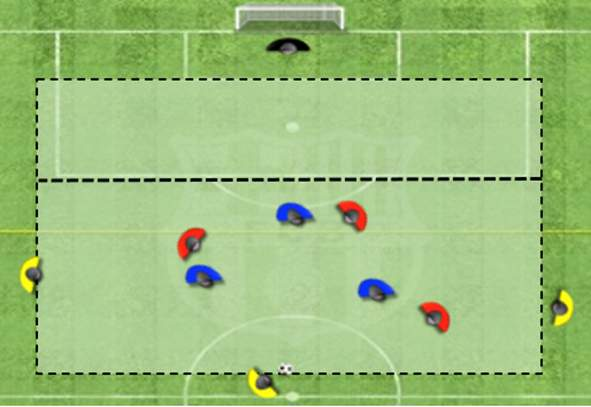

En épilogue du module, il convient de noter que les apprentissages acquis avec ce type de pratique doivent être régulièrement transférés à des situations globales. Ceux-ci sont conceptualisés comme des contextes ouverts qui respectent les règles du football dans lesquels le joueur, dans des densités spécifiques à celles du jeu, doit manifester tous les concepts en DM et MR à la demande de l’environnement pour tenter d’imposer son intention.
