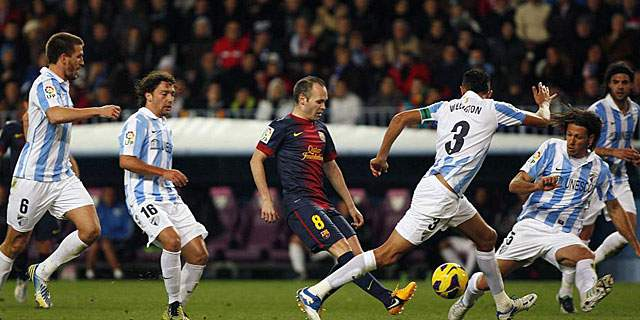
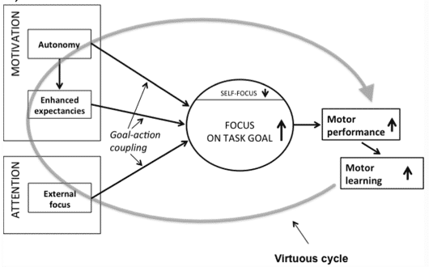
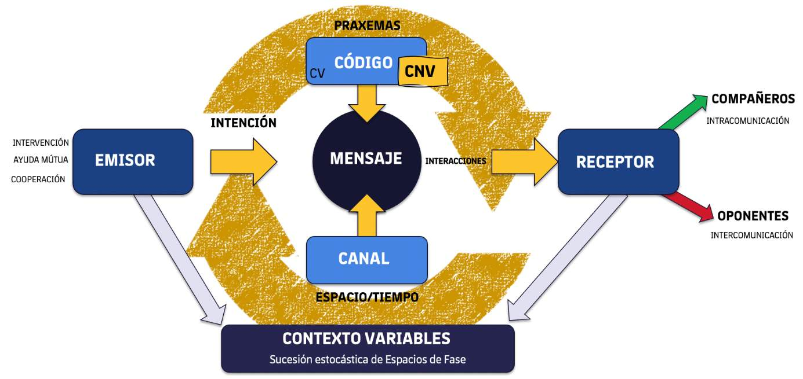
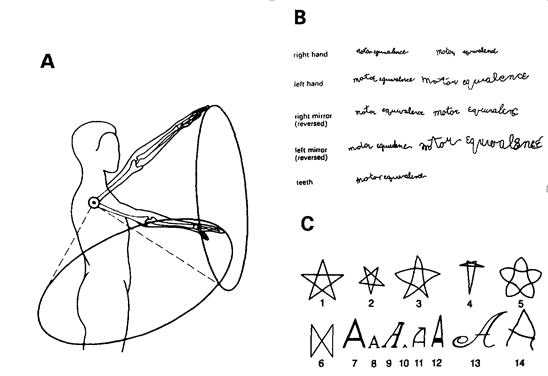
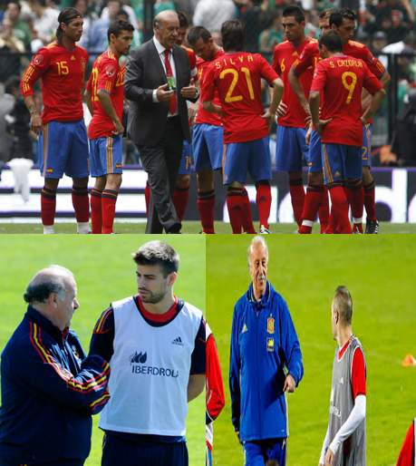
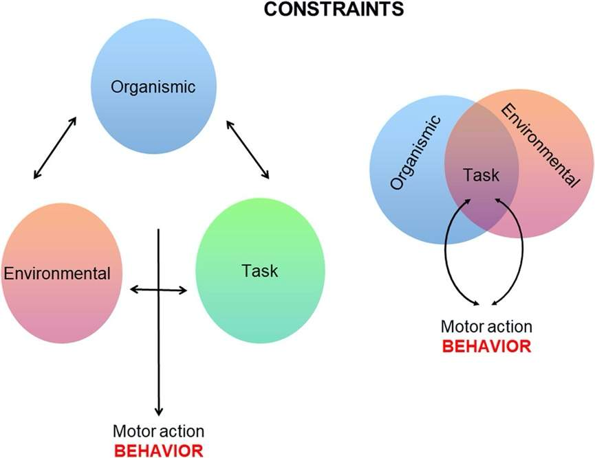
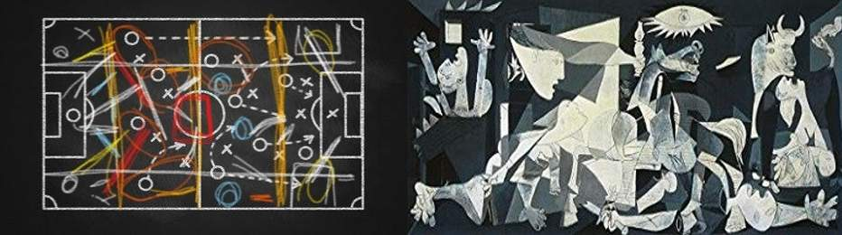
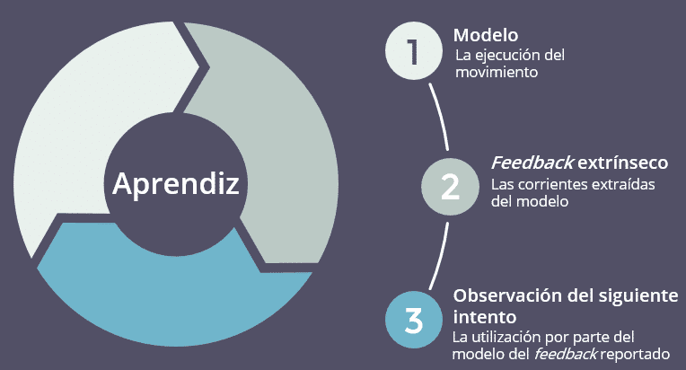

**  
Unité 3.1 Information continue. Quand donner son avis ?**

*Leçon 1 de 5*

**Planifier le processus de rétroaction avant, pendant et après la pratique physique, en tenant compte des attentes du joueur**

**3.1.1 L’auto-efficacité du joueur grâce *au feedback***

Pour commencer ce module, nous considérons qu’il est approprié de partir de la question suivante : que poursuivons-nous avec les *commentaires *que nous donnons au joueur ? Parfois, l’information transmise est choisie sans comprendre quel est son véritable impact. En tant qu’entraîneurs, nous savons que fournir un* retour d’information* au joueur peut l’aider dans sa croissance, car il sert à préciser le plan d’action, mais nous ne distinguons pas exactement quel type de retour d’information améliore le plus le processus d’apprentissage, en fait, normalement, cela s’intéresse aux aspects que le joueur doit optimiser, et nous ne pouvons pas différencier quel est le meilleur moment pour le donner. S’enquérir de tout cela peut ou non ouvrir une nouvelle façon de gérer les *retours*, mais, surtout, ce que nous obtiendrons, c’est au moins (bien que ce soit déjà beaucoup), réfléchir avant de le fournir aux joueurs.

Partant du mouvement volontaire (la capacité de décider et d’ordonner son propre comportement), des auteurs tels que Wulf et Lewthwaite (2016), dans leur théorie *de l’optimisation de la performance par la motivation intrinsèque et l’attention pour l’apprentissage* (OPTIMAL), affirment que l’utilisation de stratégies qui s’occupent de l’attention et de la motivation des apprenants peut avoir un impact positif sur la performance et l’apprentissage moteur. En approfondissant cette théorie, il est possible d’identifier une perspective qui s’éloigne de celles déjà mentionnées, en acceptant la véracité expérimentale des deux précédentes (voir module 2), en complétant, par de nouvelles contributions et découvertes, les propositions existantes qui décrivent et envisagent l’apprentissage moteur. Par conséquent, l’hypothèse qu’ils développent est étayée par des preuves scientifiques qui prouvent une amélioration de l’apprentissage à partir de la génération de conditions qui augmentent les attentes de l’apprenant envers la prochaine action (future), lorsque des variables qui stimulent leur autonomie sont utilisées et lorsqu’une focalisation externe de l’attention sur le mouvement à effectuer est promue.

Sur la base de ces hypothèses, les auteurs établissent un lien entre l’auto-efficacité et les attentes visant le résultat. Sur la base de cette conjecture, ils soulignent que l’utilisation de *la rétroaction* positive, entendue comme celle fournie sur les habiletés motrices réussies, permet à l’interprète d’augmenter sa perception de compétence, de prendre confiance en ses actions motrices futures et, à partir de là, d’améliorer les attentes de performance et de faciliter l’apprentissage moteur.

Pour cette raison, s’occuper d’une gamme de succès, une caractéristique associée à la connaissance du résultat (voir module 1), est compris comme une manœuvre significative pour l’apprentissage moteur du joueur, car elle évite la stigmatisation par laquelle l’entraîneur est le principal créancier à partir duquel il est déterminé si une interaction est correcte ou non. Il convient de noter, en ce sens, que cela est généralement établi, dans la plupart des cas, non pas tant par le sentiment du joueur qui effectue l’action cognitivo-motrice, mais par les croyances de l’entraîneur. Celles-ci ont tendance à être orientées vers des interactions réduites (qui sont, en plus, assez fermées), un fait que, de leur point de vue, l’erreur est trop révélée. Par contre, ce que nous pouvons extraire de ce qui a été dit jusqu’à présent concernant la nécessité d’augmenter les attentes du joueur pour atteindre un apprentissage moteur plus efficace, c’est que cette interaction ou, plutôt, l’ensemble des interactions qui sont fonctionnelles dans le contexte, en interprétant, dans cette gamme, toutes les interactions qui mènent au succès ; Cela se voit également dans l’évaluation du joueur sur la réalisation de l’objectif. Cela augmentera la perception de la concurrence par ces derniers, un aspect qui, à long terme, sera bénéfique pour augmenter leur sécurité et leurs performances.

L’idée que l’apprenant se fait de la motricité a un rôle prépondérant dans sa perception de la réussite ou de l’échec lors de son exécution. Wulf et Lewthwaite (2016) indiquent que les personnes qui croient que les habiletés motrices peuvent être incorporées, c’est-à-dire acquises, sont plus susceptibles de considérer une tâche comme une occasion de s’améliorer, en considérant les erreurs comme des phases temporaires et comme faisant partie du processus d’apprentissage. Dans la lignée de ce qui a été décrit, Chiviacowsky et Wulf (2007) et Chiviacowsky, Wulf, Wally et Borges (2009) observent que croire en l’impact positif que la motricité générera augmente également les attentes, il est donc possible d’utiliser cette stratégie comme un outil.

Sur la base de ce qui précède, nous pourrions nous demander si nous laissons au joueur une marge d’erreur, si nous lui faisons ressentir cette circonstance et à quel point nous sommes exigeants. Le coach doit comprendre l’apprentissage moteur comme un processus. En ce sens, il est important de savoir que l’exécution des compétences est améliorée. Pour cela, il est essentiel d’identifier la nécessité pour l’apprenant de participer activement à l’accord définitif des interactions réussies ou non, comme cela a été soutenu. Avec cela, nous pourrons faire voir au joueur que nous travaillons ensemble pour qu’il s’améliore. De cette gestion, il peut également commencer à comprendre que l’apprentissage découle de la relation disparate, mais contextuelle, entre le succès et l’erreur et que toutes les expériences, en particulier celles qui impliquent un défi qui implique un pourcentage élevé d’erreurs, sont les pratiques qui permettent la croissance fonctionnelle, car elles nécessiteront d’incorporer des solutions motrices jamais réalisées auparavant. Par conséquent, nous devons partir de la relation entre le sujet, en tenant compte de ses capacités, et l’environnement, en tenant compte de ses composantes dynamiques, afin de soustraire cette appréciation conjointe. En bref, il faut éviter l’analyse à sens unique, c’est-à-dire que l’on ne peut pas se concentrer uniquement sur l’évaluation du coach. Selon cette idée, compte tenu de la complexité de l’environnement du jeu de football, il se peut que le simple fait, mais pas trivial, de continuer avec la possession du ballon puisse être considéré comme un succès, surtout lorsque le contexte n’est pas le plus favorable pour cela, bien que nous, en tant qu’entraîneurs, de l’extérieur, pensons qu’il existe de meilleures options pour le résoudre (Figure 1).

**Figure 1 : Iniesta, meilleur meneur de jeu**

**Fontaine: **El Mundo (2013). \[Image d’Iniesta, meilleur meneur de jeu\]. Tiré de t.ly/tgyQ

Poursuivant avec Wulf et Lewthwaite (2016), ces auteurs soutiennent que, si ce type de *rétroaction* est donné conformément à des informations sociales comparatives dans lesquelles l’efficacité de la motricité est distinguée au-dessus de la moyenne ou est présenté à l’aide de la technique de l’auto-modélisation (rétroaction du sujet lui-même), il provoquera la même sensation. Dans le même temps, Wulf, Raupach et Pfeiffer (2005), dans le cadre des arguments scientifiques inclus dans la théorie OPTIMAL, mettent en évidence l’apprentissage par observation par vidéo comme un instrument optimal à prendre en compte à cette fin. De leur côté, ils précisent que le fait de fixer certains critères qui, apparemment, montrent une bonne performance, mais qui peuvent être obtenus relativement facilement, renforce les attentes de la même manière. À cela s’ajoute la possibilité de choisir tout au long de la pratique qui, ajoutée à l’ordre d’exécution, augmente l’intérêt du sujet à réaliser la tâche proposée. Cela favorise indirectement l’apprentissage. Par conséquent, les conditions qui permettent de choisir sont motivantes, car elles exposent que l’on sera capable de contrôler les prochains événements qui se produiront.

En complément des informations fournies dans le module 2, il est essentiel de se demander (et de se demander) quel style d’enseignement-apprentissage nous utilisons normalement : est-il unidirectionnel ou bidirectionnel ? La plupart d’entre nous pensent que nous, en tant qu’entraîneurs, devons connaître toutes les solutions du jeu. Cela n’est pas sans rappeler les séances d’entraînement au cours desquelles l’entraîneur effectue lui-même une **master class**. Dans l’analyse, il est possible d’observer comment, dans chaque session, nous utilisons un style unidirectionnel. Cependant, si nous partons de l’argument fourni dans le paragraphe précédent, nous pourrions avoir la possibilité de repenser l’échange que nous effectuons avec les joueurs. Sur cette base, en rassemblant les limites possibles de l’idée, serait-il judicieux de laisser nos joueurs proposer des tâches d’entraînement ? Si nous sommes en mesure de créer le bon environnement dans lequel les limites sont claires et, en même temps, de gérer efficacement les groupes de travail, la mise en œuvre de cette stratégie peut nous aider à optimiser l’acteur, car nous utilisons des tâches créées par lui dans lesquelles il sera très impliqué et, par conséquent, motivé, tout en connaissant sa perception du contenu de la pratique.

Il convient de noter que la théorie OPTIMALE met l’accent sur le rôle de la récompense dans ce processus. Compris comme un indice d’efficacité de la performance, qui augmente la motivation intrinsèque telle que les attentes anticipatives personnelles de l’atteindre ou de la perdre, améliorant ainsi l’exécution ultérieure. En revanche, des attentes élevées de réussite affectent positivement l’apprentissage moteur (Pascua, Wulf et Lewthwaite, 2015 ; Rosenqvist et Skans, 2015 ; Wulf, Chiviacowsky et Cardozo, 2014).

Sur la base de ce qui précède, un autre aspect est ajouté à garder à l’esprit : comment utilisons-nous le scoring dans nos pratiques ? Parfois, nous utilisons la ponctuation de manière abusive dans les tâches d’entraînement, soit parce que nous donnons beaucoup de scores, soit parce que nous donnons beaucoup de valeur aux interactions que nous avons l’intention de pratiquer. Pour cette raison, il serait opportun de le réguler, car, comme il se manifeste, il a un impact important sur l’apprentissage du joueur. Par conséquent, pour y parvenir, il est proposé qu’il soit responsable et associé à l’objectif, non lié à l’une des interactions qui permettent de l’atteindre, de sorte que, de cette façon, il laisse une marque sur la dynamique du jeu. En même temps, il est possible de ne pas l’envisager, un aspect qui ne focalisera l’attention que sur le processus, si nous le comprenons comme l’interaction ou l’union d’interactions perçues comme réussies.

 

Tous ces arguments soutiennent, selon Wulf et Lewthwaite (2016), l’idée que l’apprentissage moteur est médié par des facteurs de motivation. Les deux principales positions motivationnelles de la théorie OPTIMALE pour faciliter l’apprentissage moteur sont l’augmentation des attentes de performance et le besoin de l’apprenant de se sentir autonome. La littérature a montré que donner à l’apprenant le contrôle de certains aspects de la pratique physique améliore l’apprentissage moteur (Chiviacowsky, Wulf, Lewthwaite, & Campos, 2012 ; Wulf, 2007). Recevoir un retour d’information autocontrôlé, c’est-à-dire lorsque l’interprète le souhaite, s’est avéré être une variable positive pour améliorer l’exécution des capacités motrices (Quintana Recasens, 2019, p. 39).

Il est important de comprendre que le joueur est le guide de leur processus d’apprentissage. Il détermine le moment idéal pour recevoir des *commentaires *de toute nature. De cette façon, l’entraîneur doit le lui offrir, en utilisant toutes les stratégies mentionnées, afin de former un joueur autonome. C’est le moyen de répondre aux attentes du joueur, de l’impliquer, c’est-à-dire de le faire participer activement à son processus de formation et d’apprentissage.

**Figure 2 : Théorie OPTIMALE**

**Fontaine: **Wulf et Lewthwaite, 2016, p. 1405.

| LANGUE SOURCE                            | TRADUCTION                               |
|------------------------------------------|------------------------------------------|
| MOTIVATION                               | MOTIVATION                               |
| Autonomie                                | Autonomie                                |
| Attente accrue                           | Des attentes plus élevées                |
| ATTENTION                                | ATTENTION                                |
| Focalisation externe                     | Focalisation externe                     |
| Objectif-action                          | Objectif-action                          |
| Couplage                                 | Couplage                                 |
| MISE AU POINT SUR SOI                    | MISE AU POINT AUTOMATIQUE                |
| SE CONCENTRER SUR L’OBJECTIF DE LA TÂCHE | SE CONCENTRER SUR L’OBJECTIF DE LA TÂCHE |
| Performances du moteur                   | Performances du moteur                   |
| Apprentissage moteur                     | Apprentissage moteur                     |

**3.1.2 Espaces d’échange d’informations d’observation avec le joueur**

L’intégration d’une habileté motrice implique le transfert d’informations entre le coach et l’apprenant. Cette relation permet d’accélérer le processus d’apprentissage dit moteur. Par conséquent, l’apprentissage par l’observation d’un modèle sans combiner la pratique physique est une ressource qui est utilisée de manière répétée et qui s’appelle la **pratique observationnelle**. L’utilisation de l’observation isolée, comme ressource pour intégrer les compétences motrices, offre la possibilité de percevoir le rôle qu’elle joue lors de l’apprentissage moteur. En ce sens, plusieurs auteurs partent de deux hypothèses différentes pour expliquer ce rôle (Maslovat, Hayes, Horn et Hodges, 2010 ; Vogt et Thomaschke, 2007). D’une part, la médiation précoce vise à ce que le système moteur de l’observateur soit activé de manière cachée pendant l’observation, générant que tout progrès, dans l’exécution de la motricité ultérieure de ce dernier, est attribué à la quantité d’informations que le système moteur a reçues tout au long de l’étape au cours de laquelle la visualisation s’est produite. D’autre part, elle diffère de la médiation tardive par le caractère stratégique de cette dernière, qui est liée aux améliorations qui se produisent par l’observation, qui n’inclut que l’activation du système moteur, une fois la pratique physique commencée.

Par conséquent, sur la base des informations ci-dessus, nous nous demandons pourquoi nous montrons des séquences vidéo aux joueurs. Depuis un certain temps, les entraîneurs offrent aux joueurs des commentaires sur leurs interactions par le biais d’images. En ce sens, nous sommes conscients qu’il s’agit d’une stratégie qui facilite la transmission d’informations (une image vaut mille mots) et nous avons concentré son utilisation sur l’évaluation des performances motrices, principalement basée sur l’erreur. Bien que cette stratégie se soit avérée efficace, il est important de garder à l’esprit que ce n’est pas la seule possibilité qui existe de donner du *feedback*. En fait, la littérature recommande d’utiliser le feedback à différentes fins, surtout si nous prêtons attention aux attentes du joueur (voir point 3.1.1).

L’amélioration de la reconnaissance perceptuelle associée à la pratique observationnelle permet des avancées significatives dans la compréhension de la coordination d’une nouvelle tâche visuo-motrice, même si la performance manifeste ne s’améliore pas. En ce sens, la pratique observationnelle s’est avérée aussi efficace que la pratique physique pour reconnaître les erreurs dans une tâche, car elle permet d’identifier le bon *moment* d’exécution et facilite l’acquisition de comportements séquentiels (Black & Wright, 2000 ; Black, Wright, Magnuson et Brueckner, 2005). Il a aussi la propriété de faire adopter à l’observateur des stratégies similaires à celles perçues lors du visionnage, quel que soit le bénéfice final qu’elles apportent... Ces faits renforcent l’influence de l’observation sur l’apprentissage moteur et dénotent l’acquisition de connaissances cognitives stratégiques associées à une médiation tardive. Cependant, il est important de mentionner que, lorsque la connaissance stratégique ne peut être appliquée qu’avec une efficacité limitée pour résoudre une habileté motrice, la pratique observationnelle ne montre pas les mêmes améliorations de performance que celles qui résulteraient de tâches dans lesquelles une stratégie particulière mène à la résolution du problème moteur. En revanche, la médiation précoce prend du devant de soi face à l’observation des habiletés motrices déjà apprises, et sa contribution est quasi nulle face à de nouvelles tâches pour l’apprenant... Face à une nouvelle motricité pour le sujet, l’observation apporte des bénéfices dans les performances perceptives et cognitives, et non dans le développement moteur, c’est pourquoi la pratique physique est nécessaire pour améliorer le comportement. (Quintana Recasens, 2019, p. 51).

  

En poursuivant la réflexion, quels types de pratiques sont réalisées avant de commencer la formation, et après ? Les coachs comprennent-ils ces moments pour mener à bien le processus d’apprentissage ? Quelles stratégies utilisons-nous ? Comment articulons-nous les activités ? Il est étrange que le processus de formation envisage des stratégies d’apprentissage avant, pendant et après la pratique et que celles-ci incluent le même objectif. Parfois, il peut être réalisé avec un joueur, mais il n’est pas structuré pour atteindre toute l’équipe. En tenant compte des contraintes de temps qui composent les réalités actuelles de certaines équipes, l’optimisation du processus d’apprentissage, sa compréhension comme un élément clé dans la formation du joueur et, par conséquent, de l’équipe, peut être différentiel dans les performances.

Selon l’interprétation fournie par Hodges (2017), de tels énoncés améliorent la capacité d’observation à déterminer ce que l’on veut exécuter, ce qui est beaucoup plus pertinent dans l’évolution de **ce qu’il faut faire **et non dans **la façon dont cela est fait**. Ceci, ajouté au potentiel de l’observation pour augmenter la perception de l’efficacité du sujet, laisse à l’arrière-plan la conception simpliste qui comprend l’observation seule, comme un outil pour évaluer la performance souhaitée, et lui fournit des arguments pour l’admettre comme un instrument nécessaire et utile pour l’apprentissage moteur.

Pour toutes ces raisons, le coach doit réfléchir aux interactions qu’il souhaite montrer en images tous les moments de l’entraînement (avant, pendant et après). Sachant comment fonctionne la médiation précoce et tardive, cette sélection peut être effectuée qualitativement et les interactions montrées seront celles qui fourniront des références fonctionnelles pour la pratique ultérieure. Il est nécessaire de coordonner toutes ces informations montrées par la pratique observationnelle avec l’apprentissage observationnel par *retour vidéo *visuel (**voir modules 1 et 4**), que nous proposerons lors de la formation ; et, enfin, conclure le processus avec les informations d’observation qui en résultent, où la réflexion avec le joueur sera significative. Comprendre et structurer l’entraînement de cette manière permet de planifier les impacts en fonction des objectifs visés pour un joueur, un groupe de joueurs ou le collectif d’équipe. À notre avis, la gestion efficace de cet aspect apporte plus de variabilité à la pratique, qui est sous le même fil pendant tous les moments où nous échangeons des informations avec les joueurs.

#  Unité 3.2 Informations polyvalentes. Quel retour d’information donner ?

*Leçon 2 de 5*

**Transmettre des informations qui favorisent l’adaptation à l’environnement**

Certains auteurs, tels que Shmuelof, Krakauer et Mazzoni (2012), soulignent que la compréhension d’une habileté motrice implique un changement durable de sa capacité d’exécution et qu’il n’est possible de l’obtenir que par le processus d’entraînement. Pour Todorov, Shadmehr et Bizzi (1997), cela implique la solution simultanée de deux aspects :

- balle

identifier les constantes qui font le succès du mouvement ; et

- balle

Sélectionnez un sous-ensemble d’actions (mouvements) qui sont plus faciles à exécuter et à contrôler et qui peuvent être exécutés de manière plus fiable.

De nature complexe, les compétences technico-tactiques (interactions cognitives-coordonnatives) configurent l’ensemble des mouvements spécifiques que chaque sport doit exécuter de manière efficace et efficiente (Riera, 1989 ; Solà, 2010). Dans les sports d’équipe, comme le football, ces types d’habiletés acquièrent une valeur encore plus grande lorsqu’elles sont exécutées en même temps que l’engagement affectif que l’athlète a envers les individus avec lesquels il coopère, compétitionne, accepte ou rejette nécessairement (Seirul·lo, 2017).

L’émergence des comportements moteurs du joueur dépend avant tout de la capacité à s’adapter aux conditions de diverses natures qui se produisent dans les contextes de pratique. Le cycle de communication basé sur les interactions socio-affectives montre comment interpréter, dans cette perspective, typique du processus d’entraînement qui se définit (voir module 2), l’échange d’informations entre les acteurs (figure 3). Selon que le joueur occupe l’espace d’intervention, d’entraide ou de coopération, l’impact de l’intention qu’il réalise touche un plus grand nombre de joueurs, qu’ils soient coéquipiers ou adversaires. Ce message qu’il transmet est exprimé par un code. Cela peut être verbal, par le langage oral, ou non verbal, par des praxèmes. Ce type de communication non verbale est une priorité pour l’avenir de la communication, car son déchiffrage est beaucoup plus intuitif et rapide. C’est pertinent, car l’information émise n’a de sens qu’à un moment précis et, après cela, perd son sens. En effet, le canal par lequel l’information circule est l’espace-temps à travers lequel le jeu se déplace et se manifeste dans un contexte variable. Les récepteurs de ce message sont les camarades de classe, avec lesquels une communication positive est établie, et les adversaires, avec lesquels il faut essayer d’établir une communication neutre ou négative. Ce cycle de communication se répète dans la succession stochastique des espaces de phase et c’est celui qui est pratiqué pendant le processus d’entraînement. Capturer cette sensibilité par l’observation est le défi de l’entraîneur lorsqu’il s’agit de fournir une *rétroaction* pendant la pratique.

**Figure 3 : Le cycle de la communication socio-affective**

**Fontaine: **FCB (s.d.). Archive non publiée, avec sa propre adaptation.

L’entraîneur doit fournir un *retour d’information* contingent qui renforce les connaissances procédurales du joueur, qui sont basées sur le cycle de communication. Il ne suffit pas de transmettre au joueur, seul, à quel point il a bien fait une interaction. Le message doit contenir **les raisons pour lesquelles** l’exécution est considérée comme réussie. Il est recommandé, si possible, que ce soit sous la forme d’une question, afin que l’apprenant puisse la découvrir par lui-même, à travers sa propre réflexion. Il est basé sur le principe que chaque espace de phase est différent et que le joueur doit être capable de lier l’émotion qu’il ressent avec l’efficacité et l’efficience de l’interaction qu’il a réalisée. Si cela est réalisé, l’apprentissage peut devenir significatif et se manifester plus souvent à l’avenir. Pour cette raison, on considère que la connaissance déclarative n’est pas nécessaire au moment de la réponse, puisqu’elle ne servira qu’à nommer les comportements. D’autre part, l’interaction est valorisée comme le moyen d’atteindre l’objectif. Dans le même temps, il est conseillé que le coach ne donne pas de *feedback* constamment. Cela détourne l’attention des joueurs du jeu, c’est ce qui est important.

 

Face à ce dilemme, Wulf et Lewthwaite (2016) affirment que, compte tenu des avantages de l’approche de l’attention externe, le *retour d’information* devrait être donné par le biais d’une instruction ouverte car elle facilite le lien objectif-action (voir module 2). L’utilisation de l’attention externe, loin des parties du corps et de l’effet du mouvement prévu, profite à la performance et à l’apprentissage moteur (Wulf, 2007, 2013). Les avantages constatés sont liés aux mesures de l’efficacité (p. ex., précision lors de la frappe d’un objet, production d’une certaine force, maintien d’une position équilibrée) et de l’efficacité (p. ex., activité musculaire, consommation d’oxygène et fréquence cardiaque réduite) du mouvement. Il dénote un apprentissage moteur supérieur par rapport à la concentration de l’attention interne, en raison du fait qu’un niveau plus élevé et plus rapide de motricité est atteint, et montre une amélioration du recrutement des unités motrices, de la coactivation musculaire et de la cinématique des habiletés motrices adaptée à l’environnement. Selon les auteurs, l’approche de l’attention externe favorise les processus de contrôle inconscients, rapides et réflexifs, et favorise la coordination libre sans restreindre les degrés de liberté de mouvement, ce qui favorise la variabilité fonctionnelle et la réduction de l’attention. (Quintana Recasens, 2019, p. 40).

 

En plus de cela, l’utilisation d’un langage pédagogique favorise le sens du choix, accordant ainsi plus d’autonomie. Tout cela conduit à un apprentissage moteur supérieur, comme l’indiquent Hooyman, Wulf et Lewthwaite (2014). Par conséquent, ces auteurs s’opposent à l’enseignement fermé qui offre peu d’options sur la façon d’exécuter l’habileté motrice.

Par conséquent, l’entraîneur doit utiliser un langage verbal et non verbal approprié pour augmenter l’impact du message multimodal parmi les joueurs. Cette information équivaudrait à quel message faire passer ? Habituellement, les invites font référence à des actions biomécaniques centrées sur le corps du joueur, basées sur une approche interne. Un exemple pourrait être les slogans typiques faisant référence au col. Ceux-ci indiquent des aspects tels que le fait que les passes doivent être tendues, qu’elles doivent être faites avec l’intérieur du pied, que ce pied d’appui doit être placé dans la direction dans laquelle nous voulons envoyer le ballon, etc. Ces expressions limitent le joueur et entravent tout ce qui est réalisé avec une pratique variable. Le message doit être plus polyvalent et axé sur le résultat que vous souhaitez obtenir. En utilisant l’approche externe comme support*, le retour d’information doit *indiquer des références adaptables à la variabilité du jeu qui donnent au joueur l’autonomie nécessaire pour s’exprimer de manière créative, selon les degrés de liberté articulaire qu’il juge appropriés pour atteindre l’objectif visé.

Nikolai Bernstein (1896 – 1966), un neurophysiologiste russe qui a été le pionnier de l’étude du contrôle moteur et de l’apprentissage, a introduit pour la première fois le concept de** degrés de** liberté **articulaire**, qui survit toujours. Ses recherches centrées sur l’étude de la coordination motrice, opposées aux idées comportementalistes de Pavlov, typiques de son époque, et différentes de celles du cognitivisme, ont fourni une nouvelle approche du concept qui a servi de base au **modèle écologique** (Meijer & Bongaardt, 1998 ; Stuart, 2005 ; Schmidt et Lee, 2011). Voir quelle a été leur conception aidera à comprendre la nécessité de traiter chacune des interactions réalisées par les joueurs comme unique. Ce sera un fait différentiel qui conditionnera le retour d’expérience, puisque la difficulté de ce choix est de déterminer comment exprimer le message que l’on veut transmettre.

Bernstein souligne que la conception de l’appareil moteur des vertébrés crée un problème dans le contrôle des mouvements du corps (Sporns, Tortoni et Edelman, 1993). Il comprend que les organes moteurs des animaux et des humains, composés de plusieurs articulations et d’un nombre encore plus grand de muscles, peuvent atteindre un grand nombre de degrés de liberté. Ce nombre de degrés de liberté est supérieur à la dimension de votre espace de travail, définie comme la région de l’espace à l’intérieur de laquelle l’organe moteur peut se déplacer. Ce fait conduit au concept de **redondance**, qui reflète la possibilité existante que plus d’un signal moteur puisse se conclure dans la même trajectoire motrice. De plus, cela indique que des signaux moteurs identiques peuvent conduire à des mouvements différents, si les conditions initiales sont différentes ou s’il existe des variations sous-jacentes dans l’environnement externe (Meijer & Bongaardt, 1998 ; Sporns, Tortoni et Edelman, 1993).

Il a proposé une compréhension hiérarchique du système de mouvement humain basée sur deux niveaux d’action parallèles : le niveau supérieur définissait la réponse au problème posé, tandis que le niveau inférieur organisait le système locomoteur afin de résoudre de manière satisfaisante le problème à résoudre. L’approche susmentionnée est née de la conception du mouvement humain qui s’attache à sa variabilité d’exécution. Il affirmait qu’il était impossible de répéter un mouvement à l’identique du précédent, même s’ils partageaient une structure de base et commune (Figure 4). Cette idée était évidente lorsque nous avons vu le grand nombre de degrés de liberté que les êtres humains devaient contrôler en raison de la structure de leur système moteur. Il estimait que c’était inacceptable uniquement en raison du système nerveux central. L’influence des forces extérieures sur le développement final de l’exécution du moteur est l’une de ses grandes réflexions. Cela s’expliquait par l’hypothèse de l’inexistence d’une relation univoque entre les signaux centraux et la réponse motrice, en raison de l’impossibilité de contrôler la prévisibilité des forces réactives, encore une fois, par le système nerveux central. En fait, pour l’auteur, toute modification dans l’exécution d’une action motrice a été corrigée tout au long de son développement ultérieur. Comme l’expliquent Schmidt et Lee (2011), pour Bernstein, dans les premières étapes de l’apprentissage d’une habileté motrice, les apprenants figent les parties non essentielles du corps en réduisant le nombre de degrés de liberté. Avec cette action, ils peuvent se concentrer sur l’essence du mouvement. L’élégance de celle-ci apparaît lorsque l’habileté est développée et coïncide avec la libération et l’exploitation des degrés de liberté.

**Figure 4 : Ensemble de mouvements avec des trajectoires topologiquement identiques avec des résultats différents**

**Fontaine:** Sporns, Tortoni et Edelman, 1993, p. 962.

Sur la base de l’exemple de la passe et après une meilleure compréhension du concept de **degrés de liberté articulaire**, un slogan possible pourrait être que les passes doivent avoir la puissance idéale pour que le ballon atteigne le coéquipier (tableau 1 et tableau 2). Cette manière extérieure d’exprimer les instructions à l’individu répond à la fois à ses propres besoins et à ceux du partenaire, et n’est pas détachée du comportement collectif qui se manifeste dans l’environnement, un aspect clé des interactions socio-affectives, donnant au joueur une marge d’action suffisante (degrés de liberté) pour y parvenir, selon ses possibilités.

| **FOCUS INTERNE**                                                                              |
|------------------------------------------------------------------------------------------------|
| ***LARGEUR ET PROFONDEUR / TROISIÈME HOMME / JOUER À DIFFÉRENTES HAUTEURS***                   |
| Jouez avec une largeur maximale.                                                               |
| Jouez avec une profondeur maximale.                                                            |
| Pour donner de la continuité au changement d’orientation.                                      |
| Localisez et utilisez les espaces libres, en privilégiant ceux qui sont éloignés.              |
| Jouez en diagonale.                                                                            |
| Surmontez une ligne pour pouvoir recevoir de face.                                             |
| Faites des passes progressives en donnant la priorité à celles qui surmontent les adversaires. |
| Mobilité des lignes avancées pour recevoir.                                                    |
| Alternez les mouvements en profondeur et en amplitude.                                         |
| Ne pas rencontrer d’autres camarades de classe dans la même allée verticale et horizontale.    |

**Tableau 1 : Modèles de réflexion formulés par une approche interne**

**Source : **Élaboration des auteurs sur la base de FCB (s.d.). Matériel non publié.

**Tableau 2 : Modèles de réflexion formulés par une approche externe**

| **APPROCHE EXTERNE**                                                                                                                                                         |
|------------------------------------------------------------------------------------------------------------------------------------------------------------------------------|
| ***LARGEUR ET PROFONDEUR / TROISIÈME HOMME / JOUER À DIFFÉRENTES HAUTEURS***                                                                                                 |
| Ajuster les distances de relation entre les joueurs, en utilisant la largeur et la profondeur et en tenant compte des possibilités d’intervention sur le ballon (réception). |
| Identifiez et utilisez les espaces libres, en privilégiant ceux qui sont éloignés, en ne proposant pas la même ligne de dépassement.                                         |
| Réajustez les distances de relation par rapport aux possibilités d’interaction du support, ce qui tend à modifier la zone.                                                   |
| Garantir les distances optimales entre les joueurs en fonction de la situation du ballon (pouvoir intervenir directement ou indirectement sur le ballon).                    |
| Réajuster constamment l’occupation rationnelle des espaces.                                                                                                                  |
| Ajustez les emplacements en prévision d’une éventuelle perte de balle.                                                                                                       |

**Source :** Élaboration des auteurs sur la base de FCB (s.d.). Matériel non publié.

**  
Unité 3.3 Renseignements individualisés**

*Leçon 3 de 5*

**À qui dois-je donner *mon avis* ? Véhiculer un message qui renforce le joueur sans limiter sa pratique**

Dans cette unité, nous nous permettons de repenser et de nous demander quels aspects nous devons garder à l’esprit lors de la sélection de l’information. En ce sens, connaître nos joueurs permettra d’établir le cadre sur lequel adapter les *retours*. Pour cela, la gestion de cet environnement est essentielle pour faire passer notre message aux joueurs. C’est-à-dire que nous n’avons pas besoin de nous imposer, il suffit de leur offrir les informations qu’ils recherchent, en étant conscients qu’elles n’ont pas à coïncider pleinement avec ce que nous voulons leur transmettre.

**Figure 5 : Entraîneur Vicente Del Bosque**

**Source : **Auteurs.

L’une des stratégies les plus favorables, lorsqu’il s’agit d’apprendre et d’intégrer une habileté motrice, est l’utilisation de *la rétroaction* extrinsèque. Se concentrer sur le résultat souhaité lors de l’exécution d’une action motrice donne au sujet la possibilité de mieux comprendre où les ajustements doivent être effectués. Ce processus peut constituer un avantage pour l’apprenant, car le mouvement qui en résulte est généralement plus efficace et efficient. En exprimant le terme efficace, il est possible de l’associer à des aspects qui ont à voir avec la précision et l’équilibre. D’autre part, un mouvement efficace est associé à des caractéristiques telles que l’activité musculaire, la consommation d’oxygène et la fréquence cardiaque. Dans le même temps, en fonction de l’attention choisie et de sa modalité d’entrée sensorielle, la *rétroaction* extrinsèque peut augmenter son influence sur l’interprète (Shea et Wulf, 1999 ; Sigrist, Rauter, Riener et Wolf, 2013).

Maintenant, quelles informations sont significatives pour le joueur ? De cette conception, les informations que nous transmettons, en tant qu’agents éducatifs, doivent permettre au sujet de s’adapter à l’environnement. Par conséquent, il doit être composé de références dynamiques. Leur principale caractéristique est qu’ils ne sont pas corsetés dans une situation de jeu spécifique. Au contraire, ils offrent au joueur des points d’appui qui lui permettent d’osciller librement, mais de manière cohérente, avec le groupe.

À ce sujet, Balagué, Pol, Torrents, Ric, Hristovski (2019) expliquent que la tâche, entendue comme l’objectif moteur émergent qui doit être exécuté à un moment plus ou moins extensif, découle d’une rétroaction directe entre le sujet et l’environnement. L’un contraint l’autre et vice versa, tant qu’il existe une dépendance fonctionnelle ou une tâche qui a un sens dans ce cadre (système sujet-environnement), dans lequel le mouvement moteur qui en résulte émerge, qui se répercutera sur le système (Figure 6).

**Figure 6 : Système sujet-environnement**

**Fontaine: **Balagué et al., 2019, p. 3.

| LANGUE SOURCE   | TRADUCTION      |
|-----------------|-----------------|
| CONTRAINTES     | CONTRAINTES     |
| ORGANISME       | ORGANISME       |
| ENVIRONNEMENTAL | ENVIRONNEMENTAL |
| TÂCHE           | TÂCHE           |
| Motricité       | Action motrice  |
| COMPORTEMENT    | COMPORTEMENT    |
| Organisme       | Organisme       |
| Tâche           | Tâche           |
| Environnemental | Environnemental |
| Motricité       | Action motrice  |
| COMPORTEMENT    | COMPORTEMENT    |

Cela suggère qu’il n’y a pas de réponse standard qui résout chaque contexte de pratique. La réponse optimale est conjecturée comme un ensemble d’interactions efficaces et efficientes, c’est-à-dire fonctionnelles, avec des degrés de liberté spécifiques, uniques et différents, dans la succession stochastique d’espaces de phases, qui changent, en fonction des compétences de chacun des acteurs.

Par conséquent, nous devons nous poser les questions suivantes : comment le sujet reconnaît-il l’information ? Quel est le canal le plus efficace pour transmettre des informations ? Les entraîneurs se sont appuyés sur différents outils pour transmettre notre message. L’un d’eux a été le tableau noir. Sans sous-estimer son potentiel de clarification, puisqu’il schématise un champ de manière simple ; Notre façon de l’utiliser, parfois, ne précise pas suffisamment l’information. Avez-vous remarqué comment ils finissent après la clarification parler aux joueurs à la mi-temps ? Être conscient des ressources dont nous disposons pour faciliter la reconnaissance des informations au joueur, en mettant en évidence la vidéo au-dessus d’eux, améliorera l’apprentissage par observation. Cela nous permettra également de proposer des informations d’une manière spécifique.

**Figure 7 : Comparaison entre un tableau noir avec des indications et le Guernica de Picasso**

**Source : **Auteurs.

La vision est la principale modalité sensorielle utilisée dans l’apprentissage moteur. Riemann et Lephart (2002) soulignent que le système visuel facilite l’exécution des ajustements nécessaires aux mouvements des membres et aux positions articulaires pour que l’être humain s’adapte à un objet ou au sol, en utilisant des stratégies aussi variées que l’observation, l’imitation et la démonstration. Il est connu que l’apprentissage par observation améliore la capacité perceptive de l’apprenant : une plus grande précision dans la discrimination du mouvement (Lago, López et Fernández del Olmo, 2013) ; et que l’observation d’un modèle facilite l’acquisition globale de la motricité (Horn, Williams et Scott, 2002). Chez l’homme, la fréquence visuelle la plus élevée qui peut être suivie est de 16 Hz, soit une période de 0,06 s, ce qui signifie que les actions plus rapides ne peuvent pas être traitées avec précision (Winter, 2005). Dans le même temps, plusieurs études menées auprès d’athlètes ont montré que les différents types de *rétroaction* visuelle ont un impact plus important sur l’apprentissage moteur que d’autres modalités de *rétroaction*, telles que la rétroaction verbale, tactile ou auditive (Boyer et al., 2009 ; Guadagnoli et al., 2002 ; Menickelli, 2004 ; Rhoads, 2012) ... De même, le processus d’apprentissage et les effets du *retour d’information* sur celui-ci dépendent de la complexité de la compétence et des expériences antérieures de l’apprenant (Wulf & Shea, 2002). (Quintana Recasens, 2019, p. 170).

 

Pourquoi l’information est-elle importante pour un sujet ? Les *commentaires* que nous donnons sont-ils toujours valables pour tous les joueurs ? Si non, comment décidons-nous ? Lors de notre mission, en formation, nous donnons généralement du *feedback* de manière globale. Même s’il s’adresse à un seul joueur, nous pensons qu’en le manifestant haut et fort et pour tout le monde, il aura un impact général. Sans nier son impact, pouvoir individualiser le *feedback* améliore l’apprentissage (attention à tout ce qui a été mentionné dans les sections précédentes). Par conséquent, il est nécessaire d’adopter des stratégies qui impliquent cette focalisation par l’apprentissage par l’observation.

Hodges (2017) souligne que la science a été responsable de la discrimination, d’une part, de l’auto-observation et, d’autre part, de l’auto-modélisation (lecture de la vidéo non éditée qui montre l’ensemble de l’action, par opposition à une vidéo éditée qui montre les parties sélectionnées de l’action) (Ste-Marie, Vertes, Law et Rymal, 2013). En ce qui concerne la deuxième approche, elle est analysée à partir d’un scénario où l’observation de soi pourrait mieux fonctionner que l’observation de l’autre. En ce sens, la littérature scientifique soutient cette idée, avec plus de recherches sur l’auto-observation que sur l’auto-modélisation (Clark & Ste-Marie, 2007 ; Oñate et al., 2005). Par conséquent, dans les propositions qui utilisent l’auto-modélisation, il ne semble pas y avoir de consensus parmi les chercheurs (Barzouka, Bergeles, & Hatziharistos, 2007 ; Clark et Ste-Marie, 2007).

Cela signifie que le message du coach doit être centralisé dans chacun des sujets qui interagissent et qu’il est différent pour chacun d’entre eux, même s’ils vivent le même environnement. De plus, le caractère de chaque joueur donne de la complexité au choix du moment où donner son* avis*, un aspect traité dans la section précédente. Par conséquent, il est conseillé que l’entraîneur adapte le* retour d’information* à chaque situation de jeu dans laquelle le joueur résout le problème posé, en utilisant le contenu pratiqué comme moyen d’atteindre l’objectif du SSP (score) ou du match (objectif).

Dans le domaine de la science, la recherche a été chargée d’évaluer les effets générés par l’observation des autres, ainsi que l’observation elle-même. En ce qui concerne l’observation des autres, il s’est concentré sur les différences qui existent dans l’apprentissage moteur de la visualisation des modèles pairs et non-pairs (sexe et âge similaires entre l’observateur et le modèle ou non), et des modèles experts et non experts (modèles qui exécutent parfaitement la motricité observée chez les sujets qui apprennent). Les résultats sont intéressants, car, contrairement à la logique selon laquelle on pourrait penser que le meilleur apprentissage est celui fourni par le modèle expert, les résultats montrent que, dans la plupart des cas, la visualisation d’un apprenant est plus efficace. À leur tour, Meaney, Griffin et Hart (2005) indiquent que, si ce résultat est un modèle pair, il provoque plus de transfert, puisque l’identification sera plus grande.

Par conséquent, dans cette perspective, comment pouvons-nous introduire un* retour* vidéo pendant la formation ? Les joueurs sont heureux d’accepter les* commentaires* vidéo *après* leurs devoirs, pendant le match. Nous pouvons faire de même lors de la formation, selon le plan de développement. À partir de là, précisez le *retour d’expérience* individuel, en fonction de l’objectif de la pratique, en sélectionnant ses meilleures actions (auto-modélisation) et proposez-le au joueur, pendant les pauses d’entraînement. Mener à bien cette tâche, en tant qu’entraîneurs, augmente nos responsabilités, mais en même temps, il est encore plus facile d’obtenir un environnement d’apprentissage pour la formation du joueur.

Comme l’indiquent Schmidt et Lee (2011), l’apprenant s’inscrit dans un environnement d’observation dynamique. Cela vous permet d’accéder à des informations provenant de différentes sources :

- balle

du modèle, l’exécution du mouvement (informations visuelles et auditives) ;

- balle

*la rétroaction* extrinsèque, les corrections extraites du modèle ; et

- balle

à partir de l’observation de la prochaine tentative, l’utilisation par le modèle des *retours* rapportés.

**Figure 8 : Le sujet dans l’environnement d’observation dynamique**

**Source : **Auteurs.

L’obtention du succès supposera, dans ce cas, un stimulus positif qui facilitera le lien entre le mouvement et l’émotion. Il s’agit d’un aspect clé pour augmenter la probabilité que le cycle perception-action émerge, fonctionnellement, dans un contexte variable. Il convient de noter que les émotions sont construites et sont liées à notre expérience antérieure. Par conséquent, comme mentionné ci-dessus, par le biais d’une découverte guidée, l’entraîneur doit trouver ce qu’est ce lien et découvrir, avec lui, les présomptions sur lesquelles le joueur a fait émerger son comportement. Si l’entraîneur estime que la réflexion est utile pour l’ensemble du groupe, la *rétroaction *doit être collective, car elle peut aider à augmenter la synchronisation de l’équipe. Si ce n’est pas le cas, l’engagement moteur que la pratique accorde doit être au-dessus de tout et le message doit être individuel. Mettre cela avant nos mots clarifie qui nous devrions renvoyer.

**Vidéo 1 : Vous n’êtes pas à la merci de vos émotions, c’est votre cerveau qui les crée \| Lisa Feldman Barrett**

**Source :** TED (23 janvier 2018). \[Vidéo YouTube\]. Tiré de t.ly/b2eA
