*  
*  
**3. Une proposition méthodologique pour atteindre le match**

*Module 1 sur 8*

**1.1 Présentation**

Dans ce module, nous développerons l’importance des rondos en tant que proposition méthodologique pour entraîner l’athlète humain.

Les rondos ont deux particularités qui doivent être recherchées en permanence à l’entraînement : d’une part, comprendre l’athlète humain à partir de son auto-organisation et, d’autre part, comprendre la logique interne du jeu.

Sur la base de cette interprétation du sujet du joueur, nous décrirons brièvement quelques particularités du jeu. Le football est un jeu de mélange, d’espaces interpénétrés et de haute entropie. Si ces traits sous-tendent la pratique du football, les joueurs seront en mesure d’encadrer leurs performances dans la dynamique changeante du jeu et seront capables d’interpréter cette dynamique.

En résumé, nous retenons deux points d’analyse :

- 1

L’athlète et les caractéristiques qui le définissent comme un sujet dynamique et complexe, composé de structures avec leurs systèmes respectifs en interaction continue avec l’environnement.

- 2

Le football et sa dynamique changeante et imprévisible.

Nous comprenons que la proposition méthodologique doit être adaptée aux réalités susmentionnées. C’est dans les rondos que se trouvent les ressources pratiques pour développer un parcours de formation.

Il est entendu que ce type de proposition stimule les joueurs puisqu’il génère des situations proches de celles auxquelles ils doivent faire face lors de la compétition réelle (Owen, Twist et Ford, 2004).

Avant de commencer l’analyse des rondos du point de vue du FC Barcelone, nous présenterons quelques définitions que d’autres auteurs en font :

Il s’agit de jeux qui se déroulent sur une petite zone du terrain de jeu où les joueurs, régulièrement répartis dans la zone périphérique de la zone fermée, tentent de garder la possession du ballon contre d’autres joueurs en infériorité numérique et tentent de le récupérer (Portugal, 2006, p. 25).

> Il s’agit d’un jeu avec une supériorité numérique de deux joueurs ou plus dans lequel l’objectif principal est de reprendre possession du ballon, à partir d’une disposition initiale prédéfinie. Cette activité comporte une multitude d’éléments et de variantes qui en font un élément utile dans la formation du footballeur, en raison de la motivation qu’elle génère en eux car il s’agit d’une proposition avec un haut degré de spécificité (Martínez, 2010, p. 6).

Le football est un jeu communicatif et social, donc retirer le joueur du contexte qui détermine sa performance n’est pas le plus conseillé, car les fonctions développées par chaque joueur dépendent du fonctionnement commun et sont le produit d’une interaction permanente (Cano, 2010, p. 33).

** **

**Les rondos comme proposition pour atteindre le match**

L’un des principaux objectifs de la formation est de développer des tâches spécifiques à la pratique du sport. Selon les termes de Seirul·lo, la tâche représente la structure élémentaire du processus d’apprentissage et d’entraînement de l’athlète humain.

Concevoir des propositions d’enseignement/apprentissage implique d’établir des relations positives et significatives entre la pratique de la tâche, les objectifs et les contenus à aborder et le niveau de motricité manifesté par le joueur. L’expérience motrice d’une certaine pratique permet de stimuler certains types d’apprentissage ou d’habiletés qui peuvent faciliter le développement du joueur.

Une tâche est définie comme une situation qui simule le fait concurrentiel qui permet de stimuler sélectivement une composante de la pratique et d’augmenter ou de réduire son degré d’exigence.

Les conditions dans lesquelles les tâches de formation sont effectuées sont ce qui détermine l’efficacité des sources d’information. Cela conduit à l’auto-configuration de la structure fonctionnelle de l’athlète (Seirul·lo, 2017). Le joueur efficace sera celui qui parviendra à identifier dans chaque tâche quelles sont les modifications de l’environnement et à adapter ou ajuster ses actions motrices à ce contexte changeant. Dans les rondos, les joueurs reçoivent des informations sur l’orientation de leurs coéquipiers et adversaires, les trajectoires des adversaires et les espaces disponibles sur lesquels ils ont un avantage (actuel ou futur), en plus de la supériorité numérique déjà courante dans le rondo.

**Spécificité**

Les rondos sont, à l’heure actuelle, l’une des propositions les plus utilisées par les entraîneurs, car les adaptations générées dans les pratiques seront transférées aux matchs, grâce au fait qu’elles ont une spécificité relativement élevée, par rapport à d’autres tâches dans lesquelles il n’y a pas de coopération-opposition dans un espace partagé ou où les décisions n’ont pas à être prises. Par exemple. Évidemment, il existe des tâches avec un degré de spécificité plus élevé, comme les jeux de situation ; Mais le rondo, en raison de sa simplicité, de sa faible demande conditionnelle et de son contact continu avec le ballon, est une bonne tâche pour toute séance d’entraînement.

L’entraînement doit être effectué dans des conditions spécifiques en fonction des caractéristiques de chaque discipline sportive. Cette spécificité dans les propositions méthodologiques est un principe fondamental pour générer des réponses d’adaptation à la formation. Les rondos ont cette qualité, car ils garantissent l’activation des structures du joueur, dans une plus ou moins grande mesure, et favorisent un plus grand transfert vers les matchs.

À cet égard, Pedro Gómez (2014) commente certains des avantages de ce type de proposition : plus de participation de la part des acteurs impliqués, donc plus de répétitions de travail ; utilité dans la structure conditionnelle ; sollicitation de différents types d’efforts ; délimitation des comportements sectoriels (espaces de zone).

Il convient de noter que l’utilisation de ce type de tâche ne génère pas un niveau de spécificité adéquat pour certaines variables du football. Dans ce cas, nous parlons des dimensions du terrain, du nombre de joueurs impliqués et de la modification des règles. Il existe d’autres tâches qui peuvent répondre à ces besoins.

Avant de commencer à détailler le travail des rondos au FC Barcelone, nous reviendrons sur les contributions de Daniel Guindos (2015) sur le sujet.

Selon Guindos (2015), les tâches appliquées pendant la formation peuvent être divisées en trois :

- Préliminaire.

- Optimisation.

- Séance principale ou de fin de session.

Dans cette description, l’auteur déclare que les rondos sont très utiles dans les tâches d’introduction. Pour Guindos (2015), les rondos sont des situations de jeu réduites avec l’opposition, dans lesquelles, normalement, il n’y a pas de changements de position en raison de l’espace réduit ou, s’il y en a, ils sont minimes.

Les rondos sont le début des jeux collectifs. C’est là que se trouve l’échantillon, à plus petite échelle, de ce qui se passe sur le terrain de jeu. Il serait injuste de parler de rondos sans mentionner Laureano Ruiz (2010) qui, dans les années 70, a été le premier à installer cette proposition d’entraînement pour les sports collectifs.

Il a maintenu :

Nous ne pensons pas qu’il soit nécessaire de courir plus, de mieux jouer. L’important est le fonctionnement collectif, tout le monde joue la même chose, avec l’intelligence et l’habileté dans le jeu. Vous n’avez pas besoin d’être physiquement doué pour réussir. Le football est fait pour courir et réfléchir. Les facteurs déterminants sont l’intelligence, la capacité mentale dans le traitement de l’information et le sens du jeu collectif (Ruiz, 2010, p. 28).

Pour vous rendre à la fête, vous passez par un processus qui a une raison et un ordre. Ce processus part du plus élémentaire et inculque les critères que nous considérons comme les plus importants pour pouvoir jouer au football, quels que soient les objectifs ou le modèle de jeu.

Les objectifs à atteindre lors de l’application de ce type de proposition visent à améliorer certains aspects du joueur, par exemple :

- Améliorer leur rapport avec le ballon.

- Améliorer leur disposition, l’orientation de leur corps et leur profil. Cela lui permet d’effectuer correctement chacune des passes dans lesquelles il intervient.

- Manipulez les deux jambes afin d’optimiser la passe au partenaire, que ce soit à gauche ou à droite.

- Maintenir la possession du ballon avec 1 ou 2 touches.

- La capacité d’identifier où faire la prochaine passe avant de recevoir le ballon.

Les questions concernant ce que l’on pourrait appeler des tactiques collectives sont optimisées par un autre type de tâche.

Le rondo caractéristique de nos pratiques poursuit, dans la phase de possession, l’objectif de jouer pour garder le ballon. Pour ce faire, il ne suffit pas d’empêcher le ballon d’être volé. L’objectif est de s’assurer que, dans chaque intervention du joueur, il est dans une position qui favorise son partenaire. À son tour, la passe effectuée par le joueur doit essayer de laisser son coéquipier en bon état afin qu’il ne perde pas le ballon. L’objectif n’est pas de jouer pour ne pas se tromper, mais de jouer pour que ses coéquipiers n’échouent pas.

Les joueurs doivent être en mouvement constant pour générer des lignes de passe, qu’il s’agisse de passes courtes ou longues. Les shorts, à terme, courent le risque d’être perdus en raison de la proximité de rivaux qui sont en phase de récupération. La longue passe surmonte cette pression et trouve le joueur éloigné ou le troisième homme. Le titulaire doit (toujours) avoir plus de 2 lignes de passage.

Vous trouverez ci-dessous les étapes du processus pour arriver au match du point de vue du FC Barcelone. Ici, on observera que les rondos occupent la première étape de la phase d’entraînement.

*  
Module 2 sur 8*

**1.2 Étapes du processus**

**Figure 1 : Étapes pour se rendre au match**

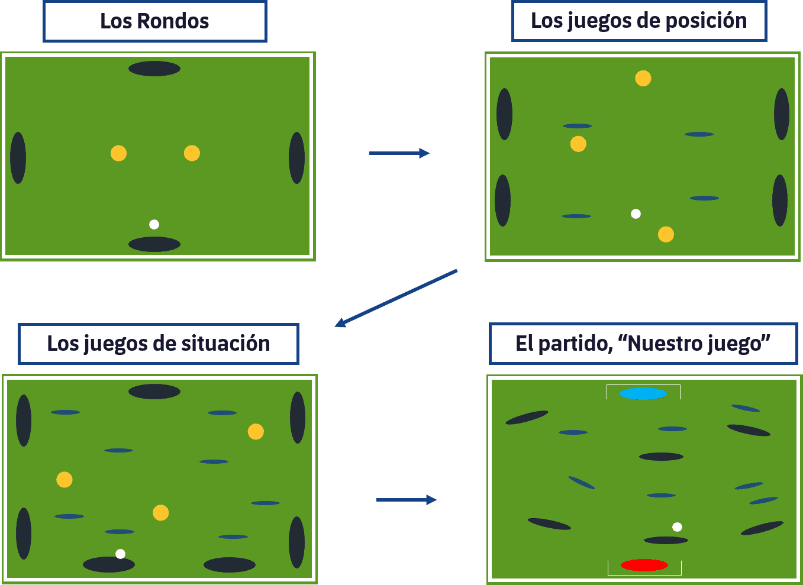

Source : Auteurs.

- 1

Rondos.

- 2

Jeux de position.

- 3

Match (notre jeu).

Les rondos, le début des jeux collectifs. Laureano Ruiz :

Tous les concepts abordés dans l’application méthodologique des rondos sont de la plus haute importance, car ce sont des « mini-matchs ».

Le Rondo est un jeu d’entretien dans lequel l’emplacement des joueurs est préfixé, en fonction d’un emplacement intelligent de l’espace dans lequel les joueurs qui maintiennent la possession du ballon sont positionnés de manière à ce que l’interrelation entre eux soit aussi efficace et efficiente que possible. De cette façon, en appliquant ce type de proposition, à partir et surtout dans les étapes de formation, les jeunes joueurs pourront occuper l’espace de manière logique, en suivant et en acquérant les principes qui régissent la logique interne du jeu.

**Figure 2 : Rodos**

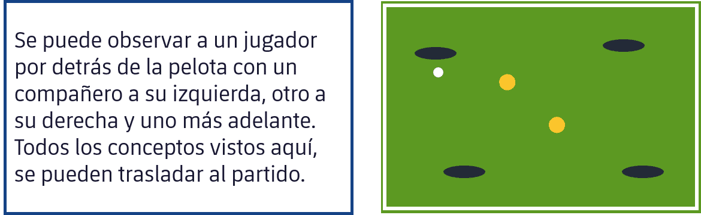

Source : Auteurs.

**Application pratique**

Quelques exemples pratiques des rondos les plus couramment utilisés seront développés.

- Exemple : rondo 4v2 + 1 avec deux espaces.

Dans l’exemple suivant, le terrain sera divisé en deux zones. Dans l’un, vous jouez en 4v2 et, dans l’autre, vous trouvez un joueur offensif en attente. Un nombre minimum ou maximum de passes doit être effectué dans le but de générer un changement d’orientation pour le joueur situé dans l’autre zone. Si cela est réalisé, trois joueurs offensifs plus les deux récupérateurs passeront pour continuer la situation 4v2 dans la zone suivante.

Pour une meilleure approximation de la réalité du jeu, le nombre de passes n’est pas demandé, mais pour profiter du bon moment pour changer d’espace.

**Figure 3 : 4v2+1 avec deux espaces**

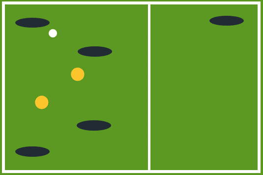

Source : Auteurs.

Dans ce cas, l’intention est de jouer avec le libre, d’occuper rationnellement l’espace et d’apporter des solutions au porteur de ballon grâce à la création permanente de lignes de passe. Quant aux joueurs en récupération, ils devront essayer de récupérer le ballon, fermer les lignes de passe, presser pour les changements d’orientation et accumuler les joueurs dans les zones où se trouve le ballon.

- Exemple : rondo 6v3 + 1 à l’intérieur.

6 joueurs à l’extérieur du rondo, 3 joueurs en récupération et un joker à l’intérieur. L’équipe avec le ballon marque si elle parvient à entrer en contact avec le joker et à passer le ballon entre les deux adversaires. Le joker, à son tour, doit renvoyer la balle hors du rondo à un autre joueur que celui qui a reçu la passe. Avec ces règles, une façon optimale de marquer est, par exemple, que le joker s’éloigne du ballon et cherche le dos des récupérateurs. À leur tour, les joueurs extérieurs devront garder le ballon, mais aussi être attentifs à pouvoir faire la passe qui marque et qui, en termes de transfert au jeu, serait une passe qui obtient l’espace derrière les adversaires.

 **Figure 4 : 6 contre 3 + 1 à l’intérieur**

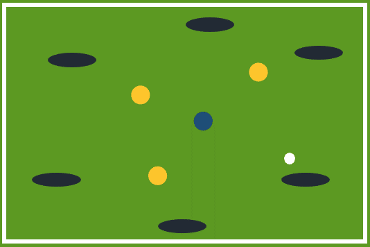

Source : élaboration personnelle.

- Exemple de rondo 4v2 + 2c.

Comme dans l’exemple de la figure 3, deux zones seront divisées. Dans l’un, le 5v2 est joué, et dans l’autre, un joueur offensif vous attend. Sous les mêmes objectifs que l’exemple précédent, vous passerez dans l’autre zone après un certain nombre de passes pour jouer en 5v2.

**Figure 5 : 4v2 + 2c**

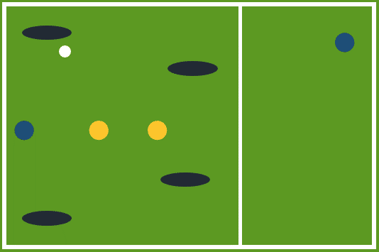

Source : Auteurs.

- Exemple d’un rondo mobile 6v2.

Dans ce cas, 6 joueurs doivent garder la possession du ballon tandis que 2 tentent de le récupérer. Les joueurs forment des paires, placées 2 de chaque côté et 2 au centre. Lorsque l’un des joueurs de la paire passe le ballon à un joueur éloigné, le joueur qui a passé le ballon et son partenaire échangent leur position avec la paire au milieu. Dans ce cas, le travail commence sur le changement de position, ce qui provoque la mobilité des joueurs.

**Figure 6 : 6v2 mobile**

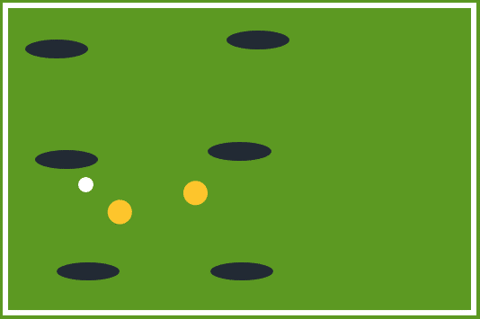

Source : Auteurs.

- Exemple de double rondo.

Il se pratique dans un double espace réduit. Dans le petit, 4 joueurs doivent garder la possession du ballon pendant que 1 essaie de le récupérer. Ici, un certain nombre de passes sont prévues pour ensuite passer à la case extérieure. 4 autres joueurs avec le ballon sont ajoutés, de sorte que, à part le petit espace récupérateur, les trois joueurs avec le ballon du petit espace qui n’ont pas fait la passe vers l’extérieur continuent également à récupérer, étant alors un 5vs4.

**Figure 7 : Double Rondo**

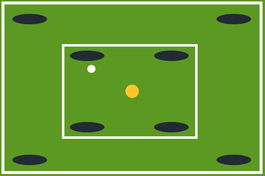

Source : Auteurs.

- Exemple de rondo par positions.

Des situations de jeu spécifiques sont récupérées et nous les transformons en rondo. En d’autres termes, nous proposons des situations concrètes dans lesquelles nous permettons aux joueurs qui sont en dehors du rondo d’effectuer des mouvements prédéterminés, comme ils le feraient dans le jeu réel.

Plus précisément, nous pouvons faire un rondo 4v2 où les 4 sont le défenseur central gauche, l’arrière gauche, l’ailier gauche et le milieu de terrain gauche (supposons un 1-4-3-3). Les deux récupérateurs pourraient être un attaquant et un ailier de l’équipe adverse. Le défenseur central et l’intérieur se comporteraient comme un rondo de ceux vus ci-dessus, mais nous ajoutons une règle de mobilité : si l’arrière gauche se déplace, dans sa recherche de lignes de passe, vers la zone de l’ailier, ce dernier doit se déplacer perpendiculairement au premier vers l’intérieur (pour se rapprocher de l’intérieur). Ce mouvement laisserait la voie libre pour l’arrière latéral. Ainsi, ce joueur doit être conscient non seulement du ballon, mais aussi de la position du coéquipier, dans un sens plus tactique.

**Figure 8 : Rondo par positions**

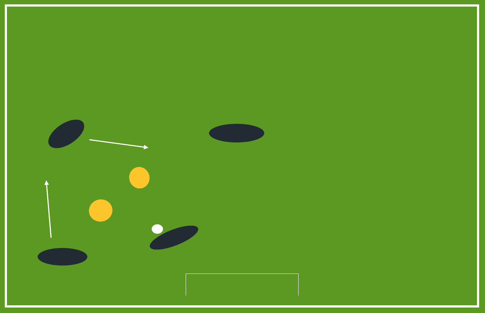

 

Source : Auteurs.

Ce rondo est une étape préliminaire à d’autres types de tâches telles que les jeux de position. Il est considéré comme un rondo parce que les distances fonctionnelles sont réduites et parce qu’il y a des joueurs qui agissent dans la tâche comme un rondo (bien qu’on leur donne un rôle de démarcation, pour générer un contexte pour ceux qui n’agissent plus comme s’ils étaient un rondo ; dans ce cas, l’arrière latéral et l’ailier).

- Exemple : rondo football 7.

Dans ce style, tous les joueurs agissent avec des positions prédéterminées en fonction des positions de football à 7, grâce au système 1-3-2-1.

Le but est de faire au moins 3 passes à chacun des 3 rondos (voir Figure 9). En passant au petit rondo, certains joueurs font le bon mouvement de jeu, comme l’indiquent les flèches blanches. Lorsque vous passez au grand, 5 participent (attaquant, 2 milieux de terrain, 2 arrières latéraux) contre 2.

Le retriever peut être marqué qu’il doit se rendre au petit rondo (qu’il soit le plus avancé ou un autre) pour échanger ses positions. S’ils volent, ils doivent faire deux passes ou trouver un entraîneur avec le ballon, par exemple.

Variante : ne forcez pas un minimum de passes, mais commencez le jeu de manière à ce qu’elles n’atteignent pas rapidement le premier rondo et que, pour marquer, c’est pour atteindre l’attaquant.

**Figure 9 : Football de football à 7 Rondo**

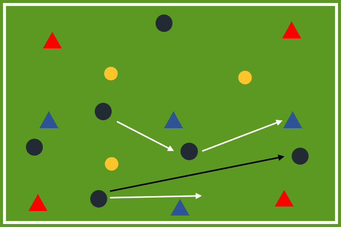

Source : Auteurs.

- Exemple de rondo ludique.

Un rondo 6v2 est généré et la seule différence par rapport aux autres est que, lorsqu’ils volent le ballon (pas un turnover), les 8 joueurs doivent chercher un nouvel espace de jeu extérieur, qui ne peut être, dans le cas des joueurs qui sont déjà à l’extérieur, l’un des deux sur les côtés. Si deux joueurs arrivent au même espace en même temps, ceux qui ont volé ont la priorité et si deux joueurs de l’extérieur coïncident, l’entraîneur décide. Les deux joueurs qui manquent d’espace sont les nouveaux qui voleront.

Il s’agit d’un défi ludique qui, il faut le dire, est incompatible avec certains des objectifs présentés ci-dessous. Une première approche de base du « changement de jeton » peut être faite lorsque notre équipe perd le ballon et que le désir de sortir et de voler et de laisser notre position derrière doit être rapidement activé.

**Figure 10 : Rondo ludique**

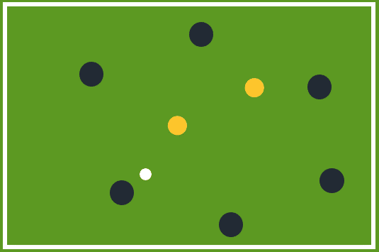

Source : Auteurs.

**Objectifs, concepts et critères**

- Apprenez à vouloir avoir le ballon en équipe. Le concept d’équipement est né dans le rondo dès le premier instant. Ce n’est pas une question d’individualité quand il s’agit d’avoir le ballon, c’est une logique d’équipe.

- Optimiser les aspects coordonnatifs (COO), cognitifs (COG), socio-affectifs (SAF), émotionnels-volitifs (EVO), créatifs-expressifs (CEX) du jeu. Tous ces concepts ou structures doivent coexister simultanément dans les propositions de rondo.

- Identifier, interpréter et pratiquer les éléments de notre jeu dans des espaces d’entraide.

- Adapter notre jeu socio-affectif au continuum du jeu. Le football est complexe et continu, il ne s’agit pas de terminer une intervention après une passe ou un tir, mais de comprendre la dynamique permanente du jeu dans laquelle nous sommes toujours connectés.

- Nous participons tous à la possession du ballon et tous à sa récupération, si nous l’avons perdu. Le jeu consiste à savoir laquelle des deux équipes possède le ballon et, avec lui, domine l’équipe adverse. Pour ce faire, la coopération de tous les joueurs dans les deux moments de jeu (compris comme un seul dans le continuum du jeu) est essentielle.

- Les rondos peuvent également avoir une composante ludique, idéale pour le début de la séance, pour concentrer l’attention du joueur sur les tâches proposées à l’entraîneur et aussi comme moyen de coordonner l’échauffement.

*  
Module 3 sur 8*

**1.3 Objectifs des rondos**

- Le ballon est à nous et nous ne pouvons pas le perdre. Tout le monde devrait apprécier le jeu.

- Améliorer les passes courtes et le contrôle orienté (en utilisant les deux jambes et différentes surfaces de contact). Les passes et les contrôles orientés dans un petit espace font partie de notre jeu.

- Pour donner de la continuité au jeu (donner le ballon au début ; avant, pendant et après avec la même inertie de la passe, je sors chercher la prochaine action en évitant de longer la ligne du ballon).

- Apprendre à regarder, voir, prévoir, anticiper et décider.

- Alternatives de jeu court et long, extérieur et intérieur (passe longue). Comme il s’agit d’un rondo, il y a toujours un coéquipier qui est plus loin et qui sera l’option pour la longue passe (à l’extérieur et à l’intérieur) pour obtenir les espaces derrière les adversaires.

- Offrez des lignes de dépassement, répétez les laissez-passer et donnez du soutien (encouragez la communication).

- Pour tromper et surprendre les récupérateurs (passe inattendue). La tromperie de l’adversaire et l’entente entre nous sont deux variables qui vont de pair, l’une ne peut se faire sans l’autre. Il est important de profiter d’une bonne performance de groupe. Connaître notre partenaire, comprendre l’action qu’il va effectuer rien qu’en voyant le début de son mouvement, donne un avantage de quelques dixièmes de seconde. Ceci est possible avec une forte optimisation de la structure socio-affective et est réalisé, entre autres, avec des heures d’entraînement dans des situations de haute spécificité, du rondos au match.

**Pour la phase de récupération (comprend les aspects SAF et EVO)**

- Feindre pour tromper l’adversaire dans cette phase de récupération. Feinte.

- N’entrez pas soudainement.

- Couvrez le pied dominant.

- Communication entre les récupérateurs pour bloquer la trajectoire du ballon.

**« Lorsque le FC Barcelone se réorganise pour récupérer le ballon, à la vitesse de la lumière, sa structure peut prendre n’importe quel type de forme, pas une disposition prédéterminée » (Cano, 2012, p. 33).**

Nous considérons qu’il est important de souligner à quel point ces deux structures, SAF et EVO, sont de la plus haute importance dans le concept de relèvement. La relation positive entre les joueurs accordera des avantages coopératifs à l’équipe et de plus grandes chances de récupérer le ballon. Will est une autre clé pour vouloir récupérer ou garder le ballon.

**Objectifs à pratiquer en phase de possession (1 choix)**

- Améliorer les passes courtes et le contrôle orienté (utiliser les deux jambes).

- Apprendre à regarder, voir, prévoir, anticiper et décider.

- Avoir des options pour jouer à l’extérieur et à l’intérieur.

**Objectifs à pratiquer en phase de récupération (choisir 1)**

- Feinte pour cette récupération.

- N’entrez pas soudainement.

- Le 1er joueur au ballon, le 2e aux trajectoires de l’adversaire.

**Concepts, critères et informations efficaces (pour le coach)**

- Fournissez au joueur des informations individualisées et efficaces à chaque pause du jeu.

- Changez de joueur. Tout le monde change tout le temps. Ceci est de la plus haute importance pour que les profils soient différents et varient les caractéristiques des jeux de possession. De plus, il permet au joueur de comprendre comment les décisions sont gérées dans chaque espace du terrain. Il est essentiel de travailler sur cet aspect dès le plus jeune âge.

- Si la récupération est effectuée par les 2 et que le passeur et le receveur doivent entrer. Le succès d’une pièce est dû au fait que quelque chose a été bien fait auparavant. Il en va de même pour les jeux qui échouent.

**Concepts en 4v2**

**Figure 11 : Critères de possession**

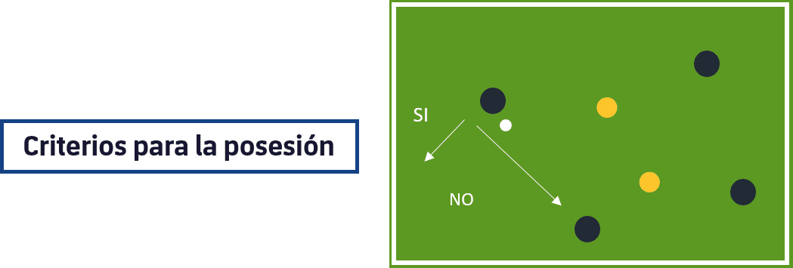

Source : Élaboration personnelle

Avant la passe : regardez, profilez correctement le corps, gardez les pieds actifs et feignez avant de recevoir le ballon pour tromper l’adversaire et donner la ligne de passe au possesseur.

Pendant le pass : deux options sont possibles. Il est important de se rappeler que les opposés conditionnent toujours nos chances.

a\) Contrôle orienté vers le meilleur espace libre et passe (si c’est impensable, mieux).

b\) Fixez l’adversaire le plus proche pour générer un 2v1 avec le partenaire et ainsi provoquer une supériorité numérique.

Après la passe : donnez au coéquipier qui reçoit une sortie dans une ligne différente de la trajectoire du ballon.

En tout temps :

- Maintenir la mobilité.

- N’occupez pas les sommets ou les angles de l’espace de jeu (oui les bandes latérales).

- Gardez vos pieds actifs.

- Profilez correctement le corps pour voir tous les espaces du jeu (regardez de près et de loin) pour choisir les meilleures alternatives pour court (passe latérale) et longue (entre les deux adversaires).

- Le meilleur soutien au possesseur (émergence, continuité, progression, attirance pour le troisième homme jouant sur la ligne).

**Figure 12 : Critères de rétablissement**

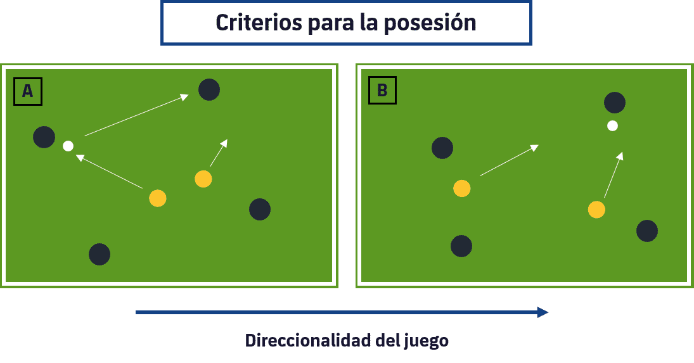

Source : Auteurs.

**Avant le pass :**

- 1

Harceler l’adversaire possesseur sur le côté de sa jambe habile pour le forcer à sortir avec sa jambe non qualifiée.

- 2

Se placer dans une position intermédiaire entre les deux adversaires et rester profilé pour couvrir un éventuel 1v1 avec son partenaire ; si vous êtes en entraide dans le rétablissement.

**Pendant le pass :**

- 1

Occupez l’espace entre les deux adversaires et restez de profil pour voir la passe intermédiaire possible.

- 2

Harceler le possesseur en fermant la trajectoire de la passe derrière lui vers le troisième adversaire.

**Après le pass :**

- 1

Lorsque nous aurons récupéré le ballon, il faudra faire 3 passes pour le considérer comme le nôtre. Il peut être judicieux de répéter les passes 1 à \> 2 et, lors de la troisième passe, de quitter cette zone pour éviter de perdre le ballon récupéré et, en même temps, de laisser le temps aux joueurs en attente de récupération de se réorganiser (évidemment, cela ne se produit généralement pas dans les rondos, bien que les tâches puissent être effectuées avec des cycles continus, c’est-à-dire avec des transitions : moments avec le ballon et sans le ballon, et vice versa).

**En tout temps :**

- Ne suivez pas la trajectoire de la balle.

- Délimitez le corps pour voir le plus de terrain possible.

- Coupez 1 ou 2 lignes de passage du support.

- Offrez une seule sortie au titulaire.

- Un receveur doit mettre la pression sur le porteur (plaquage) et l’autre doit le couvrir.

- Profitez du moment de l’erreur (dans la passe, le contrôle, etc.) pour mettre plus de pression sur le possesseur et ainsi forcer la balle à être perdue avec sa récupération conséquente.

**Suggestions**

Il n’est pas nécessaire de pratiquer plus d’un concept à chaque fois que vous pratiquez des rondos. L’intention est de le faire à temps et dans le cadre d’un processus planifié.

Tous les éléments vus servent à générer de **bonnes habitudes** chez les joueurs qui suivent des processus d’entraînement.

Vous ne devez pas cesser d’insister sur ce type de tâche, car si le joueur conquiert de mauvaises habitudes, il est très complexe de corriger ce qui a été appris. Les neurosciences nous montrent qu’il est plus facile de créer de nouveaux liens neuronaux que d’envoyer des liens existants (ce qui a déjà été appris). Les étapes de formation sont essentielles car c’est là que la motivation pour apprendre et jouer prédomine.
