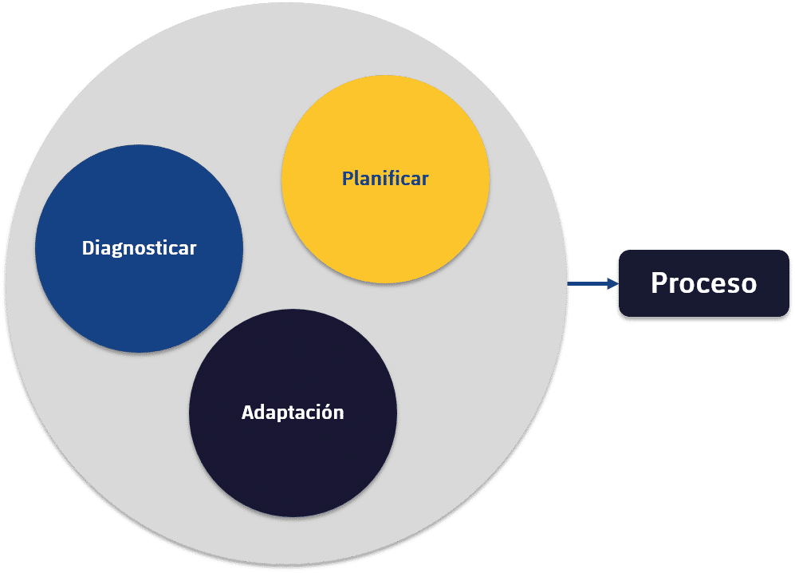
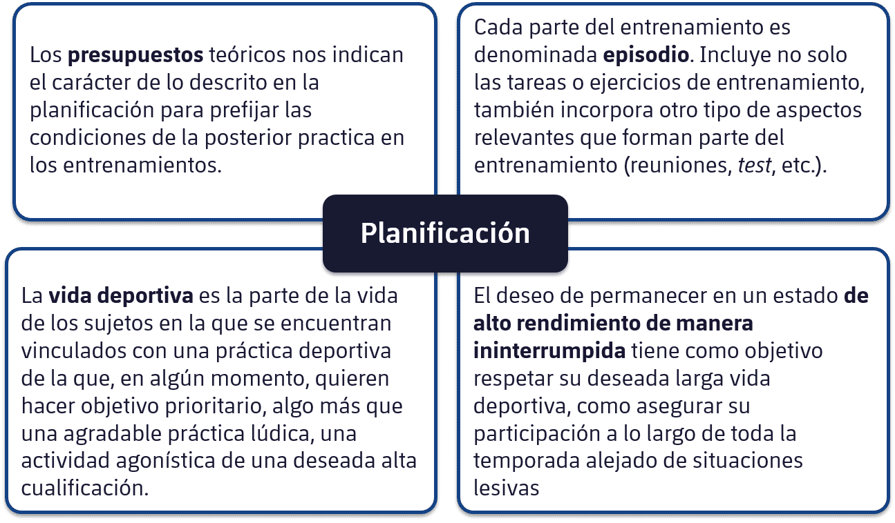
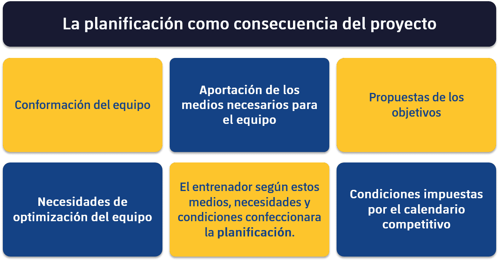
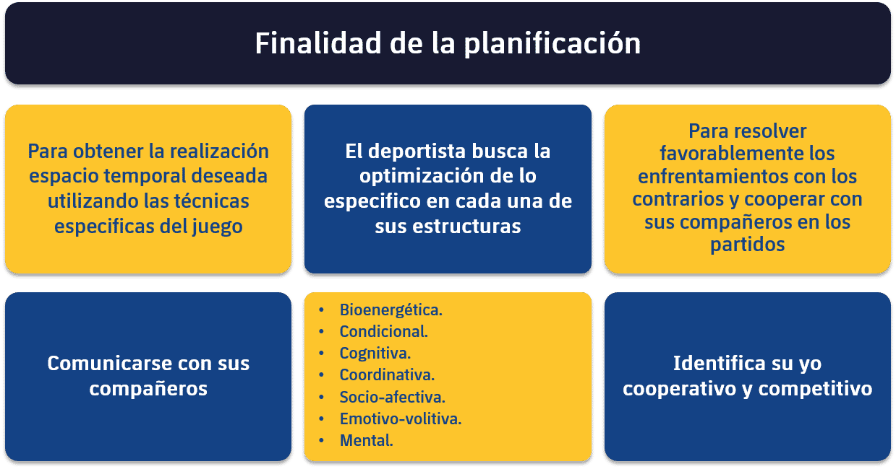
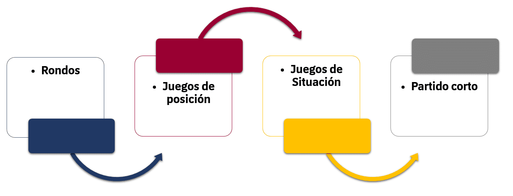
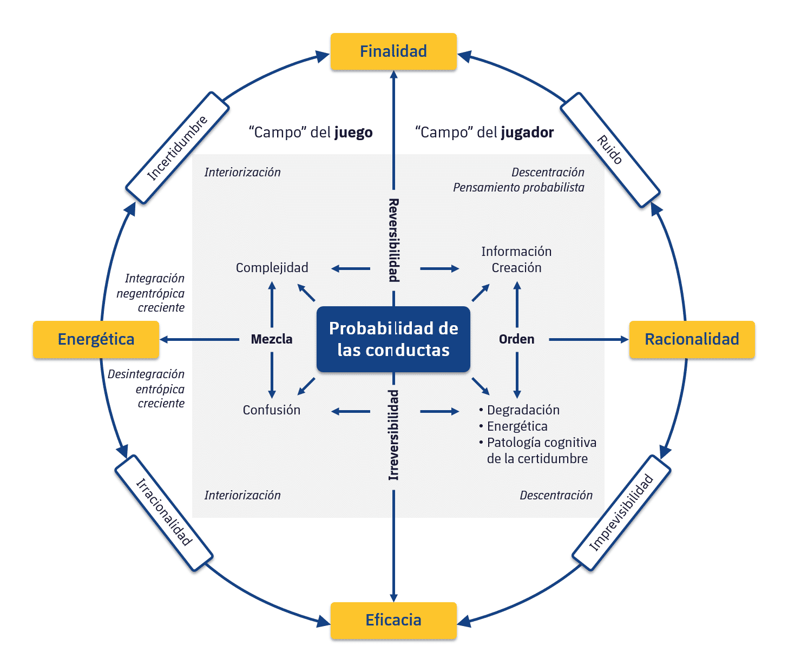

*  
*  
**2. La session de formation**

*Module 1 sur 6*

**2.1 Présentation**

Dans un premier temps, il est jugé essentiel de souligner l’importance de la planification en tant qu’outil organisationnel au sein d’une institution lors de la définition des objectifs des sports d’équipe. Il sera développé conformément au caractère holistique qui entoure les sports d’interaction en espace partagé (DIEC), c’est-à-dire qu’il s’agira d’une planification qui s’adapte à la réalité complexe d’un environnement changeant, dans lequel les joueurs et leurs structures hypercomplexes interagissent et coexistent en changement permanent face à la variabilité qui se produit tout au long de leur vie sportive et personnelle. Selon les mots de Seirul·lo.

Il faut passer d’une cohérence que l’on peut appeler épistémologique à une ouverture épistémologique qui permet de faire face aux savoirs consubstantiels aux situations vécues dans l’écosystème-jeu où l’incertitude coexiste avec l’autoréférence des interactions socio-affectives ou émo-volitives dans chaque épisode vécu par le joueur avant, en formation, pendant le match et après le match (Seirul·lo, 2005, p. 3).

Le Football Club Barcelona considère qu’il est optimal de réaliser une planification ouverte et flexible, qui s’adapte aux besoins des joueurs et au modèle de jeu, qui respecte toujours l’histoire et l’identité du club. En ce sens, il est encouragé à développer des plans en constante adaptation, qui permettent des modifications dans la recherche d’objectifs préalablement fixés (Guindos, 2015). L’évolution de l’état du football et les facteurs complémentaires qui émergent en cours de route doivent être gardés à l’esprit.

**Figure 1 : Aperçu du processus de planification**

Source : Élaboration personnelle basée sur Guindos, 2015.

En conséquence, le processus de planification dans les sports d’équipe, dans une perspective d’entraînement structuré, propose d’établir différentes lignes directrices en fonction du contexte du jeu, auquel il est confronté à travers sa complexité, en gardant à l’esprit que la planification consiste à « prévoir et séquencer les événements d’entraînement nécessaires aux sports d’équipe » (Seirul·lo, 2005, p. 4).

**Tableau 1 : Processus de planification-microstructuration**

| **Processus de planification**                                 |                      |
|----------------------------------------------------------------|----------------------|
| Complexité                                                     | Formation structurée |
| Interactions changeantes permanentes entre les systèmes.       |                      |
| Promouvoir les relations complexes entre le temps et l’espace. |                      |
| **Microstructuration**                                         |                      |

En bref, et dans cette perspective, Seirul·lo dans son livre « Training in team sports » nous apporte le concept de planification qui convient le mieux au DIEC

L’ensemble des hypothèses théoriques faites par l’entraîneur et qui incluent la description, la prévision, l’organisation et la conception de chacun des épisodes d’entraînement que les joueurs effectueront ensuite à ce moment précis de leur vie sportive dans lequel ils restent dans leur équipe ; ainsi que de disposer des moyens d’analyse et de contrôle nécessaires pour modifier ces épisodes afin de fournir un processus d’entraînement de plus en plus approprié pour parvenir à l’optimisation des joueurs, ce qui leur permettra d’obtenir les résultats souhaités de manière ininterrompue dans la compétition dans laquelle ils sont impliqués (Seirul·lo, 2017, p. 284).

**Figure 2 : Concepts pertinents dans la planification**

Source : propre élaboration basée sur Seirul·lo, 2017.

Ce nouveau regard sur la planification est basé sur les besoins du jeu et du joueur. Cela nous a permis de faire un saut qualitatif lorsqu’il s’agit de mettre en œuvre l’approche dans le cadre de la méthodologie d’entraînement dans le football. En d’autres termes, l’entraînement naît du jeu et pour le jeu, en fonction des besoins et des interactions que les athlètes ont pour jouer au football (Sanz, 2014).

Sur la base de la compréhension historico-culturelle du club, dans le cadre de son organisation fonctionnelle, la planification que l’entraîneur concevra avec son équipe de travail, doit répondre aux besoins de l’équipe et, en fonction des exigences qui surviennent dans la compétition, permettre d’atteindre les objectifs fixés.

**Figure 3 : Processus permettant d’atteindre les objectifs**

Source : Seirul·lo, 2017, p. 283.

**Caractéristiques de la planification dans les sports d’interaction en espace partagé (DIEC)**

Il est important de noter que pour identifier la séquence dynamique des différentes composantes qui seront développées dans une planification, certains éléments sélectionnés (spécifiques et qualitatifs) sont utilisés, toujours centrés sur l’athlète humain ; qui doit optimiser à travers différents composants de sa structure grâce à des boucles d’interaction entre tous ces composants. De cette façon, il est possible de déterminer les conditions de pratique sur lesquelles la planification doit s’approfondir.

C’est pour cette raison que la planification dans les sports d’équipe présente des caractéristiques différentes de celles utilisées pour les sports individuels. Ces derniers sont basés sur la théorie générale de l’entraînement, où le support conditionnel (générique et quantitatif) est la base de son processus de conformation.

Alors que dans les plans du DIEC, il y a

Différents aspects organisationnels émergent de la demande contextuelle des sports d’équipe, en y accordant une attention permanente, il sera possible de reconnaître des critères de clarification pour identifier les différences entre les différentes spécialités et la nécessité d’approches hautement différenciées pour chaque spécialité au moment de la planification (Seirul·lo, 2005, p. 10).

En ce sens, il est proposé que la planification du DIEC soit :

- Unique.

- Spécifie.

- Coutume.

En exprimant le terme **unique**, il est associé à une unité paradigmatique qui soutient les sports d’équipe. Ici, les sciences de la complexité que le Futbol Club Barcelona prend comme référence scientifique pour proposer sa propre façon de comprendre le jeu deviennent pertinentes ; c’est-à-dire par la pensée systémique. L’imprévisibilité d’un jeu comme le football signifie que sa planification doit donner de l’importance à ce type d’événement et unifier les critères en termes de communication et d’intercommunication entre les joueurs, ainsi que d’interaction entre le joueur et l’entraîneur. Le même nouveau langage permettra d’éviter d’éventuelles erreurs qui sont piégées sous les concepts du paradigme classique. Cela soutient l’idée de créer une nouvelle unité terminologique, unifiée et étendue entre les joueurs et avec l’entraîneur dans une perspective des sciences de la complexité.

D’autre part, la planification doit être **spécifique**. Cette expression fait référence à la recherche d’une planification avec sa propre identité ; c’est-à-dire propre aux sports d’équipe, dans lesquels les processus compétitifs, la réglementation institutionnalisée de chaque sport collectif, les besoins des joueurs, tant individuels que collectifs, sont respectés. En ce sens, Seirul·lo (2005) affirme que « dans chaque sport, ses règlements et la manière dont ils sont interprétés sont les prémisses qui induisent une « optimisation différenciée », donc spécifique, de certains systèmes de préférence à d’autres, dans leurs aspects qualitatifs, au sein de chaque structure de joueur » (Seirul·lo, 2005, p. 12). Ainsi, la spécificité sera d’une importance vitale autour du niveau d’exécution technique des joueurs et du système de jeu proposé par l’entraîneur ; c’est-à-dire que cette caractéristique se reflétera en fonction de la façon dont le joueur s’adapte, interprète et interagit avec la logique interne du jeu.

**La planification personnalisée** tente de se détacher conceptuellement de l’individu ; C’est-à-dire que dans un sport comme le football, les tâches d’entraînement qui sont créées sont généralement conçues en groupes, plus ou moins nombreux.

Cela indique que le critère de personnalisation, dans le cadre de la planification dans le DIEC, doit être adapté aux aspects suivants :

- Talent sportif personnel.

- La vie sportive.

- Intégration différenciée.

Cela soutient l’idée de respecter les processus que l’athlète humain traverse tout au long de sa formation. L’interaction permanente de leurs structures sous des connexions intersystémiques et en fonction de leur stade sportif, leur permettra de mieux comprendre le jeu. Dans cette optique, toutes les expériences que le joueur a vécues, dans les différents environnements dans lesquels il a fourni des interactions, forment des traces d’accès à son moment présent à travers l’optimisation des différents systèmes à travers lesquels il a vécu dans sa pratique.

En conséquence de ce qui précède, on peut affirmer que le talent ne doit pas être réduit à la capacité d’un athlète à résoudre une activité dont le niveau de complexité est élevé, ni être associé et réduit à un seul facteur génétique. À partir de là, nous essayons de collaborer à la conception que le talent dépendra des conditions de vie maintenues dans le temps, qui accordent et offrent un génotype différent, à la suite de ces expériences vécues (Seirul·lo, 2017).

En conséquence, il y a une insistance sur une planification dans laquelle des pratiques spécifiques sont incluses à grande échelle, afin que leur épigénétique apporte sa contribution au génotype de l’athlète et optimise son potentiel. L’entraîneur sera chargé de créer (par la planification) des stratégies où le talent de chaque joueur peut s’épanouir.

Enfin, **l’intégration différenciée** donne de la valeur à la personnalisation au sein d’une planification. C’est-à-dire que le talent et la vie de l’athlète émergent de l’intérieur de l’athlète humain, à la suite de sa relation avec l’environnement, pour cette raison, il cherche à responsabiliser les joueurs, par l’interaction avec l’environnement, cela leur permet de s’auto-organiser en fonction du jeu, de l’équipe et ainsi réaliser l’optimisation tant souhaitée.

En conclusion, la planification doit être associée à un processus systémique d’élaboration et de mise en œuvre de plans d’action, appelés **épisodes de formation** (Seirul·lo, 2017). Ce processus est réalisé par le coach et son équipe de collaborateurs avec l’intention d’atteindre les objectifs proposés. De cette façon, l’entraîneur et ses assistants doivent développer une planification unifiée précise des actions, des efforts et des connaissances pour créer, selon les moyens dont ils disposent, des plans d’entraînement efficaces et efficients.

En bref, il s’agit de concevoir des tâches fluctuantes entre la fluctuation apparente que traverse le jeu dans les différentes spécialités si l’on veut offrir au joueur des événements qui optimisent leurs structures dans les termes souhaitables de personnalisation, qui pourront optimiser les performances individuelles ainsi que leur intégration homogénéisée dans la technique des tâches du jeu (Seirul·lo, 2005, p. 24).

**Figure 4 : Objectif de la planification sportive : comprendre et aimer le jeu**

Source : Seirul·lo 2017, p. 291.

Au cours du processus d’entraînement, des questions se posent sur lesquelles nous devons réfléchir d’un point de vue critique afin d’avoir des réponses ouvertes et de considérer les besoins du jeu et de l’athlète humain. En d’autres termes, lors des séances d’entraînement du FC Barcelone, nous posons et reformulons des questions pour lesquelles nous avons « nos réponses » :

**Que voulons-nous former ?**

–

1.  Nous nous référerons ici à l’objectif de la formation. En ce sens, ce que vous voulez entraîner doit être réalisé (nous voulons le voir reflété) dans le match d’entraînement, c’est donc le point à prendre en compte pour tout entraînement.

2.  À partir de là, le reste de la formation sera fait, de sorte que, tout au long de celle-ci, l’objectif à travailler soit le même, ainsi que les instructions.

**Comment voulons-nous l’entraîner ?**

–

Un bon entraîneur doit être conscient qu’il doit adapter sa conception du jeu à la réalité du club (philosophie, caractéristiques, contexte), et ainsi la transférer sur le terrain de jeu, en sachant la transmettre de manière cohérente à ses joueurs (Sánchez & Perdomo, 2016).

1.  Comment améliorer l’objectif ? -------\> Critères à élaborer.

2.  Comment réaliser ce travail ? -------\> Forme didactique à utiliser.

- Diverses tâches, toujours avec le ballon.

- Rondos.

- Jeux de position.

- Évolutions.

- Parties.

**Qui devrait le former ?**

–

1.  Lors d’une séance d’entraînement mondiale, tous les joueurs ; Bien que certaines tâches puissent être plus spécifiques en fonction du ballon et des positions des joueurs.

2.  En ce sens, il est important que les catégories qui sont développées dans le football à 7 apprennent à jouer à tous les postes pour mieux comprendre le jeu sous différents angles.

**Où devrions-nous l’entraîner ?**

–

En formation, avec l’équipe, bien que certaines tâches avec une plus grande approche de la spécificité puissent être effectuées en petits groupes.

**Quand devrions-nous l’entraîner ?**

–

L’idée de jeu qui est destinée à être enseignée doit être adaptée à l’âge et au niveau de jeu de chacun des joueurs (Sánchez & Perdomo, 2016).

1.  Différencier (prioriser) les concepts et contenus à former en fonction des étapes de la formation :  
    >   
    > \*Phase d’initiation.  
    > \*Stade de formation spécifique et de spécialisation.  
    > \*Scène de performance.

À chaque position sur le terrain, nous essayons de nous assurer que tous les joueurs U-8 jouent au moins 3 positions ; en U-10, en 2-3 positions et en U-12, au moins obligatoire, en 2 positions et toujours dans deux lignes différentes. En d’autres termes, des postes tels que arrière gauche, arrière droit ; défenseur central gauche, défenseur central droit, par exemple, si vous cherchez à optimiser grâce à un 1-2-3-1 (en parlant de football à 7). Il peut être défenseur central gauche, mais aussi milieu de terrain, milieu de terrain, puis attaquant.

De cette façon, un plus grand contexte d’expériences motrices et cognitives est fourni au joueur.

Il y a différents aspects à prendre en compte dans la séance d’entraînement qui font la différence tout au long de la vie de l’athlète au cours de son évolution :

**1. Organisation**

- Commencez la séance d’entraînement à l’heure.

- Il est important de fournir une brève explication de la formation, des tâches et des objectifs prévus. Celle-ci sera effectuée dans la mesure du possible dans le vestiaire, avec un tableau noir, avant le début de l’entraînement.

- Les tâches de formation de la session doivent être préparées, c’est-à-dire à différents endroits de l’espace de formation.

- Évitez le désordre du matériel qui ne sera pas utilisé sur le terrain, de cette façon le temps de réalisation des contenus à développer est optimisé.

- Ne perdez pas de temps à donner trop d’informations aux joueurs. Essayez de ne pas donner la solution prévue à chaque tâche afin de ne pas restreindre la créativité.

- Explications courtes, claires et utiles des tâches (au début et pendant les pauses). Utilisez un langage que le joueur peut interpréter facilement et rapidement.

- Donnez juste la bonne quantité d’informations pour commencer à jouer, en évitant d’arrêter la session à plusieurs reprises.

- Posez des questions aux joueurs pour savoir s’ils ont compris l’objectif de la tâche et s’ils sont concentrés sur son développement.

- S’il est nécessaire d’interrompre pour corriger ou fournir un renforcement positif, essayez de faire de courtes pauses.

**2. Activation**

- Évaluez l’intensité avec laquelle les joueurs effectuent les tâches d’entraînement pendant la séance.

- Assurez-vous qu’il s’agit d’un niveau d’activation optimal (ni trop peu, ni trop).

- Tant chez les enfants que chez les adultes, les joueurs stressés doivent être évités avec des cris, trop d’indications ou d’instructions.

- Cependant, les entraîneurs doivent éviter d’être passifs ou non participatifs.

**3. Apprentissage**

- Il sera important de concentrer l’information sur l’objectif de la formation.

- L’entraîneur devra préparer la séance d’entraînement en se concentrant non seulement sur ce qui sera fait, mais aussi sur ce qui sera dit pendant le match.

- Vous devez éviter de commander ou d’indiquer constamment ce qui doit être fait et quand le faire.

- L’orientation vers l’apprentissage doit être abordée à travers des questions et des observations qui invitent le joueur à réfléchir, c’est-à-dire à réfléchir sur ce qui s’est passé.

**L’heure de chaque phase**

Parties et contenus à entraîner lors d’une session :

**1) Partie :**

–

o Des tâches de formation seront effectuées dans lesquelles l’accent sera mis sur la perception et la décision.

o Protection du ballon, conduite, dribble, contrôle, passe, entre autres.

o Tâches de coordination (de préférence avec le ballon) et variabilité.

ou Rondos, dans lequel toutes les structures des athlètes (coordinatrice, socio-affective, cognitive, etc.) seront optimisées.

o Introduire la bilatéralité si possible et intéressante.

**2) Partie :**

–

o Les jeux de position ou de situation (ceux-ci seront la priorité dans cette phase de formation).

o Des tâches seront créées dans lesquelles les joueurs apprendront afin d’optimiser par la suite les concepts associés à la position du corps ou du profil, à la largeur ou à la profondeur, aux lignes de passe, aux appuis, à l’occupation rationnelle de l’espace de jeu, à l’alternance du jeu court et long.

**3) Partie :**

–

o Parties. Ici, les objectifs de travail se reflètent dans les tâches de formation.

o Il sera important qu’ils soient développés selon des règles simples et claires, en arbitrant en mode compétition, les buts sont comptés.

o Les motivations ont une composante importante dans cette phase, les objectifs atteints doivent être récompensés, l’esprit gagnant doit être stimulé, etc.

Guerrero (2016) aborde la complexité, l’intervention de l’entraîneur et les éléments qui composent l’athlète humain dans un environnement changeant comme le football. L’auteur affirme que c’est le sport le plus incertain de tous, pour deux raisons :

- L’exécution coordonnée (technique) est réalisée au moyen d’un membre non dominant. Il est donc difficile d’anticiper consciemment les actions qui se déroulent, en particulier dans les espaces d’intervention et d’entraide si le joueur a un meilleur accès à l’anticipation décisionnelle dans les espaces éloignés du ballon (espaces de coopération), en raison de la relation espace-temps potentiellement avantageuse. Dans les sports avec une base de coordination œil-main, comme le basket-ball, l’athlète n’a pas une charge perceptuelle et une concentration attentionnelle aussi élevées par rapport au téléphone portable.

- D’autre part, ce membre non dominant qui est responsable de la mise en œuvre de l’action de coordination, à son tour, est responsable du déplacement du corps dans l’espace.

Bref, compte tenu de cette réalité descriptive, il sera difficile de penser que le joueur est capable, au moins dans les espaces proches du ballon, de fonder sa gestion décisionnelle sur les processus traditionnels de perception, d’analyse, de décision et d’exécution.

**Comment nous fournirons les informations obtenues au cours de la session**

« La méthodologie est la projection d’idées sur le plan réel, c’est-à-dire sur la façon dont nous enseignons et formons » (Sánchez & Perdomo, 2016, p. 64).

La communication et l’intervention auprès des athlètes se feront par le biais d’un retour d’information contingent, qui renforce leurs connaissances procédurales et comportementales. Il ne suffit pas de dire au joueur s’il a bien accompli une tâche pendant l’entraînement ; Dans ces cas précis, ajouter le « pourquoi » sous forme de question permettra au joueur de réfléchir à la tâche effectuée, de découvrir la réponse optimale et d’accroître sa compréhension du jeu. En ce sens, il est important de souligner qu’une connaissance déclarative instantanée de la réponse motrice ne sera pas nécessaire, mais que cette connaissance contribuera (contraindra) à de futures actions similaires pour une nouvelle urgence motrice.

Nous pouvons alors exprimer qu’une méthode pour optimiser les joueurs est d’offrir des commentaires, d’utiliser les bons mots, de réfléchir en tant qu’entraîneurs avant d’entamer un dialogue avec les joueurs. Pour cette raison, l’utilisation du message verbal et non verbal approprié multiplie l’impact du message sur le destinataire (les joueurs). Il faut toujours garder à l’esprit que les protagonistes du jeu sont les joueurs, de cette façon vous devez éviter de donner des instructions en permanence et respecter leur comportement sur le terrain, cela leur permettra de vivre différents états sur lesquels ils doivent s’auto-organiser.

En bref, il doit être clair que les entraîneurs ne sont pas essentiels à l’apprentissage des joueurs, mais si les processus de chaque joueur sont respectés, ils peuvent avoir un impact sur leurs différentes phases de formation et contribuer tout au long de leur vie sportive.

**Quand fournir l’information aux joueurs**

L’entraîneur adaptera les informations à chaque situation de jeu à laquelle le joueur participe afin de ne pas restreindre la possibilité qu’il prenne lui-même des décisions.

À son tour, il respectera la demande de retour du joueur et fournira ce feedback, surtout si l’athlète humain le demande.

De cette façon, la réussite sera un stimulus positif qui facilitera le lien entre le mouvement et l’émotion. Ainsi, par une découverte guidée, l’entraîneur doit trouver ce qu’est ce lien et découvrir les présomptions sur lesquelles le joueur fonde son comportement.

Par exemple : Qu’avez-vous perçu en passant le ballon ? Si la réflexion est jugée utile pour l’ensemble du groupe, le feedback doit être collectif ; Sinon, l’engagement moteur accordé par la pratique doit être avant tout et le message doit être individuel.

Bien qu’il n’y ait jamais une seule bonne réponse, le comportement doit être efficient et efficace car il est entrevu dans un ensemble d’interactions infinies et changeantes à chaque espace de phase, le message doit être décentralisé chez l’athlète humain. Son individualité lui donne de la complexité et cette caractéristique fait que le « pourquoi » se transmet selon le moment. Ainsi, il doit être aligné avec les attentes de l’athlète, puisque celles-ci sont intimement liées à sa motivation. Cet aspect sera optimisé au fur et à mesure que les joueurs seront encore plus connus (leurs intérêts et leurs besoins, c’est la clé sur laquelle clarifier notre invention).

Normalement, les joueurs devraient recevoir des directives de réflexion. Cette activité lui donne du pouvoir moteur et cognitif. Le joueur, pendant la compétition, n’aura pas de directives et sera dans le contexte réel du jeu. Pour cette raison, les directives de réflexion supposée, en général, sont une imposition créée par l’entraîneur pour l’athlète afin de promouvoir une réflexion ouverte (pour cette raison, les questions suggestives doivent être évitées) et qu’elles sont une ligne directrice incitative pour que l’intention du joueur coïncide finalement avec celle de l’entraîneur. L’entraîneur ne doit pas s’attendre à une certaine réponse du joueur, mais doit être sincèrement ouvert à ce que le joueur propose quelque chose qui correspond à sa nature décisionnelle et renforce la décision prise (si elle se manifeste par un comportement efficace). De cette façon, il existe une contrainte peu invasive qui renforce un cycle de perception-action du joueur, puisqu’il est basé sur ce qu’il a perçu et son intention naturelle face à un problème tactique ou de coordination donné (Damunt & Guerrero, 2016).

En résumé, traditionnellement, l’entraîneur a un rôle prépondérant dans la communication avec ses joueurs. Ce nouveau paradigme de l’échange pédagogique nécessite un rôle différent : celui de facilitateur et donne le rôle principal au joueur. L’entraîneur doit contraindre, accompagner, promouvoir, mais sans être le protagoniste puisqu’il va laisser cette place au joueur. En bref, il s’agit de remplir une fonction plus efficace et de faciliter les comportements émergents chez le joueur qui encouragent son intention exploratoire. Nous sommes face à un coach qui cesse d’être un « faiseur » pour devenir un « inducteur » et, finalement, devenir un « facilitateur » (Damunt & Guerrero, 2016).

 **La route « vers » la fête**

Pour arriver au match (compétition) de manière optimale, en référence à notre idée du jeu, il est nécessaire de mettre l’accent sur le processus d’entraînement pendant la semaine, c’est-à-dire avant la compétition. À partir de là, des tâches sont proposées sous l’idée du jeu qu’ils souhaitent développer le jour du match. Des tâches d’entraînement seront conçues, dont les éléments de mise en forme sont basés sur les besoins du jeu et du joueur ; Des situations de simulation préférentielles seront créées qui fourniront aux joueurs la variabilité nécessaire pour que de nouvelles synergies collectives émergent qui les aident à s’auto-organiser et ainsi à circuler et à voyager ensemble conformément à la même volonté, de partager le ballon pour remporter la victoire. Pour cette raison, s’identifier dans une même idée de jeu nous permettra de proposer des scénarios d’entraînement dans lesquels notre identité s’exprime spécifiquement.

**Figure 5 : Le chemin vers le match**

Source : Auteurs.

Il y a 7 éléments qui constituent la base de notre jeu que tous les joueurs de notre institution doivent connaître et pratiquer tout au long de leur vie sportive.

Il faut comprendre que chacun de ces éléments a sa propre signification, car il est également important de savoir que la combinaison et la recombinaison de chacun d’entre eux créent une grammaire de jeu propre au club.

**Éléments:**

- 1

Jouez avec 1 ou 2 touches si vous voulez donner du rythme au jeu et désorganiser l’équipe adverse.

- 2

Jouez le pied si l’espace du receveur est déjà occupé par lui, tandis que l’espace à occuper doit être disputé avec un adversaire.

- 3

Jouez face à face si le coéquipier qui reçoit a une meilleure perception et orientation du terrain de jeu et de l’environnement.

- 4

Répétez une passe si vous voulez attirer les adversaires, bien orienter votre corps, avoir plus de temps pour décider de la meilleure option, toucher pour que les adversaires se déplacent, distraire le marqueur du possesseur puisqu’il n’a plus le ballon.

- 5

Avant de recevoir le pass :  
o Effectuez l’ensemble du processus cognitif (regarder, observer, anticiper, etc.).

o Orienter correctement le corps.

o Feinte antérieure de tromperie de l’adversaire.

o Appui dans une autre direction que celle de la feinte faite (devant pour l’attirer ou par derrière pour apparaître ou s’en libérer).

- 6

La passe est destinée à donner du temps au coéquipier : Par conséquent, elle doit toujours venir du coéquipier bien placé.

- 7

Après avoir passé le ballon :  
o Donnez de la continuité au jeu.

o Donner un appui dans une autre direction que celle de la trajectoire de la balle.

**Son processus cyclique**

Tout commence par le jeu, pour y revenir. Le processus par lequel se déroule le développement, la croissance et l’évolution du jeu comprend plusieurs parties : ** **

- 1

L’intégration de la connaissance du jeu, ce qui implique ce que l’on appelle les « 3 i » : **identification** et **interprétation** des éléments et des variables du jeu, ainsi que **l’information **de celle-ci aux entraîneurs et aux joueurs.

- 2

La transmission de ces connaissances. Par la conception, la programmation et l’adaptation méthodologique par la formation.

- 3

L’enquête interne. Il s’agit du processus interne de développement d’un produit dans n’importe quel domaine, entreprise ou institution.

- 4

Innovation. Qui envisage la relation avec la science et le monde de la recherche, pour avancer et progresser dans ce processus.

Tout cela revient au jeu après ce processus cyclique, pour l’optimiser grâce à cette étude et à sa connaissance.

Notre** fiche de formation** comprend :

**1. L’objectif de la formation**

–

Le premier aspect qui se pose est l’objectif. Ici émerge le besoin de se demander le « quoi ? » de ce que l’on veut enseigner et comment on veut qu’ils l’apprennent sans négliger la composante ludique, c’est-à-dire apprendre en s’amusant. Comme l’exprime Moreno (2013), la composante ludique est non seulement nécessaire, mais obligatoire dans une séance de formation, tant chez les enfants que chez les professionnels.

**2. La structure préférentielle à former (et l’interrelation entre elles)**

–

De là, émergent à la fois des éléments de communication et des éléments spatiaux et temporels, dans la phase de possession et dans la phase de récupération. Un élément ou la combinaison de plusieurs d’entre eux doit être envisagé, de cette façon les joueurs incorporeront quelque chose qu’ils ne savaient pas auparavant et à propos de ce type de relation ou de combinaison, ils doivent se plonger dans chacun des éléments qu’ils ont immergés (incorporés). Les entraîneurs chercheront à concevoir les tâches de manière à ce qu’ils connaissent quelque chose de spécifique et, pendant la formation, une préférence sera faite avec les informations pertinentes sur cet élément tout au long de la session.

 

La comparaison de ces informations est très importante car l’entraîneur, à de nombreuses reprises, manque de patience ou veut (force) les joueurs à s’améliorer beaucoup et rapidement, en évitant les fluctuations indispensables pour parvenir à l’auto-organisation. Face aux différents succès et variabilités qui émergent au sein d’un même exercice, l’entraîneur et ses assistants doivent avoir suffisamment de patience pour que le joueur connaisse un élément du jeu et l’apprenne. De cette façon, cette préférence doit être maintenue tout au long de la séance, en se concentrant sur l’objectif qui a été fixé avant le début de l’entraînement.

**3. Situations préférentielles de base sur simulateur (SSP) (organisation prescrite) pour former cet objectif.**

–

Quel est notre outil de pratique ? Une situation de simulation préférentielle, c’est-à-dire une situation de jeu. Lors de la pratique, le coach donnera des informations précises (de manière assertive et afin de maintenir la préférence tout au long de la séance) d’une certaine situation. L’attention du joueur est une composante importante du jeu de l’équipe et, grâce à ces SSP, l’équipe sera identifiée de la même manière.

**4. Pratique massive spécifique au concept (priorité) tout au long de la formation**

–

Si nous priorisons un concept tout au long de la formation, nous essayons d’avoir une pratique de masse spécifique.

 

Ici, le talent est associé à une pratique de masse spécifique de quelque chose en particulier et ce quelque chose en particulier, eh bien, est la pratique de notre jeu. Donc, le désir est que l’athlète humain apprenne quelque chose de significatif et si, en même temps, des éléments qui sont associés d’une manière spécifique à notre jeu sont ajoutés, tous nos joueurs entraîneront massivement une façon de jouer très spécifique qui renforce notre identité de jeu.

**À. Le concept de variabilité au sein de ce SSP de base**

Devons-nous tout faire ? Est-ce que spécifique et massif signifie que nous devons répéter le même élément plusieurs fois ?

 

C’est exactement le contraire qui est vrai. En pratique, lorsqu’il y a un élément que l’équipe maîtrise déjà, un changement doit être proposé, comment réaliser ce changement ? Eh bien, simplement, en variant les éléments.

Ces combinaisons et recombinaisons entre les acteurs et l’espace sur un même concept, sont liées aux combinaisons et aux relations possibles qui existent dans chacun des éléments, qu’ils soient spatiaux ou temporels. Ainsi, à chaque fois, ils connaîtront l’élément considéré comme important sous différents angles. Par exemple, nous n’allons pas passer le ballon plusieurs fois de la même manière, nous n’allons pas le contrôler de la même manière. Il y a tellement de variations dans « notre jeu » qu’il est de la responsabilité de l’entraîneur et de son équipe que les joueurs apprennent de la variété, afin qu’ils puissent modifier les innombrables situations qui peuvent être déclenchées à partir de cet élément spécifique, comme le ballon.

 

Ensuite, nous donnerons de la variabilité au fur et à mesure que l’élément significatif est maîtrisé et que la pratique se poursuit avec des changements dans certaines des conditions ; qu’il s’agisse de travailler sur la passe, par exemple, les angles de passe, les distances, le temps entre le moment où il va recevoir le ballon. L’énorme nombre de combinaisons permet et oblige les entraîneurs à approfondir la méthodologie afin que chaque élément connu et incorporé par les joueurs ait un éventail croissant de possibilités qui peuvent se produire dans le jeu.

 ** **

**b. Les critères de différenciation préférentielle (avec préférence)**

 

Un autre aspect très intéressant lors de la préparation de la séance est que le coach, en plus de réfléchir au type de situation, au type d’objectif et aux différents éléments qui découlent de la tâche ; Vous devez être conscient du type et de la forme des critères que vous allez informer les joueurs. Cette procédure collaborera au processus de mise en forme et de compréhension du concept développé au cours de la session. À partir de là, vous devriez garder votre attention là-dessus.

Il est pratique, en plus de préparer l’exercice, le nombre de joueurs, le type de tâche, de saisir adéquatement le type d’information et la façon dont elle sera fournie afin que le joueur comprenne ce que nous voulons qu’il sache sur le jeu.

 

À partir de là, des slogans et des critères sont définis :

 

Lorsqu’un critère est fourni, il sert (ou devrait servir) pour les différentes situations dans lesquelles le joueur rencontrera ce concept. Cependant, si l’on s’exprime, « aujourd’hui il sera entraîné sur la façon dont nous voulons que vous orientiez le corps » C’est-à-dire que si nous exprimons qu’ils doivent essayer (selon la situation de la balle) que le dos soit, au moins, sur l’une des deux ailes séparées selon la situation de la balle, ce même critère prend déjà un autre sens, et il est valable pour n’importe quelle situation sur le terrain.

 

Par exemple : si le ballon est dans l’allée droite, je dois avoir mon corps orienté de manière à pouvoir observer la majeure partie du terrain.

 

 

**c. Les « tâches individuelles » de chaque joueur (feuille de joueur)**

Ce qui a été développé jusqu’à présent aura du sens car il est en relation avec le fichier du joueur. Le même objectif et la même préférence peuvent être maintenus tout au long de la formation afin que l’équipe reconnaisse un certain élément important. De même, l’entraîneur doit consacrer un temps spécifique au joueur pour intégrer et apprendre les différents éléments qu’il doit optimiser d’une manière particulière.

 

Ensuite, vous parlez à chacun des joueurs et, à un certain moment de la saison (cela peut être au début parfaitement) chaque joueur sait qu’en plus des objectifs préalablement fixés à réaliser avec l’équipe, l’entraîneur a convenu avec lui qu’il devra optimiser une série d’aspects sur le plan personnel. De cette façon, dans chaque tâche d’entraînement où l’une de ces tâches individuelles peut se produire, le joueur doit mettre l’accent sur ce qui a été convenu précédemment avec l’entraîneur dans son dossier joueur.

 

Par exemple, l’objectif sera d’identifier la supériorité numérique et le joueur s’est mis d’accord avec l’entraîneur sur une amélioration de la rotation. Dans chaque jeu de position, dans chaque rondo ou dans chaque jeu court, il sait qu’il devra être conscient de cet élément marqué particulier.

 

En ce sens, chaque joueur est conscient qu’il y a des aspects sur lesquels il doit s’améliorer à un niveau particulier et cela optimise le temps d’entraînement. C’est-à-dire qu’il y a des situations que tout le monde doit connaître, mais chaque expérience est personnelle, personnelle et si un joueur est nouveau dans le club, il peut maîtriser certains éléments, mais il doit en approfondir d’autres et garder à l’esprit que la grande majorité des coéquipiers qui sont dans l’institution depuis plus longtemps peuvent déjà avoir ces éléments incorporés dans leur propre jeu.

 

De cette façon, nous nous rapprochons du triomphe que chaque joueur a l’attention de l’entraîneur, reçoit des informations particulières sur des aspects spécifiques de chacun et nous nous assurons que chaque athlète humain se sente pris en charge et compris, puisque l’entraînement est pour lui, dans ce cas ce n’est pas pour l’équipe (directement), un élément de plus pour optimiser ses performances. Lors de la préparation de la feuille d’entraînement, il sera important d’écrire les objectifs individuels de chaque joueur afin qu’il y ait une trace des processus qu’ils traversent dans leur vie sportive.

 

**d. Continuité dans le même cabinet pendant au moins 2-3 semaines**

Précédemment, nous avons parlé de la patience dont l’entraîneur a besoin au cours d’une même séance pour respecter les processus que les joueurs traversent. Dans le même temps, il est nécessaire de garder à l’esprit combien de temps un objectif doit être maintenu avec la même préférence et des variations alternées. Au début d’une nouvelle pratique, le sentiment émerge qu’il s’agira d’une situation incontrôlable, c’est-à-dire que lorsqu’on demande au joueur de se placer dans une certaine situation ou position sur le terrain de jeu et que l’entraîneur lui conseille d’essayer d’observer ce qui vient d’être expliqué ou de se passer, au début une phase de stress est vécue en raison de l’incapacité initiale d’une nouvelle situation inconnue. Le temps peut sembler très court et la possibilité de décider devient éphémère, sous le sentiment d’inefficacité.

 

Dans ce type de situation, le coach doit émettre et transmettre de la patience et insister sur l’importance d’essayer. Face à une nouvelle tâche, il est essentiel que les joueurs comprennent qu’ils peuvent ne pas s’en sortir efficacement du premier coup. Même si cela se passe bien la première fois, cela signifie que ce qu’ils essaient d’enseigner ou d’inculquer, ils savent déjà comment le faire. Ou, du moins, dans ces conditions.

 

Il est essentiel que cette première phase de difficulté soit respectée, où le joueur a besoin d’un certain temps pour connaître les informations que l’entraîneur lui donne pour la première fois. Ensuite, le joueur aura également besoin d’un certain temps pour interpréter les aspects, qu’ils soient spatiaux ou temporels, qui sont les plus importants pour réaliser ce que l’entraîneur lui demande. Donc, ici, vous devez avoir 2 ou 3 semaines au cours desquelles le même objectif sera présenté afin que le joueur commence à le maîtriser, commence à avoir du succès dans la pratique sur cet élément. Et puis, selon la façon dont la pratique de l’équipe émerge, il leur faudra également un certain temps pour l’apprendre, en plus de la maîtriser. Si ces 2 premières phases passent et qu’il reste encore du temps, le joueur l’intégrera et ce sera quelque chose qu’il identifiera, reconnaîtra et saura utiliser efficacement et efficacement lorsque ce sera son tour (dans les conditions appropriées d’espace et de temps). À ce moment-là, ce sera un élément optimisé dans notre jeu.

 

Cela soutient l’idée que, pour apprendre un objectif, l’équipe a besoin d’une continuité de pratique suffisante pour que le joueur le maîtrise et jusqu’à ce que cela se produise, il ne sera pas pratique de passer à un autre élément ou à une autre préférence.

**5. La méthodologie d’apprentissage**

–

Cet aspect est lié au type d’informations qui seront communiquées lors de la présentation de l’objectif dans cette méthodologie d’apprentissage.

**À. Découverte guidée en séance et moment de formation**

Comme déjà décrit, la découverte guidée est l’un des moyens de réfléchir avec l’athlète (selon le moment) sur la situation. Cela vous permet d’apprendre à connaître les joueurs, de leur poser des questions et d’observer ce qu’ils répondent sur cet élément spécifique.

 

**b. Communication assertive et empathique avec le joueur et entre les joueurs**

L’information doit être efficace. La précision dans la langue devra être suffisamment claire pour que le joueur puisse comprendre.

 

En gardant toujours à l’esprit que le joueur fait la méthode et non l’inverse (Gómez, 2014). À cette fin, il conviendra que les informations et les règles communiquées pendant l’entraînement soient transmises de manière à avoir un effet positif sur le joueur, son apprentissage moteur et cognitif et à valoriser l’intervention de l’entraîneur.

 

Si l’on demande au joueur de « tu dois défendre » puis « maintenant tu dois voler », l’attitude pour récupérer sera très différente. Rien qu’en modifiant et en unifiant la terminologie, l’attitude pour récupérer le ballon le plus rapidement possible sera différente. En revanche, si le joueur doit défendre, l’attitude peut être très différente. Peut-être sera-t-il plus passif au début, mais agressif si l’adversaire s’approche de l’espace où il peut intervenir. Pour prendre soin du langage, le seul moyen que nous avons est, d’abord, de communiquer avec la connaissance et, ensuite, de ne pas improviser.

 

Par conséquent, afin de favoriser un apprentissage significatif, les scénarios d’apprentissage que nous utilisons dans un sport doivent correspondre à ses caractéristiques structurelles et fonctionnelles. Ce n’est qu’ainsi que nous pourrons faciliter l’application ultérieure de ce qui est appris dans les situations d’enseignement dans la situation de jeu réelle (Jiménez, 2011, p. 5).

 

**c. Aide, rétroaction, renforcement et corrections pertinents tout au long de la formation**

 

Comment pouvons-nous collaborer ?

 

Nous pouvons vous aider avec des commentaires, des renforcements et des corrections que nous apportons tout au long de la formation. Ces messages, s’ils sont positifs, aident le joueur à continuer d’essayer, il reçoit un plus de confiance et de motivation de sa référence sur le terrain.

 

**6. Observations et réflexions à la fin de la formation (post-formation)**

–

Le pré-entraînement, avec les points mentionnés ci-dessus, est tout aussi important que les observations et réflexions qui doivent être faites à la fin de la séance. À de nombreuses reprises, pour plus de commodité, parce qu’il n’y a pas de temps ou parce qu’il est difficile de travailler, lorsque la formation est terminée, vous dites « cette formation est terminée, maintenant nous devons penser à la suivante ».

 

Il est très important d’analyser les points qui ont été travaillés lors de la séance et ce que chaque coach considère qu’il y a. Par exemple, nous avons été bons dans la préférence, nous avons su la maintenir tout au long de la formation, entre autres.

 

On considère que l’enseignement d’un sport comme le football doit favoriser la compréhension par le joueur de la logique interne du sport qu’il apprend, afin qu’il puisse organiser son action de jeu de manière autonome, intentionnelle et réfléchie (Jiménez, 2011, p. 5).

En plus des caractéristiques développées, il sera important d’obtenir un processus d’entraînement cohérent qui collabore avec la complexité quotidienne de l’entraînement (Moreno, 2013) à chaque session. Les entraîneurs et les joueurs ont des besoins dans la logique interne du jeu (qui est changeante et chaotique), elle est basée sur la richesse des expériences vécues tout au long de leur carrière sportive, des éléments seront fournis qui permettent de décrypter les exigences de l’athlète humain, ils seront fournis avec des pratiques variées en phase avec la connaissance du jeu et l’optimisation dans chaque phase.

**Figure 6 : État de l’équilibre dynamique entre le jeu et le joueur**  
Source : Menaut in Gorostiaga, 2007, p. 383.

