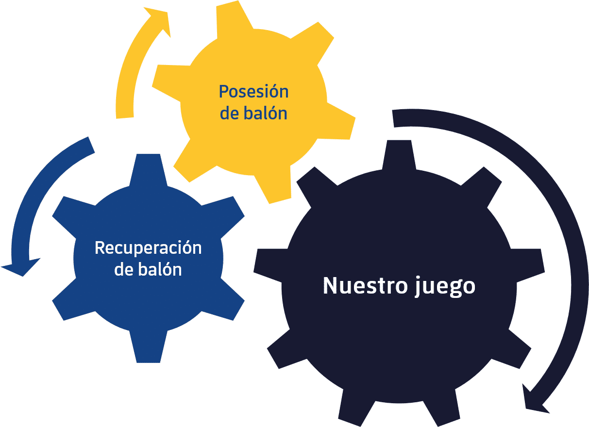
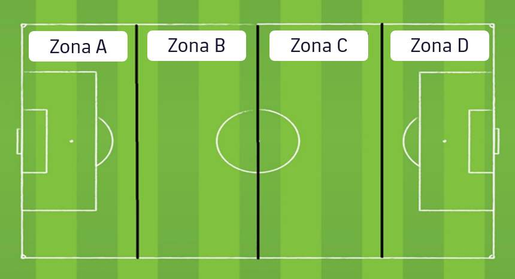
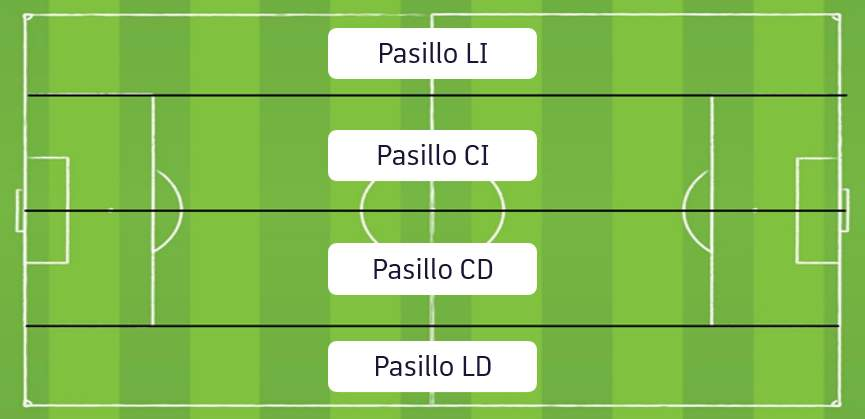
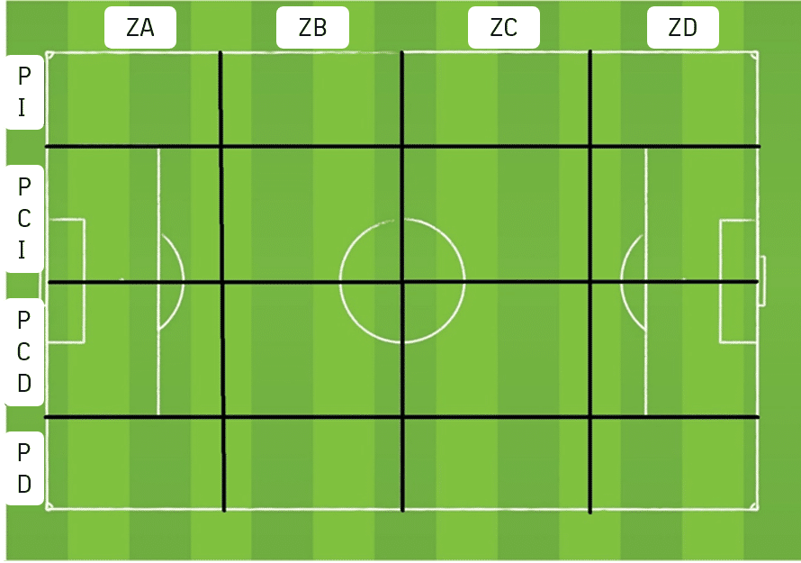
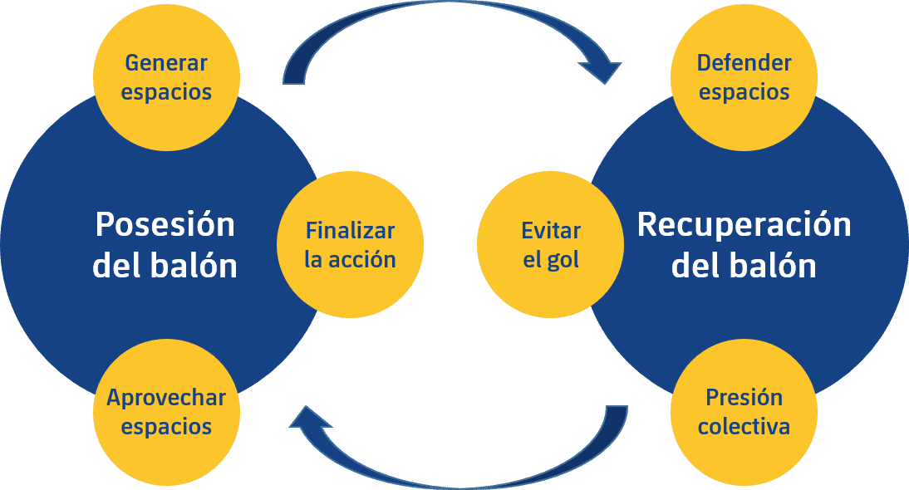
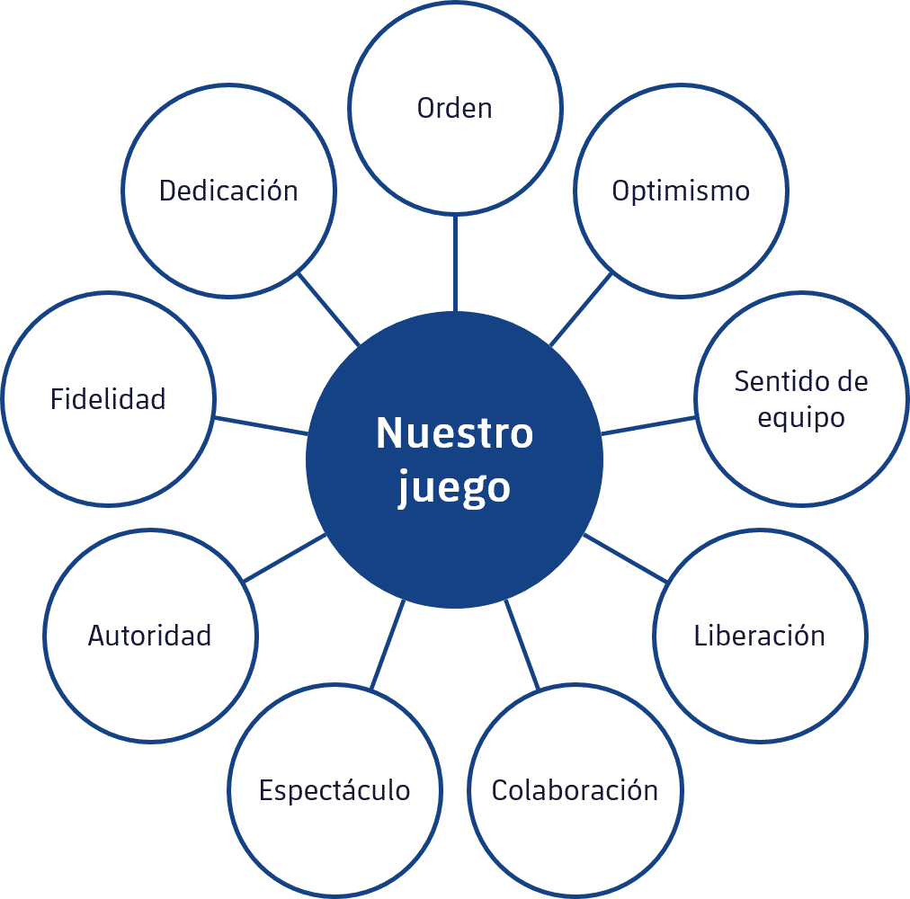

**4. Les phases du jeu**

*  
Module 2 sur 6*

**4.1 Présentation**

La philosophie de jeu qui a caractérisé le Futbol Club Barcelona au cours des 30 dernières années a été liée à deux aspects transcendantaux de notre façon de voir et de ressentir le football : la « possession » et la « récupération du ballon ».

Les deux phases interagissent en permanence pour obtenir leur propre identité de jeu qui leur permet d’être comprises par les joueurs, à travers les différents éléments qui configurent les tâches d’entraînement que, tout au long de leur vie sportive, ils vivent, développent et optimisent.

Pour comprendre cette proposition différente du jeu, le point de départ est de regarder le jeu dans son ensemble et de le conceptualiser comme une unité indivisible avec une fonctionnalité unique : jouer au football !

Cela signifie avoir le ballon ou devoir le récupérer, sans jamais arrêter de jouer. Cette compréhension holistique du jeu permet d’observer la réalité dans son ensemble, dans le but d’interpréter les phénomènes d’un processus de jeu et ses effets sur son identité globale. Avec cette nouvelle façon d’interpréter, il est nécessaire que chacun des épisodes du jeu soit configuré avec la compréhension et la participation de tous les joueurs de l’équipe, avec une seule mentalité, et évite que le joueur attaque ou défende, mais joue toujours.

« Si vous avez le ballon, l’adversaire ne peut pas marquer de but contre vous », a déclaré Johan Cruyff. « Si vous avez le ballon, le joueur est heureux et ne se fatigue pas », a déclaré Eusebio Sacristán. « Si vous avez le ballon, vous voulez prendre l’initiative », a ajouté Ernesto Valverde. « Si vous avez le ballon, c’est vous qui décidez », a résumé Joan Franscesc Ferrer, Rubi (Ruipérez, 2018, https://www.lavanguardia.com/deportes/20181114/452917657958/si-tu-tienes-el-balon-tu-mandas.html).

La volonté est de capturer un jeu offensif avec le ballon comme élément central. En d’autres termes, avoir la possession du ballon donnera à l’équipe un sentiment d’appartenance, cela générera un style bien marqué, dans lequel le ballon est le principal communicateur de toutes les phases du jeu.

Avec ce concept, il unit, mondialise, partage et fait une proposition qui a conduit le jeu du FC Barcelone à avoir une identité particulière et singulière, appelée « notre jeu ».

Pour son développement, il est important de comprendre que chacune des composantes de l’équipe est dans une interaction continue, à travers laquelle des signaux spécifiques de leurs coéquipiers sont observés (intracommunication), ainsi que les signaux de leurs adversaires (intercommunication) et du ballon. Dans le même temps, dans cette communication, ils doivent utiliser un langage efficace, interprété correctement par leurs coéquipiers et non interprété par les adversaires. Tout cela, dans le but de prendre l’initiative et, ainsi, d’incarner le jeu que l’équipe veut, dans chacun des espaces et autour du ballon ; soit pour garder leur possession le plus longtemps possible et l’utiliser pour générer des espaces de phase favorables pour pouvoir finir par marquer des buts, soit pour la récupérer le plus rapidement possible, et ainsi dominer le jeu pendant et tout au long du match.

Pour développer cette idée, la passe et le contrôle deviennent des outils essentiels pour la communication entre coéquipiers, car ils permettent un jeu de position optimal, dans lequel chaque joueur est disposé dans une situation idéale pour garder le ballon ensemble, c’est-à-dire en équipe : du gardien de but aux attaquants, le tout dans la recherche permanente d’un emplacement approprié pour recevoir le ballon et, Si vous le perdez, récupérez-le dès que possible.

Celui qui perd la balle devient immédiatement le premier retriever car il est généralement le plus proche de celle-ci. Peu importe la zone du terrain où le ballon est perdu, la récupération doit avoir lieu là et le plus rapidement possible, et s’il est proche de la zone adverse, plus vite et plus efficacement possible la zone de définition sera atteinte, donc le but.

La proposition qui vient du FC Barcelone commence à La Masia et s’étend à la première équipe professionnelle, axée sur l’idée que l’espace de jeu est marqué par le ballon, c’est-à-dire qu’il est l’axe central, la référence. À partir de là, l’organisation permanente et la réorganisation de l’espace dépendront de la zone du domaine où il se trouve, de qui l’a et de ce que vous voulez et pouvez en faire.

En ce sens, sur le terrain de jeu, il y a 4 zones et 4 couloirs ; Dans chacun d’eux, l’équipe est organisée de manière différente en fonction de la situation de conservation ou de récupération du ballon.

**Tableau 1 : Zones et corridors des terrains de jeu** 

<table>
<colgroup>
<col style="width: 49%" />
<col style="width: 50%" />
</colgroup>
<thead>
<tr class="header">
<th><blockquote>

<strong>Zone d’alarme « A »</strong>

</blockquote></th>
<th><blockquote>

Couloir LD : côté droit

</blockquote></th>
</tr>
</thead>
<tbody>
<tr class="odd">
<td><blockquote>

<strong>Zone de bien-être « B »</strong>

</blockquote></td>
<td><blockquote>

Allée CD : centre droit

</blockquote></td>
</tr>
<tr class="even">
<td><blockquote>

<strong>Zone de contrôle « C »</strong>

</blockquote></td>
<td><blockquote>

Allée CI : Centre gauche

</blockquote></td>
</tr>
<tr class="odd">
<td><blockquote>

<strong>Définition de la zone « D »</strong>

</blockquote></td>
<td><blockquote>

Allée LI : Côté gauche

</blockquote></td>
</tr>
</tbody>
</table>

Source : Création des auteurs.

Au cours d’un match, tous les espaces de jeu sont configurés par rapport au ballon, soit pour s’en débarrasser, soit pour le récupérer au plus vite. Pour ce faire, nous devons nous associer et communiquer dans ces espaces, occuper les zones et couloirs du terrain susmentionnés d’une manière spéciale qui est marquée et proposée par les relations et la communication qui s’établissent entre nos joueurs, et qui donnera lieu à différentes actions dans chacun des espaces de jeu, en fonction de l’endroit où se trouve le ballon.

Par conséquent, il n’y a pas d’arrangement en lignes, mais des espaces de jeu dimensionnés de différentes manières, et les couloirs de passe seront nos voies de communication pour que le jeu passe et traverse les espaces où il n’y a personne (nouveaux espaces générés) et que nous voulons occuper.

**Figure 1 : Interaction des phases en fonction de la bille**

Source : Auteurs.

**Aperçu des phases de jeu**

Comme nous l’avons mentionné, les phases de jeu sont, à notre avis, subdivisées en deux, c’est-à-dire selon que le ballon est disponible ou non.

À partir de là, la classification est élaborée en fonction des situations qui peuvent apparaître dans le jeu, mais sans les diviser puisque le football, en tant que sport d’interaction dans des espaces partagés, se développe comme un jeu continu, dans lequel les deux phases ainsi que les différentes situations de jeu se succèdent, donc, Vous ne pouvez pas comprendre l’un sans les autres.

Le modèle de jeu émerge et est conditionné par le contexte avec lequel ils interagissent constamment, les joueurs, l’entraîneur, l’idéologie du club, l’environnement. (Guindos, 2015, p. 147).

Ces situations de jeu se déroulent généralement dans certaines zones du terrain. En divisant le terrain de jeu en 4 parties de manière transversale, naissent les dénominations de zones : alarme (A), bien-être (B), contrôle (C) et définition (D). Si nous regardons l’équipe qui possède le ballon, dans le A il y aura des situations de jeu liées à la **sortie du ballon**. Dans B, **l’arrangement positionnel** se produira ; en C, la **disposition positionnelle devant la dernière ligne de l’adversaire**, et en D,** la finition**.

**Figure 2 : Occupation des espaces par zone**

Source : Auteurs.

Sur la figure 2, il convient de préciser :

- Zone A : Alarme.

- Zone B : bien-être.

- Zone C : contrôle.

- Zone D : définition.

**Figure 3 : Occupation des espaces dans les couloirs en fonction de l’évolution du jeu**

Source : Création des auteurs.

La figure 3 devrait être clarifiée :

- Allée LI : côté gauche.

- Couloir CI : centre gauche.

- Corridor CD : centre droit.

- Couloir LD : centre droit.

**Figure 4 : Intégration des zones et des corridors**

Source : Création des auteurs.

La figure 4 contient les mêmes précisions que dans les figures précédentes :

- ZA : Zone d’alarme.

- ZB : zone de bien-être.

- ZC : Zone de contrôle.

- ZD : Zone de définition.

- PI : Allée gauche.

- PCI : Allée centrale gauche.

- PCD : allée centrale droite.

- PS : allée droite.

Pendant l’entraînement, ces situations de jeu génériques peuvent être spécifiées en fonction de la contrainte des tâches afin que ce qui est destiné à être optimisé apparaisse. Nous comprenons les contraintes comme les variables qui influencent à la fois le comportement de l’athlète humain et des équipes. Ils ont été classés en trois types : organisme, environnement et tâche, malgré leurs multiples interconnexions (Davids et al., 2008). Les contraintes individuelles de l’organisme comprennent : génotype et phénotype, capacités physiques ou cognitives, motivations, émotions, etc. les environnements environnementaux font référence à l’environnement familial, social, culturel, météo, résultat et temps de jeu, etc. et les contraintes de la tâche se réfèrent aux règles appliquées, au matériel utilisé, aux mesures du terrain, à la distance à l’objectif, au nombre de pratiquants, etc. (Passos et al., 2008). Modifier les contraintes, à travers différentes variantes d’une même tâche, vous permettra de créer et d’avancer dans différents contextes au sein d’une même situation de jeu. Bien sûr, vous pouvez également modifier complètement une tâche. En ce sens, les deux options nous permettront de nous appuyer sur la variabilité nécessaire. Dans le même temps, dans la conception des tâches, il faut s’assurer que la pratique est massive et spécifique ; Cela permet d’effectuer suffisamment de tâches de ce type pour assurer la continuité.

Les situations de jeu qui se présentent lorsque le ballon n’est pas disponible peuvent également être optimisées de la même manière que lorsque le ballon est disponible. Mais si les tâches sont spécifiques, lorsque le but est une situation de jeu de balle, certains de nos joueurs essaieront de récupérer le ballon dans cette situation particulière. Par conséquent, nous pouvons optimiser simultanément les deux comportements dans les deux situations qui se produisent en même temps. En d’autres termes, les éléments suivants seront optimisés :

- Récupération sur la sortie du ballon de l’adversaire.

- Protéger les zones pour empêcher la progression de l’adversaire.

- Évitez le débordement des derniers adversaires.

- Actions pour se protéger contre la finition de l’adversaire.

Si une équipe est utilisée comme contrainte par rapport à l’autre, alors l’une des deux situations de jeu à optimiser aura la priorité sur l’autre, mais cela ne veut pas dire qu’elle ne sera pas optimisée avec de la pratique.

Cependant, d’autres objectifs d’optimisation peuvent survenir pendant l’entraînement, qui sont différents des situations de jeu. Du point de vue de la complexité, certaines d’entre elles n’auraient pas de sens, car elles iraient à l’encontre du nouveau paradigme. Pour montrer que dans le nouveau paradigme, il n’y a pas de place pour certains objectifs, ci-dessous, nous illustrerons avec un formateur qui a l’intention de former à la conduite.

Dans ce cas, le formateur ne doit pas concevoir de tâches spécifiques, car par définition elles sont ouvertes et de nombreuses autres actions non liées à la conduite apparaîtront pendant le temps de pratique. De plus, si vous avez l’intention d’améliorer la conduite, il est entendu que vous voudrez le faire sans tenir compte des intentions tactiques qu’une telle conduite peut avoir, car si vous le vouliez, votre objectif serait alors l’optimisation de la façon d’attirer un adversaire proche pour le désorganiser, ou comment obtenir des espaces protégés par l’adversaire. Ainsi, dans le cas où vous souhaitez optimiser la conduite, l’entraîneur peut l’aborder à partir de deux options :

**Concevoir une tâche ouverte**

–

Avec tous les éléments pour le rendre proche de la réalité du jeu, et limiter ou forcer les joueurs à conduire. Ce cas n’est pas recommandé car, bien qu’il propose aux joueurs d’expérimenter dans un contexte réel, leurs possibilités d’action sont fortement limitées, et ainsi le cycle « perception-action » est brisé, de sorte que le joueur ne vit pas vraiment des situations de jeu réelles.

**Conception d’une tâche fermée**

–

Moins complexe, où, en raison de la conception de la tâche, la conduite apparaît. Donc, forcément, cette tâche ne sera pas spécifique au jeu car il manquera de nombreux éléments qui définissent notre sport.

La « phase de possession » est très marquée par une idée centrale : tous les joueurs y participent, du gardien de but, appelé « premier attaquant » aux joueurs qui occupent la zone d’arrivée.

Pour développer l’idée du jeu, il est important que le gardien de but ait un bon jeu de jambes, c’est-à-dire qu’il domine sans problème les variantes de passes que le jeu offre dans les différentes circonstances qui se produisent tout au long du match.

De ce point de vue, afin d’avoir une possession optimale du ballon, il est d’une importance vitale d’avoir une position et une situation adéquates de tous nos joueurs sur le terrain de jeu. Cela indique que nous devrions éviter d’avoir des joueurs trop éloignés. De cette façon, les soi-disant transitions de « l’attaque à la défense » doivent être favorisées dans le jeu, et ainsi éviter d’éventuels dégâts, car l’intention de possession cherche à se développer le plus longtemps possible sur le terrain de l’équipe adverse. Pour cela, la distance entre les récupérateurs et le but lui-même doit rester correctement alignée, en anticipant pour résoudre, de manière optimale, les scénarios possibles en cas de perte de balle.

Tout au long du processus d’entraînement, afin de mener à bien ce type de tâche, il est nécessaire de comprendre le système de jeu que vous souhaitez capturer sur le terrain, par exemple : afin d’avoir une possession correcte du ballon, il est essentiel de reconnaître les triangulations qui émergent pendant l’entraînement et, par la suite, en compétition. Certains éléments cruciaux à mettre en avant lors de l’entraînement hebdomadaire sont : contrôler, passer, regarder devant et ainsi permettre des résolutions possibles avant de recevoir le ballon. Un autre aspect à optimiser chez les joueurs est de toujours être bien profilé avant de recevoir le ballon, ce qui leur permettra d’être bien préparés pour l’action suivante.

Lors des premières possessions du terrain (c’est-à-dire plus près de notre but (zone A), les « passes de confinement » sont surtout utilisées pour garder le ballon et ainsi éviter les tempos de jeu élevés, un rythme sûr prévaut, pour une conservation fluide. Pendant cette période, au fur et à mesure que les lignes sont franchies et que l’équipe s’approche du but de l’adversaire, la passe devra accélérer plus de rythme pour attirer et tromper l’adversaire. Le but ultime est de « désorganiser » l’équipe adverse, et au bon moment, une passe plus verticale peut être nécessaire pour profiter de cette désorganisation. En ce sens, des aspects tels que la patience, le déplacement de l’adversaire, le développement de supériorités numériques, qualitatives et socio-affectives, sont présentés comme des caractéristiques fondamentales pour comprendre l’identité du jeu que l’on souhaite réaliser dans la compétition à travers la possession du ballon. Ainsi, alors que l’adversaire est désorganisé et que l’équipe elle-même reste organisée, de nouvelles situations de jeu (espaces de phase) peuvent être générées favorables à nos intentions, qui, en fin de compte, sont toujours de marquer un but, de sorte que nous construirons les situations de jeu pour nous retrouver près du but de l’adversaire avec la disposition de faire une passe au but.

*  
Module 3 sur 6*

**4.2 Triangulation-espace-Lignes de dépassement**

**Triangulation Concept**

Pour obtenir la triangulation souhaitée, il est nécessaire d’avoir un moyen de se positionner sur le terrain, et ainsi privilégier les passes diagonales qui permettent de dépasser les lignes. Le système 4-3-3 ou 3-4-3 permet aux joueurs de se positionner efficacement autour du porteur de balle, et des opportunités de triangulation apparaissent. Pour développer et optimiser les triangulations, les supports sont des éléments fondamentaux, car ils évitent les positions fixes des joueurs. De cette façon, les joueurs sont motivés à se déplacer en permanence, à créer des espaces, à désorganiser l’adversaire et à s’auto-organiser en fonction de paramètres tels que la position du ballon, l’orientation, la zone et le couloir, le nombre d’adversaires et de coéquipiers, l’intention du détenteur, etc.

**Créer des espaces**

Lorsque l’objectif est d’attirer l’adversaire, on peut dire que nous sommes en présence de la création d’espaces. Par exemple : si l’intention de l’équipe est d’atteindre les zones C et D sur la voie de droite, l’adversaire peut être attiré en doublant les passes sur la voie de gauche, pour attirer l’attention de l’adversaire et laisser la voie du fond sans protection. Il est nécessaire de préciser que lorsque vous commencez à doubler les passes, le seul objectif est de ne pas attirer, car si vous vous permettez de vous approcher du but de l’adversaire par cette voie, les joueurs devront en profiter. En d’autres termes, la meilleure façon d’attirer l’adversaire est d’essayer de progresser sur une voie, et si ce n’est pas possible, vous pouvez répéter les passes, si nécessaire, pour attirer plus d’adversaires, puis vous diriger rapidement vers d’autres voies.

Un autre concept d’attraction peut être fait par le joueur sans le ballon. Par exemple, la position dite de « faux 9 » (que Guardiola a proposée avec Messi, et que Cruyff avait déjà mise en pratique avec Laudrup) dans laquelle le joueur quittait la zone des défenseurs centraux, attirant l’un d’entre eux près du milieu de terrain (ou non, et recevant seul) et tandis que les ailiers se déplaçaient de l’extérieur vers l’intérieur à la vitesse maximale et occupaient le nouvel espace créé. Le concept de mobilité est très important afin d’éviter les positions statiques ; Le démarquage en appui ou en rupture converge en permanence lorsque l’idée du jeu a une identité marquée. C’est pourquoi les termes 4-4-3 ou 3-4-3 sont utilisés pour développer une idée, qui sont des systèmes fixes, mais en réalité, le système présente beaucoup de variabilité, et ce sont les joueurs, organisés autour du ballon, qui marquent la façon de jouer avec leurs mouvements sur le terrain de jeu et leurs créations d’espace.

**Début du jeu**

Pour que l’idée de désorganiser l’adversaire soit efficace, au sein des zones A et B du terrain où se trouve le ballon, il faut que la présence d’un plus grand nombre de joueurs soit disponible, c’est-à-dire ce que l’on appelle la « supériorité numérique ». La réalisation de passes courtes et d’un plus grand nombre de joueurs situés près du ballon vous permettra d’avoir le contrôle du ballon et de la situation, d’atteindre les secteurs du terrain adverse (zone C et D), proches de la zone adverse. Dans le même temps, afin de progresser dans la zone de définition, le changement de rythme du ballon est essentiel, l’intensité à laquelle le ballon se déplace permettra de surmonter les espaces, ainsi, le dépassement qualitatif du 1 contre 1, le démarquage et les passes verticales dans l’espace rapprocheront l’équipe du plus grand objectif, marquer le but.

L’importance de la « récupération » au sein de l’équipe est d’un « haut niveau » : c’est un élément essentiel qui doit être développé pendant le processus d’entraînement, en sélectionnant des éléments de mise en forme qui permettent d’optimiser la synergie des joueurs sur le terrain de jeu. Pour mener à bien leur compréhension, il est essentiel que les joueurs gardent à l’esprit que, lorsqu’ils perdent la possession du ballon, il faut le récupérer le plus rapidement possible, c’est-à-dire que toute l’équipe essaie de récupérer le ballon, et les attaquants seront les premiers à le faire. De cette façon, les scénarios possibles de contre-attaques ou de situations adverses de l’équipe adverse seront évités, ce qui, en cas de mauvaise disposition des joueurs dans l’espace, augmentera la probabilité de terminer près de notre but et augmentera la possibilité de marquer un but. De plus, plus la balle est récupérée rapidement, plus la probabilité de continuer dans la zone d’arrivée est grande. Un bloc haut et des joueurs ensemble permettront à l’envie de récupérer le ballon le plus rapidement possible de devenir une réalité immédiate, ce qui optimisera la réorganisation et le positionnement de l’équipe en fonction du même objectif : avoir à nouveau le ballon pour profiter du jeu et marquer des buts.

**Si** nous n’avons pas le ballon, nous courons et nous n’aimons pas courir. Nous aimons jouer au football, nous passer le ballon. Cette énergie interne qui vous donne cette intention est ce qui vous donne continuellement, lorsque vous perdez le ballon, à vouloir aller le chercher où que vous soyez. Le rôle de l’entraîneur est d’organiser cette façon de récupérer le ballon le plus rapidement possible. Au moment où nous perdons, comment nous organisons-nous pour avoir le ballon immédiatement ? Si nous sommes capables d’inculquer à nos joueurs que le ballon est ce qui nous rend forts, nous avons fait un très grand pas en avant (Seirul·lo, 2015, http://www.motricidadhumana.com/entrevista_Paco_Seirul_lo_su_metodologia_pasado_presente_futuro_mayo_2015.pdf

Quels éléments expliquer et proposer aux joueurs concernant la récupération du ballon ?

Comme mentionné, lors de la perte du ballon, le sens de l’équipe doit être primordial, le but est de récupérer le ballon. En d’autres termes, la pression doit être exercée sur le joueur proche, non seulement le joueur qui perd le ballon, mais aussi les coéquipiers les plus proches de la zone de balle. En revanche, les joueurs éloignés sont placés dans une position intermédiaire, pour éviter la marque « homme à homme ». Un joueur en position intermédiaire doit être capable de couvrir une ligne de passe et/ou être conscient de deux joueurs qui, si le ballon atteint l’un d’eux, pourraient être mis sous pression au plus tard au moment du contact avec le ballon. Dans le même temps, les joueurs éloignés (par exemple les défenseurs) si le ballon est perdu dans une zone proche du but de l’équipe adverse, doivent être constamment sous surveillance pour agir rapidement si nécessaire.

Tant dans la tentative de récupération du ballon, que lorsque nous l’avons, il est important de souligner le concept de « vigilance offensive », c’est-à-dire en cas de perte soudaine du ballon, que cette transition ne génère pas une disposition incorrecte dans l’espace, par exemple : en cas de perte du ballon, une longue passe dans notre dos, Cela peut créer un scénario d’opportunité de but possible pour l’équipe rivale, pour cela il est essentiel que les joueurs derrière le ballon soient concentrés en permanence sur le développement du jeu, à la fois où se trouve le ballon à ce moment-là, et aussi ce qui se passe autour de lui. Si le ballon a circulé correctement, tous les joueurs sont dans la bonne situation car ils ont tous voyagé autour du ballon ensemble. Probablement ces vigilances offensives émergeront, car toute l’équipe sera autour du ballon et dans des situations de pression immédiate, dans des intermédiaires ou des vigilances avec peu de mouvement.

C’est là que le « hors-jeu » prend une place prépondérante au sein de notre identité de jeu, c’est un élément fondamental des règles que nous devons promouvoir à travers l’entraînement. En ce sens, la synchronisation d’une défense organisée durant les différentes phases du jeu permettra d’optimiser cet aspect. En référence au hors-jeu comme tactique pour la réorganisation de l’équipe, Lillo (2016) a déclaré que le meilleur livre écrit sur la tactique est le règlement. Il veut dire par là que tout ce qui se passe, et ce dont un jeu comme le football a besoin, est là. En d’autres termes, si l’équipe en possession du ballon se trouve dans la moitié de terrain adverse, zone C ou D, la distance entre les défenseurs et le gardien de but sera marquée par un hors-jeu, et il sera essentiel de profiter de cette situation, ce qui nous permettra de continuer la conservation du ballon dans des zones éloignées de notre but.

Pour cela, en plus de la distance entre collègues. Le gardien de but doit avoir un bon contrôle du pied, et surtout jouer vers l’avant, c’est-à-dire plus près des défenseurs centraux, réduire l’espace entre lui et les défenseurs. En d’autres termes, la vigilance en tant qu’élément de récupération est également importante pour le gardien de but, qui doit prévoir d’éventuelles longues passes de l’équipe adverse, et s’avancer pour résoudre favorablement et recommencer avec la possession du ballon.

Après la perte immédiate du ballon, Cano Moreno (2010) nous apporte différents éléments à prendre en compte concernant l’organisation défensive :

\- Essayez de récupérer le ballon immédiatement après l’avoir perdu, en décourageant les relations sur des espaces contraires à l’endroit où il est perdu.  
- Empêcher l’équipe adverse de générer des conditions d’attaque favorables.  
- Évitez de surmonter complètement le premier groupe d’intimidateurs, en particulier dans les espaces proches de l’axe longitudinal.  
- Annuler les chances immédiates de progression de l’équipe adverse en harcelant le possesseur et les receveurs potentiels.  
- Prédisposition immédiate à changer de rôle.  
- Volonté de faire pression sur les pairs et les impairs de manière soutenue et systématique. Le « désir de balle » est notre motivation.  
- Responsabilité, être conscient que si je suis débordé, je compromettrai le reste de mes collègues.  
- Maîtrise des variables de harcèlement dans tous les postes spécifiques.  
- Solidarité, sentiment d’aide défensive constante.  
- Sensibilisation à la défense des droits en tant qu’activité collective.  
- Maîtrise des trajectoires dissuasives lors de la course d’approche pour harceler.  
- Évaluation de la profondeur défensive en utilisant l’axe longitudinal du terrain comme référence de regroupement.  
- Interdiction des pénétrations qui dépassent la dernière ligne de défense.

>                                                                                                      (Cano Moreno, 2010, p. 8).

D’une manière générale, il existe plusieurs principes fondamentaux qui interagissent dans les moments sans ballon ainsi que dans les moments avec le ballon :

**Apprendre à regarder**

–

Regarder nous permet d’anticiper, c’est-à-dire d’être informés à l’avance de ce que font nos collègues et nos adversaires. Cela permet d’anticiper les actions imprévues et, par conséquent, d’éviter les erreurs inutiles.

**Bien s’orienter/profil : se situer et se positionner de manière optimale, comprise de deux manières**

–

**L’orientation collective** : quelle orientation voulons-nous donner aux différentes situations de jeu qui se produisent dans le match par rapport aux notions d’espace et de temps ?

**L’orientation du joueur** : où mène l’intention, quelles informations de position offre-t-elle et qu’est-ce qui est utilisé pour communiquer avec le joueur ?

**Profils**

–

Chaque joueur doit adapter la position et la disposition de son corps à tout moment en fonction de la situation du ballon, des coéquipiers et des adversaires, afin de pouvoir voir et mieux comprendre tout ce qui se passe.

**Directivité**

–

Quelle direction donnons-nous à notre jeu par rapport à chaque situation de jeu et aux espaces à créer, occuper et exploiter, afin de générer une certaine supériorité.

Dans le même temps, les joueurs auront une série de fonctions dans la phase de récupération :

- Appuyez sur le support.

- Couvrir les canaux de communication.

- Positionnez-vous dans les lignes médianes.

Damunt et Guerrero (2016) affirment que les joueurs agissent en fonction de deux espaces : l’un socio-affectif et l’autre de responsabilité du joueur par rapport au modèle de jeu proposé par l’entraîneur, et qui aurait comme références les zones et les couloirs mentionnés ci-dessus. Dans le premier groupe d’espaces, on parle de ceux occupés par le joueur par rapport au ballon et à ses coéquipiers (organisation spatiale). Plus précisément, l’interaction affective de ces derniers avec eux, et l’incertitude que cela engendre. Selon Seirul·lo (2004), les éléments et les joueurs du jeu provoquent une « affectivité », et celle-ci se manifeste selon les possibilités de relation.

Dans les espaces statiques, le joueur gardera à l’esprit les objectifs de l’équipe ainsi que sa ligne dans la zone et le couloir qu’elle occupe à ce moment-là. Cet emplacement est défini par le modèle de jeu. En d’autres termes, les références spatiales pour le joueur dans ce cas seront beaucoup plus stables que dans le cas précédent. De plus, les espaces socio-affectifs (dynamiques) interagissent toujours au sein des espaces statiques, qui ont des particularités spécifiques.

Dans la disposition des joueurs dans l’espace au moment de la récupération, la défense de zone émerge, qui est un marquage collectif, où les joueurs structurés et placés dans leurs positions se déplacent selon une série de paramètres relationnels :

- La raison d’être est la coopération, et sa base est la couverture.

- Le premier objectif est le ballon et le mouvement de la défense en fonction de l’endroit où le ballon est placé. Les joueurs s’orientent vers le ballon, ce qui détermine la position.

- Coordination dans les mouvements entre les joueurs. L’intracommunication est essentielle.

Il est fait référence aux concepts de division des fonctions, d’équilibre entre les lignes et d’inclinaison défensive.

Cependant, conformément à la nécessité d’une récupération immédiate de la balle, il convient de noter qu’au niveau conceptuel, la « pression » est une conséquence directe de l’application correcte des principes collectifs de zone qui se produisent à tout moment sous une prédisposition émotionnelle et volitive dans la poursuite de la récupération de la balle.

1\. Diminuez l’espace de jeu en largeur et en longueur

*Cliquez pour retourner*

À. Appliquez la « pression dans les zones latérales », car nous avons l’aide des lignes de côté et la seule issue est vers la direction de notre pression (réduction de la largeur).

b\. « Avancer avec la ligne défensive jusqu’à la hauteur de la ligne médiane » et obtenir un bon équilibre entre les lignes (réduction de la longueur).

c\. Appliquer la ressource tactique du « hors-jeu » (réduction de la longueur).

*Cliquez pour retourner*

2\. Création d’une supériorité numérique autour du porte-bille

À. Pression sur les receveurs potentiels : de cette façon, nous pouvons anticiper et nous n’aurons pas à courir après le ballon.

b\. Pression sur le récepteur avant qu’il ne reçoive et ne puisse contrôler.

3\. Rôle et responsabilité des hommes les plus éloignés du ballon.

À. Neutralisez l’espace entre les lignes et les adversaires qui s’y trouvent.

**Figure 5 : Dynamique de jeu continue**

Source : Élaboration des auteurs sur la base de Corberán, (2014).

Au cours du processus d’entraînement ou en compétition, différentes situations émergent dans lesquelles les athlètes doivent réagir efficacement, à la fois individuellement et collectivement. Lors de l’exposition des différentes phases et situations du jeu qu’une équipe traverse, il est important que les joueurs s’identifient sur une synergie collective, dans laquelle les différentes zones et couloirs du terrain sont toujours bien occupés. En d’autres termes, pour réaliser un jeu fluide, il sera nécessaire de comprendre le football dans son ensemble, un sport d’interaction dynamique non linéaire. Pour cela, à partir de l’identité du FC Barcelone, il est considéré comme nécessaire de penser le ballon comme l’axe principal, pour une fonctionnalité collective optimale, à travers la recherche inlassable de la création de nouveaux espaces à occuper, en utilisant la mobilité permanente de l’équipe, et en partageant de petits partenariats entre coéquipiers (intracommunication). De cette façon, un comportement tactique collectif pur sera généré dans lequel la dimension relationnelle et socio-affective de l’athlète humain sera développée à travers la communication interpersonnelle et intergroupe. Cette intégration doit être abordée par l’entraîneur par le biais de situations de simulation préférentielles en fonction des besoins des joueurs immergés dans le jeu. Selon les mots de Menaut :

(…) Un comportement intelligent pendant le jeu sera le résultat non seulement d’une simple activité sensori-motrice mais aussi d’une activité cognitive que l’on peut définir comme le couplage des perturbations provenant du jeu et des compensations apportées par le joueur, l’intelligence tactique étant non seulement une adaptation optimale à certaines conditions du jeu ; mais aussi à la recherche de diversité et de nouveauté des acteurs (Menaut, 1992, p. 26).

En bref, nous pensons que la meilleure façon d’obtenir des résultats favorables sera d’avoir le ballon plus et mieux que l’adversaire (Moreno, 2013), augmentant ainsi la possession, la position et la situation près des zones d’en-but. Il faut toujours garder à l’esprit que pendant le processus d’émergence du modèle de jeu, il subit des fluctuations, et cela varie en permanence, car les relations ne s’expriment pas en termes linéaires : c’est-à-dire que les synergies et les comportements changent constamment (Guindos, 2015). Pour cela, il sera important de garder notre histoire à l’esprit, c’est-à-dire de poursuivre l’héritage que des entraîneurs tels que Ruiz, Cruyff, Michels, Guardiola, entre autres, ont contribué à cette idée unique et singulière de penser, de ressentir et d’apprécier le football.

**Figure 6 : Éléments à prendre en compte lors de la construction d’un modèle de jeu**

Source : Élaboration des auteurs sur la base de Cruyff, 2012.
