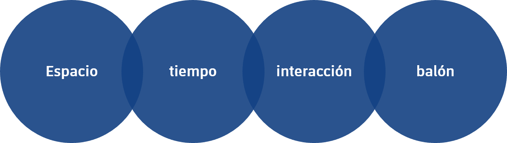
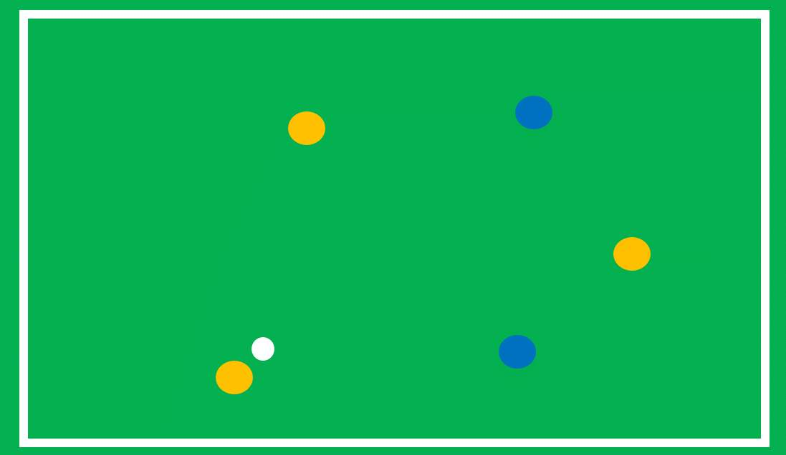
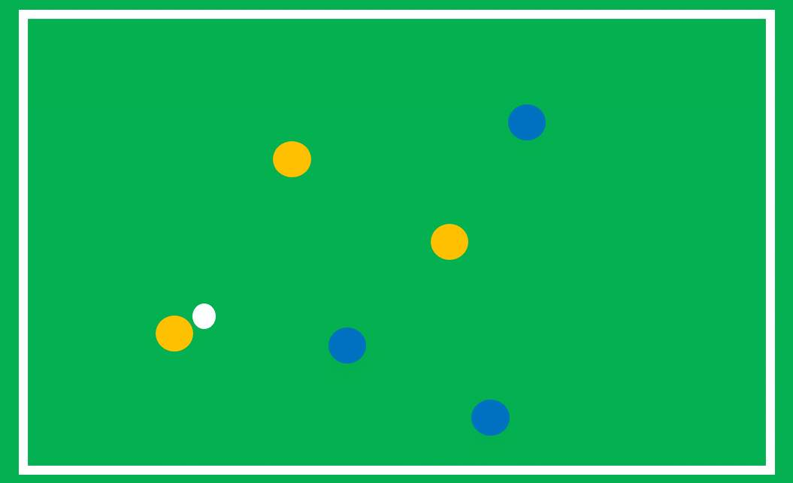
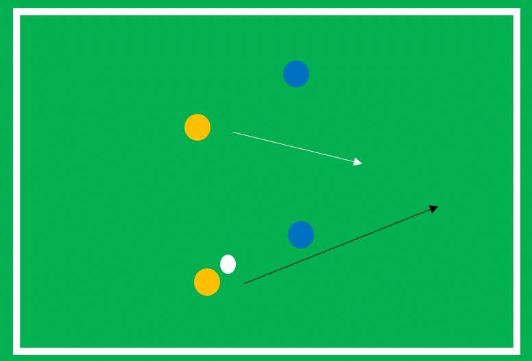
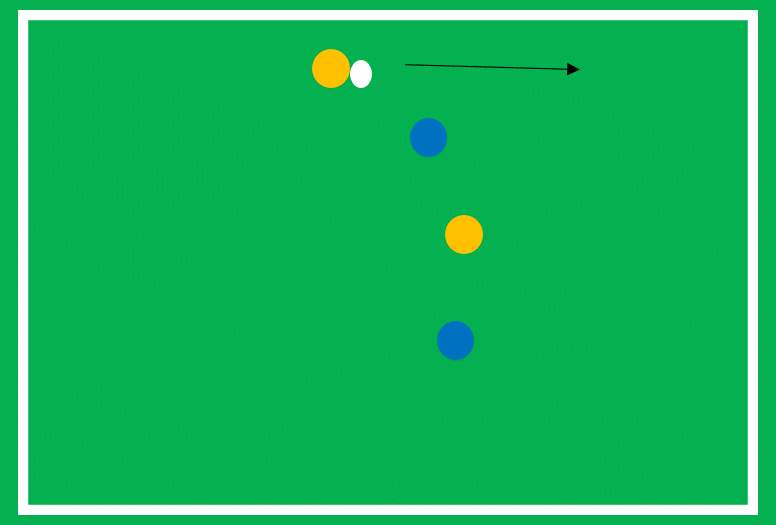
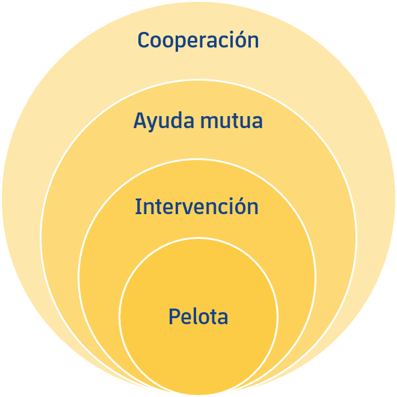
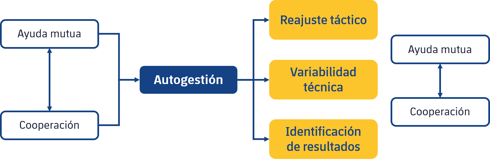

**3. Éléments du groupe d’équipe**

**3.1 Présentation**

Découvrir la logique interne du football, c’est découvrir son identité, qui permet aux entraîneurs et aux formateurs de se placer dans une position optimale pour le développement des tâches et la prise de décision (Parlebas, 2001).

Lorsque nous parlons de prise de décision, l’unité indissoluble entre le joueur (équipe) et l’environnement, et toutes les tâches, se forme. Comme mentionné tout au long du programme, ils doivent être contextualisés et liés à la pratique du sport. L’amélioration de la prise de décision par les acteurs est directement proportionnelle à la spécificité des tâches.

Les joueurs s’entraînent pour optimiser leur motricité, l’entraînement doit donc viser à inclure tous les éléments qui conditionnent les activités (spécificité) et les structures qui la composent. Ensuite, le formateur modifiera certains de ces éléments pour que les situations qu’il souhaite optimiser émergent dans la tâche, de préférence.

Suivant le principe de spécificité, les tâches doivent respecter la logique interne du football. Parlebas (2001) soutient que l’entraînement dans le même domaine que les actions motrices du football génère un plus grand transfert dans l’apprentissage.

**Graphique 1. La logique interne du football**

Source : Casamichana, Quintana, Gonzales et Paulis, 2015.

Poursuivant l’analyse de Parlebas (2001), l’auteur utilise le terme **de réseau de connexions pratiques**, qui implique, de la part des acteurs, une série d’actions, de réactions et de pré-actions où l’inventivité individuelle acquiert un sens par rapport à celle des autres.

À partir de maintenant, nous allons commencer à étudier certains éléments, qui font partie de l’objectif de comprendre la dynamique interne du football. Du point de vue du FC Barcelone et avec l’empreinte qui caractérise le club, les questions qui, sur la base du paradigme de formation utilisé, sont importantes sont développées de manière théorique et pratique. Il s’agit, entre autres, de la supériorité, de l’organisation, de l’occupation des espaces et des distances relationnelles.

**3.2 Supériorité – types**

Dans certaines situations, il est d’une importance vitale de profiter de la supériorité numérique obtenue, tant qu’une certaine distance est maintenue et que les joueurs sont fixés. Si ces deux aspects ne sont pas faits correctement, avec un seul joueur, l’adversaire pourra contrôler deux de sa propre équipe.

**Supériorité à 2 joueurs**

Dans ce type de supériorité, il est important de maintenir des distances stratégiques entre les 2 attaquants, pour éviter qu’un récupérateur ne gêne une intention de jeu par son mouvement. Si le retriever choisit de bloquer son but, la bonne décision est de passer au coéquipier pour qu’il puisse terminer. Si le retriever choisit de couvrir la voie de dépassement, ce qu’il faut faire est de changer de rythme pour essayer de terminer sans marquage.

- Si une distance suffisamment grande est maintenue entre les coéquipiers, l’adversaire ne pourra pas s’occuper de toutes les actions possibles que les porteurs de ballon peuvent entreprendre, ils perdront donc toute initiative de récupération.

- D’un autre côté, si vous êtes très proche du récupérateur, il peut avoir un certain contrôle sur la situation, et même prendre l’initiative de la récupération.

**Supériorité à 3 joueurs**

Dans ce cas, il doit être transformé en 2 :1 ou fixé à l’un des adversaires afin que le ballon puisse être passé à l’un des coéquipiers qui n’est pas marqué. Comme mentionné dans le premier cas, il est important de garder la distance entre le possesseur et les éventuels receveurs, de cette manière pour éviter qu’un joueur ne bloque le coéquipier possesseur.

Dans ce type de supériorité, si l’un des joueurs se déplace sur l’aile, il y aura supériorité numérique mais pas supériorité positionnelle. L’un des joueurs doit être empêché de se déplacer sur l’aile car il ne pourra pas intervenir dans le jeu.

**Supériorité à 4 joueurs**

Dans ce cas, la situation est peu différente de celles mentionnées ci-dessus. Le type de supériorité est ce qui détermine le positionnement. Le reste des coéquipiers libres sera chargé d’attaquer l’espace, avec l’intention de laisser le passeur derrière et ainsi donner de la quantité à l’attaque au cas où ils auraient les espaces couverts.

Ce qui vient d’être décrit fait référence à des types de supériorité dans l’ordre **numérique** : deux joueurs ayant une participation immédiate potentielle au jeu sont plus que les adversaires.

**Graphique 2. Exemple : supériorité numérique. Nous sommes plus**

Source : Création des auteurs.

Comme mentionné, vous pouvez également parler de supériorité** positionnelle**. En ce sens, les joueurs sont placés de manière à désactiver la participation des adversaires.

**Graphique 3. Exemple de supériorité positionnelle. Nous sommes mieux placés**

Source : Création des auteurs.

Seirul·lo (2017) suggère un type de supériorité qu’il appelle **socio-affectif**, où les joueurs ayant une implication potentielle immédiate s’entendent mieux que leurs adversaires.

**Graphique 4. Un exemple de supériorité socio-affective. Nous nous entendons mieux**

Source : Création des auteurs.

Poursuivant avec Seirul·lo (2017), un autre type de supériorité, qu’il qualifie de **qualitative**, affirme que les joueurs utilisent leurs ressources tactiques et techniques plus efficacement que leurs adversaires.

**Graphique 5. Exemples de supériorité qualitative. Nous sommes meilleurs**

Source : Création des auteurs.

Il faut comprendre que, sur la base d’une vision systémique du jeu, ces supériorités n’apparaîtront pas de manière isolée dans le jeu, pas même une à la fois, mais à partir de l’interaction entre le contexte où les joueurs jouent, et les caractéristiques et l’état de ces mêmes joueurs, des possibilités d’action apparaîtront à des moments qui doivent être identifiés comme des supériorités.

Afin que le joueur puisse optimiser ces actions, il est nécessaire de vivre des expériences similaires à la réalité du jeu à l’entraînement, comme mentionné dans l’introduction. Et que l’entraîneur, à travers les règles de la tâche, sait produire et répéter ce contexte sans perdre trop de spécificité du jeu, et que, avec la même règle ou d’autres, il oriente le joueur vers les actions à effectuer dans ces situations, s’il considère qu’il devrait y en avoir une.

*  
Module 4 sur 8*

**3.3 Organisation – commande**

Lorsque nous parlons d’organisation spatiale, nous faisons référence à savoir percevoir les combinaisons qui peuvent exister des différents lieux lors d’un match de football.

Un joueur de football doit interpréter sa situation, celle de ses coéquipiers et de ses adversaires à tout moment, afin de pouvoir agir en conséquence. Cette situation consistera en des stimuli de distance, de trajectoire et d’orientation ; tout à la fois. Cette manifestation de l’organisation devient plus évidente lorsque nous pensons à un joueur qui doit comprendre l’organisation de toute l’équipe, par exemple, les adversaires. Afin de pouvoir interpréter tout ce qui fait référence à l’adversaire, il devra percevoir les distances entre les joueurs, entre les joueurs et les limites du terrain de jeu, les trajectoires de mouvement décrites par les adversaires et les orientations prises par chacun d’eux. Ce n’est qu’ainsi, en interprétant tous les stimuli reçus ensemble (et non séparément), que vous pourrez comprendre l’organisation spatiale de l’équipe adverse. Chacun des emplacements affecte les autres. Par exemple, en raison des distances interlinéaires, un joueur peut avoir l’impression qu’il n’y a pas assez d’espace pour qu’un coéquipier puisse recevoir le ballon en toute sécurité ; Cependant, l’orientation des joueurs qui définissent les distances interlinéaires fournit des informations qui peuvent être interprétées par l’observateur, comprenant qu’il y a suffisamment d’espace pour donner la passe au coéquipier et la recevoir en toute sécurité. L’organisation est l’interaction de différents endroits.

Plus nous aurons exercé notre équipe système et dans différentes situations, meilleures seront nos capacités perceptuelles et nous serons capables de percevoir l’organisation spatiale à un niveau supérieur. La prise de décision au niveau des tâches valides dépend de cette capacité, et donc de l’efficacité en conséquence.

**Distances relationnelles**

Comme mentionné précédemment en faisant référence aux espaces de phases, dans cette section, nous parlerons des distances relationnelles. Compris comme : intervention, entraide et coopération.

**Les espaces socio-affectifs de la phase**

Il s’agit de l’interaction du joueur avec le reste des composants du système en fonction de la relation affective qui émerge.

- Une image de l’ensemble des espaces socio-affectifs où le but, les éléments et les événements émergents interagissent.

- Il est susceptible de varier en fonction de tout changement qui se produit.

- Ce qui s’y passe déterminera le comportement des joueurs, qui varieront leur état en fonction d’eux.

Du point de vue du FC Barcelone, les espaces ne sont pas des lieux physiques, ce sont des zones spécifiques du terrain de jeu qui dépendent essentiellement de la situation des joueurs des deux équipes et, surtout, de l’endroit où se trouve le ballon et du porteur du ballon.

**Graphique 6. Phase Espaces socio-affectifs**

Source : Création des auteurs.

Il est nécessaire de déterminer dans quel espace socio-affectif se trouve le joueur à proximité.

- Intervention : si vous avez le ballon ou si vous pouvez le récupérer rapidement (récupérateur).

- Entraide : si vous pouvez vous rapporter directement au titulaire ou au récupérateur.

- Coopération : si vous ne vivez ni l’un ni l’autre. Pas de canaux de communication directs.

Une situation idéale pour le joueur possesseur par rapport à ses coéquipiers, est qu’il en a un grand nombre dans l’espace d’entraide, organisés autour de lui pour lui offrir différentes possibilités d’action, et d’autres joueurs en coopération qui, bien qu’ils ne puissent pas aider le possesseur, coopèrent avec les autres coéquipiers pour essayer de créer des espaces. les rivaux d’ancrage, etc. La succession des situations de jeu est constante, du fait que les joueurs, coéquipiers et rivaux, changent leur situation personnelle, et modifient ainsi le contexte et les possibilités du propriétaire.

En relation avec ce qui précède, nous pouvons définir les situations de jeu comme la réalité qu’un joueur ressent et avec laquelle il interagit dans n’importe quel espace socio-affectif et à tout moment du jeu pendant la compétition ou l’entraînement.

Les communications motrices qui ont été pratiquées à l’entraînement sont plus susceptibles d’être identifiées par le joueur dans le jeu et elles réapparaîtront. À travers le cycle perception-action, apparaît cette coordination avec ses compagnons, qui, du fait qu’elle doit être exécutée avec peu de temps, ne peut être raisonnée, bien qu’elle puisse apparaître plus tard dans un état conscient.

Il s’agit d’une situation caractérisée par un niveau élevé d’incertitude, de sorte que la participation de l’entraîneur est minimale. Moins un joueur a de temps pour prendre une décision, moins l’entraîneur a de chances d’intervenir. C’est pourquoi il est entendu que le coach a plus de poids dans ce qui se passe dans l’espace de coopération.

Les espaces d’intervention auxquels il est fait référence sont inondés de situations de jeu qui se produisent simultanément à tout moment.

**L’entraide et la coopération comme moyens d’optimiser l’autogestion des équipes**

Le rôle du coach est de s’assurer que son équipe a la capacité de se gérer dans tous les types de situations. Il fournit les ressources nécessaires au développement de toutes les structures nécessaires à cet effet. Les termes **d’entraide et de** **coopération** sont utilisés dans la culture des sports d’équipe, précisément dans le but de souligner la valeur du travail d’équipe. Ces concepts se recoupent dans chaque **situation de match** ou épisode de jeu.

Dans un épisode de jeu donné, l’entraide est indispensable, qui a lieu entre les compagnons les plus proches. Le joueur a l’intention de faire un mouvement devant un adversaire, et les joueurs proches de lui participeront à cette action en collaborant avec l’exécuteur pour conclure l’action avec succès. Cette action peut être réalisée avec ou sans le ballon. Ici, les interventions affectives interpersonnelles sont d’une grande valeur.

L’entraînement à la structure socio-affective aide les joueurs à interpréter de plus en plus les intentions de leurs coéquipiers. La connaissance empathique que l’on a d’un partenaire (structure socio-affective) va permettre d’agir avec une certaine dimension motrice (structure de coordination), plus une certaine intentionnalité de résolution (structure émotionnelle volitive), et d’engager et de mettre en évidence des éléments d’exécution (structure conditionnelle). L’entraide poursuit l’objectif d’assurer ce que le partenaire souhaite accomplir.

Ces événements ont lieu dans une certaine zone du terrain. Tout le terrain restant doit être occupé d’une certaine manière par le reste des joueurs, qui doivent être en situation de coopération avec ceux qui se trouvent dans la zone d’entraide. Tous les joueurs qui coopèrent sont situés spatialement par rapport à l’espace d’intervention et surtout par rapport au ballon, comprenant les objectifs du modèle que l’entraîneur a proposé pour un match donné.

La coopération dans les sports d’équipe est liée au fait de répartir les responsabilités individuelles dans chaque espace du terrain de jeu. En outre, il s’accompagne d’intérêts et d’objectifs communs. Les entraîneurs sont chargés de définir les espaces de phase où se trouvera chaque joueur, la disposition de ceux-ci, la vitesse de circulation du ballon, les manifestations motrices à effectuer, etc.

Comme mentionné au début, si une équipe s’entraîne de cette manière, elle sera plus proche de la conquête de l’autogestion. Grâce à l’entraide et à la coopération, des informations interpersonnelles des joueurs peuvent être mises à disposition, qui seront méconnaissables par les adversaires.

Nous ne devons pas perdre de vue le fait que ces événements se produisent dans les deux équipes. Le système est immergé dans des boucles rétroactives très complexes, dont l’équipe qui parvient à identifier la structure formelle de l’adversaire sera la gagnante.

**Graphique 7. Autogestion**

Source : Création des auteurs.

Au FC Barcelone, il est entendu que le concept de l’équipe est directement lié à tout groupe de joueurs qui ont formé la capacité à s’autogérer. Une telle autogestion permet à chaque joueur de mettre son talent et sa créativité au service de l’équipe. De plus, il permet de renforcer les liens socio-affectifs, notamment dans les espaces d’intervention, un lieu où tout ce qui se passe est impossible à contrôler par le coach.

Sans perdre la focalisation systémique qui caractérise les sports d’équipe, le 1v0 ou le 1v1 pourrait être interprété comme un outil dans le but d’améliorer les tactiques individuelles. Ces propositions ne sont pas compatibles d’un point de vue systémique, car le 1v0 ou le 1v1 sont le résultat d’une situation vécue dans l’espace d’intervention, qui, à son tour, dépend et est une conséquence de ce qui a été causé dans l’espace des phases. Elles ne sont pas validées d’un point de vue systémique puisque l’aspect socio-affectif n’intervient pas. C’est pourquoi un certain degré de spécificité dans les tâches est nécessaire si vous souhaitez optimiser la communication empathique entre collègues. Si nous n’ajoutons que le nombre de joueurs dans la tâche, mais sans contexte de jeu, ces joueurs optimiseront leur structure socio-affective par rapport à leurs coéquipiers, mais les coordinations de haute valeur socio-affective n’apparaîtront pas dans le match, car ils n’ont pas été capables d’expérimenter et de reconnaître quels besoins et comment leurs coéquipiers les communiquent de manière motrice.

**Occupation de l’espace et gain de temps**

La génération d’espace de joueur est un concept qui implique deux coéquipiers ou plus lors d’une situation de pose de balle (connexion tactique). Deux grands types d’acteurs sont présents : un générateur et un ou plusieurs récepteurs (synergie collective). Le générateur est un joueur qui se déplace dans un certain espace tout en attirant l’attention de ses adversaires dans le processus. Ce comportement provoque la libération de l’espace précédemment occupé par l’adversaire. Lorsque cet adversaire était auparavant proche d’un ou plusieurs coéquipiers, nous disons que ces joueurs reçoivent de l’espace généré par le joueur qui les attire.

Essentiellement, nous attribuons un gain spatial à un joueur lorsqu’un retriever laisse sa marque et se dirige vers un coéquipier, sous réserve des conditions où le retriever était proche du joueur et s’est retrouvé près du coéquipier pendant une courte période de jeu.

L’espace, le temps et l’opportunité sont trois variables intimement liées. L’un ne peut être compris isolément s’il n’est pas en communion avec les autres.

L’espace de jeu peut être modifié par le comportement de l’équipe, en fonction du modèle de jeu proposé, qui peut augmenter ou diminuer. Dans le cas de proposer, par exemple, une défense proche de son propre but ou d’avancer les lignes de défense au milieu du terrain, l’espace de jeu est réduit, même si les deux stratégies ont un objectif défensif spécifique. Dans le cas d’être en possession du ballon et avec une grande partie des joueurs autour de lui, ajouté à la lenteur de la circulation et au manque de largeur et de profondeur, l’espace de jeu sera également réduit. Ces variables doivent être prises en compte par les entraîneurs. L’entraîneur doit travailler sur la nécessité pour l’équipe de dominer l’espace de jeu.

Comme nous l’avons dit, le temps et l’espace sont des variables liées. Dans ce cas, le temps est déterminé par l’espace et vice versa. Le temps imparti pour une certaine intervention des joueurs sera réduit s’ils sont plus proches du but adverse. Dans la grande majorité des situations de jeu, le temps d’intervention pour agir est minime (Moreno, 2013).

Selon Moreno (2013), les raisons pour lesquelles le temps d’intervention est minimal sont dues à deux facteurs :

- L’intention de l’adversaire de récupérer le ballon.

- L’intention d’effectuer des actions qui empêchent l’adversaire d’occuper des espaces libres près de la surface de but.

Avec cela, on peut dire que le temps nécessaire à l’exécution des actions détermine leur développement correct et leur succès. Dans un sport comme le football, la vitesse n’apporte pas le succès.

L’opportunité est le moment précis où une certaine action doit être intervenue. Comme dit, il ne s’agit pas d’agir rapidement mais d’agir au bon moment. Le meilleur exemple de cette situation est Lionel Messi, c’est le joueur qui interprète le mieux les variables espace-temps-opportunité dans le monde, où tout le monde voit un joueur immobile, avec peu de mouvements, il lit les situations de jeu pour intervenir au bon moment. Il est le joueur le plus efficace et le plus efficient au monde à cet égard et, bien sûr, dans beaucoup d’autres aussi. Dans d’innombrables matchs, Messi n’est ni le plus rapide, encore moins celui qui court le plus de kilomètres, mais celui qui prend les meilleures décisions, tant individuellement que collectivement. Il n’y a pas de meilleur dominateur de l’espace-temps.

À cet égard, Johan Cruyff déclare :

Il est prouvé dans les statistiques que les joueurs, en réalité, sont en possession du ballon pendant 3 minutes, en moyenne. Donc, la chose la plus importante est : que faites-vous pendant ces 87 minutes où vous n’avez pas le ballon ? Cela détermine la qualité du joueur. (Cruyff, s.d., https://barcainnovationhub.com/es/espacios-futbol-perspectiva-cuantitativa/).

Ces dernières années, la plupart des équipes ont été chargées de diriger le jeu depuis la possession du ballon, pour lesquelles différentes actions sont effectuées telles que : générer de la supériorité (numérique, qualitative, socio-affective, positionnelle ou, probablement, un mélange de certaines d’entre elles), générer du désordre chez l’adversaire, construire le jeu à partir du gardien de but et générer des passes avec des intentions offensives, etc. Cependant, l’action la plus importante pour la possession est la création et l’occupation d’espaces.

Lorsque nous parlons d’occupation de l’espace, nous faisons référence à la gestion du joueur dans la recherche de zones pertinentes sur le terrain de jeu. L’importance de comprendre si une zone du terrain de jeu est correctement occupée est liée à la position relative de la balle, au niveau d’approximation des intentions de l’adversaire et au nombre d’adversaires dans une zone donnée (densité numérique).

Selon la vitesse du joueur, il existe deux types d’occupation spatiale :

- Actif : Le joueur se déplace en sprint pour occuper des espaces.

- Passif : lorsque le joueur se déplace lentement ou en marchant.

*  
Module 5 sur 8*

- **3.4 La valeur de l’espace sur le terrain**

- Le contrôle de l’espace est une variable indispensable à l’occupation et à la génération de l’espace. Comme mentionné ci-dessus, le joueur, lorsqu’il se déplace pour trouver une occasion de passer, se transforme déjà en un avantage en soi. Le fait est que tous les espaces n’ont pas la même valeur. Par exemple, une façon d’interpréter la valeur de l’espace est de prendre comme référence la distance par rapport au but adverse. Il est clair que les espaces proches du but adverse sont d’une grande valeur compte tenu du degré de danger qui peut être généré. Du point de vue du football du Barça, la valeur de l’espace change constamment en fonction de la position du ballon et des joueurs ; de sorte qu’un espace plus éloigné du but de l’adversaire a souvent plus de valeur qu’un espace proche de celui-ci ; En raison de la situation des joueurs à ce nouvel emplacement de phase qui sera créé si nous faisons cette passe.

- Compte tenu de la nature dynamique du football, les joueurs sont impliqués dans un processus continu de gain et de perte d’espace (dans une auto-organisation permanente). Un petit gain d’espace peut se produire lorsque les récupérateurs à proximité suivent la balle alors qu’elle s’éloigne du joueur, laissant au joueur un meilleur contrôle de l’espace. Cependant, la même chose peut se produire dans une situation de course à grande vitesse entre l’attaquant et le retriever, où l’attaquant se déplace un peu plus vite (brisure de symétrie). Dans un autre cas, un gain d’espace moyen ou élevé peut se produire lorsque le joueur se déplace dans un espace libre. De ce fait, il est nécessaire de définir un niveau de gain spatial à partir duquel l’espace gagné peut être considéré comme un avantage professionnel réel et non comme une conséquence des facteurs contextuels d’un mouvement plus lent dans une situation donnée.

- Dans un sport où la possession moyenne du ballon par un joueur est de 3 minutes sur 90, l’analyse de la dynamique collective de l’équipe, à travers les mouvements hors ballon, devient un élément critique pour comprendre la performance. Il a été démontré qu’à travers les données spatio-temporelles, il est possible d’extraire des informations significatives liées à l’occupation d’espaces précieux et à la génération d’espaces pour les coéquipiers. Grâce à une compréhension des fréquences (oscillations), de la qualité, de la position et de l’efficacité de l’occupation et de la génération de l’espace, un entraîneur peut construire des outils spécifiques qui guident un joueur à collaborer avec l’équipe au-delà de ce qu’il peut faire avec le ballon.

- À titre d’exemple, et pour résumer ce qui a été analysé jusqu’à présent, nous partageons un extrait de l’une des nombreuses analyses effectuées sur l’équipe première lors d’un match :

- Match officiel entre le FC Barcelone et le Villareal F.C. en janvier 2017. Plus précisément, une analyse axée sur les concepts d’occupation spatiale et de génération d’espace est fournie, en utilisant les données de suivi optique de Metrica Sports. Ce match s’est terminé par un résultat de 1-1, où le premier but a été marqué par Villareal F.C. à la 49e minute (deuxième mi-temps). L’égalisation du FC Barcelone est intervenue à la 90e minute par Lionel Messi. Sur le plan situationnel, il s’agit d’un match où le FC Barcelone devait marquer dans les dernières minutes, et devait occuper et générer autant d’espaces que possible pour obtenir des occasions de but. Afin d’identifier les actions d’occupation et de génération d’espace, nous avons calculé pour les situations offensives du FC Barcelone tous les cas dans lesquels un joueur avait contrôlé la possession du ballon avec ses pieds. À partir de chacune de ces situations, et en collaboration avec des analystes de football experts du FC Barcelone, nous avons défini une fenêtre de trois secondes après chacun de ces cas, arrivant à un total de 845 situations différentes. Le facteur de proximité est fixé à 5 mètres, en fonction de la distance minimale qu’un adversaire a en moyenne avec un joueur en possession du ballon. Nous avons également fixé la distance minimale d’attraction pour la génération d’espace à 3 mètres.

- Iniesta, Sergio Busquets et Lionel Messi ont représenté plus de 41 % du gain d’occupation spatiale. Notamment, ces trois joueurs occupent des positions différentes et ont des rôles différents au sein de l’équipe. Busquets est un milieu de terrain central et a un rôle spécifique pour aider à gérer le ballon avec une possession contrôlée pendant les constructions, et pour accompagner le jeu lors des attaques de position. Iniesta est un milieu de terrain offensif avec un excellent contrôle du ballon et des capacités spéciales pour se déplacer et trouver de l’espace entre les lignes. Messi est un attaquant, mais il n’est pas lié à une position spécifique, et il est autorisé à couvrir de larges zones du terrain pour trouver de l’espace et demander le ballon. Les trois joueurs partagent cependant une longue tradition de mouvements axés sur la possession et la qualité des mouvements hors du ballon au cours de leur carrière. Suarez et Neymar, deux joueurs très mobiles, apparaissent avec un plus petit nombre de situations où des espaces ont été gagnés. Cela peut être associé au niveau élevé de marquage strictement fermé que ces joueurs ont subi pendant le match, ou, peut-être, au fait de ne pas avoir pratiqué pendant des années de football de base les concepts qui permettent de tels gains, contrairement aux coéquipiers qui viennent de La Masia.

- Il est intéressant de noter que, pour la plupart des joueurs, l’occupation active de l’espace est considérablement plus répandue que l’occupation passive. Cela est particulièrement visible chez les arrières gauches et droits qui doivent couvrir des espaces plus larges et montrer une grande distance moyenne au ballon, une caractéristique partagée par les défenseurs centraux. Un cas notable est celui de Lionel Messi, où il manifeste des caractéristiques plus passives qu’actives. La fonctionnalité passive ne signifie pas que le joueur n’occupe pas intentionnellement l’espace, mais plutôt qu’il ne se déplace pas à la vitesse de course, mais plus lentement. On a beaucoup discuté ces dernières années de divers moments pendant les matchs au cours desquels Messi se promène dans des zones du terrain. Cependant, ce comportement de marche n’est pas un détachement du jeu, mais une action consciente pour se déplacer dans des espaces vides de valeur et reprendre le contrôle de l’espace précieux, et finalement du ballon. Messi le fait très efficacement, ce qui le place près du sommet des joueurs en termes d’espace gagné tout au long du match, malgré le manque de gain actif. Une caractéristique pertinente de ceci est que 71% du temps, le gain d’espace se fait devant le ballon plutôt que derrière lui.
