**1. Optimiser l’entraînement et les structures des joueurs**

**1.1 Présentation**

L’optimisation de l’entraînement vise l’intégration simultanée de toutes les structures de l’athlète dans chacune des tâches effectuées. Cela n’est possible que sur le terrain, puisque c’est le jeu lui-même qui permet cette optimisation du joueur dans le contexte compétitif.

Dans le point suivant, une approche pratique sera menée où se manifestent les tâches qui impliquent les structures et les valeurs avec lesquelles le club travaille. À tout moment, ces tâches doivent être effectuées avec l’implication des valeurs parallèlement aux questions techniques et tactiques.

Chez l’être humain, les structures suivantes interagissent :

| **Structure bioénergétique**      | Il fournit de l’énergie pour la vie.                                     |
|-----------------------------------|--------------------------------------------------------------------------|
| **Structure conditionnelle**      | Il représente les capacités physiques.                                   |
| **Structure de coordination**     | Soutenez la technique.                                                   |
| **Cognitive Structure**           | Connaissance de l’environnement de jeu.                                  |
| **Structure socio-affective**     | Relations interpersonnelles.                                             |
| **Structure émotive-volitive**    | Émotions et désirs.                                                      |
| **Structure expressive-créative** | Signes de communication entre vous et votre équipe.                      |
| **Structure mentale**             | Comprenez et interprétez ce que vous voulez pour le présent et l’avenir. |

**Tableau 1 : Structures**

Source : Seirul·lo, 2017.

Chacune des structures que l’on verra dans l’exemple suivant favorise le développement des canaux de communication. Comme mentionné ci-dessus, dans chacune des tâches, en plus des objectifs technico-tactiques, les valeurs les plus représentatives du club doivent être formées, et cela inclut, entre autres, la philosophie du jeu et le joueur ; La formation doit donc avoir tendance à être personnalisée.

**Graphique 1. Interaction entre les structures de l’athlète humain et les valeurs**

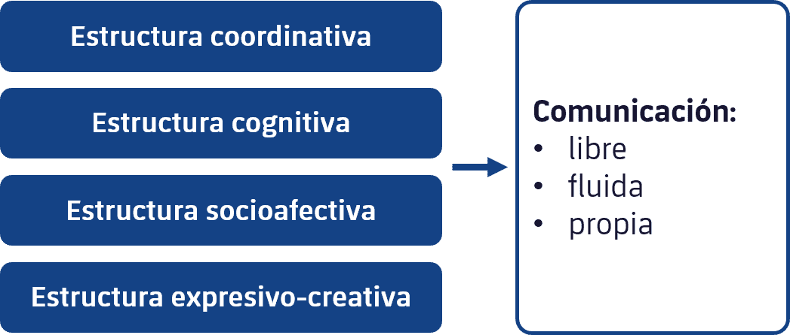

Source : Création des auteurs.

Des tâches sont élaborées pour déterminer la signification de :

- Les différents types de contrôles.

- Les trajectoires variées avec et sans ballon.

- Distances d’interphone.

- Différentes orientations corporelles et gestuelles.

Cela se fait par le biais de :

- Jeux de situation : (6v3 + 1), (4v4 + 3).

- Correspondances : en phase de **possession**, la **communication** entre le possesseur et les destinataires potentiels situés dans un espace d’entraide est encouragée. En phase de **récupération**, la référence est le joueur qui se trouve dans la zone d’intervention.

Exemples:

Exercices de passe, de contrôle et de soutien où se manifestent l’intégration des structures et le lien avec des valeurs telles que la communication et l’expressivité.

**Graphique 2. Exemples**

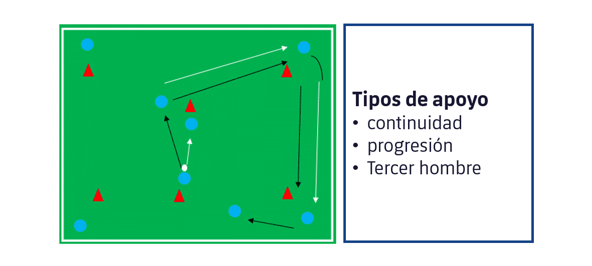

Source : Création des auteurs.

**Graphique 3. Exemples**

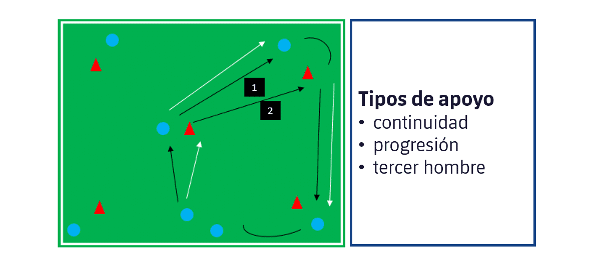

Source : Création des auteurs.

**Graphique 4. Exemples**

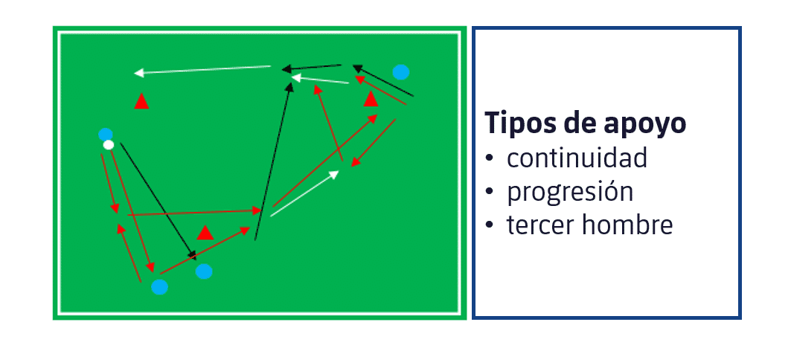

Source : Création des auteurs

**Graphique 5. Exemples**

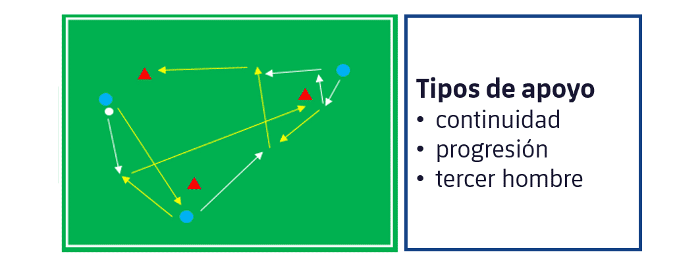

Source : Création des auteurs.

Dans tous ces exemples, l’accent sera mis sur la façon dont la passe est faite, les mouvements et les gestes que les joueurs font avant et après avoir fait la passe ou l’avoir reçue, pourquoi cette passe est faite. Intrinsèquement, nous développons la capacité de communiquer interpersonnellement à travers les actions du jeu ; En même temps, nous encourageons l’expressivité des joueurs, car chacun exprimera d’une manière différente ce qu’il veut manifester ou réaliser avec les actions qu’il réalise. C’est la valeur ajoutée des tâches qui, autrement, deviennent un simple contrôle et une simple réussite.

Dans le cas suivant, nous voyons comment le travail par les structures est combiné en combinaison avec une valeur telle que la confiance dans différentes tâches.

**Figure 6 : Interaction entre les structures de l’athlète humain et les valeurs**

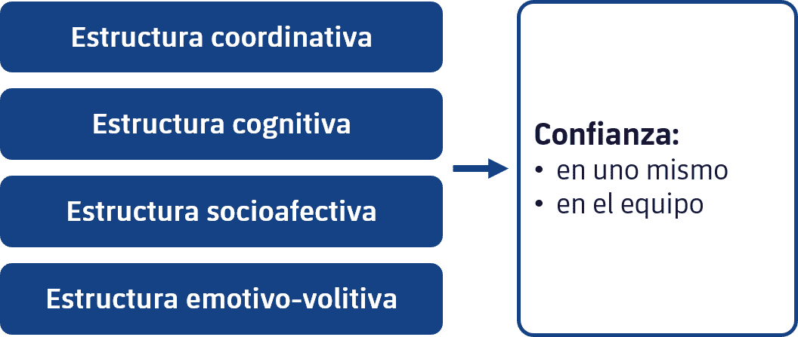

Source : Création des auteurs.

Cela peut être entraîné en créant :

Situations 1 contre 1 :

- En possession : dribbles.

- En phase de récupération : entrée.

Récupération de balle après les revirements :

- Confiance en l’équipe pour générer une supériorité dynamique dans la phase de récupération afin d’obtenir le ballon.

**Figure 7 : Exemples**

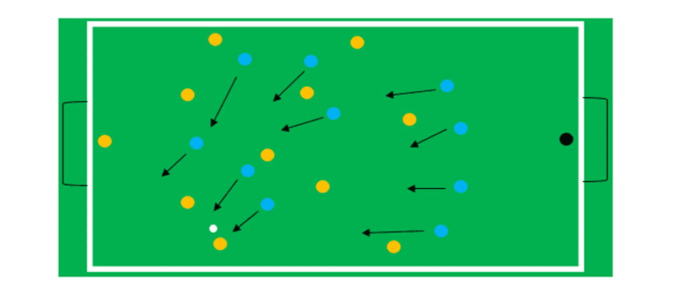

Source : Auteurs.

Une fois de plus, le facteur de différenciation de cette tâche est l’approche émotive-volitive. Oui, il sera important de savoir comment et quand la pression est appliquée après la défaite, mais il sera plus important de générer ou d’optimiser le désir de récupération immédiate du ballon (structure émotionnelle-volontaire), et de communication pour la localisation correcte de chaque joueur et le maintien de distances interpersonnelles entre coéquipiers (structure socio-affective) pour pouvoir mener à bien cette pression.

Dans le cas suivant, la valeur sur laquelle les structures sont développées sera l’excellence.

**Graphique 8. Interaction entre les structures de l’athlète humain et les valeurs**

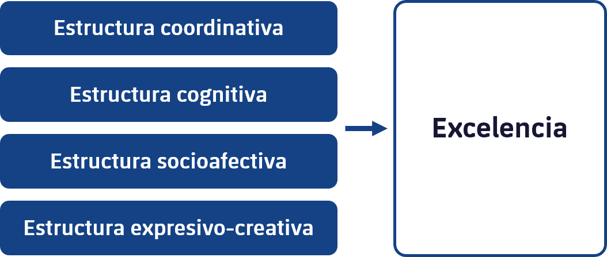

Source : Création des auteurs

Nous devons travailler avec engagement personnel et selon les conditions indiquées par l’entraîneur, car il est entendu qu’il s’agit de propositions qualitatives qui seront maintenues indéfiniment : le ballon et l’excellence dans le jeu.

Le développement de l’excellence s’effectue par des jeux de position et de mise en situation :

- 4 c 4 + 3 avec jokers.

- Le but est de dominer le jeu en possédant le ballon.

- Soutenez votre coéquipier, générez de la supériorité et jouez comme vous le souhaitez.

La domination du jeu n’est générée que par la possession du ballon, l’équipe conquiert l’excellence dans la mesure où elle est chargée de générer du jeu. Lorsqu’un coéquipier a le ballon, tous les autres font des trajectoires et des appuis pour apporter des solutions de supériorité. Le joueur ne doit pas se contenter de donner une passe à un coéquipier qui n’est pas marqué, il doit donner sa meilleure passe, au meilleur coéquipier et dans les meilleures conditions. De cette façon, l’équipe et le coéquipier ne sont pas compromis.

**Figure 9 : Exemples**

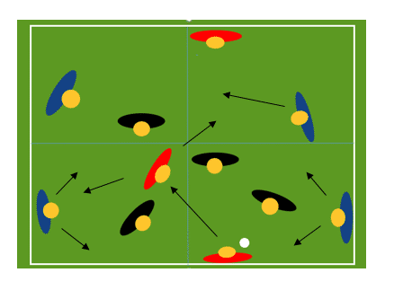

Source : Création des auteurs

Les structures des joueurs et leur relation avec les dirigeants.

**Graphique 10. Interaction entre les structures de l’athlète humain et les valeurs**

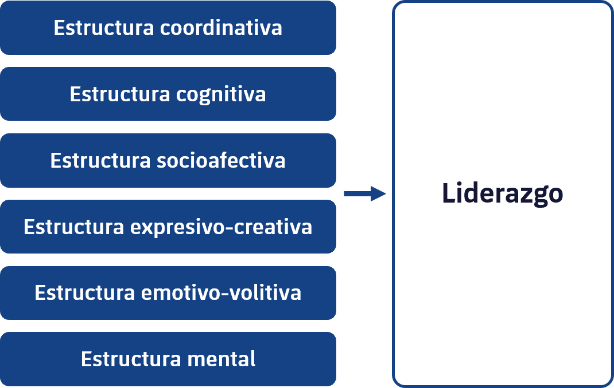

Source : Création des auteurs

Dans ce cas, les jeux de situation et les matchs sont utilisés comme proposition de développement du leadership en combinaison avec les structures susmentionnées. Le leadership est essentiel pour qu’une équipe atteigne des niveaux de performance élevés. Le leadership peut être réparti entre plusieurs joueurs, et ce fardeau ne repose pas sur un seul joueur.

Le leadership pendant le match et sur le terrain ne devrait jamais être commandé par l’entraîneur. C’est le joueur responsable, qui a grandi pendant sa phase de formation avec les idées du leadership et s’est formé en tant que tel. Non pas dans l’idée d’être un complément passif et introverti, mais plutôt d’être extraverti, de parler et de communiquer en permanence.

Jeux de situation :

- Les jokers sont chargés d’exercer un leadership pendant les jeux de situation, pour dominer le jeu avec la possession du ballon.

Parties:

- Dans ce cas, un style de leadership est nommé comme celui de Carles Puyol, qui était une référence dans l’équipe première, qui guide et maintient l’équipe ensemble pendant le développement du jeu.

L’étude de cas utilisée est celle mentionnée à la figure 11. Les structures des joueurs et leur lien avec la responsabilité.

**Graphique 11. Interaction entre les structures de l’athlète humain et les valeurs**

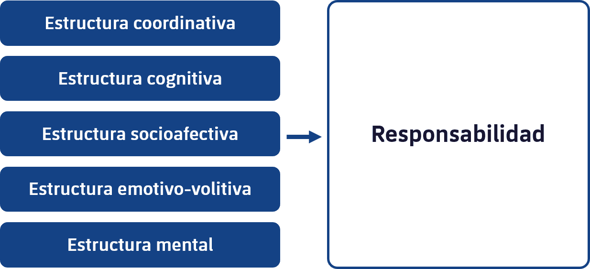

Source : Création des auteurs

La proposition de travail pour la formation à la responsabilité, en combinaison avec les structures susmentionnées, est développée et renforcée pendant la phase de récupération, au cours de laquelle l’engagement de tous les joueurs de l’équipe est requis.

- Il est important de s’engager à marquer les zones à risque, en utilisant des approches tactiques des stratégies défensives. Exemple; d’un coin.

**Figure 12 : Exemples**

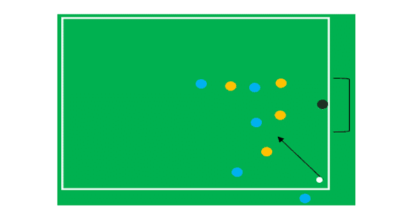

Source : Création des auteurs.

Les structures des joueurs et leur lien avec le développement du jeu d’équipe.

**Figure 13 : Interaction entre les structures et les valeurs de l’athlète humain**

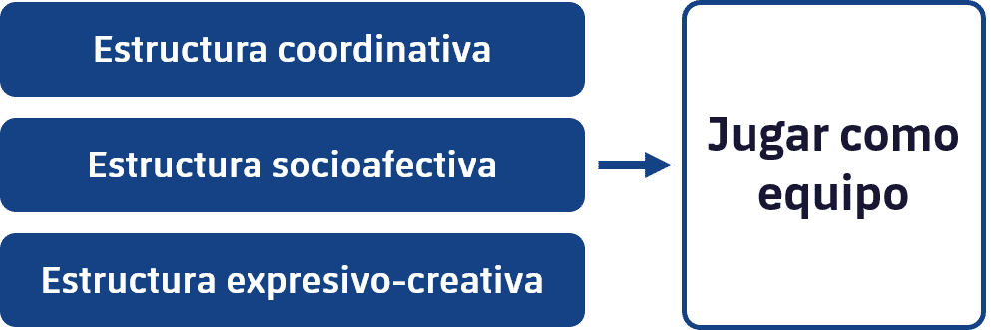

Source : Auteurs.

Pendant la phase de récupération de balle :

- Dans les espaces d’intervention, d’entraide et de coopération, le désir immédiat de récupération de la balle se manifeste.

- Dans tout type de tâche où ils s’entraînent à travers des jeux de situation, ce désir de récupération doit être montré, surtout lorsque l’équipe avec le ballon vient de le perdre.

**Figure 14 : Exemples**

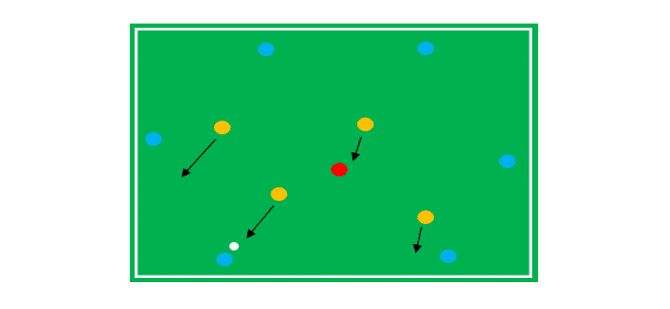

Source : Création des auteurs

Les structures des joueurs et leur lien avec la résilience.

**Figure 15 : Interaction entre les structures et les valeurs de l’athlète humain**

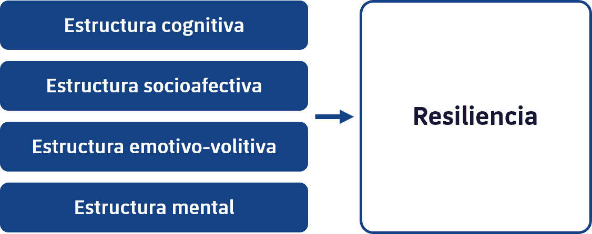

Source : Création des auteurs

Cela se manifeste dans toutes les situations où des situations défavorables doivent être surmontées :

- Résultats négatifs lors du développement du jeu.

- Jouer en infériorité numérique (ou avec des jokers en phase de possession).

- Surmonter les moments de difficulté physique ou mentale.

**Figure 16 : Exemples**

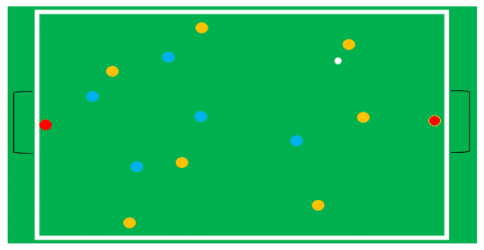

Source : Auteurs.

Il convient ici de souligner l’importance de la structure mentale et de la façon dont l’entraîneur introduit des règles provocatrices afin que les actions émergent des joueurs aussi réelles que possible dans les situations qui doivent être optimisées.

**Importance du laissez-passer en tant qu’élément de communication**

Le transfert fluide du ballon est essentiel pour l’emporter, il faut donc porter une attention particulière à la passe. Le laissez-passer est le moyen par lequel deux personnes ou plus se lient et se rapportent pour atteindre un objectif commun. La passe est la synthèse du jeu collectif.

Dans toutes les écoles d’entraîneurs, la passe est définie simplement comme une action technique du jeu. Mais, en réalité, c’est bien plus qu’une action technique.

La passe est la base et l’exposant maximal du jeu collectif et associatif de tout sport d’équipe, et bien plus encore dans le cas du football, en raison de la grande difficulté d’être joué avec les pieds.

Dans la passe, toutes les structures qui interagissent chez le joueur (athlète humain) pendant le jeu sont données :

Conditionnel

*Cliquez pour retourner*

Lacomposante de la force dans la frappe ou le contact avec la balle.

*Cliquez pour retourner*

Coordination

L’action technique elle-même (la relation entre le joueur et le ballon).

Cognitif

L’identification, l’interprétation et la compréhension du jeu que chaque passe exige.

Socio-affectif

L’idée de « partager », de « jouer en équipe » et de « générosité » entre les membres de l’équipe, ce qui implique.

Expressif-créatif

Une intra-communication empathique et affirmée entre nos joueurs.

Émotif-volitif

L’émotion et le plaisir de continuer à posséder le jeu grâce à la possession du ballon.

Mental

La conviction qu’à travers elle, nous serons supérieurs et dominerons le jeu.

En fait, toutes les actions techniques du football peuvent être définies comme des passes, et avec cela, nous définissons également l’essence de **notre jeu**.

Toutes les composantes variables du jeu (situation et trajectoires du ballon, coéquipiers et adversaires) se concluent dans** l’organisation globale** **de l’équipe** qui a comme éléments de référence : **le ballon et la passe**

C’est pourquoi définir** Our Game**, c’est parler de l’expression maximale du concept de passe :

Une répétition systématique, constante et intentionnelle des interactions entre toutes les composantes de l’équipe, à travers le ballon afin d’organiser l’équipe elle-même, de désorganiser l’équipe adverse et d’atteindre l’objectif ultime et définitif : le but.

Le lien entre les joueurs, qui se manifeste par la passe, signifie qu’ils doivent s’adapter aux caractéristiques de leur coéquipier. Une passe mal faite peut souvent être générée en raison d’un manque de connaissance du coéquipier qui est sur le point de recevoir le ballon, car elle peut être générée avec trop de force et le coéquipier n’a pas les ressources pour recevoir. Dans la mesure où les joueurs de l’équipe se connaissent mieux et mieux, leur communication par la passe sera optimale.

Dire **passe,** c’est dire** football**.

Dire **passe,** **c’est dire notre jeu.**

*  
Module 3 sur 7*

**1.2 Communication d’équipe**

L’affirmation de soi et l’empathie sont considérées comme des compétences que les athlètes doivent entraîner pour optimiser leurs relations sociales et leur communication entre eux. Dans les sports collectifs, il s’agit des voies socio-affectives, qui indiquent les moyens par lesquels les informations verbales et non verbales circulent entre les joueurs pendant l’entraînement et les compétitions. Les informations interpersonnelles, avec leurs différentes significations et interprétations, seront le résultat du processus que le joueur traverse lors de son entraînement sportif.

L’objectif du coach est, entre autres, d’optimiser la communication au sein de l’équipe et les moyens d’y parvenir vont de pair avec le développement des compétences susmentionnées : **empathie** et **affirmation de soi**.

L’affirmation de soi dérive du latin assertum et est comprise comme **affirmative**. En transférant le terme à des situations quotidiennes de pratique, il fait référence à l’affirmation de sa propre performance et à une communication sûre et efficace. D’un point de vue psychologique, on peut dire que le joueur ressent de la confiance en soi et de l’estime de soi. Tout cela contribue positivement à la communication intragroupe. Le mouvement est le canal de communication affirmé-moteur, qui se manifeste à travers les différentes techniques ou schémas de coordination dans les sports kinésiques. Tout cela est transmis avec une charge affective car il s’adresse à des collègues, qui demandent des paramètres d’action concrète. Le jeu assertif implique :

- Soyez clair et transmettez ce que vous avez l’intention avec un haut niveau de confiance, tout comme vous avez été formé.

- Agissez honnêtement, en donnant des solutions alternatives pour vous entraider.

- Être responsable de s’assurer que l’échange communicatif se déroule de la manière souhaitée par l’un ou l’autre et l’équipe.

Les approches méthodologiques, les formations, doivent être orientées non pas individuellement mais avec des propositions de communication affirmées-motrices, afin qu’il soit ensuite possible d’agir en équipe de manière optimale. C’est-à-dire : créer des situations où les individualités peuvent être améliorées en faveur de l’équipe.

Le coach doit générer des moments propices à ce type de communication, pour lesquels il doit fournir des informations telles que :

- Demander aux athlètes un niveau homogène d’orientation active, c’est-à-dire ; Préparer la réflexion sur les objectifs proposés.

- Prédisposer le joueur à accepter les propositions d’entraînement, avec discipline et concentration suffisante, en évitant les efforts ménagers, la passivité, l’irritabilité, l’utilisation de préjugés erronés en termes de compétences individuelles et collectives.

- Établir des relations affectives qui favorisent l’esprit d’équipe par des actions collectives. Cela se manifeste par des efforts d’entraide et de coopération.

- Favoriser **l’harmonisation collective**, par la coordination d’actions de groupe dans le but d’atteindre les situations souhaitées pendant le match. L’intention est que les démonstrations collectives qui ont lieu à l’entraînement soient transférées au match, grâce à la bonne gestion des actions.

- Agir sur des expériences référentielles individuelles, qui permettent aux joueurs ayant moins de répertoire moteur de réfléchir et de répéter des actions concrètes réalisées avec succès par ceux qui ont les meilleures compétences.

- Générez le sentiment de vous sentir à l’aise lorsque la situation exige l’action des autres. C’est ce qu’on appelle la socio-évaluation générative, où la dépendance de groupe est nécessaire.

- Comprenez qu’être assertif fait partie d’un processus et non d’un état. De cette façon, l’athlète comprend qu’après un échange positif d’informations motrices assertives, des sentiments de contrôle, de sécurité et de confiance en soi et en le groupe apparaissent.

Des auteurs tels que Kohut (1959), lorsqu’ils se réfèrent à l’empathie, soutiennent que :

« Tous les humains sont capables d’introspection de leur propre expérience, ce qui nous permet d’interpréter ce qu’une autre personne doit ressentir lorsqu’elle est impliquée dans une situation similaire à celle que nous avons déjà vécue » (p. 461)

Dans ce cas, cela ne signifie pas que sa propre expérience (par exemple, motrice) est identique à celle d’un autre, juste en trouvant des similitudes il est déjà possible d’identifier l’empathie pour l’autre, en fonction de la tension affective qui les lie.

L’affirmation de soi et l’empathie sont liées à l’interprétation d’une communication globale, dans le but d’interpréter la complexité des événements qui se déroulent dans les sports d’équipe d’un point de vue socio-affectif. Cette interprétation est présentée comme indispensable à la performance des joueurs dans les sports collectifs, comme le football, car ce qui se passe dans les espaces d’intervention, se produit dans de petits espaces de temps et physiques, de manière imprévisible et irremplaçable ; Et avoir la capacité de comprendre des dixièmes de seconde plus tôt ce qui se passe devant l’adversaire est un avantage vital.

Lorsque l’athlète parvient à comprendre et à interpréter ce qui se passe et ce qui arrive au partenaire, on dit qu’il est en harmonie automotrice et en résonance empathique. Cela se traduit par dire que le sujet est capable de prédire les événements moteurs auxquels un partenaire sera exposé, et interprète ce qu’il ressentira pendant et après ces événements.

Seirul·lo (2017) suggère la question suivante : comment vais-je pouvoir interagir avec mon partenaire comme j’agirais avec moi-même, si je ne connais pas son monde de significations et la dimension qu’il leur donne ? Dans ce cas, l’influence culturelle doit être prise en compte, car elle manifeste non seulement l’entraînement sportif mais aussi tout le bagage de comportements qui influenceront les relations affectives. Compte tenu de l’importance de l’influence culturelle sur le comportement affectif et les habiletés motrices des athlètes, le multiculturalisme, bien qu’il offre de grands avantages dans d’autres dimensions, peut devenir une variable qui nuit à la communication assertive-empathique.

**1.3 Notre histoire : équipes, joueurs et entraîneurs**

Depuis sa fondation en 1899, de nombreuses équipes, joueurs et entraîneurs ont fait la grandeur de l’histoire du F.C. Barcelone. Tout au long de cette histoire, une image, un modèle et une identité de club se sont forgés qui en ont fait aujourd’hui une référence mondiale. Mais il convient de souligner 4 moments clés qui ont marqué cette histoire :

# *Les années 50*

La décennie des années 50 et surtout la saison 1951-52 au cours de laquelle, sous la direction d’Helenio Herrera et avec des joueurs de la catégorie Kubala, Kocsis, Basora, Segarra, Biosca, l’équipe a réussi à remporter 5 coupes et pour cette raison, elle est entrée dans l’histoire comme « Le Barça des 5 coupes ».

# *1970 -1971*

L’arrivée de Rinus Michels en tant qu’entraîneur de l’équipe première lors de la saison 1970-71 a marqué le début d’un nouveau cycle. Cet entraîneur a apporté une nouvelle idée du football néerlandais basée sur un « football total » dont les meilleurs représentants étaient l’Ajax Amsterdam et l’équipe nationale néerlandaise (« L’Orange mécanique ») qui a étonné le monde à ce stade, et en particulier lors du championnat du monde en Allemagne en 1974. Il était basé sur une idée globale d’attaque-défense dans laquelle tous les joueurs développaient une grande tâche d’équipe, avec un effort physique important mais aussi avec une forte composante technico-tactique dans leur jeu (d’où le nom Total Football). Avec cette idée, le FC Barcelone a remporté le célèbre titre de champion lors de la saison 1973-74, auquel Johan Cruyff a participé en tant que joueur, étant le véritable architecte de ce succès.

# *Laureano Ruiz*

En même temps que l’arrivée de Rinus Michels, un entraîneur (Laureano Ruiz) est arrivé dans les rangs des jeunes du Barça, en avance sur son temps et qui a été un véritable pédagogue pour de nombreux joueurs qui ont depuis suivi ses traces en tant qu’entraîneurs. Il a donné la priorité à la maîtrise du ballon (technique) et à la compréhension du jeu d’équipe (tactique) plutôt qu’aux aspects physiques et a semé la graine du football de jeunes du Barça, qui sera la base de tout le processus ultérieur et qui perdure encore aujourd’hui. Il a remporté 5 championnats espagnols consécutifs de jeunes, ce qui est sans précédent à ce jour, et de cette étape sont sortis de nombreux joueurs qui ont fini par réussir en équipe première et dans le football professionnel.

# *Johan Cruyff*

Le troisième grand moment de l’histoire du club a été l’arrivée de Johan Cruyff en tant qu’entraîneur de l’équipe première en 1988. C’est Cruyff qui a apporté une autre nouvelle idée. Leur devise était : « Jouer pour s’amuser, prendre plaisir à jouer ». Le jeu est pour le plaisir et non pour la souffrance. Il a changé beaucoup de choses et a établi un nouveau style, une nouvelle philosophie et un modèle de jeu qui perdure encore aujourd’hui, ce qui a vraiment fait du jeu du Barça une référence mondiale et a gagné l’admiration de tous les acteurs du football. Il a mis en place un système de jeu en 1-3-4-3 pour l’ensemble du club, basé sur la possession du ballon, sur la bonne répartition des joueurs sur le terrain, sur l’aide permanente à la domination du jeu à tout moment, sur l’idée de créativité face à la destruction de ce que fait l’équipe adverse, sur la confiance absolue en ses propres possibilités et celles de l’équipe, dans la joie que ce jeu transmettait.

# *La Dream Team de 1992*

Il est l’architecte de la fameuse « Dream Team » qui remporte 4 titres de champion consécutifs et la 1ère Coupe d’Europe pour le club à Wembley en mai 1992. La Dream Team a fait tomber le monde amoureux et a été le miroir et le modèle avec lequel tout le football de base du club s’est développé au cours des 30 dernières années.

# *L’ère Guardiola 2008-09*

Et le couronnement est arrivé : la saison 2008-09 au cours de laquelle Pep Guardiola a rejoint en tant qu’entraîneur. Pep a fait partie de la Dream Team en tant que joueur, et avec son intelligence, sa passion et ses connaissances approfondies, il construit ce qui a sans doute été la meilleure équipe de tous les temps. Il forme une équipe technique avec des personnes en qui il a confiance, dans laquelle la figure de Paco Seirul·lo, maître des préparateurs physiques, avec une grande personnalité et une connaissance approfondie du sport d’équipe (il avait été le bras droit de Valero Ribera dans la première équipe de handball du club, remportant 6 Coupes d’Europe et de nombreux titres de champion et de Coupe d’Espagne) acquiert une importance vitale. Ils rassemblent une génération de footballeurs exceptionnels qui remportent un total de 13 titres sur 16 au cours des 4 années suivantes. Le jeu développé par cette équipe au cours de ces 4 années a été l’un des meilleurs exemples (peut-être le meilleur) de l’histoire du football, de l’efficience, de l’efficacité et de la beauté qui accompagnent une équipe vraiment gagnante, qui laisse sa marque. L’excellence avec laquelle ce groupe de joueurs fantastiques incarnait le jeu d’équipe n’a pas été égalée dans toute l’histoire du sport. C’était ce qu’on a appelé « The Perfect Storm » et, sans aucun doute, nous pouvons parler d’un avant et d’un après de cette œuvre d’art.

Cette étape s’est poursuivie la saison suivante (2012-13) avec le regretté Tito Vilanova comme entraîneur, puis dans une saison sans titres (2013-14) avec Tata Martino et dans les 3 dernières saisons (2014-17) avec Luis Enrique comme entraîneur, au cours desquelles 8 titres ont été remportés qui ont permis au FC Barcelone de continuer à être une référence mondiale. Et en cette nouvelle saison 2017-18, avec Ernesto Valverde, le club s’est engagé à continuer à donner de la continuité à ce modèle de jeu. À l’heure actuelle, ceux d’entre nous qui font partie de la structure technique du club ont le défi, la responsabilité et l’engagement de donner une continuité à ce modèle, à ce que nous avons appelé **Our Game**, une idée différente du football traditionnel exposé par les autres équipes, et donc admiré et reconnu par le monde du football.

Sans aucun doute, l’objectif ultime est de donner une continuité à ce modèle de jeu et à cette identité de club et de faire en sorte que l’équipe première soit composée d’autant de joueurs que possible formés dans notre football de base, dans notre académie. Les saisons les plus réussies de notre équipe première ont coïncidé avec la présence d’un pourcentage élevé de ses membres formés dans notre club. Le plus grand représentant a été lors de la saison 2012-13 au cours de laquelle, lors d’un match de championnat, l’équipe était composée de 11 joueurs formés dans notre football de jeunes.
