**3.1 Les composants d’identification de FB**

*  
Module 2 sur 7*

**3.1.1 Idées de jeux**

L’organisation positionnelle des joueurs sur le terrain recherche un objectif clair, lié à l’idée permanente de possession du ballon et à la nécessité d’une récupération immédiate, en raison d’une pression constante, après sa perte. Ces concepts sont entraînés avec une proposition méthodologique qui n’est pas seulement résumée dans leur mise en œuvre, mais qui est comprise comme une question philosophique au sein du club.

Au cours des phases d’entraînement, il est entendu que l’utilisation conceptuelle correcte génère les modèles de compréhension du jeu, qui sont transférés à l’identité du club.

Comme nous l’avons mentionné, les éléments qui identifient le FCB sont liés à sa proposition de formation et aux fondamentaux de son jeu. Dans la mesure où nous travaillons à ces fins, il sera possible de générer un style de jeu en rapport avec les objectifs poursuivis par le Club.

Au cours des dernières années, une identité unique s’est construite, identifiée comme un style à part entière. Un tel objectif n’est pas atteint sans une proposition qui est réalisée dans tous les cas de formation de chaque joueur. Une similitude dans les styles de jeu d’une catégorie de jeunes peut être observée si elle est comparée à l’équipe première.

Les sports d’équipe se caractérisent par le fait qu’ils sont trop complexes pour être analysés, observés et compris dans une perspective de simplicité. S’il y a une chose qui a caractérisé le football tout au long de son histoire, c’est le fait qu’il s’agit peut-être du seul sport sur lequel tout le monde a une opinion, qu’il soit entraîneur ou non, connaisseur du sujet. Le Futbol Club Barcelona nous a invités à réfléchir à ce phénomène à partir d’un nouveau paradigme, qui se caractérise par l’englobement d’un nombre infini de variables qui caractérisent ce sport.

À ce stade, le domaine des connaissances orientées vers les sports d’équipe est en plein développement. Comme évoqué dans les premiers modules, l’athlète humain (HD) n’est plus conçu comme une machine conventionnelle. Elle s’inscrit dans un cadre d’interactions dynamiques, parfois inattendues, en partie méconnues et toujours non reproductibles et qui ne devraient pas être entraînées sur la base de modèles traditionnels. Les événements sportifs sont pleins d’incertitude, de variabilité, de turbulences, d’auto-organisation et d’urgences. De ce point de vue, les événements monocausaux représentent une vision réductionniste, car selon la théorie des systèmes dynamiques, les actions que l’on peut voir dans le système d’équipe sont de nature émergente, le produit des interactions et des rétroactions entre ses sous-systèmes.

Le concept d’émergence ajoute de la valeur à l’analyse des sports collectifs, qui consiste à interpréter pourquoi beaucoup naît d’un peu, et beaucoup n’est pas réductible aux éléments qui apparaissent comme sa cause.

Les différentes théories qui étudient la complexité peuvent être réinterprétées pour concevoir des propositions d’entraînement pour les sports d’équipe. Le nouveau paradigme de la complexité s’installe dans le monde de l’entraînement aux sports d’équipe en raison de la congruence entre ces deux domaines. Le jeu se déroule dans un contexte où les espaces d’intervention sont disputés avec d’autres athlètes et où les relations entre eux sont variables et dynamiques.

> L’application de ces nouvelles branches de connaissances dans le domaine des sports d’équipe a permis d’améliorer les performances des athlètes humains et, non seulement cela, mais aussi d’accroître les connaissances sur les variables qui influencent l’amélioration de ces performances.

« L’athlète en tant que structure dissipative s’auto-structure selon des processus dialogiques qui assurent l’interaction dynamique continue entre des formes opérationnelles considérées comme incompatibles par le paradigme classique de l’entraînement » (Seirul·lo, 2017).

**Figure 1 : Modèles d’entraînement selon différents paradigmes**

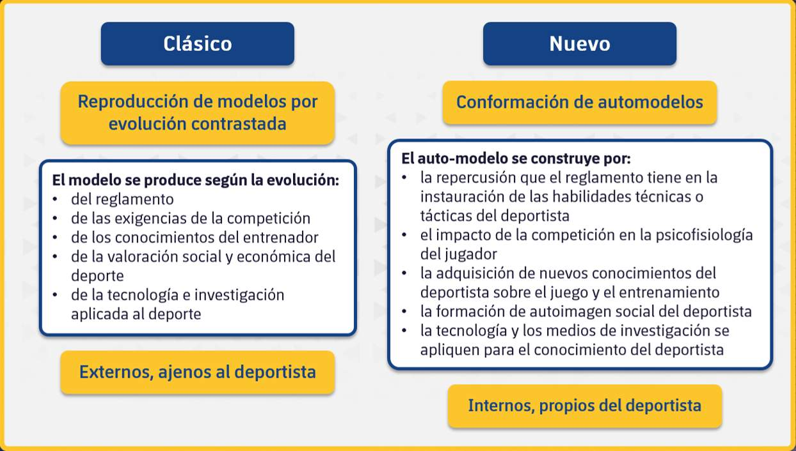

Source : Seirul·lo, 2017, p. 29.

La proposition méthodologique du FCB, basée en partie sur ce qui est proposé par les Théories des Systèmes Dynamiques, fonde son application pratique sur sa variabilité. Cette variabilité exprime la flexibilité des systèmes pour être en mesure de s’ajuster, de sélectionner ou de changer à de nouveaux modèles et, par conséquent, de s’adapter aux changements.

**Adaptation aux nouvelles propositions des entraîneurs**

Comme mentionné dans le module précédent, les instructions et les commentaires reçus par les athlètes font partie des changements qui ont commencé à être appliqués à l’entraînement sur la base de la proposition méthodologique. Claramunt et Balagué (2010, 2011) soutiennent que la rétroaction permanente peut générer des effets négatifs sur les athlètes entraînés et non entraînés. La définition des paramètres d’une technique idéale, probablement héritée des méthodologies d’entraînement des sports individuels, peut interférer avec les structures de coordination de certains joueurs. Les instructions sont fréquemment utilisées lorsque les athlètes ne se conforment pas aux schémas de mouvement souhaités, Claramunt et Balagué (2010) soutiennent que cela ne génère pas chez l’athlète la possibilité d’auto-organisation dont il a besoin pour sa propre analyse et prise de décision.

Comme il existe des modèles préétablis sur les schémas de mouvement dans chacun des sports, ce qui a été essayé de faire au fil des ans, c’est d’amener progressivement les athlètes vers ces paramètres en tant qu’objectif dans la proposition d’entraînement. Dans ce cas, le concept de l’individualité de l’athlète est perdu ou mal compris, entre autres, tandis que des solutions variées et créatives sont rejetées.

Dans le cadre d’un team building efficace, la variabilité des ressources individuelles augmente les chances d’efficacité, mais ce n’est pas le cas lorsque les équipes répondent aux mêmes schémas idéaux. Cette variabilité signifie que les mêmes mouvements ne se produisent jamais (que ce soit individuellement ou en groupe). Ceci, bien qu’il puisse sembler complexe pour son analyse, génère la survie dans des contextes de caractéristiques changeantes tels que les sports d’équipe et augmente les réponses résolues possibles.

Ci-dessous, certaines des caractéristiques d’identification du Futbol Club Barcelona basées sur sa proposition de formation seront détaillées.

**Les composants d’identification de FB**

Haute qualité technique individuelle et collective :

- Contact permanent avec le ballon dès la phase d’initiation.

- Travaillez sur les variables de coordination (avec et sans ballon).

- Travailler sur le contenu technique (Quoi ?) lors des différentes étapes du processus de formation (Quand ?).

- Clarté permanente des concepts et des slogans (Comment ?) pour l’amélioration de tous les contenus techniques.

- Pourquoi? Historiquement, le jeu du FCB a été associé à l’excellence technique, à la plasticité et au spectacle.

**Occupation rationnelle des espaces sur le terrain :**

- On parle de la situation des acteurs dans les zones de couloir.

- Pendant la phase de possession, le terrain devient toujours plus grand. Avec le ballon, faites toujours un pas en arrière.

- Pendant la phase de récupération, les places sont toujours réduites. Sans le ballon, toujours un pas en avant.

- Formation permanente de triangles pour réaliser :  
  > - En phase de possession : améliorer le soutien et progresser dans le jeu.  
  > - En phase de récupération : améliorer l’efficacité de la récupération.

- Toujours de courtes distances entre les joueurs et entre eux par rapport au ballon (espaces d’intervention, d’entraide et de coopération).

**Figure 2 : Organisation positionnelle 1**

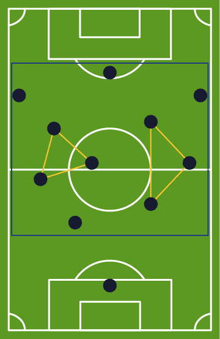

Source : Création de l’auteur.

Les 3 P : Le jeu du Futbol Club Barcelona repose sur trois concepts fondamentaux.

- Position : Situation et emplacement des joueurs sur le terrain.

- Possession : liée au sentiment de protection du ballon.

- Pression : Récupération immédiate de la balle après qu’elle ait été perdue.

La relation entre ces 3 termes est significative en ce sens que : La position des joueurs sur le terrain de jeu leur permet d’améliorer l’efficacité en possession et la récupération du ballon. Cela permet et génère la possibilité d’avoir le ballon pour profiter et jouer. La prémisse ultime de FCB.

**Sens de la protection du ballon :**

*L’équipe qui a le ballon possède le jeu*

**Figure 3 : Organisation positionnelle 2**

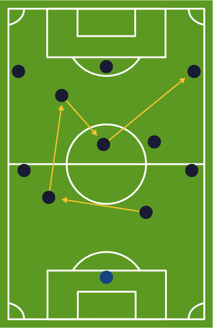

Source : Création de l’auteur.

Le jeu du FCB repose sur deux prémisses :

- 1

Ne perdez pas le ballon.

- 2

Ne perdez pas votre position.

À cela s’ajoute l’alternance du petit et du long gibier (regarder de près et regarder loin).

- 3

La supériorité dans le nombre de passes courtes génère de la pression de la part de l’équipe adverse et des revirements.

- 4

La supériorité des longues passes conduit à des turnovers constants (diminue la précision).

**Mobilité des joueurs sans ballon :**

**Figure 4 : Organisation positionnelle 3, mobilisation hors ballon**

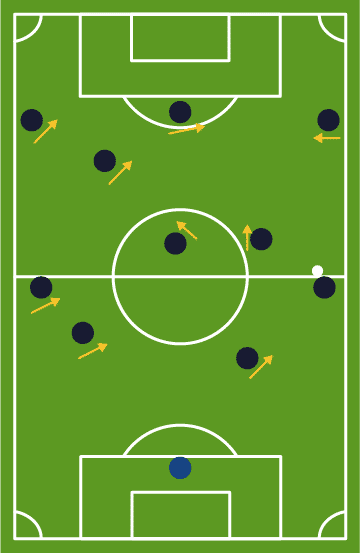

Source : Création de l’auteur.

On parle de la trajectoire des joueurs (appuis et démarquage) pour :

- Créez, occupez et profitez d’espaces libres.

- Aidez le possesseur et progressez dans le jeu.

Objectifs:

- La balle doit être reçue dans des conditions optimales pour pouvoir être jouée.

- Faites en sorte qu’il soit plus facile pour le coéquipier qui a le ballon de faire le meilleur choix.

- Faciliter les actions conjointes de l’équipe pendant la phase de possession.

- Entraver les actions offensives de l’équipe adverse.

La mobilité n’est pas synonyme de courir plus que nécessaire, l’important n’est pas de courir pour le plaisir de courir, mais de savoir courir. L’objectif est d’optimiser les mouvements et les trajectoires du joueur.

**Unité fonctionnelle de tous les joueurs en tant qu’équipe**

À cet égard, il est fait référence au fait que :

- Quand vous avez le ballon, toute l’équipe joue et en profite.

- Quand vous n’avez pas le ballon, toute l’équipe est prête à le récupérer le plus rapidement possible.

L’équipe doit être comprise comme une somme de travail entre chacun des joueurs. Par conséquent, le jeu est compris comme un processus continu et non fragmenté (continuum de complexité).

**Figure 5 : Directionnalité**

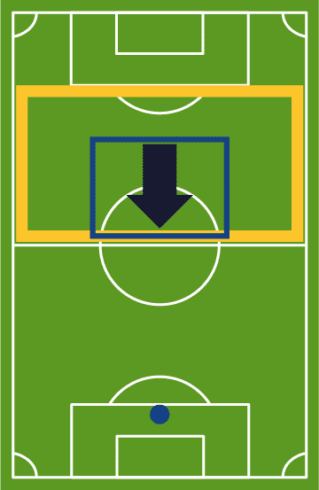

Source : Création de l’auteur.

**Interprétation et compréhension du jeu**  
Apprendre à regarder, à percevoir et à décider (cognition).

- Perception et gestion des espaces (E).

- Gestion du temps (T) et contrôle du rythme de jeu.

- Identifier et interpréter la situation de jeu (coéquipiers, adversaires, ballon et intentions).

Des actions ou des exécutions efficaces et efficientes.

- Suivi et évaluation des actions.

- Clarté dans les concepts avant, pendant et après.

Sur la base de ce qui a été travaillé jusqu’à présent, on peut dire que les fondements du jeu du FCB sont basés sur :

**Figure 6 : Dimensions du jeu FCB**

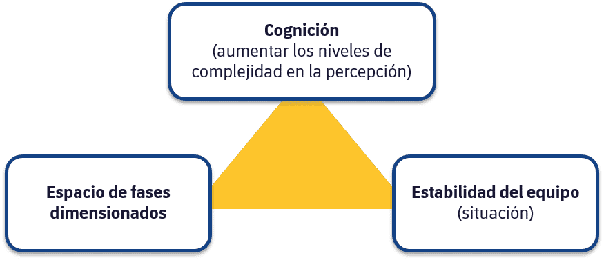

Source : Création de l’auteur.

Comme mentionné dans le tableau précédent, la cognition est liée à l’augmentation des niveaux de complexité de la perception.

**Figure 7 : Perception** 

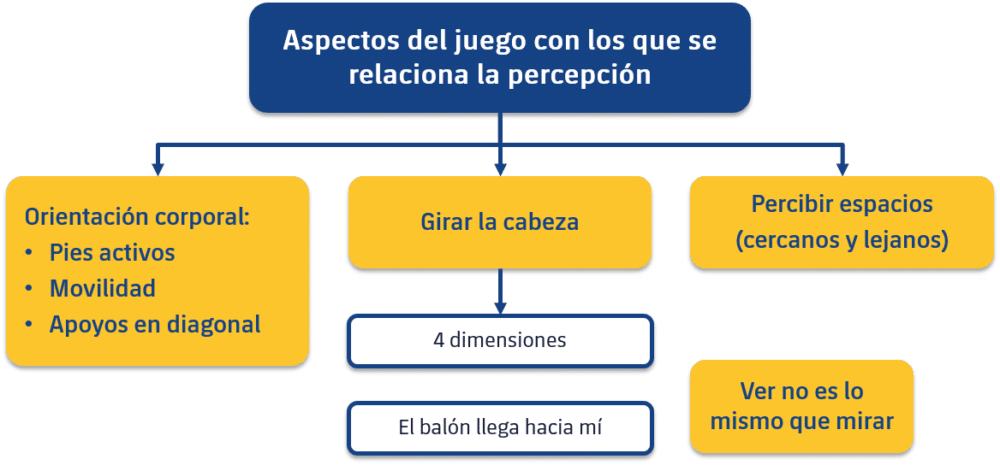

Source : Création de l’auteur.

**1. Cognition**

Tourner la tête : cela vous permet de collecter des informations sur les espaces, les compagnons et les adversaires qui n’entrent pas dans le plan de vision en raison de l’orientation du corps. La périphérie entre en 4 dimensions.

**Figure 8 : Dimensions de la perception**

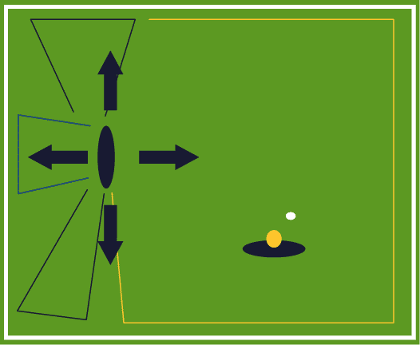

Source : Création de l’auteur.

**Regard :** profil, orientation du corps, tête et yeux avec l’intention d’élargir le champ visuel.

**Percevoir** : dans ce cas, les situations doivent être détectées ; espaces de proximité (espaces d’entraide) ; Espaces distants (espaces de coopération).

**Comprendre les situations** : regard fixe, vision périphérique. Détectez les espaces qui s’ouvrent et se ferment. Anticipez les actions ultérieures.

**Décider :** l’option la mieux reconnue pour notre équipe.

Avant que le ballon ne soit mis en jeu, le joueur en possession doit avoir déjà perçu toutes ces informations. C’est là que commence le continuum de la complexité.

**Action:** On s’attend à ce que l’action soit efficace et efficiente. La communication entre le porteur du ballon et le receveur est optimisée.

**Figure 9 : Perception et distribution sur le terrain**

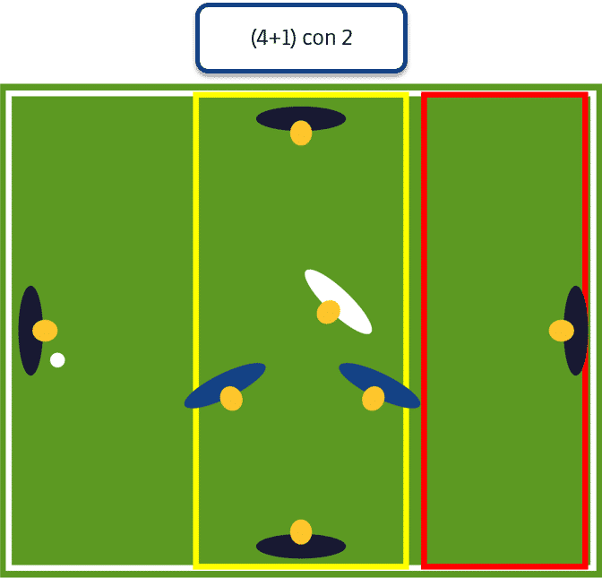

Source : Création de l’auteur.

La zone où le receveur a la plus grande maîtrise perceptuelle est marquée en jaune, ce qui, si ces variables sont entraînées, permettra d’obtenir un meilleur contrôle de la balle. La zone sous laquelle il n’y a pas de perception est marquée en rouge, et cela dépendra du travail collectif des collègues. Ceux-ci, avec leur orientation corporelle, fournissent également des informations au receveur afin qu’il puisse interpréter s’il peut ou non jouer dans la zone rouge.

**Concentration permanente sur le jeu**

Bien que le concept de possession soit détaillé au cours des thématiques, c’est l’une des variables que le FCB a le plus développées au fil des ans et pour laquelle il consacre son étude à sa proposition méthodologique ultérieure.

Pendant la phase de possession, il y a trois moments dont les joueurs doivent être conscients :

**Avant de posséder le ballon** : Les étapes de ce processus forment ce que l’on appelle la cognition complexe (regarder, percevoir, analyser, anticiper et décider de ce qui doit être fait).

**Pendant (moment de contact avec le ballon) :** à ce stade, l’exécution doit être efficace et efficiente. C’est le passage du receveur au possesseur et la relation entre l’action technique que le joueur effectue et le ballon.

**Après le contact avec le ballon : la** mobilité est le passage du possesseur à un nouveau receveur potentiel. Donnez le ballon.

**Figure 10 : Répartition sur le terrain de jeu**

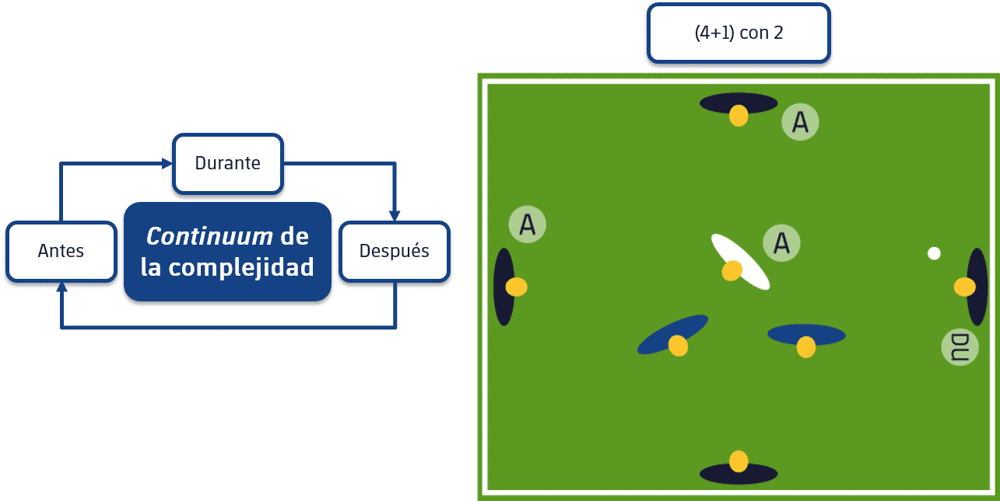

Source : Création de l’auteur.

**2. Espaces de phase cotés**  
Espaces : surface du champ à occuper sur la longueur et la largeur du champ.

- Intervention.

- Entraide.

- Coopération.

Phase : possession (avec le ballon) – récupération (sans ballon).

Dimensionné : les dimensions données à chacun de ces espaces.

**Figure 11 : Intervention, entraide et coopération**

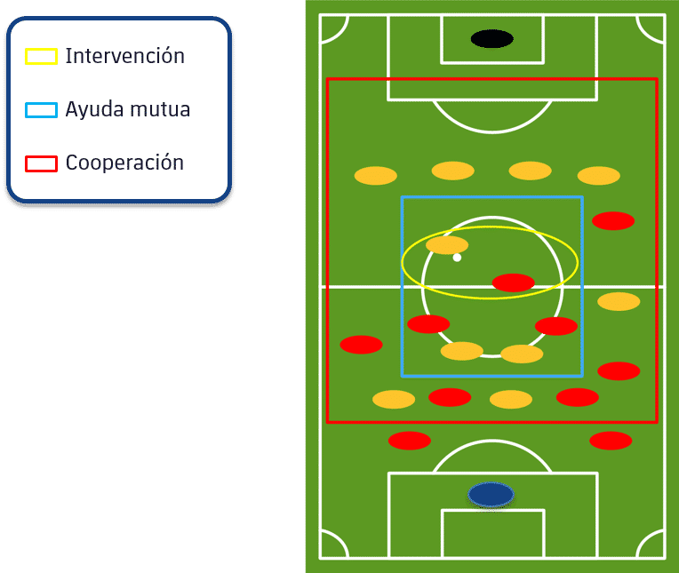

Source : Création de l’auteur.

**1. Stabilité de l’équipe (situation)**

Stabilité:

- L’emplacement et la situation des joueurs et du ballon sur le terrain.

- La distance entre les joueurs et entre eux et le ballon.

- Les trajectoires des joueurs et du ballon.

- L’orientation des joueurs et du jeu.

- L’organisation de toutes les composantes de l’équipe pour atteindre la supériorité à chaque moment du jeu par rapport à l’équipe adverse.

Réorganisation de l’équipe :

- L’organisation de l’équipe doit être construite avec les informations de l’entraîneur ainsi que les critères spécifiques décidés par certains joueurs lorsqu’un inconvénient particulier survient, pour revenir à l’organisation prescrite.

**Figure 12 : Réorganisation des positions**

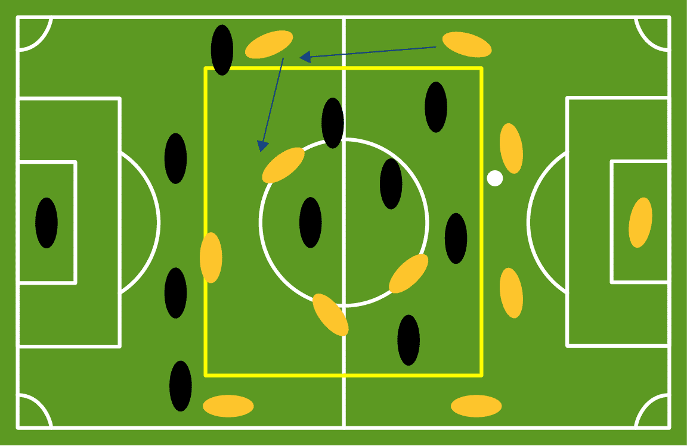

Source : Création de l’auteur.

**Participation individuelle et collective :**

*Le ballon court toujours plus vite que le joueur*

Il y est question de :

- Les trajectoires et la circulation de la balle : dans les airs ou au sol. Passer, contrôler, conduire, dribbler, tirer. Tous les slogans considérés comme importants.

- Communication entre les membres de l’équipe : quand ? Comment? Où? Où ça? Pourquoi et pour quoi faire ? Dans quel but ? Ces intentions doivent être détectées par les coéquipiers, en fonction des organisations prescrites par l’entraîneur et l’équipe elle-même.

Objectif : Dominer le jeu en créant une supériorité sur l’équipe adverse.

**Les qualités individuelles sont toujours au service de l’équipe :**

- Il ne devrait pas y avoir d’égoïsme dans une équipe.

- Le sens de l’équipe et de la collectivité doit prévaloir.

- La contribution personnelle est à l’équipe.

- Le talent de chaque joueur est intégré dans le collectif.
