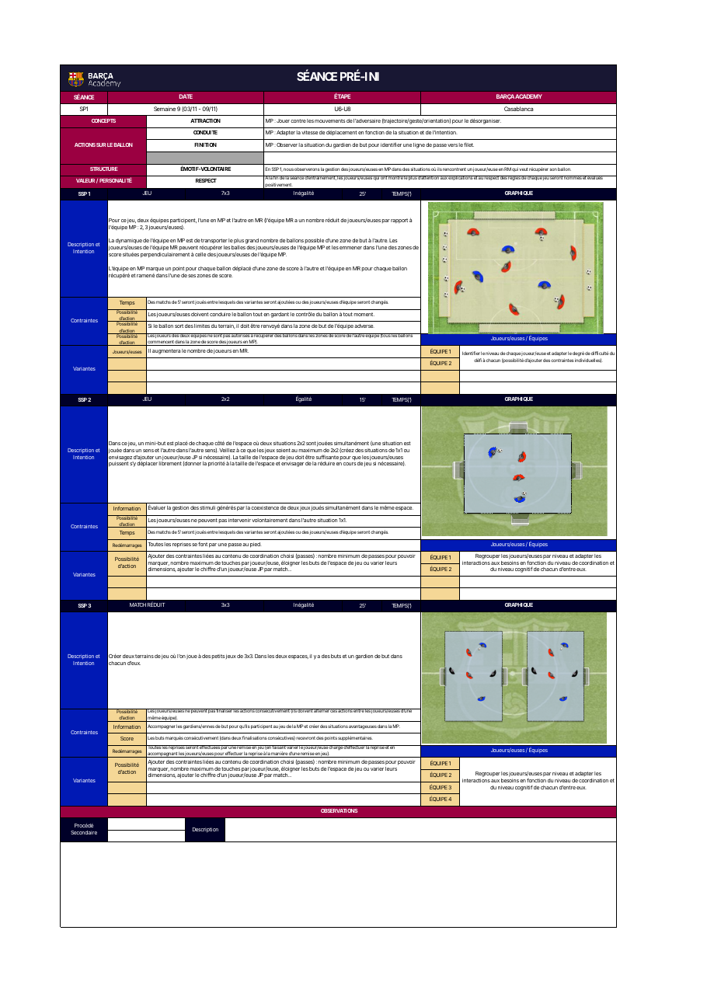

# Fiche de séance — semaine-09 SP2

PDF original : [pdf/semaine-09_SP2.pdf](pdf/semaine-09_SP2.pdf)



## Texte intégral de la fiche

```text
                                                                                                                   SÉANCE PRÉ-INI
  SÉANCE                                              DATE                                                                             ÉTAPE                                                                           BARÇA ACADEMY

     SP1                                   Semaine 9 (03/11 - 09/11)                                                                   U6-U8                                                                                Casablanca
            CONCEPTS                                        ATTRACTION                             MP : Jouer contre les mouvements de l'adversaire (trajectoire/geste/orientation) pour le désorganiser.

                                                             CONDUITE                              MP : Adapter la vitesse de déplacement en fonction de la situation et de l'intention.

  ACTIONS SUR LE BALLON                                       FINITION                             MP : Observer la situation du gardien de but pour identifier une ligne de passe vers le filet.

           STRUCTURE                                   ÉMOTIF-VOLONTAIRE                           En SSP 1, nous observerons la gestion des joueurs/euses en MP dans des situations où ils rencontrent un joueur/euse en RM qui veut récupérer son ballon.
                                                                                                   A la fin de la séance d'entraînement, les joueurs/euses qui ont montré le plus d'attention aux explications et au respect des règles de chaque jeu seront nommés et évalués
   VALEUR / PERSONALITÉ                                       RESPECT
                                                                                                   positivement.

    SSP 1                            JEU                                    7x3                                  Inégalité                          25'              TEMPS(')                                               GRAPHIQUE

                 Pour ce jeu, deux équipes participent, l'une en MP et l'autre en MR (l'équipe MR a un nombre réduit de joueurs/euses par rapport à
                 l'équipe MP : 2, 3 joueurs/euses).

                 La dynamique de l'équipe en MP est de transporter le plus grand nombre de ballons possible d'une zone de but à l'autre. Les
Description et
                 joueurs/euses de l'équipe MR peuvent récupérer les balles des joueurs/euses de l'équipe MP et les emmener dans l'une des zones de
  Intention
                 score situées perpendiculairement à celle des joueurs/euses de l'équipe MP.

                 L'équipe en MP marque un point pour chaque ballon déplacé d'une zone de score à l'autre et l'équipe en MR pour chaque ballon
                 récupéré et ramené dans l'une de ses zones de score.

                        Temps         Des matchs de 5' seront joués entre lesquels des variantes seront ajoutées ou des joueurs/euses d'équipe seront changés.

                       Possibilité    Les joueurs/euses doivent conduire le ballon tout en gardant le contrôle du ballon à tout moment.
 Contraintes            d'action
                       Possibilité    Si le ballon sort des limites du terrain, il doit être renvoyé dans la zone de but de l'équipe adverse.
                        d'action
                       Possibilité    Les joueurs des deux équipes ne sont pas autorisés à récupérer des ballons dans les zones de score de l'autre équipe (tous les ballons
                                                                                                                                                                                                                     Joueurs/euses / Équipes
                        d'action      commencent dans la zone de score des joueurs en MP).

                  Joueurs/euses       Il augmentera le nombre de joueurs en MR.                                                                                                       ÉQUIPE 1        Identifier le niveau de chaque joueur/euse et adapter le degré de difficulté du
                                                                                                                                                                                                            défi à chacun (possibilité d'ajouter des contraintes individuelles).
                                                                                                                                                                                      ÉQUIPE 2
  Variantes

    SSP 2                            JEU                                    2x2                                    Égalité                          15'              TEMPS(')                                               GRAPHIQUE

                 Dans ce jeu, un mini-but est placé de chaque côté de l'espace où deux situations 2x2 sont jouées simultanément (une situation est
Description et   jouée dans un sens et l'autre dans l'autre sens). Veillez à ce que les jeux soient au maximum de 2x2 (créez des situations de 1x1 ou
  Intention      envisagez d'ajouter un joueur/euse JP si nécessaire). La taille de l'espace de jeu doit être suffisante pour que les joueurs/euses
                 puissent s'y déplacer librement (donner la priorité à la taille de l'espace et envisager de la réduire en cours de jeu si nécessaire).

                   Information        Évaluer la gestion des stimuli générés par la coexistence de deux jeux joués simultanément dans le même espace.
                       Possibilité    Les joueurs/euses ne peuvent pas intervenir volontairement dans l'autre situation 1x1.
 Contraintes            d'action
                        Temps         Des matchs de 5' seront joués entre lesquels des variantes seront ajoutées ou des joueurs/euses d'équipe seront changés.

                  Redémarrages        Toutes les reprises se font par une passe au pied.                                                                                                                             Joueurs/euses / Équipes

                                      Ajouter des contraintes liées au contenu de coordination choisi (passes) : nombre minimum de passes pour pouvoir                                ÉQUIPE 1              Regrouper les joueurs/euses par niveau et adapter les
                   Possibilité
                                      marquer, nombre maximum de touches par joueur/euse, éloigner les buts de l'espace de jeu ou varier leurs                                                        interactions aux besoins en fonction du niveau de coordination et
                    d'action
                                      dimensions, ajouter le chiffre d'un joueur/euse JP par match...                                                                                 ÉQUIPE 2                    du niveau cognitif de chacun d'entre eux.
  Variantes

    SSP 3                    MATCH RÉDUIT                                   3x3                                  Inégalité                          25'              TEMPS(')                                               GRAPHIQUE

Description et   Créer deux terrains de jeu où l'on joue à des petits jeux de 3x3. Dans les deux espaces, il y a des buts et un gardien de but dans
  Intention      chacun d'eux.

                       Possibilité    Les joueurs/euses ne peuvent pas finaliser les actions consécutivement (ils doivent alterner ces actions entre les joueurs/euses d'une
                        d'action      même équipe).

                   Information        Accompagner les gardiens/ennes de but pour qu'ils participent au jeu de la MP et créer des situations avantageuses dans la MP.
 Contraintes
                         Score        Les buts marqués consécutivement (dans deux finalisations consécutives) recevront des points supplémentaires.
                                      Toutes les reprises seront effectuées par une remise en jeu (en faisant varier le joueur/euse chargé d'effectuer la reprise et en
                  Redémarrages                                                                                                                                                                                       Joueurs/euses / Équipes
                                      accompagnant les joueurs/euses pour effectuer la reprise à la manière d'une remise en jeu).
                                      Ajouter des contraintes liées au contenu de coordination choisi (passes) : nombre minimum de passes pour pouvoir                                ÉQUIPE 1
                   Possibilité
                                      marquer, nombre maximum de touches par joueur/euse, éloigner les buts de l'espace de jeu ou varier leurs
                    d'action                                                                                                                                                                                Regrouper les joueurs/euses par niveau et adapter les
                                      dimensions, ajouter le chiffre d'un joueur/euse JP par match...                                                                                 ÉQUIPE 2
  Variantes                                                                                                                                                                                           interactions aux besoins en fonction du niveau de coordination et
                                                                                                                                                                                      ÉQUIPE 3                    du niveau cognitif de chacun d'entre eux.

                                                                                                                                                                                      ÉQUIPE 4

                                                                                                                                OBSERVATIONS

  Procédé
                                                             Description
 Secondaire
```
