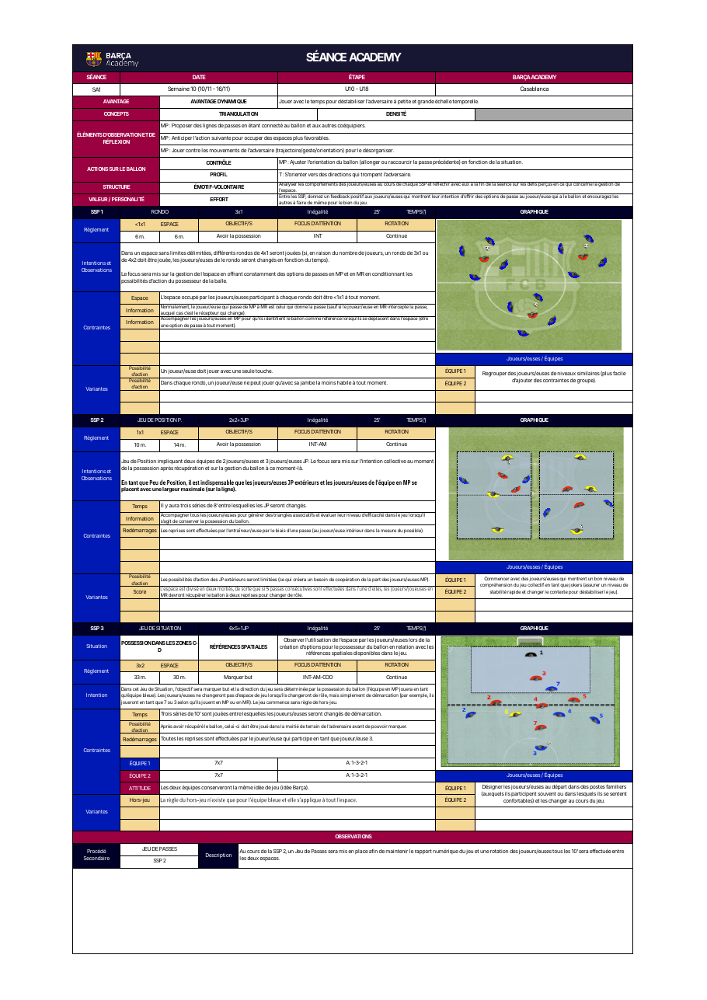

# Fiche de séance — semaine-10 SA1

PDF original : [pdf/semaine-10_SA1.pdf](pdf/semaine-10_SA1.pdf)



## Texte intégral de la fiche

```text
                                                                                                                SÉANCE ACADEMY
   SÉANCE                                               DATE                                                                         ÉTAPE                                                                          BARÇA ACADEMY

     SA1                                      Semaine 10 (10/11 - 16/11)                                                           U10 - U18                                                                            Casablanca

             AVANTAGE                                   AVANTAGE DYNAMIQUE                         Jouer avec le temps pour déstabiliser l'adversaire à petite et grande échelle temporelle.

             CONCEPTS                                                TRIANGULATION                                                                      DENSITÉ

                                        MP : Proposer des lignes de passes en étant connecté au ballon et aux autres coéquipiers.
ÉLÉMENTS D'OBSERVATION ET DE
                                        MP : Anticiper l'action suivante pour occuper des espaces plus favorables.
         RÉFLEXION
                                        MP : Jouer contre les mouvements de l'adversaire (trajectoire/geste/orientation) pour le désorganiser.

                                                               CONTRÔLE                            MP : Ajuster l'orientation du ballon (allonger ou raccourcir la passe précédente) en fonction de la situation.
   ACTIONS SUR LE BALLON
                                                                PROFIL                             T : S'orienter vers des directions qui trompent l'adversaire.
                                                                                                   Analyser les comportements des joueurs/euses au cours de chaque SSP et réfléchir avec eux à la fin de la séance sur les défis perçus en ce qui concerne la gestion de
           STRUCTURE                                     ÉMOTIF-VOLONTAIRE
                                                                                                   l'espace.
                                                                                                   Entre les SSP, donnez un feedback positif aux joueurs/euses qui montrent leur intention d'offrir des options de passe au joueur/euse qui a le ballon et encouragez les
    VALEUR / PERSONALITÉ                                        EFFORT
                                                                                                   autres à faire de même pour le bien du jeu.
     SSP 1                            RONDO                                  3x1                                 Inégalité                        25'             TEMPS(')                                              GRAPHIQUE

                           <1x1         ESPACE                          OBJECTIF/S                        FOCUS D'ATTENTION                             ROTATION
  Règlement
                           6 m.                 6 m.               Avoir la possession                              INT                                 Continue

                  Dans un espace sans limites délimitées, différents rondos de 4x1 seront jouées (si, en raison du nombre de joueurs, un rondo de 3x1 ou
                  de 4x2 doit être jouée, les joueurs/euses de le rondo seront changés en fonction du temps).
 Intentions et
 Observations
                  Le focus sera mis sur la gestion de l'espace en offrant constamment des options de passes en MP et en MR en conditionnant les
                  possibilités d'action du possesseur de la balle.

                         Espace         L'espace occupé par les joueurs/euses participant à chaque rondo doit être <1x1 à tout moment.
                                        Normalement, le joueur/euse qui passe de MP à MR est celui qui donne la passe (sauf si le joueur/euse en MR intercepte la passe,
                    Information         auquel cas c'est le récepteur qui change).
                                        Accompagner les joueurs/euses en MP pour qu'ils identifient le ballon comme référence lorsqu'ils se déplacent dans l'espace (être
                    Information         une option de passe à tout moment).
  Contraintes

                                                                                                                                                                                                                 Joueurs/euses / Équipes
                        Possibilité
                                        Un joueur/euse doit jouer avec une seule touche.                                                                                           ÉQUIPE 1
                         d'action                                                                                                                                                                     Regrouper des joueurs/euses de niveaux similaires (plus facile
                        Possibilité
                                        Dans chaque rondo, un joueur/euse ne peut jouer qu'avec sa jambe la moins habile à tout moment.                                                                          d'ajouter des contraintes de groupe).
                                                                                                                                                                                   ÉQUIPE 2
   Variantes             d'action

    SSP 2                   JEU DE POSITION P.                            2x2+3JP                                Inégalité                        25'             TEMPS(')                                              GRAPHIQUE

                           1x1          ESPACE                          OBJECTIF/S                        FOCUS D'ATTENTION                             ROTATION
  Règlement
                          10 m.                 14 m.              Avoir la possession                           INT-AM                                 Continue

                  Jeu de Position impliquant deux équipes de 2 joueurs/euses et 3 joueurs/euses JP. Le focus sera mis sur l'intention collective au moment
                  de la possession après récupération et sur la gestion du ballon à ce moment-là.
 Intentions et
 Observations
                  placent avec une largeur maximale (sur la ligne).

                         Temps          Il y aura trois séries de 8' entre lesquelles les JP seront changés.
                                        Accompagner tous les joueurs/euses pour générer des triangles associatifs et évaluer leur niveau d'efficacité dans le jeu lorsqu'il
                    Information         s'agit de conserver la possession du ballon.

                   Redémarrages Les reprises sont effectuées par l'entraîneur/euse par le biais d'une passe (au joueur/euse intérieur dans la mesure du possible).
  Contraintes

                                                                                                                                                                                                                 Joueurs/euses / Équipes
                        Possibilité                                                                                                                                                                   Commencer avec des joueurs/euses qui montrent un bon niveau de
                                        Les possibilités d'action des JP extérieurs seront limitées (ce qui créera un besoin de coopération de la part des joueurs/euses MP).      ÉQUIPE 1
                         d'action                                                                                                                                                                   compréhension du jeu collectif en tant que jokers (assurer un niveau de
                          Score         MR devront récupérer le ballon à deux reprises pour changer de rôle.
                                                                                                                                                                                   ÉQUIPE 2             stabilité rapide et changer le contexte pour déstabiliser le jeu).
   Variantes

    SSP 3                    JEU DE SITUATION                             6x5+1JP                                Inégalité                        25'             TEMPS(')                                              GRAPHIQUE

                                                                                                     Observer l'utilisation de l'espace par les joueurs/euses lors de la
                  POSSESSION DANS LES ZONES C-
   Situation                                                    RÉFÉRENCES SPATIALES               création d'options pour le possesseur du ballon en relation avec les
                               D
                                                                                                               références spatiales disponibles dans le jeu.

                           3x2          ESPACE                          OBJECTIF/S                        FOCUS D'ATTENTION                             ROTATION
  Règlement
                          33 m.                 30 m.                   Marquer but                            INT-AM-COO                               Continue

                  Dans cet Jeu de Situation, l'objectif sera marquer but et la direction du jeu sera déterminée par la possession du ballon (l'équipe en MP jouera en tant
   Intention      qu'équipe bleue). Les joueurs/euses ne changeront pas d'espace de jeu lorsqu'ils changeront de rôle, mais simplement de démarcation (par exemple, ils
                  joueront en tant que 7 ou 3 selon qu'ils jouent en MP ou en MR). Le jeu commence sans règle de hors-jeu.

                         Temps          Trois séries de 10' sont jouées entre lesquelles les joueurs/euses seront changés de démarcation.
                        Possibilité
                                        Après avoir récupéré le ballon, celui-ci doit être joué dans la moitié de terrain de l'adversaire avant de pouvoir marquer.
                         d'action
                   Redémarrages Toutes les reprises sont effectuées par le joueur/euse qui participe en tant que joueur/euse 3.

  Contraintes

                        ÉQUIPE 1                                  7x7                                                               A: 1-3-2-1

                        ÉQUIPE 2                                  7x7                                                               A: 1-3-2-1                                                                   Joueurs/euses / Équipes

                        ATTITUDE        Les deux équipes conserveront la même idée de jeu (idée Barça).                                                                            ÉQUIPE 1           Désigner les joueurs/euses au départ dans des postes familiers
                                                                                                                                                                                                     (auxquels ils participent souvent ou dans lesquels ils se sentent
                        Hors-jeu                                                                                                                                                   ÉQUIPE 2                    confortables) et les changer au cours du jeu.

   Variantes

                                                                                                                              OBSERVATIONS

                              JEU DE PASSES
   Procédé                                                                     Au cours de la SSP 2, un Jeu de Passes sera mis en place afin de maintenir le rapport numérique du jeu et une rotation des joueurs/euses tous les 10' sera effectuée entre
                                                              Description
  Secondaire                          SSP 2                                    les deux espaces.
```
