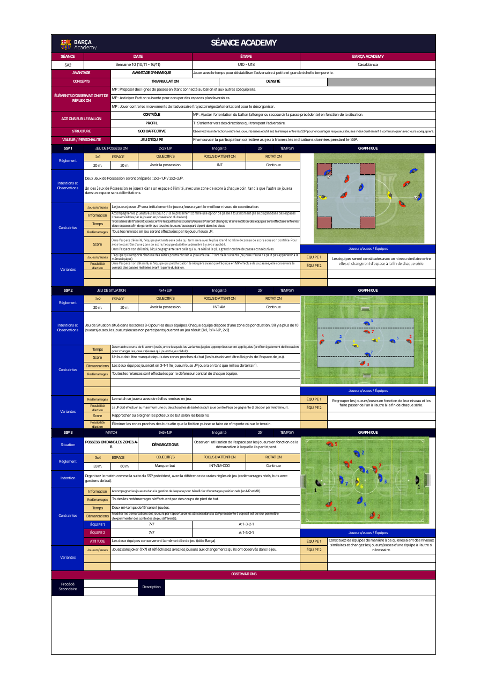

# Fiche de séance — semaine-10 SA2

PDF original : [pdf/semaine-10_SA2.pdf](pdf/semaine-10_SA2.pdf)



## Texte intégral de la fiche

```text
                                                                                                                  SÉANCE ACADEMY
   SÉANCE                                               DATE                                                                            ÉTAPE                                                                          BARÇA ACADEMY

     SA2                                  Semaine 10 (10/11 - 16/11)                                                                  U10 - U18                                                                            Casablanca
             AVANTAGE                                  AVANTAGE DYNAMIQUE                           Jouer avec le temps pour déstabiliser l'adversaire à petite et grande échelle temporelle.

             CONCEPTS                                                TRIANGULATION                                                                         DENSITÉ

                                        MP : Proposer des lignes de passes en étant connecté au ballon et aux autres coéquipiers.
ÉLÉMENTS D'OBSERVATION ET DE
                             MP : Anticiper l'action suivante pour occuper des espaces plus favorables.
         RÉFLEXION
                                        MP : Jouer contre les mouvements de l'adversaire (trajectoire/geste/orientation) pour le désorganiser.

                                                               CONTRÔLE                             MP : Ajuster l'orientation du ballon (allonger ou raccourcir la passe précédente) en fonction de la situation.
    ACTIONS SUR LE BALLON
                                                                 PROFIL                             T : S'orienter vers des directions qui trompent l'adversaire.

           STRUCTURE                                       SOCIOAFFECTIVE                           Observez les interactions entre les joueurs/euses et utilisez les temps entre les SSP pour encourager les joueurs/euses individuellement à communiquer avec leurs coéquipiers.

    VALEUR / PERSONALITÉ                                     JEU D'ÉQUIPE                           Promouvoir la participation collective au jeu à travers les indications données pendant le SSP.

     SSP 1                 JEU DE POSSESSION                               2x2+1JP                                 Inégalité                         25'                TEMPS(')                                           GRAPHIQUE

                           2x1          ESPACE                           OBJECTIF/S                         FOCUS D'ATTENTION                              ROTATION
  Règlement
                          20 m.               20 m.                 Avoir la possession                               INT                                  Continue

                  Deux Jeux de Possession seront préparés : 2x2+1JP / 2x2+2JP.
 Intentions et
 Observations
                  dans un espace sans délimitations.

                   Joueurs/euses        Le joueur/euse JP sera initialement le joueur/euse ayant le meilleur niveau de coordination.

                    Information         libres et visibles par le joueur en possession du ballon).
                                        Trois séries de 8' seront jouées, entre lesquelles les joueurs/euses JP seront changés, et une rotation des équipes sera effectuée entre les
                         Temps          deux espaces afin de garantir que tous les joueurs/euses participent dans les deux.
  Contraintes
                   Redémarrages         Tous les remises en jeu seront effectuées par le joueur/euse JP.

                          Score
                                                                                                                                                                                                                    Joueurs/euses / Équipes

                   Joueurs/euses
                                        même équipe.)
                                                                                                                                                                                       ÉQUIPE 1         Les équipes seront constituées avec un niveau similaire entre
                        Possibilité
                                        compte des passes réalisées avant la perte du ballon.
                                                                                                                                                                                       ÉQUIPE 2
   Variantes             d'action

     SSP 2                   JEU DE SITUATION                              4x4+2JP                                 Inégalité                         25'                TEMPS(')                                           GRAPHIQUE

                           2x2          ESPACE                           OBJECTIF/S                         FOCUS D'ATTENTION                              ROTATION
  Règlement
                          20 m.               20 m.                 Avoir la possession                             INT-AM                                 Continue

 Intentions et    Jeu de Situation situé dans les zones B-C pour les deux équipes. Chaque équipe dispose d'une zone de ponctuation. S'il y a plus de 10
 Observations     joueurs/euses, les joueurs/euses non participants joueront un jeu réduit (1x1, 1x1+1JP, 2x2).

                                        Des matchs courts de 6' seront joués, entre lesquels les variantes jugées appropriées seront appliquées (profiter également de l'occasion
                         Temps          pour changer les joueurs/euses qui jouent le jeu réduit).

                          Score         Un but doit être marqué depuis des zones proches du but (les buts doivent être éloignés de l'espace de jeu).

                   Démarcations Les deux équipes joueront en 3-1-1 (le joueur/euse JP jouera en tant que milieu de terrain).
  Contraintes
                   Redémarrages         Toutes les relances sont effectuées par le défenseur central de chaque équipe.

                                                                                                                                                                                                                    Joueurs/euses / Équipes

                   Redémarrages         Le match se jouera avec de réelles remises en jeu.                                                                                             ÉQUIPE 1         Regrouper les joueurs/euses en fonction de leur niveau et les
                        Possibilité     Le JP doit effectuer au maximum une ou deux touches de balle lorsqu'il joue contre l'équipe gagnante (à décider par l'entraîneur).
                                                                                                                                                                                                            faire passer de l'un à l'autre à la fin de chaque série.
                                                                                                                                                                                       ÉQUIPE 2
   Variantes             d'action
                          Score         Rapprocher ou éloigner les poteaux de but selon les besoins.
                        Possibilité     Éliminer les zones proches des buts afin que la finition puisse se faire de n'importe où sur le terrain.
                         d'action
     SSP 3                            MATCH                                6x6+1JP                                 Inégalité                         25'                TEMPS(')                                           GRAPHIQUE

                  POSSESSION DANS LES ZONES A-                                                       Observer l'utilisation de l'espace par les joueurs en fonction de la
   Situation                                                          DÉMARCATIONS
                               B                                                                                    démarcation à laquelle ils participent.

                           3x4          ESPACE                           OBJECTIF/S                         FOCUS D'ATTENTION                              ROTATION
  Règlement
                          33 m.               60 m.                      Marquer but                             INT-AM-COO                                Continue

                  Organisez le match comme la suite du SSP précédent, avec la différence de vraies règles de jeu (redémarrages réels, buts avec
   Intention
                  gardiens de but).

                    Information         Accompagner les joueurs dans la gestion de l'espace pour bénéficier d'avantages positionnels (en MP et MR).

                   Redémarrages         Toutes les redémarrages s'effectuent par des coups de pied de but.

                         Temps          Deux mi-temps de 15' seront jouées.
                                        Modifier les démarcations des joueurs par rapport à celles utilisées dans la SSP précédente (l'objectif est de leur permettre
  Contraintes      Démarcations d'expérimenter des contextes de jeu différents).

                        ÉQUIPE 1                                   7x7                                                                 A: 1-3-2-1

                        ÉQUIPE 2                                   7x7                                                                 A: 1-3-2-1                                                                   Joueurs/euses / Équipes

                        ATTITUDE        Les deux équipes conserveront la même idée de jeu (idée Barça).                                                                                ÉQUIPE 1       Constituez les équipes de manière à ce qu'elles aient des niveaux
                                                                                                                                                                                                       similaires et changez les joueurs/euses d'une équipe à l'autre si
                   Joueurs/euses        Jouez sans joker (7x7) et réfléchissez avec les joueurs aux changements qu'ils ont observés dans le jeu.                                       ÉQUIPE 2                                   nécessaire.

   Variantes

                                                                                                                                 OBSERVATIONS

   Procédé
                                                              Description
  Secondaire
```
