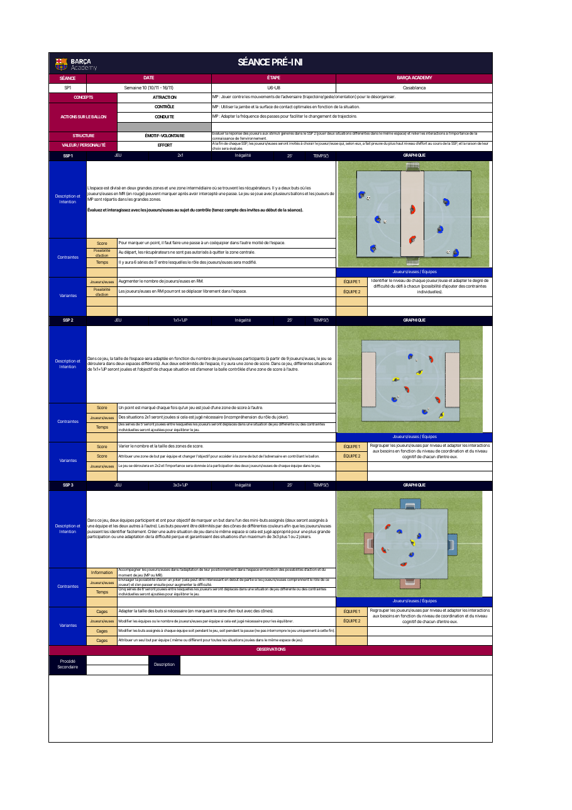

# Fiche de séance — semaine-10 SP1

PDF original : [pdf/semaine-10_SP1.pdf](pdf/semaine-10_SP1.pdf)



## Texte intégral de la fiche

```text
                                                                                                                  SÉANCE PRÉ-INI
  SÉANCE                                              DATE                                                                            ÉTAPE                                                                                BARÇA ACADEMY

     SP1                                   Semaine 10 (10/11 - 16/11)                                                                 U6-U8                                                                                   Casablanca

            CONCEPTS                                        ATTRACTION                            MP : Jouer contre les mouvements de l'adversaire (trajectoire/geste/orientation) pour le désorganiser.

                                                             CONTRÔLE                             MP : Utiliser la jambe et la surface de contact optimales en fonction de la situation.

   ACTIONS SUR LE BALLON                                     CONDUITE                             MP : Adapter la fréquence des passes pour faciliter le changement de trajectoire.

                                                                                                  Évaluer la réponse des joueurs aux stimuli générés dans le SSP 2 (jouer deux situations différentes dans le même espace) et relier les interactions à l'importance de la
            STRUCTURE                                  ÉMOTIF-VOLONTAIRE
                                                                                                  connaissance de l'environnement.
                                                                                                  À la fin de chaque SSP, les joueurs/euses seront invités à choisir le joueur/euse qui, selon eux, a fait preuve du plus haut niveau d'effort au cours de la SSP, et la raison de leur
   VALEUR / PERSONALITÉ                                        EFFORT
                                                                                                  choix sera évaluée.
    SSP 1                            JEU                                   2x1                                  Inégalité                          25'              TEMPS(')                                                   GRAPHIQUE

                  L'espace est divisé en deux grandes zones et une zone intermédiaire où se trouvent les récupérateurs. Il y a deux buts où les
                  joueurs/euses en MR (en rouge) peuvent marquer après avoir intercepté une passe. Le jeu se joue avec plusieurs ballons et les joueurs de
Description et
                  MP sont répartis dans les grandes zones.
  Intention
                  Évaluez et interagissez avec les joueurs/euses au sujet du contrôle (tenez compte des invites au début de la séance).

                         Score        Pour marquer un point, il faut faire une passe à un coéquipier dans l'autre moitié de l'espace.
                       Possibilité
                                      Au départ, les récupérateurs ne sont pas autorisés à quitter la zone centrale.
 Contraintes            d'action
                        Temps         Il y aura 6 séries de 5' entre lesquelles le rôle des joueurs/euses sera modifié.

                                                                                                                                                                                                                        Joueurs/euses / Équipes

                   Joueurs/euses      Augmenter le nombre de joueurs/euses en RM.                                                                                                       ÉQUIPE 1          Identifier le niveau de chaque joueur/euse et adapter le degré de
                                                                                                                                                                                                           difficulté du défi à chacun (possibilité d'ajouter des contraintes
                       Possibilité
                                      Les joueurs/euses en RM pourront se déplacer librement dans l'espace.                                                                             ÉQUIPE 2                                     individuelles).
  Variantes             d'action

    SSP 2                            JEU                                 1x1+1JP                                Inégalité                          25'              TEMPS(')                                                   GRAPHIQUE

                  Dans ce jeu, la taille de l'espace sera adaptée en fonction du nombre de joueurs/euses participants (à partir de 9 joueurs/euses, le jeu se
Description et
                  déroulera dans deux espaces différents). Aux deux extrémités de l'espace, il y aura une zone de score. Dans ce jeu, différentes situations
  Intention
                  de 1x1+1JP seront jouées et l'objectif de chaque situation est d'amener la balle contrôlée d'une zone de score à l'autre.

                         Score        Un point est marqué chaque fois qu'un jeu est joué d'une zone de score à l'autre.

                   Joueurs/euses      Des situations 2x1 seront jouées si cela est jugé nécessaire (incompréhension du rôle du joker).
 Contraintes
                                      Des séries de 5' seront jouées entre lesquelles les joueurs seront déplacés dans une situation de jeu différente ou des contraintes
                        Temps         individuelles seront ajoutées pour équilibrer le jeu.
                                                                                                                                                                                                                        Joueurs/euses / Équipes

                         Score        Varier le nombre et la taille des zones de score.                                                                                                 ÉQUIPE 1         Regrouper les joueurs/euses par niveau et adapter les interactions
                                                                                                                                                                                                          aux besoins en fonction du niveau de coordination et du niveau
                         Score        Attribuer une zone de but par équipe et changer l'objectif pour accéder à la zone de but de l'adversaire en contrôlant le ballon.                 ÉQUIPE 2                          cognitif de chacun d'entre eux.
  Variantes
                   Joueurs/euses      Le jeu se déroulera en 2x2 et l'importance sera donnée à la participation des deux joueurs/euses de chaque équipe dans le jeu.

    SSP 3                            JEU                                3x3+1JP                                 Inégalité                          25'              TEMPS(')                                                   GRAPHIQUE

                  Dans ce jeu, deux équipes participent et ont pour objectif de marquer un but dans l'un des mini-buts assignés (deux seront assignés à
Description et    une équipe et les deux autres à l'autre). Les buts peuvent être délimités par des cônes de différentes couleurs afin que les joueurs/euses
  Intention       puissent les identifier facilement. Créer une autre situation de jeu dans le même espace si cela est jugé approprié pour une plus grande
                  participation ou une adaptation de la difficulté perçue et garantissent des situations d'un maximum de 3x3 plus 1 ou 2 jokers.

                                      Accompagner les joueurs/euses dans l'adaptation de leur positionnement dans l'espace en fonction des possibilités d'action et du
                    Information       moment de jeu (MP ou MR).
                                      Envisager la possibilité d'avoir un joker (cela peut être intéressant en début de partie si les joueurs/euses comprennent le rôle de ce
                   Joueurs/euses
                                      joueur) et s'en passer ensuite pour augmenter la difficulté.
 Contraintes
                                      Cinq séries de 6' seront jouées entre lesquelles les joueurs seront déplacés dans une situation de jeu différente ou des contraintes
                        Temps         individuelles seront ajoutées pour équilibrer le jeu.
                                                                                                                                                                                                                        Joueurs/euses / Équipes

                        Cages         Adapter la taille des buts si nécessaire (en marquant la zone d'en-but avec des cônes).                                                           ÉQUIPE 1         Regrouper les joueurs/euses par niveau et adapter les interactions
                                                                                                                                                                                                          aux besoins en fonction du niveau de coordination et du niveau
                   Joueurs/euses      Modifier les équipes ou le nombre de joueurs/euses par équipe si cela est jugé nécessaire pour les équilibrer.                                    ÉQUIPE 2                          cognitif de chacun d'entre eux.
  Variantes
                        Cages         Modifier les buts assignés à chaque équipe soit pendant le jeu, soit pendant la pause (ne pas interrompre le jeu uniquement à cette fin).

                        Cages         Attribuer un seul but par équipe ( même ou différent pour toutes les situations jouées dans le même espace de jeu).

                                                                                                                               OBSERVATIONS

  Procédé
                                                             Description
 Secondaire
```
