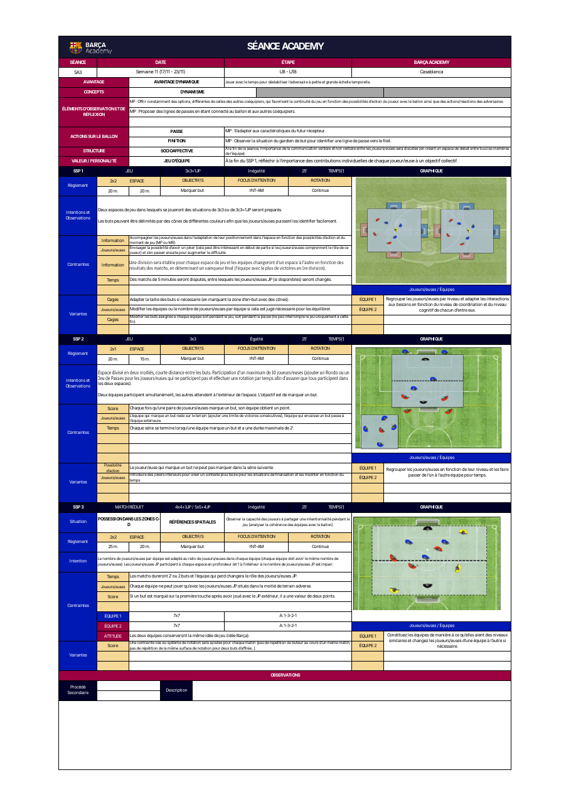

# Fiche de séance — semaine-11 SA3

PDF original : [pdf/semaine-11_SA3.pdf](pdf/semaine-11_SA3.pdf)



## Texte intégral de la fiche

```text
                                                                                                                SÉANCE ACADEMY
   SÉANCE                                              DATE                                                                           ÉTAPE                                                                          BARÇA ACADEMY

     SA3                                    Semaine 11 (17/11 - 23/11)                                                              U8 - U18                                                                             Casablanca

             AVANTAGE                                 AVANTAGE DYNAMIQUE                          Jouer avec le temps pour déstabiliser l'adversaire à petite et grande échelle temporelle.

             CONCEPTS                                                   DYNAMISME

                                       MP : Offrir constamment des options, différentes de celles des autres coéquipiers, qui favorisent la continuité du jeu en fonction des possibilités d'action du joueur avec le ballon ainsi que des actions/réactions des adversaires.
ÉLÉMENTS D'OBSERVATION ET DE
                                       MP : Proposer des lignes de passes en étant connecté au ballon et aux autres coéquipiers.
         RÉFLEXION

                                                                PASSE                             MP : S'adapter aux caractéristiques du futur récepteur.
   ACTIONS SUR LE BALLON
                                                              FINITION                            MP : Observer la situation du gardien de but pour identifier une ligne de passe vers le filet.
                                                                                                  À la fin de la séance, l'importance de la communication verbale et non verbale entre les joueurs/euses sera discutée (en créant un espace de débat entre tous les membres
           STRUCTURE                                      SOCIOAFFECTIVE
                                                                                                  de l'équipe).
    VALEUR / PERSONALITÉ                                    JEU D'ÉQUIPE                          À la fin du SSP 1, réfléchir à l'importance des contributions individuelles de chaque joueur/euse à un objectif collectif.

     SSP 1                            JEU                                 3x3+1JP                                Inégalité                        25'              TEMPS(')                                              GRAPHIQUE

                           2x2         ESPACE                           OBJECTIF/S                        FOCUS D'ATTENTION                             ROTATION
  Règlement
                          20 m.               20 m.                     Marquer but                               INT-AM                                 Continue

                  Deux espaces de jeu dans lesquels se joueront des situations de 3c3 ou de 3c3+1JP seront preparés.
 Intentions et
 Observations
                  Les buts peuvent être délimités par des cônes de différentes couleurs afin que les joueurs/euses puissent les identifier facilement.

                                       Accompagner les joueurs/euses dans l'adaptation de leur positionnement dans l'espace en fonction des possibilités d'action et du
                    Information        moment de jeu (MP ou MR).
                                       Envisager la possibilité d'avoir un joker (cela peut être intéressant en début de partie si les joueurs/euses comprennent le rôle de ce
                   Joueurs/euses
                                       joueur) et s'en passer ensuite pour augmenter la difficulté.

  Contraintes       Information

                         Temps         Des matchs de 5 minutes seront disputés, entre lesquels les joueurs/euses JP (si disponibles) seront changés.

                                                                                                                                                                                                                  Joueurs/euses / Équipes

                         Cages         Adapter la taille des buts si nécessaire (en marquant la zone d'en-but avec des cônes).                                                      ÉQUIPE 1        Regrouper les joueurs/euses par niveau et adapter les interactions
                                                                                                                                                                                                     aux besoins en fonction du niveau de coordination et du niveau
                   Joueurs/euses       Modifier les équipes ou le nombre de joueurs/euses par équipe si cela est jugé nécessaire pour les équilibrer.                               ÉQUIPE 2                         cognitif de chacun d'entre eux.
   Variantes
                                       Modifier les buts assignés à chaque équipe soit pendant le jeu, soit pendant la pause (ne pas interrompre le jeu uniquement à cette
                         Cages         fin).

    SSP 2                             JEU                                   3x3                                   Égalité                         25'              TEMPS(')                                              GRAPHIQUE

                           2x1         ESPACE                           OBJECTIF/S                        FOCUS D'ATTENTION                             ROTATION
  Règlement
                          20 m.               15 m.                     Marquer but                               INT-AM                                 Continue

 Intentions et
                  les deux espaces).
 Observations
                  Deux équipes participent simultanément, les autres attendent à l'extérieur de l'espace. L'objectif est de marquer un but.

                          Score        Chaque fois qu'une paire de joueurs/euses marque un but, son équipe obtient un point.
                                       L'équipe qui marque un but reste sur le terrain (ajouter une limite de victoires consécutives), l'équipe qui encaisse un but passe à
                   Joueurs/euses
                                       l'équipe extérieure.

                         Temps         Chaque série se termine lorsqu'une équipe marque un but et a une durée maximale de 2'.
  Contraintes

                                                                                                                                                                                                                  Joueurs/euses / Équipes
                        Possibilité
                                       Le joueur/euse qui marque un but ne peut pas marquer dans la série suivante.                                                                 ÉQUIPE 1        Regrouper les joueurs/euses en fonction de leur niveau et les faire
                         d'action
                                       Introduire des jokers intérieurs pour créer un contexte plus facile pour les situations de finalisation et les modifier en fonction du                                  passer de l'un à l'autre équipe pour temps.
                   Joueurs/euses
                                       temps.
                                                                                                                                                                                    ÉQUIPE 2
   Variantes

    SSP 3                     MATCH RÉDUIT                         4x4+3JP / 5x5+4JP                             Inégalité                        25'              TEMPS(')                                              GRAPHIQUE

                  POSSESSION DANS LES ZONES C-                                                     Observer la capacité des joueurs à partager une intentionnalité pendant le
   Situation                                                   RÉFÉRENCES SPATIALES
                               D                                                                             jeu (analyser la cohérence des équipes avec le ballon).

                           2x2         ESPACE                           OBJECTIF/S                        FOCUS D'ATTENTION                             ROTATION
  Règlement
                          25 m.               20 m.                     Marquer but                               INT-AM                                 Continue

                  Le nombre de joueurs/euses par équipe est adapté au ratio de joueurs/euses dans chaque équipe (chaque équipe doit avoir le même nombre de
   Intention
                  joueurs/euses). Les joueurs/euses JP participent à chaque espace en profondeur (et 1 à l'intérieur si le nombre de joueurs/euses JP est impair.

                         Temps         Les matchs dureront 2' ou 2 buts et l'équipe qui perd changera le rôle des joueurs/euses JP.

                   Joueurs/euses       Chaque équipe ne peut jouer qu'avec les joueurs/euses JP situés dans la moitié de terrain adverse.

                          Score        Si un but est marqué sur la première touche après avoir joué avec le JP extérieur, il a une valeur de deux points.

  Contraintes

                        ÉQUIPE 1                                  7x7                                                               A: 1-3-2-1

                        ÉQUIPE 2                                  7x7                                                               A: 1-3-2-1                                                                    Joueurs/euses / Équipes

                        ATTITUDE       Les deux équipes conserveront la même idée de jeu (idée Barça).                                                                              ÉQUIPE 1         Constituez les équipes de manière à ce qu'elles aient des niveaux
                                                                                                                                                                                                      similaires et changez les joueurs/euses d'une équipe à l'autre si
                                       Une contrainte liée au système de notation sera ajoutée pour chaque match (pas de répétition du buteur au cours d'un même match,
                          Score        pas de répétition de la même surface de notation pour deux buts d'affilée...).
                                                                                                                                                                                    ÉQUIPE 2                                     nécessaire.

   Variantes

                                                                                                                               OBSERVATIONS

   Procédé
                                                             Description
  Secondaire
```
