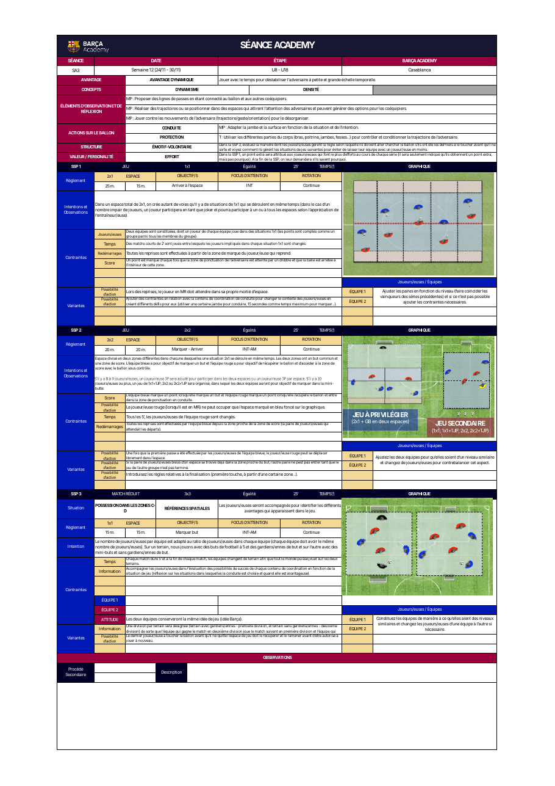

# Fiche de séance — semaine-12 SA3

PDF original : [pdf/semaine-12_SA3.pdf](pdf/semaine-12_SA3.pdf)



## Texte intégral de la fiche

```text
                                                                                                                SÉANCE ACADEMY
   SÉANCE                                             DATE                                                                           ÉTAPE                                                                              BARÇA ACADEMY

     SA3                                    Semaine 12 (24/11 - 30/11)                                                              U8 - U18                                                                                Casablanca

             AVANTAGE                                 AVANTAGE DYNAMIQUE                          Jouer avec le temps pour déstabiliser l'adversaire à petite et grande échelle temporelle.

             CONCEPTS                                                 DYNAMISME                                                                         DENSITÉ

                                       MP : Proposer des lignes de passes en étant connecté au ballon et aux autres coéquipiers.
ÉLÉMENTS D'OBSERVATION ET DE
                                       MP : Réaliser des trajectoires ou se positionner dans des espaces qui attirent l'attention des adversaires et peuvent générer des options pour les coéquipiers.
         RÉFLEXION
                                       MP : Jouer contre les mouvements de l'adversaire (trajectoire/geste/orientation) pour le désorganiser.

                                                              CONDUITE                            MP : Adapter la jambe et la surface en fonction de la situation et de l'intention.
   ACTIONS SUR LE BALLON
                                                            PROTECTION                            T : Utiliser les différentes parties du corps (bras, poitrine, jambes, fesses...) pour contrôler et conditionner la trajectoire de l'adversaire.
                                                                                                  Dans la SSP 3, évaluez la manière dont les joueurs/euses gèrent la règle selon laquelle ils doivent aller chercher le ballon s'ils ont été les derniers à le toucher avant qu'il ne
           STRUCTURE                                   ÉMOTIF-VOLONTAIRE
                                                                                                  sorte et voyez comment ils gèrent les situations de jeu suivantes pour éviter de laisser leur équipe avec un joueur/euse en moins.
                                                                                                  Dans la SSP 1, un point extra sera attribué aux joueurs/euses qui font le plus d'efforts au cours de chaque série (il sera seulement indiqué qu'ils obtiennent un point extra,
    VALEUR / PERSONALITÉ                                       EFFORT
                                                                                                  mais pas pourquoi). A la fin de la SSP, on leur demandera s'ils savent pourquoi.
     SSP 1                            JEU                                   1x1                                   Égalité                         25'             TEMPS(')                                                  GRAPHIQUE

                           2x1         ESPACE                          OBJECTIF/S                         FOCUS D'ATTENTION                             ROTATION
  Règlement
                          25 m.               15 m.                 Arriver à l'espace                              INT                                 Continue

                  Dans un espace total de 2x1, on crée autant de voies qu'il y a de situations de 1x1 qui se déroulent en même temps (dans le cas d'un
 Intentions et
                  nombre impair de joueurs, un joueur participera en tant que joker et pourra participer à un ou à tous les espaces selon l'appréciation de
 Observations
                  l'entraîneur/euse).

                                       Deux équipes sont constituées, dont un joueur de chaque équipe joue dans des situations 1x1 (les points sont comptés comme un
                   Joueurs/euses
                                       groupe parmi tous les membres du groupe).
                         Temps         Des matchs courts de 2' sont joués entre lesquels les joueurs impliqués dans chaque situation 1x1 sont changés.

                   Redémarrages        Toutes les reprises sont effectuées à partir de la zone de marque du joueur/euse qui reprend.
  Contraintes
                                       Un point est marqué chaque fois que la zone de ponctuation de l'adversaire est atteinte par un dribble et que la balle est arrêtée à
                          Score        l'intérieur de cette zone.

                                                                                                                                                                                                                     Joueurs/euses / Équipes
                        Possibilité                                                                                                                                                                        Ajuster les paires en fonction du niveau (faire coïncider les
                                       Lors des reprises, le joueur en MR doit attendre dans sa propre moitié d'espace.                                                               ÉQUIPE 1
                         d'action
                                                                                                                                                                                                          vainqueurs des séries précédentes) et si ce n'est pas possible
                        Possibilité    Ajouter des contraintes en relation avec la contenu de coordination de conduite pour changer le contexte des joueurs/euses en
                                       créant différents défis pour eux (utiliser une certaine jambe pour conduire, 15 secondes comme temps maximum pour marquer...).
                                                                                                                                                                                      ÉQUIPE 2                          ajouter les contraintes nécessaires.
   Variantes             d'action

    SSP 2                             JEU                                   2x2                                   Égalité                         25'             TEMPS(')                                                  GRAPHIQUE

                           2x2         ESPACE                          OBJECTIF/S                         FOCUS D'ATTENTION                             ROTATION
  Règlement
                          20 m.               20 m.                 Marquer - Arriver                            INT-AM                                 Continue

                  Espace divisé en deux zones différentes dans chacune desquelles une situation 2x1 se déroule en même temps. Les deux zones ont un but commun et
                  une zone de score. L'équipe bleue a pour objectif de marquer un but et l'équipe rouge a pour objectif de récupérer le ballon et d'accéder à la zone de
                  score avec le ballon sous contrôle.
 Intentions et
 Observations
                  joueurs/euses ou plus, un jeu de 1x1+1JP, 2x2 ou 2x2+1JP sera organisé, dans lequel les deux équipes auront pour objectif de marquer dans la mini-
                  butte.
                                       L'équipe bleue marque un point lorsqu'elle marque un but et l'équipe rouge marque un point lorsqu'elle récupère le ballon et entre
                          Score        dans la zone de ponctuation en conduite.
                        Possibilité
                                       Le joueur/euse rouge (lorsqu'il est en MR) ne peut occuper que l'espace marqué en bleu foncé sur le graphique.
                         d'action
                         Temps         Tous les 5', les joueurs/euses de l'équipe rouge sont changés.                                                                                   JEU À PRIVILÉGIER
  Contraintes
                                       Toutes les reprises sont effectuées par l'équipe bleue depuis la zone proche de la zone de score (la paire de joueurs/euses qui                 (2x1 + GB en deux espaces)                             JEU SECONDAIRE
                   Redémarrages attendait les départs).
                                                                                                                                                                                                                                           (1x1, 1x1+1JP, 2x2, 2x2+1JP)

                                                                                                                                                                                                                     Joueurs/euses / Équipes
                        Possibilité    Une fois que la première passe a été effectuée par les joueurs/euses de l'équipe bleue, le joueur/euse rouge peut se déplacer
                                       librement dans l'espace.
                                                                                                                                                                                      ÉQUIPE 1         Ajustez les deux équipes pour qu'elles soient d'un niveau similaire
                         d'action
                        Possibilité    Si la paire de joueurs/euses bleus d'un espace se trouve déjà dans la zone proche du but, l'autre paire ne peut pas entrer tant que le                             et changez de joueurs/euses pour contrebalancer cet aspect.
                                       jeu de l'autre groupe n'est pas terminé.
                                                                                                                                                                                      ÉQUIPE 2
   Variantes             d'action
                        Possibilité
                                       Introduisez les règles relatives à la finalisation (première touche, à partir d'une certaine zone...).
                         d'action

    SSP 3                     MATCH RÉDUIT                                  3x3                                   Égalité                         25'             TEMPS(')                                                  GRAPHIQUE

                  POSSESSION DANS LES ZONES C-                                                    Les joueurs/euses seront accompagnés pour identifier les différents
   Situation                                                   RÉFÉRENCES SPATIALES
                               D                                                                                avantages qui apparaissent dans le jeu.

                           1x1         ESPACE                          OBJECTIF/S                         FOCUS D'ATTENTION                             ROTATION
  Règlement
                          15 m.               15 m.                   Marquer but                                INT-AM                                 Continue

                  Le nombre de joueurs/euses par équipe est adapté au ratio de joueurs/euses dans chaque équipe (chaque équipe doit avoir le même
   Intention      nombre de joueurs/euses). Sur un terrain, nous jouons avec des buts de football à 5 et des gardiens/ennes de but et sur l'autre avec des
                  mini-buts et sans gardiens/ennes de but.
                                       Chaque match dure 5' et à la fin de chaque match, les équipes changent de terrain afin que tout le monde puisse jouer sur les deux
                         Temps         terrains.
                                       Accompagner les joueurs/euses dans l'évaluation des possibilités de succès de chaque contenu de coordination en fonction de la
                    Information        situation de jeu (réflexion sur les situations dans lesquelles la conduite est choisie et quand elle est avantageuse).

  Contraintes

                        ÉQUIPE 1

                        ÉQUIPE 2                                                                                                                                                                                     Joueurs/euses / Équipes

                        ATTITUDE       Les deux équipes conserveront la même idée de jeu (idée Barça).                                                                                ÉQUIPE 1         Constituez les équipes de manière à ce qu'elles aient des niveaux
                                                                                                                                                                                                        similaires et changez les joueurs/euses d'une équipe à l'autre si
                                       Une division par terrain sera désignée (terrain avec gardiens/ennes - première division, et terrain sans gardiens/ennes - deuxième
                    Information        division) de sorte que l'équipe qui gagne le match en deuxième division joue le match suivant en première division et l'équipe qui
                                                                                                                                                                                      ÉQUIPE 2                                     nécessaire.
                        Possibilité    Le dernier joueur/euse à toucher le ballon avant qu'il ne quitte l'espace de jeu doit le récupérer et le ramener avant d'être autorisé à
   Variantes
                         d'action      jouer à nouveau.

                                                                                                                              OBSERVATIONS

   Procédé
                                                             Description
  Secondaire
```
