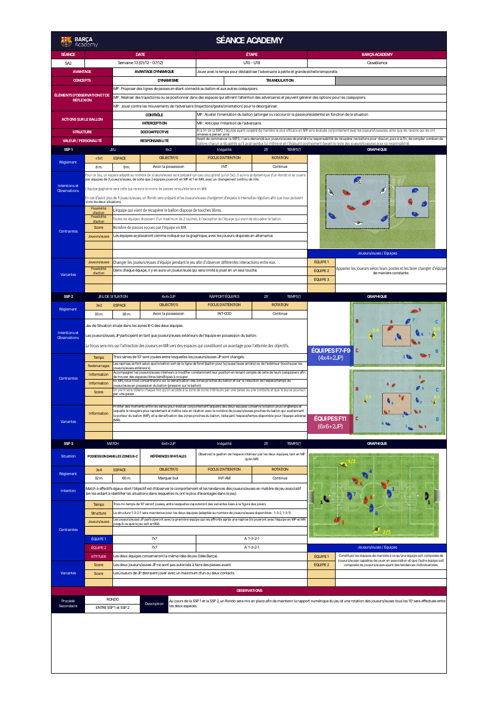

# Fiche de séance — semaine-13 SA2

PDF original : [pdf/semaine-13_SA2.pdf](pdf/semaine-13_SA2.pdf)



## Texte intégral de la fiche

```text
                                                                                                                 SÉANCE ACADEMY
   SÉANCE                                                DATE                                                                         ÉTAPE                                                                      BARÇA ACADEMY

     SA2                                     Semaine 13 (01/12 - 07/12)                                                              U10 - U18                                                                       Casablanca

             AVANTAGE                                    AVANTAGE DYNAMIQUE                        Jouer avec le temps pour déstabiliser l'adversaire à petite et grande échelle temporelle.

             CONCEPTS                                                    DYNAMISME                                                                      TRIANGULATION

                                        MP : Proposer des lignes de passes en étant connecté au ballon et aux autres coéquipiers.
ÉLÉMENTS D'OBSERVATION ET DE
                                        MP : Réaliser des trajectoires ou se positionner dans des espaces qui attirent l'attention des adversaires et peuvent générer des options pour les coéquipiers.
         RÉFLEXION
                                        MP : Jouer contre les mouvements de l'adversaire (trajectoire/geste/orientation) pour le désorganiser.

                                                                CONTRÔLE                           MP : Ajuster l'orientation du ballon (allonger ou raccourcir la passe précédente) en fonction de la situation.
   ACTIONS SUR LE BALLON
                                                            INTERCEPTION                           MR : Anticiper l'intention de l'adversaire.

           STRUCTURE                                       SOCIOAFFECTIVE
                                                                                                   amenés à penser ainsi.
                                                                                                   Avant de commencer la SSP3, il sera demandé aux joueurs/euses de prendre la responsabilité de récupérer les ballons pour chacun, puis à la fin, de compter combien de
    VALEUR / PERSONALITÉ                                   RESPONSABILITÉ

     SSP 1                             JEU                                   6x2                                  Inégalité                        25'            TEMPS(')                                           GRAPHIQUE

                           <1x1         ESPACE                           OBJECTIF/S                        FOCUS D'ATTENTION                              ROTATION
  Règlement
                           8 m.                 9 m.                Avoir la possession                              INT                                   Continue

                  par équipes de 3 joueurs/euses, de sorte que 2 équipes joueront en MP et 1 en MR, avec un changement continu de rôle.
 Intentions et
 Observations

                  vivre les deux situations.
                        Possibilité
                         d'action
                        Possibilité
                         d'action
                          Score
  Contraintes
                   Joueurs/euses        Les équipes se placeront comme indiqué sur le graphique, avec les joueurs disposés en alternance.

                                                                                                                                                                                                              Joueurs/euses / Équipes

                   Joueurs/euses                                                                                                                                                   ÉQUIPE 1
                        Possibilité
                                        Dans chaque équipe, il y en aura un joueur/euse qui sera limité à jouer en un seul touche.                                                 ÉQUIPE 2
   Variantes             d'action                                                                                                                                                                                        de manière constante.
                                                                                                                                                                                   ÉQUIPE 3

    SSP 2                    JEU DE SITUATION                             4x4+2JP                           RAPPORT ÉQUIPES                        25'            TEMPS(')                                           GRAPHIQUE

                           3x2          ESPACE                           OBJECTIF/S                        FOCUS D'ATTENTION                              ROTATION
  Règlement
                          33 m.                30 m.                Avoir la possession                           INT-COO                                  Continue

                  Jeu de Situation située dans les zones B-C des deux équipes.
 Intentions et
                  Les joueurs/euses JP participent en tant que joueurs/euses extérieurs de l'équipe en possession du ballon.
 Observations

                                                                                                                                                                                   ÉQUIPES F7-F9
                         Temps          Trois séries de 10' sont jouées entre lesquelles les joueurs/euses JP sont changés.                                                          (4x4+2JP)
                                        Les reprises se font selon que le ballon sort de la ligne de fond (ballon pour le joueur/euse arrière) ou de l'extérieur (touche par les
                   Redémarrages
                                        joueurs/euses extérieurs).
                                        Accompagner les joueurs/euses intérieurs à modifier constamment leur position en tenant compte de celle de leurs coéquipiers afin
                    Information         de trouver des espaces libres bénéfiques à occuper.
  Contraintes
                                        En MR, nous nous concentrerons sur la densification des zones proches du ballon et sur la réduction de l'espace/temps du
                    Information         joueur/euse en possession du ballon (pression sur le ballon).

                          Score         par une passe.

                                        Profiter des moments entre les séries pour évaluer conjointement laquelle des deux équipes conserve le ballon plus longtemps et
                                        laquelle le récupère plus rapidement et mettre cela en relation avec le nombre de joueurs/euses proches du ballon qui soutiennent
                    Information
                                        le porteur du ballon (MP), et la densification des zones proches du ballon, réduisant l'espace/temps disponible pour l'équipe adverse
   Variantes                            (MR).                                                                                                                                      ÉQUIPES F11
                                                                                                                                                                                    (6x6+2JP)

    SSP 3                             MATCH                               6x6+2JP                                 Inégalité                        25'            TEMPS(')                                           GRAPHIQUE

                                                                                                    Observez la gestion de l'espace intérieur par les deux équipes, tant en MP
   Situation       POSSESSION DANS LES ZONES B-C                  RÉFÉRENCES SPATIALES
                                                                                                                                    qu'en MR.

                           3x4          ESPACE                           OBJECTIF/S                        FOCUS D'ATTENTION                              ROTATION
  Règlement
                          32 m.                60 m.                     Marquer but                              INT-AM                                   Continue

                  Match à effectifs égaux dont l'objectif est d'observer le comportement et les tendances des joueurs/euses en matière de jeu associatif
   Intention
                  (en les aidant à identifier les situations dans lesquelles ils ont le plus d'avantages dans le jeu).

                         Temps          Trois mi-temps de 10' seront jouées, entre lesquelles s'ajouteront des variantes liées à la figure des jokers

                        Structure       La structure 1-3-2-1 sera maintenue pour les deux équipes (adaptée au nombre de joueurs/euses disponibles : 1-3-2, 1-3-1).
                                        Les joueurs/euses JP participeront avec la première équipe qui les affronte après une reprise (ils joueront avec l'équipe en MP et MR
                   Joueurs/euses
                                        jusqu'à ce que le jeu soit arrêté).
  Contraintes

                        ÉQUIPE 1                                   7x7                                                               A: 1-3-2-1

                        ÉQUIPE 2                                   7x7                                                               A: 1-3-2-1                                                               Joueurs/euses / Équipes

                        ATTITUDE        Les deux équipes conserveront la même idée de jeu (idée Barça).                                                                            ÉQUIPE 1       Constituez les équipes de manière à ce qu'une équipe soit composée de
                                                                                                                                                                                                 joueurs/euses capables de jouer en association et que l'autre équipe soit
                          Score         Les deux joueurs/euses JP ne sont pas autorisés à faire des passes avant.                                                                  ÉQUIPE 2          composée de joueurs/euses ayant des tendances individualistes.

   Variantes              Score         Les joueurs de JP devraient jouer avec un maximum d'un ou deux contacts.

                                                                                                                                OBSERVATIONS

                                      RONDO
   Procédé                                                                     Au cours de la SSP 1 et la SSP 2, un Rondo sera mis en place afin de maintenir le rapport numérique du jeu et une rotation des joueurs/euses tous les 10' sera effectuée entre
                                                              Description
  Secondaire               ENTRE SSP 1 et SSP 2                                les deux espaces.
```
